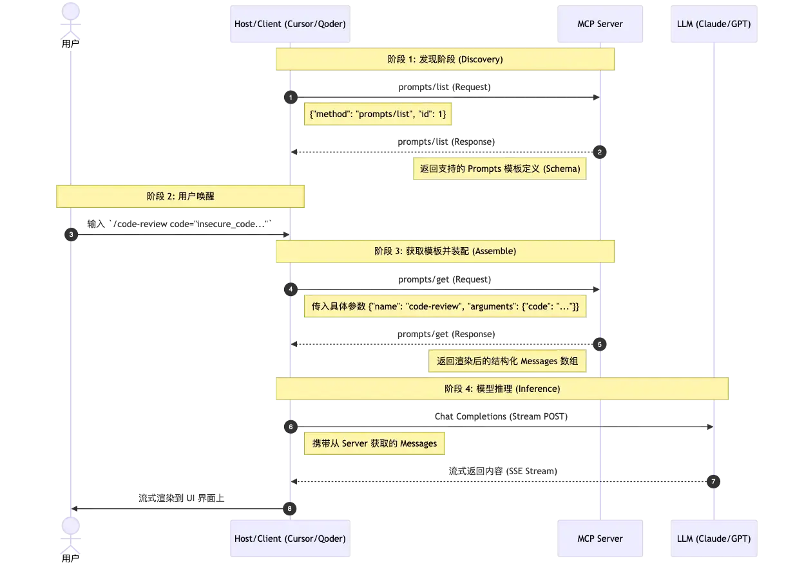

## 介绍

MCP（Model Context Protocol，模型上下文协议） ，2024年11月底，由 Anthropic 推出的一种开放标准，旨在统一大模型与外部数据源和工具之间的通信协议。MCP 的主要目的在于解决当前 AI 模型因数据孤岛限制而无法充分发挥潜力的难题，MCP 使得 AI 应用能够安全地访问和操作本地及远程数据，为 AI 应用提供了连接万物的接口。

> Function Calling是AI模型调用函数的机制，MCP是一个标准协议，使大模型与API无缝交互，而AI Agent是一个自主运行的智能系统，利用Function Calling和MCP来分析和执行任务，实现特定目标。


MCP 协议以标准化接口连接 AI、用户和外部服务，不仅赋予 AI 更丰富的工具和资源访问能力，也让 AI 应用具备了多轮协作、人机协同和复杂工作流编排能力；


## 架构


**架构组成部分**
- **MCP Host**：**Host** 是承载大模型(LLM)的宿主应用程序（如 Claude Desktop 或 Cursor），负责调度模型和解析推理结果。 应用程序中选择的GPT/DeepSeek...这类模型是LLM；Host负责组织整个流程，LLM负责理解用户问题和生成应答。Host能连接多个Mcp Server
- **MCP Client**：**Client** 作为底层组件，通常直接内嵌在 Host 程序内部。Client帮助Host连接Server，不仅能利用Server提供的上下文信息，它本身也可以向server提供多种功能。
- **MCP Server**：MCP Server是为 LLM 提供上下文、数据和功能的外部服务。LLM使用Server能能力需要通过Client，Client和Server 之间通过 MCP 协议进行通信。

**总结**：Host 是运行 AI 的应用，Client 是 Host 内部负责 MCP 通信的组件，Server 是通过 MCP 向 AI 提供能力的服务。

## 工作原理

MCP 协议采用了一种独特的架构设计，它将 LLM 与资源之间的通信划分为三个主要部分：客户端、服务器和资源。

客户端负责发送请求给 MCP 服务器，服务器则将这些请求转发给相应的资源。这种分层的设计使得 MCP 协议能够更好地控制访问权限，确保只有经过授权的用户才能访问特定的资源。

Model Context Protocol 的核心功能是允许 LLM 请求外部工具协助回答查询或完成任务。假设您向 AI 助理发出以下指令：“在我们的数据库中查找最新的销售报告，并将其通过电子邮件发送给我的经理。”
以下简要说明 MCP 将如何处理这种情况：
1. 请求与工具发现：LLM 明白其本身无法访问数据库或发送电子邮件。它使用 MCP 客户端搜索可用工具，并在 MCP 服务器上找到了两个相关工具：database_query 工具和 email_sender 工具。
2. 工具调用：LLM 生成结构化请求来使用这些工具。首先，它会调用 database_query 工具，并指定报告的名称。然后，MCP 客户端会将此请求发送到相应的 MCP 服务器。
3. 外部操作与数据返回：MCP 服务器接收请求，将其转换为面向公司数据库的安全 SQL 查询，并检索销售报告。然后，它会将这些数据格式化后发送回 LLM。
4. 第二个操作与响应生成：现在已获得报告数据，LLM 调用 email_sender 工具，提供经理的邮箱地址和报告内容。邮件发送后，MCP 服务器会确认操作已完成。
5. 最终确认：LLM 向您提供最终回应：“我已找到最新的销售报告，并通过邮件发送给您的经理。”


### 流程

请求与工具发现-工具调用-外部操作与数据返回-第二个操作与响应生成-最终确认

#### MCP 的基本工作流程

- 初始化连接：客户端向服务器发送连接请求，建立通信通道。
- 发送请求：客户端根据需求构建请求消息，并发送给服务器。
- 处理请求：服务器接收到请求后，解析请求内容，执行相应的操作（如查询数据库、读取文件等）。
- 返回结果：服务器将处理结果封装成响应消息，发送回客户端。
- 断开连接：任务完成后，客户端可以主动关闭连接或等待服务器超时关闭。

#### MCP各组件交互流程

- MCP client 首先从 MCP server 获取可用的工具列表。
- 将用户的查询连同工具描述通过 function calling 一起发送给 LLM。
- LLM 决定是否需要使用工具以及使用哪些工具。
- 如果需要使用工具，MCP client 会通过 MCP server 执行相应的工具调用。
- 工具调用的结果会被发送回 LLM。
- LLM 基于所有信息生成自然语言响应。
- 最后将响应展示给用户。


## 数据模型

数据模型官方定义(TypeScript)：https://github.com/modelcontextprotocol/modelcontextprotocol/blob/main/schema/2025-11-25/schema.ts


**部分MCP API**
~~~

# 初始化​Initialization，client->server
{
  "jsonrpc": "2.0",
  "id": 1,
  "method": "initialize",
  "params": {
    "protocolVersion": "2025-11-25",
    "capabilities": {
      "roots": {
        "listChanged": true
      },
      "sampling": {},
      "elicitation": {
        "form": {},
        "url": {}
      },
      "tasks": {
        "requests": {
          "elicitation": {
            "create": {}
          },
          "sampling": {
            "createMessage": {}
          }
        }
      }
    },
    "clientInfo": {
      "name": "ExampleClient",
      "title": "Example Client Display Name",
      "version": "1.0.0",
      "description": "An example MCP client application",
      "icons": [
        {
          "src": "https://example.com/icon.png",
          "mimeType": "image/png",
          "sizes": ["48x48"]
        }
      ],
      "websiteUrl": "https://example.com"
    }
  }
}

#Initialization应答(server->client)capabilities and information
{
  "jsonrpc": "2.0",
  "id": 1,
  "result": {
    "protocolVersion": "2025-11-25",
    "capabilities": {
      "logging": {},
      "prompts": {
        "listChanged": true
      },
      "resources": {
        "subscribe": true,
        "listChanged": true
      },
      "tools": {
        "listChanged": true
      },
      "tasks": {
        "list": {},
        "cancel": {},
        "requests": {
          "tools": {
            "call": {}
          }
        }
      }
    },
    "serverInfo": {
      "name": "ExampleServer",
      "title": "Example Server Display Name",
      "version": "1.0.0",
      "description": "An example MCP server providing tools and resources",
      "icons": [
        {
          "src": "https://example.com/server-icon.svg",
          "mimeType": "image/svg+xml",
          "sizes": ["any"]
        }
      ],
      "websiteUrl": "https://example.com/server"
    },
    "instructions": "Optional instructions for the client"
  }
}


# Capabilities,在初始化阶段client和server已经明确了能力范围；
{
  "capabilities": {
    "tools": {
      "listChanged": true
    }
  }
}

#Listing tools列表
#还有Calling Tools，List Changed Notification指令
{
  "jsonrpc": "2.0",
  "id": 1,
  "method": "tools/list",
  "params": {
    "cursor": "optional-cursor-value"
  }
}

#应答
{
  "jsonrpc": "2.0",
  "id": 1,
  "result": {
    "tools": [
      {
        "name": "get_weather",
        "title": "Weather Information Provider",
        "description": "Get current weather information for a location",
        "inputSchema": {
          "type": "object",
          "properties": {
            "location": {
              "type": "string",
              "description": "City name or zip code"
            }
          },
          "required": ["location"]
        },
        "icons": [
          {
            "src": "https://example.com/weather-icon.png",
            "mimeType": "image/png",
            "sizes": ["48x48"]
          }
        ],
        "execution": {
          "taskSupport": "optional"
        }
      }
    ],
    "nextCursor": "next-page-cursor"
  }
}
~~~


## MCP Server


### MCP Prompts 

MCP Prompts 并非简单的文本字符串，而是一种由服务端定义、供客户端发现和使用的结构化提示词模板。它允许服务端向客户端暴露一系列预设好的、可定制的交互模式，从而规范和简化与语言模型的沟通方式。

MCP Prompts 的设计核心是“用户控制”（user-controlled）。这意味着这些提示词模板并非在后台静默运行，而是明确地展示给用户，由用户主动选择和触发。


这种设计使得用户可以清晰地感知到应用提供了哪些与模型交互的能力。一个常见的界面交互模式是通过斜杠命令（slash commands）来触发，例如，在聊天输入框中输入 /，界面上就会展示出所有可用的 Prompts 列表。


#### mcp prompt交互流程




#### 问题

##### Q每次提问都要带上prompt，这样token消耗会很大，有什么优化方式
优化方式：
1LLM侧优化：服务端采用Prompt Caching（提示词缓存），如果多次请求的前半部分（如 System Prompt、固定的 Resources/Knowledge、长历史）完全一致，大模型服务端会直接复用该部分的 KV 缓存，不仅推理速度极快，而且缓存部分的 Token 计费通常能打 1~5 折。

2clinet侧优化：会话历史（Chat History）的滑动窗口与动态摘要
- **滑动历史窗口 (Sliding Window)**： 只保留最近的 $N$ 个对话回合（例如最近 6 次对话）作为原文发给模型，保障大模型拥有即时短期记忆。
- **智能异步摘要 (Summarization Thread)**： 当对话回合超过设定阈值时，客户端在后台静默发起一个**极轻量、极快的模型调用（如调用最廉价的 Flash 模型）**，将 $N$ 轮之前的旧历史压缩成一段 100 字的“核心上下文简报”（Context Summary）。

3clinet侧优化：MCP 动态 Tool/Prompt 路由
- **语义路由器（Semantic Tool Router）**： 在 Client 端维护一个本地的**极轻量级嵌入向量分类器**
	Client 在向大模型发起请求时，通过**语义路由器**先通过关键词和语义匹配，过滤筛选少量的Server 的 Tools 声明，屏蔽其他无关的 MCP 服务。
- **惰性装配 (Lazy Ingestion)**： 不要一键把所有本地资源（Resources）作为 Prompt 上下文。设计交互，让模型在明确提出“请让我阅读该 Resource”时，通过 `resources/read` 接口按需加载（On-demand）。


https://apifox.com/apiskills/mcp-prompts-introduction-and-usage/ MCP 的 Prompts 是什么？一文介绍及使用


### mcp tools

在 Model Context Protocol (MCP) 中，Tools（工具调用） 是赋予大模型“行动力”的业务原语。它使模型能够突破沙箱和纯文本生成的限制，主动对物理世界（读写文件、执行系统命令、查询数据库、调用外部服务等）发起状态变更。


#### 交互流程

```
 用户 (User)         客户端 (Client)          大模型 (LLM)         MCP 服务端 (Server)
     │                     │                      │                     │
     │ ────────────────────┼──────────────────────┼────────────────────>│ (1. 握手阶段)
     │                     │     tools/list (Request)                   │
     │                     ├───────────────────────────────────────────>│
     │                     |<───────────────────────────────────────────┤
     │                     │     tools/list (Response - 汇报可用 Tools)  │
     │                     │                      │                     │
     │ (2. 提出业务请求)    │                      │                     │
     ├────────────────────>│                      │                     │
     │ "查一下 auth.py 的安全日志"                 │                     │
     │                     │                      │                     │
     │                     │ 3. 发起对话 (带 toolsSchema)                │
     │                     ├─────────────────────>│                     │
     │                     │                      │                     │
     │                     │<─────────────────────┤                     │
     │                     │ 4. 产生工具调用意图   │                     │
     │                     │    (tool_use: query_log)                   │
     │                     │                      │                     │
     │ (5. 安全核验网关)    │                      │                     │
     │<────────────────────┤                      │                     │
     │ 弹出绿色确认框,询问批准│                      │                     │
     ├────────────────────>│                      │                     │
     │ 用户确认 (授权执行)  │                      │                     │
     │                     │                      │                     │
     │                     │ 6. 执行物理工具: tools/call                 │
     │                     ├───────────────────────────────────────────>│
     │                     │                                            │ [读取本地日志文件]
     │                     |<───────────────────────────────────────────┤
     │                     │ 7. 返回结果: content[text]                 │
     │                     │                      │                     │
     │                     │                      │                     │
     │                     │ 8. 将结果回喂给模型    │                     │
     │                     ├─────────────────────>│                     │
     │                     │                      │                     │
     │                     │<─────────────────────┤                     │
     │                     │ 9. 基于真实数据产生最终文本回复              │
     │<────────────────────┤                      │                     │
     │ 流式渲染最终审计结果 │                      │                     │
```


#### 底层协议报文内容

##### 阶段 1：能力发现与注册 (`tools/list`)

当 Client（Cursor/Qoder）启动并挂载 Server 进程时，首先发出查询请求。

- **Client** $\rightarrow$ **Server (Request)**:
    
    ```
    {
      "jsonrpc": "2.0",
      "method": "tools/list",
      "id": "list_req_001"
    }
    ```
    
- **Server** $\rightarrow$ **Client (Response)**: Server 返回自己暴露的工具清单。注意 `inputSchema` 遵循严格的 **JSON Schema** 规范，用于向 Client 和 LLM 宣告入参约束：
    
    ```
    {
      "jsonrpc": "2.0",
      "result": {
        "tools": [
          {
            "name": "audit_file_security",
            "description": "读取并扫描指定本地文件的内容，审计是否存在硬编码 Token、SQL注入或潜在的安全隐患",
            "inputSchema": {
              "type": "object",
              "properties": {
                "filePath": {
                  "type": "string",
                  "description": "待审计文件的绝对或相对路径"
                },
                "strictMode": {
                  "type": "boolean",
                  "description": "是否开启严格规约模式，默认为 false"
                }
              },
              "required": ["filePath"]
            }
          }
        ]
      },
      "id": "list_req_001"
    }
    ```
    

##### 阶段 2：执行请求投递 (`tools/call`)

大模型分析后，要求调用 `audit_file_security`。Client 在获得用户授权后，向 Server 发送具体执行指令。

- **Client** $\rightarrow$ **Server (Request)**:
    
    ```
    {
      "jsonrpc": "2.0",
      "method": "tools/call",
      "params": {
        "name": "audit_file_security",
        "arguments": {
          "filePath": "/workspace/auth.py",
          "strictMode": true
        }
      },
      "id": "call_req_002"
    }
    ```
    

###### 情况 A：执行成功响应

- **Server** $\rightarrow$ **Client (Response)**: 注意，MCP 协议中 Tool 返回的所有内容都必须包装在 `content` 数组中，并支持多模态（如 `text`、`image`、`resource` 等）：

    ```
    {
      "jsonrpc": "2.0",
      "result": {
        "content": [
          {
            "type": "text",
            "text": "=== 静态审计报告 (严格模式) ===\n[CRITICAL] 发现硬编码敏感凭证：在第 14 行存在 'DB_PASSWORD = \"123456\"'\n建议：请将其迁移至环境变量。"
          }
        ],
        "isError": false
      },
      "id": "call_req_002"
    }
    ```


###### 情况 B：Tool 物理执行发生业务异常（如文件不存在）

在 MCP 中，当工具内部代码报错（如 Python 代码抛出 Exception），在协议层依然算一次“成功的 RPC 握手”。因此协议通过在结果中注入 `isError: true` 来标识。

- **Server** $\rightarrow$ **Client (Response)**:

```
    {
      "jsonrpc": "2.0",
      "result": {
        "content": [
          {
            "type": "text",
            "text": "FileNotError: 目标路径 '/workspace/auth.py' 未找到，请核实路径是否正确。"
          }
        ],
        "isError": true
      },
      "id": "call_req_002"
    }
```


###### 情况 C：协议通道传输错误（系统级致命错误）

如果请求的工具在 Server 侧根本没有注册，或者 JSON 报文格式不正确，则返回正统的 JSON-RPC 2.0 标准错误：

- **Server** $\rightarrow$ **Client (Response)**:
    ```
    {
      "jsonrpc": "2.0",
      "error": {
        "code": -32601,
        "message": "Method not found: 该 MCP Server 未实现此名称的 Tool"
      },
      "id": "call_req_002"
    }
    ```

### 辅助功能(mcp server utilities)

在 MCP 分布式智能体协议中，Utilities（辅助服务） 是确保 Host 客户端（如 Cursor、Qoder）与 Server 服务端无缝交互、维持高可观测性与良好用户体验的底层基石。

目前有Completion(自动补全)/logging/pagination能力；

比如completion，


## MCP Client


## mcp client和mcp server长交互流程示例


一次典型的长交互流程；
- 代码审核
- 用户确认审核
- server通过client调用llm能力
- server引导用户进行信息确认和收集

~~~mermaid
sequenceDiagram
    autonumber

    actor User as 用户 (Human)

    box Host Application（IDE / Claude Desktop）
        participant UI as Chat UI
        participant HostLLM as Host LLM
        participant MCPClient as MCP Client
    end

    participant PromptServer as MCP Server (Prompts)
    participant ToolServer as MCP Server (Tools / Workflow)
    participant ClientLLM as Client LLM (Sampling Provider)

    %% ==========================================================
    rect rgb(240,248,255)
    note over User,PromptServer: 阶段一：Prompt 获取与上下文构建

    User->>UI: 输入 /review-code

    UI->>MCPClient: 请求 Prompt

    MCPClient->>PromptServer: prompts/get(review-code)

    PromptServer-->>MCPClient: Prompt Template

    MCPClient-->>UI: 返回 Prompt 模板

    note over UI: 用户填写参数<br/>IDE 收集当前 Workspace、选中文件、Git Diff 等上下文

    UI->>HostLLM: 发送完整 Prompt + Context

    end

    %% ==========================================================
    rect rgb(255,245,238)
    note over HostLLM,ToolServer: 阶段二：Tool 调用 + Server 工作流

    HostLLM-->>UI: 输出 Tool Call

    UI->>MCPClient: 请求调用 Tool

    MCPClient->>ToolServer: tools/call(review_code)

    note over ToolServer: 开始执行代码审核工作流

    ToolServer->>MCPClient: logging/message(开始分析...)

    MCPClient-->>UI: 展示实时日志

    note over ToolServer: 需要读取工程文件

    ToolServer->>MCPClient: roots/list

    MCPClient-->>ToolServer: 返回允许访问的 Roots

    note over ToolServer: 在 Roots 范围内读取源码<br/>分析依赖关系

    ToolServer->>MCPClient: logging/message(正在分析依赖...)

    MCPClient-->>UI: 更新执行进度

    end

    %% ==========================================================
    rect rgb(255,250,240)
    note over ToolServer,ClientLLM: 阶段三：Sampling（Server 借用 Client 的 LLM 能力）

    note over ToolServer: 发现复杂逻辑，需要高级模型参与推理

    ToolServer->>MCPClient: sampling/createMessage

    note over MCPClient: Client 可进行安全检查<br/>决定是否允许 Sampling

    MCPClient->>ClientLLM: 调用配置的大模型

    ClientLLM-->>MCPClient: 返回推理结果

    MCPClient-->>ToolServer: CreateMessageResult

    note over ToolServer: 综合本地分析 + LLM 推理<br/>生成最终修改建议

    end

    %% ==========================================================
    rect rgb(245,255,250)
    note over ToolServer,User: 阶段四：人与系统协同（HITL）

    ToolServer->>MCPClient: elicitation/create

    MCPClient-->>UI: 弹出用户确认窗口

    UI->>User: 请确认修改策略<br/>是否继续？

    User-->>UI: 确认

    UI-->>MCPClient: 用户确认结果

    MCPClient-->>ToolServer: Elicitation Result

    note over ToolServer: 根据用户确认完成工作流

    ToolServer-->>MCPClient: CallToolResult（Diff / 修改建议 / 分析结果）

    MCPClient-->>UI: 展示最终结果

    UI-->>User: 展示代码 Diff、审核意见及修改建议

    end
~~~


## 传输协议

### Http+SSE

Mcp中的Http+SSE传输模式：需要两个端口
/see：sse连接初始化，sse通道建立，用于后续接收server的流式内容；
/message：用于消息投递，具体内容通过sse通道返回；

一个业务处理流程，需要两个通道异步进行信息同步；这也代表他们需要类似session机制模式，来把2条通道进行关联，是stateful。

**SSE介绍**
是一种基于HTTP的协议，用于实现服务器向客户端推送实时数据；


~~~
event: message
id: msg_abc123456 // 关联标识：与前端请求的问题或消息ID一致
data: {"content": "人工智能"}
~~~


**http+sse时序交互**

~~~mermaid
sequenceDiagram


	participant client
	participant server

	
	Note over client,server: 【场景：请求-sse应答模式 client->server】
	Note right of client: 【SSE通道建立】
	client->>server: /see header:text/event-stream 开始建立长期sse通道;
	server-->>client:sse通道建立完成,header:text/event-stream
	Note right of client: 【发起业务请求 client->server】
	client->>server:json-rpc业务请求 
	server-->>client:202成功，body为空；表示服务端接收到请求，处理中；
	Note right of client: 【SSE通道应答 server->client】
	server-->>client:应答 stream模式 header:text/event-stream，业务数据1
	server-->>client:应答 stream模式 header:text/event-stream，业务数据2

~~~


### Streamable Http

`Streamable HTTP` 并不是传统意义上的 **流式 HTTP**（`Streaming HTTP`），它指的是一种 **兼具以下特性的传输机制**：

- 以普通 `HTTP` 请求为基础，客户端用 `POST/GET` 发请求；
- 服务器可选地将响应升级为 `SSE` 流，实现 **流式传输** 的能力（当需要时）；
- 去中心化、无强制要求持续连接，支持 `stateless` 模式；
- 客户端和服务端之间的消息传输更加灵活，比如同一个 `/message` 端点可用于发起请求和接收 `SSE` 流；
- 不再需要单独的 `/sse` 端点，一切通过统一的 `/message` 协议层处理。


#### streamable http时序

官方时序交互图


部分场景下时序交互

~~~mermaid
sequenceDiagram


	participant client
	participant server-connector1
	participant server-connector2
	participant server-connector3
	participant server-connector4

  Note over client, server-connector1: 【场景1：http请求-应答模式 client->server】
	client->>server-connector1:请求 /mcp post header:application/json,text/event-stream，请求参数
	server-connector1-->>client:应答：json-rpc header:application/json ,业务数据
	
	Note over client, server-connector2: 【场景2：http请求-SSE应答模式 client->server】
	client->>server-connector2:请求 /mcp post header:application/json,text/event-stream
	server-connector2-->>client:应答：stream模式 header:text/event-stream，业务数据1
	server-connector2-->>client:应答：stream模式 header:text/event-stream，业务数据2

opt mcp server可以下发日志、进度通知，这些信息需要跟client->server业务请求相关
	server-connector2-->>client:通知：stream模式 header:text/event-stream，logging数据
end
	server-connector2-->>client:应答：stream模式 header:text/event-stream，业务数据3

	
	Note over client,server-connector4: 【场景3：SSE请求-http应答模式 server->client】
	client->>server-connector3:get /mcp 开始建立长期sse通道;
	server-connector3-->>client:sse通道建立完成,header:text/event-stream,mcp-session-id=xxx
	server-connector3->>client:json-rpc请求 SSE消息
	client->>server-connector4:应答请求 /mcp post header:application/json,text/event-stream，JSON-RPC应答信息
  server-connector4-->>client:202成功，body为空

~~~


**时序交互说明**
- 【场景1：http请求-应答模式 client->server】
http+sse传输模式：是不支持这种交互的，需要双通道异步交互来完成，http通道(/message)发起业务请求，/sse通道进行应答；streamable http支持了这种简单的请求-应答场景，就是典型的http请求-应答模型，天然支持stateless；

- 
【场景2：http请求-SSE应答模式 client->server】

streamable http传输模式：也建立了SSE通道，但是一个业务流程，在一个通道里面直接处理完成，交互模式也是request-response，天然支持stateless；
http+sse传输模式：是需要双通道来完成业务流程，一条http通道用于业务请求，一条sse通道用户server->client数据应答/通知；由于需要两条通道，那两条通道需要一些元信息来关联(如session)，所以只能是stateful；

这个场景也正是mcp协议衍化采用streamable http传输模式的一个重要原因，stateless的支持也不在依赖云原生API网关负载均衡策略；


- 【场景3：SSE请求-http应答模式 server->client】
这个场景下，streamable http和http+sse模式是一样的流程，双通道异步交互模式；核心原因在于sse是单向传输的；需要client应答就必须走另一条通道；


#### 有状态会话(stateful session)
streamable http支持stateless和stateful，如果需要支持stateful，就需要session(header:mcp-session-id)机制，在传输协议交互过程中，都需要传输mcp-session-id元信息；


#### 与SSE区别

**在旧版 MCP SSE 中，Server 如果需要 Client 返回数据（例如 Sampling、Roots 等），不会主动"请求 Client 的 HTTP 接口"，而是通过 SSE 下发一个 JSON-RPC Request。Client 收到后，再通过唯一的 Client→Server 通道 `POST /message` 把 Response 发回来。** 这也是旧版 SSE Transport 设计较为复杂、最终演进到 Streamable HTTP 的重要原因。


#### 总结

streamable http可看成http + sse传输协议的超集，除了支持http+sse这种双通道传输模式，还支持单通道完成请求-应答；从开发实现来看，他没简化server，client端的工作量与复杂度。他简化了大部分场景下clien-server交互流程，即采用单通道request-resposne交互模式；

一个简单的查询天气mcp server，可以直接采用单通道request-response交互模式来实现，而不需要再专门建立sse通道；当然企业级的mcp server中，难免存在server->client的业务请求，这时候，还是需要建立sse通道，进行http+sse双通道交互模式来完成业务。


**本质**：Streamable HTTP 并不是取代 SSE，而是把 SSE 从"协议基础设施"降级为"按需启用的传输能力"。

### stdio传输协议

Stdio (Standard Input/Output，标准输入输出) 传输协议不走网络栈，而是依托于操作系统的进程间通信 (IPC, Inter-Process Communication) 机制。

**协议重点**
- client启动mcp server服务，作为client的子进程
- server从stdin中以JSON-RPC消息格式读取内容，从stdout中发送消息；

**工作机制**
当 IDE 启动或你唤醒 Agent 时，IDE（作为 Host/Client 进程）会直接在后台通过命令行拉起你的 MCP 脚本（如 python server.py 或 node server.js）。

**通信链路**
IDE 进程通过向该子进程的 stdin（标准输入）写入 JSON-RPC 字符串来发送请求；子进程执行完工具后，将结果通过 stdout（标准输出）打印出来，IDE 捕获该输出进行解析。


**stdio时序**


注意：相较于streamable+http传输模式(单通道为主，双通道异步方式实现类似全双工)，stdio天生就是全双工(JSON-RPC over stdin/stdout)。

### 自定义传输协议

mcp官方协议中允许客户端和服务器可以实现额外的自定义传输机制来满足他们的特定需求。该协议与传输无关，可以在任何支持双向消息交换的通信通道上实现。
选择支持自定义传输的实现者必须确保保留由MCP定义的JSON-RPC消息格式和生命周期需求。自定义传输应该记录其特定的连接建立和消息交换模式，以帮助互操作性。

> [!quote]
> Clients and servers **MAY** implement additional custom transport mechanisms to suit their specific needs. The protocol is transport-agnostic and can be implemented over any communication channel that supports bidirectional message exchange.Implementers who choose to support custom transports **MUST** ensure they preserve the JSON-RPC message format and lifecycle requirements defined by MCP. Custom transports **SHOULD** document their specific connection establishment and message exchange patterns to aid interoperability.


参考
https://openeuler.csdn.net/6a365e2d662f9a54cb821e1a.html#devmenu2 从 SSE 到 Streamable HTTP：看懂 MCP 最新传输协议演进
https://www.cnblogs.com/alisystemsoftware/p/19169203 揭秘 MCP Streamable HTTP 协议亲和性的技术内幕


## 安全
MCP 在设计上引入最小信任原则，保障用户控制与数据安全。下表总结了 MCP 的安全机制：

| 安全维度 | 机制              | 描述                  |
| ---- | --------------- | ------------------- |
| 用户控制 | 显式授权 UI         | 用户可见哪些工具被启用         |
| 数据隐私 | 主机侧拦截           | 任何敏感数据传输前需用户确认      |
| 工具安全 | 源验证与权限描述        | 防止恶意 Server 伪装成合法服务 |
| 采样安全 | 用户审阅提示内容        | 防止模型生成非预期调用         |
| 传输安全 | OAuth2 / JWT 认证 | 防止令牌泄露与中间人攻击        |

> 实践建议
> 企业环境建议部署 MCP Gateway，将认证、授权、审计三层逻辑统一托管，提升安全与合规性。


**数据安全**
- LLM 凭证隔离：大模型的 API Key、用户 Session 会话状态、长期聊天历史等最敏感的隐私数据，完全由 Client/Host（如 Cursor、Qoder）持有。MCP Server 在物理上处于完全无感知的状态。
- 按需加载（Lazy / On-demand Ingestion）：在 RAG 和知识库读取场景中，MCP Server 提供的资源（Resources）不会默认一股脑灌进大模型的 Context。只有在大模型根据用户问题，显式通过 resources/read 请求某一个特定 URI（例如：file:///workspace/auth.py）时，Client 才会读取该资源，并在本地进行拦截评估后，再决定是否喂给大模型。

**传输层安全**
当 MCP Server 部署在远端私有云时，协议通过以下标准保证传输过程中的数据隐私：
- TLS 1.3 强制加密
- OAuth2 / JWT 承载令牌（Bearer Token）
- 单向安全隧道（SSE）

 **工具安全（Tool Safety）**
 MCP Server 的 Tools 拥有读写本地文件、执行 Shell 脚本等本地高危权限。大模型（LLM）一旦遭遇 Prompt 注入攻击（即恶意用户诱导大模型执行非预期指令，如“删除当前项目的所有代码”），就必须依靠工具安全机制进行兜底防范。
 - 输入 Schema 契约校验
 - client侧安全拦截校验：当大模型确定需要调用某个 Tool 时，Client 并不会直接向 Server 投递 tools/call。Client 内部的状态机将当前协程/任务流置为 PAUSED_WAITING_USER_APPROVAL（暂停并等待用户批准）；Client 会在 IDE 界面弹出一个高亮的卡片（如图所示），把 LLM 传入的 arguments、工具名、以及工具的描述完全暴露给人类用户；只有当人类用户在物理键盘上按下 Ctrl + Enter 或点击“批准”按钮，Client 才会把报文打上 RPC id 发射给 Server，实现了“机器规划，人类仲裁”的安全闭环。
 - 工作区根目录感知与沙箱机制：如果工具需要读取本地文件，如何防止大模型操纵工具读取系统级私密文件？MCP Server 端在实现 Tool（如文件读取工具）时，必须在代码内部实现路径解析（Path Resolution）安全过滤，判定目标路径是否在工作区根目录下。


**采样安全（Sampling Security）与反向调用审计**
MCP 协议中还定义了 Sampling（采样） 机制，即允许 Server 向 Client 反向请求调用 LLM 推理。
- 反向注入防护：在 Server 发起 sampling/createMessage 请求时，Client 拥有一套单独的安全审计流程。Client 会评估 Server 传入的 Prompt 片段，是否试图通过引导词诱导客户端泄露当前打开的其他敏感 Resource（资源），以此防止恶意 Server 对客户端数据的反向窃取。


## mcp java sdk

MCP SDK用于构建 MCP 服务器和客户端；

java sdk官方文档：https://java.sdk.modelcontextprotocol.io/


**stateful**
Java MCP SDK (HttpServletStreamableServerTransportProvider)，默认实现的是 Stateful Session 模式(目前无Stateless配置，社区有讨论后续可能支持stateless模式)；


**server->client sampling能力调用**
从 MCP 协议设计来看，**Sampling 是一种由 Server 主动向 Client 发起的能力调用**。理论上，只要 Client 与 Server 之间存在可用的 MCP 会话（Session），Server 就可以主动发送 `sampling/createMessage` 请求，由 Client 调用其配置的大模型完成推理，再将结果返回给 Server。

但在 **Java SDK（io.modelcontextprotocol.sdk）当前实现** 中，并没有提供独立的 `Server -> Client` Sampling API。Sampling 能力被绑定在 `McpServerExchange` 上，因此只能在处理已有请求（如 `tools/call`、`resources/read` 等）的上下文中发起。

需要注意的是，这并**不意味着 MCP 协议本身不支持** `Server -> Client` 的主动请求，而是当前 Java SDK 尚未提供对应的编程接口。

### mcp java sdk示例

工程：https://github.com/heavensay/ai-learn/tree/master/ai-mcp，就是mcp协议测试demo；
包括client和server服务，以及tool能力的调用；

**工程介绍**
ai-mcp-client：mcp client客户端，用来连接mcp server，调用mcp server能力。
ai-mcp-serverlocal：此mcp server传输协议使用stdio，mcp server跟mcp client部署在同一个主机上，server作为client子进程启动并提供服务(mcp协议规定)
ai-mcp-serverspring：此mcp server使用spring mvc框架，传输协议使用streamable http，作为远程mcp server服务


**ai agent客户端连接mcp server**
下面是cherry stdio连接mcp server；
自定义的mcp server用的java语言，所以需要java运行环境才能使用；


## QA

### Q传输协议为什么不采用websocket
无论是传统的 HTTP+SSE 还是 Streamable HTTP，一旦涉及场景3（Server 主动反向请求 Client），本质上都必须依赖 SSE 下发 Request、Client 另开一个 POST 通道送回 Response。这种“逻辑双向，物理割裂”的设计依然有状态维护成本。

WebSocket 天生支持单通道、全双工、且原生支持 Binary（二进制）帧传输，为什么 MCP 官方没有首选它，并不是技术水平问题，而是 MCP 协议在制定时，对生态兼容性、基础设施成本、以及智能体生态对齐做出的深度工程权衡。
- 基础设施与云原生环境的“天然不友好”
- 浏览器与安全网关的“严格审计阻碍”
- MCP 本质是“对齐 LLM 的生命周期”，而非高频即时通信
- 关于“Base64 编码不合适”的底层真相：MCP 并非文件传输协议


## 参考
https://modelcontextprotocol.io/ mcp官方文档、协议规范
https://github.com/modelcontextprotocol 官方github工程
https://qoder.com.cn/download 阿里云对标claude code产品
https://cloud.google.com/discover/what-is-model-context-protocol?hl=zh-CN  MCP 是什么
https://github.com/modelcontextprotocol/servers mcp server官方工程(包含通用列表)
https://zhuanlan.zhihu.com/p/27327515233 MCP(大模型上下文协议)
https://apifox.com/apiskills/what-is-mcp-client/ 什么是 MCP 客户端？一文介绍