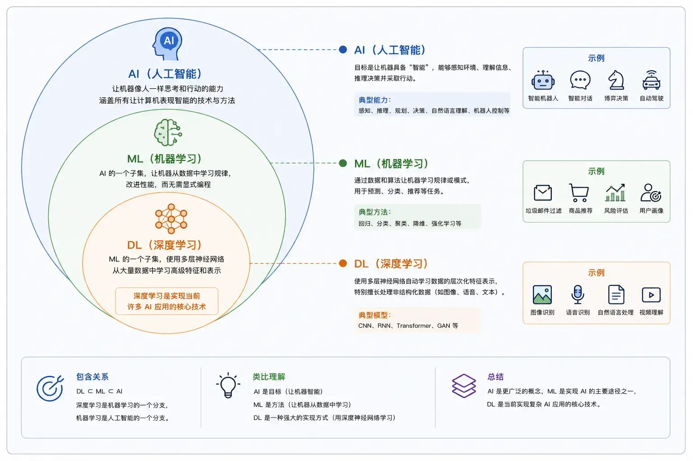
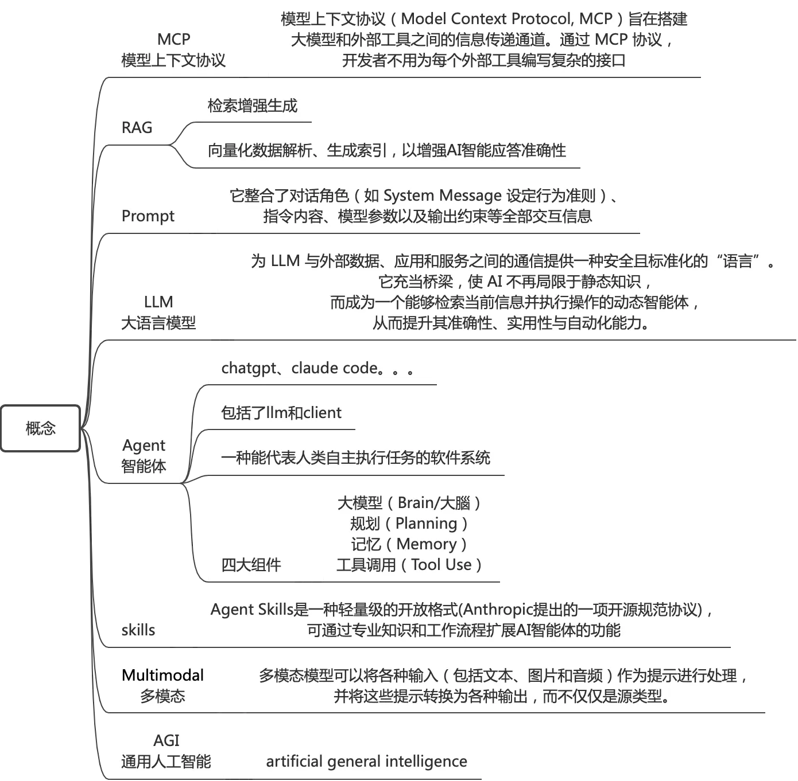
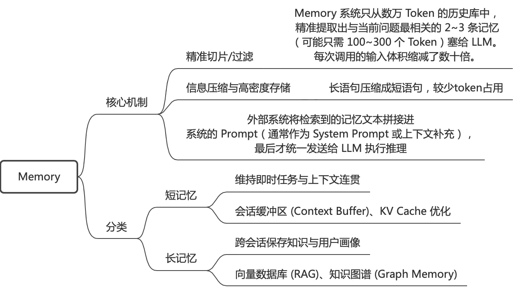
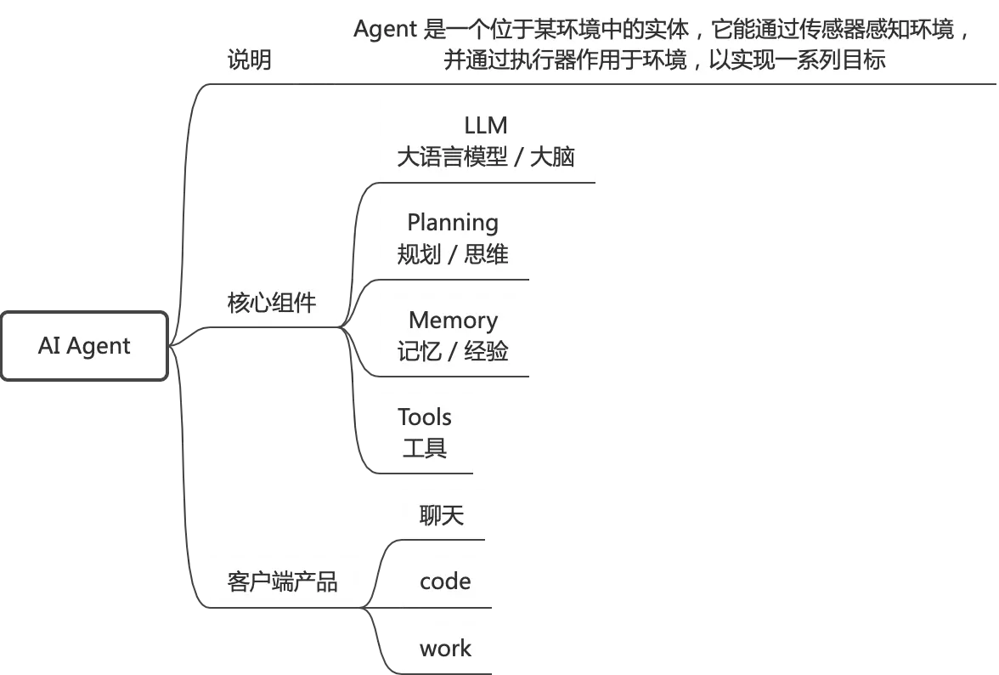
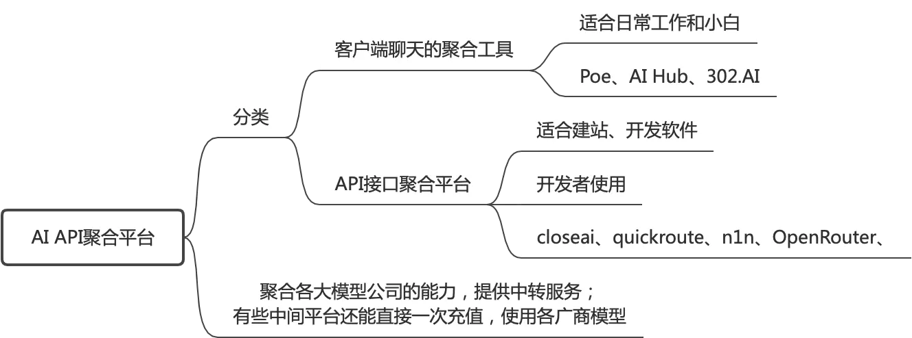
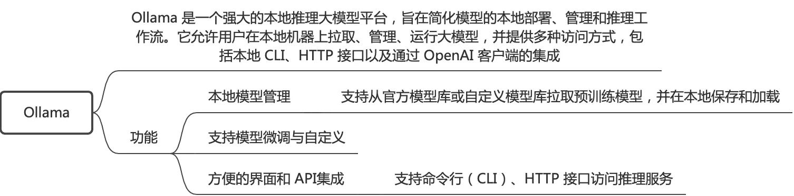
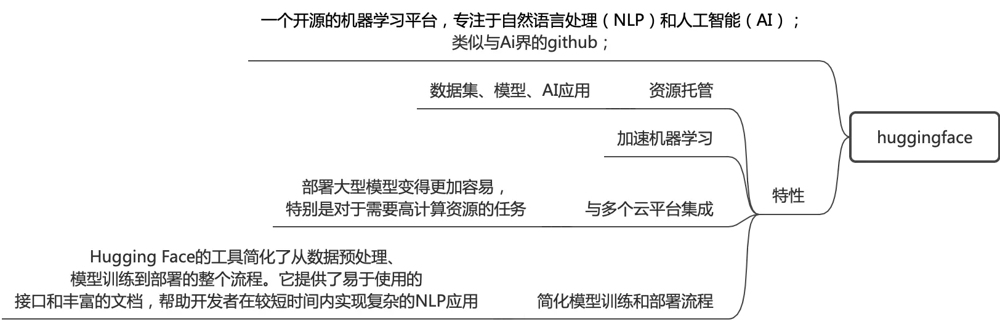

## 介绍
AI（Artificial Intelligence，人工智能）是一种让计算机具备理解、学习、推理、生成内容以及执行任务能力的技术。
AI不再是固定程序的机械运行，而是可以通过数据学习、自主判断、适配不同场景的智能技术。
过去的软件依赖固定规则运行，而 AI 更像一种能够从数据中学习规律，并自主完成目标的新型计算方式。
今天的 AI 已经不只是聊天机器人，它已经能够：写文章、写代码、生成图片、分析数据、制作 PPT等。


### AI、ML、DL关系


### 概念




## memory记忆机制




## AI Agent(智能体)



## OpenAI Chat Completion API
OpenAI API 协议是 OpenAI 公司定义的一套与大语言模型交互的 HTTP API 接口规范。由于其先发优势和广泛的应用场景，这套协议已经成为事实上的行业标准。

目前这套协议不开源，但是基本大模型都支持此协议；


### API入口

```bash
https://域名地址/v1/chat/completions


请求示例：
curl -X POST 'https://tokenhub.tencentmaas.com/v1/chat/completions' \
  -H 'Authorization: Bearer sk-xxxxxxxx' \
  -H 'Content-Type: application/json' \
  -d '{"model": "deepseek-v4-flash","messages": [{"role": "user", "content": "你好"}]}'

```

**端点 (Endpoint)**: /v1/chat/completions
**认证头 (Authorization Header) Authorization**: Bearer $API_KEY Bearer 是 HTTP 认证框架中的一种 Token 类型，定义于 RFC 6750 (OAuth 2.0)，继承自 HTTP/1.0 就存在的通用认证机制。服务器从该头中提取 Token，校验通过后赋予本次请求的调用权限。Token 即你的 API Key，不记名，持有即授权。


### 入参

| 参数名称                  | 是否必填 | 数据类型          | 默认值   | 取值范围       | 作用     | 参数说明                                                      |
| --------------------- | ---- | ------------- | ----- | ---------- | ------ | --------------------------------------------------------- |
| **model**             | ✅ 必填 | String        | -     | -          | 指定模型   | 确定使用哪一个具体的大模型，如 `gpt-4`、`qwen-plus`、`deepseek-chat`       |
| **messages**          | ✅ 必填 | Array         | -     | -          | 消息列表   | 传递给模型的对话历史或指令，包含 `role` 和 `content`                       |
| **temperature**       | ❌ 选填 | Float         | 1.0   | 0.0 - 2.0  | 温度系数   | 控制输出随机性，低值稳定，高值创意                                         |
| **top_p**             | ❌ 选填 | Float         | 1.0   | 0.0 - 1.0  | 核采样    | 与 temperature 类似但算法不同，建议只调其一                              |
| **max_tokens**        | ❌ 选填 | Integer       | 模型最大  | -          | 最大输出长度 | 限定单次响应最大 Token 数                                          |
| **n**                 | ❌ 选填 | Integer       | 1     | 1-N        | 生成次数   | 为同一 Prompt 生成 n 个不同回应                                     |
| **stream**            | ❌ 选填 | Boolean       | false | true/false | 流式输出   | 是否流式返回 Token                                              |
| **stop**              | ❌ 选填 | String/Array  | null  | -          | 停止标记   | 遇到指定字符串立即停止生成                                             |
| **presence_penalty**  | ❌ 选填 | Float         | 0     | -2.0 - 2.0 | 出现惩罚   | 正值鼓励新话题，负值减少新话题                                           |
| **frequency_penalty** | ❌ 选填 | Float         | 0     | -2.0 - 2.0 | 频率惩罚   | 正值减少重复，负值增加连贯                                             |
| **seed**              | ❌ 选填 | Integer       | null  | -          | 复现种子   | 提高结果可复现性（非 100% 保证）                                       |
| **tools**             | ❌ 选填 | Array         | null  | -          | 工具定义   | 定义可调用的外部工具/函数                                             |
| **tool_choice**       | ❌ 选填 | String/Object | auto  | -          | 工具选择   | 控制工具调用行为                                                  |
| **response_format**   | ❌ 选填 | Object        | null  | -          | 响应格式   | 指定输出格式如 JSON                                              |
| **user**              | ❌ 选填 | String        | null  | -          | 用户标识   | 用于追踪和识别终端用户                                               |
| stream                | ❌ 选填 | Boolean       | -     | true/false | 流式输出   | 应答是一次性返回；还是多批次流式返回，常使用SSE技术，在长周期任务任务下，能快速返回内容(部分)，提升用户体现； |

#### 核心入参说明
#### messages（消息列表）
	
对话上下文数组。数组元素为消息对象，最少包含 role 与 content。role 可以是 system、user 或 assistant，content 即消息正文。此例仅一条 {"role": "user", "content": "你好"}，代表单轮用户输入。若传入多轮历史消息，模型将基于完整上下文生成响应。


role 字段：用来标识一段消息是谁说的、以及它在对话中的作用。最常见的三个角色是 system、user、assistant。
```json
{
  "messages": [
    {"role": "system", "content": "你是一个有帮助的助手。"},
    {"role": "user", "content": "你好！"},
    {"role": "assistant", "content": "你好！有什么可以帮助你的吗？"},
    {"role": "user", "content": "请介绍一下你自己。"}
  ]
}
```

**角色类型详细说明：**

| 角色            | 作用            | 使用场景                                                                        | 示例                                                         |
| ------------- | ------------- | --------------------------------------------------------------------------- | ---------------------------------------------------------- |
| **system**    | 设定模型的行为、角色和约束 | 放在 messages 第一位，定义 AI 的"人设"和回答风格                                            | `"你是一个专业的Python编程助手，回答时请给出代码示例。"`                          |
| **user**      | 用户的输入或问题      | 每次用户提问时添加到 messages 末尾                                                      | `"请帮我写一个快速排序算法。"`                                          |
| **assistant** | 模型的历史回复       | 多轮对话时保存之前的 AI 回复，保持上下文连贯                                                    | `"好的，这是快速排序的Python实现..."`                                  |
| **tool**      | 工具调用的返回结果     | ⚠️ 仅用于 Function Calling，必须紧跟在包含 tool_calls 的 assistant 消息之后；ai agent工具调用使用； | `{"role": "tool", "tool_call_id": "xxx", "content": "北京今天` |

#### temperature（温度系数）
这是控制输出多样性的关键参数：

|温度值|适用场景|特点|
|---|---|---|
|0.1 - 0.3|代码生成、事实问答、法律文本|高确定性、可预测|
|0.5 - 0.7|通用对话、翻译、摘要|平衡创意与准确|
|0.8 - 1.0|创意写作、头脑风暴、营销文案|高创意、多样性|
|> 1.0|极端创意场景|输出可能不可预测|

**建议**：通常默认 0.7 即可，需要更稳定输出可设 0.3。


#### tools / tool_choice（工具调用）
这是 AI Agent 开发的核心参数，用于 Function Calling：

```json
{
  "tools": [
    {
      "type": "function",
      "function": {
        "name": "get_weather",
        "description": "获取指定城市的天气信息",
        "parameters": {
          "type": "object",
          "properties": {
            "city": {
              "type": "string",
              "description": "城市名称"
            }
          },
          "required": ["city"]
        }
      }
    }
  ],
  "tool_choice": "auto"
}
```


**tool_choice 选项：**

- `auto`：模型自动决定是否调用工具（默认）
- `none`：不调用任何工具
- `required`：必须调用工具，调用参数如：`{"type": "function", "function": {"name": "xxx"}}`：强制调用指定工具


**tool调用时序交互**


> [!note]
> 补充：现在mcp协议也能完成工具调用，已经是agent tool调用的开源标准协议；此参数也支持mcp调用


##### 列表支持


### 出参

| 参数名称                            | 数据类型    | 作用       | 参数说明                        |
| ------------------------------- | ------- | -------- | --------------------------- |
| id                              | String  | 唯一标识符    | 每个 chunk 中相同，标识同一次请求        |
| object                          | String  | 响应对象类型   | 固定为 `chat.completion.chunk` |
| model                           | String  | 模型名称     | 实际使用的模型名称                   |
| created                         | Integer | 时间戳      | API 响应创建的 Unix 时间戳          |
| **choices**                     | Array   | 分块输出列表   | 包含本次增量内容                    |
| choices[i].index                | Integer | 选项索引     | 从 0 开始的索引                   |
| **choices[i].delta**            | Object  | 增量内容     | 本次数据块新增的内容                  |
| choices[i].delta.role           | String  | 角色       | 仅在第一个 chunk 出现              |
| **choices[i].delta.content**    | String  | 增量文本     | 本次新增的极小部分文本，需拼接             |
| **choices[i].delta.tool_calls** | Array   | 工具调用增量   | 流式工具调用，增量式返回                |
| choices[i].finish_reason        | String  | 完成原因     | 仅在最后一个 chunk 返回             |
| usage                           | Object  | Token 统计 | 通常在最后一个 chunk 返回            |

#### 核心出参说明
##### finish_reason 完成原因

| 值              | 含义               | 处理建议                    |
| -------------- | ---------------- | ----------------------- |
| stop           | 正常完成             | 输出完整，可直接使用              |
| length         | 达到 max_tokens 限制 | 输出被截断，可能需要继续            |
| tool_calls     | 模型请求调用工具         | AI Agent 核心，需要执行工具并返回结果 |
| content_filter | 内容被安全过滤          | 输入或输出触发了安全策略            |
| function_call  | 旧版函数调用（已废弃）      | 使用 tool_calls 替代        |


### 参考
https://developers.openai.com/api/reference/chat-completions/overview openai chat-completion api官方协议规范
https://juejin.cn/post/7624184992536952867#heading-3 OpenAI API 协议完全指南 - 大模型应用开发的通用标准
https://agent.csdn.net/6a4e23f510ee7a33f28973cc.html AI智能体研发 | 什么是OpenAI API协议


## OpenAI Response API

在 Responses API 体系下，OpenAI 将模型视为一个自带状态和内置工具链（Hosted Tools）的智能体系统。

Open Responses 开放标准：OpenAI 已联合 Hugging Face、Vercel 及开源社区，共同推出了基于 Responses API 的开放推理标准 —— Open Responses 规范，旨在统一 Agent 时代的接口形态。目前还是一个商业api，而非开源api标准，但是很多大模型支持此api；

### 核心优势

- 从“无状态”到“服务端原生有状态（Stateful）”
在请求中只需带上 store: true，并在后续交互中关联 conversation_id，OpenAI 就会在服务端托管你的对话上下文。开发者不再需要自己在本地搞复杂的数据库存聊天记录，每次只需发送最新的一句话，极大节省了带宽并提升了模型注意力。

- 单次调用闭环“多轮工具循环（Tool Loop）
在传统 Chat 模式下，Tool Calling 是断续的。而 Responses API 支持在单次 API 呼叫中，由模型自主完成多轮“思考 ──> 调工具 ──> 获取结果 ──> 再次思考”的闭环。

- 内置强大的工具集
Responses API 原生集成了多项核心工具与能力，开发者无需自己写底层对接：
- **内置工具链**：包含网页搜索（Web Search）、文件搜索、计算机使用（Computer Use，如执行 Shell 指令/容器操作）。
- **代码解释器（Code Interpreter）**：支持数据分析及复杂的数学/图像思维计算。
- **多轮图像生成（gpt-image）**：可作为工具被调用，支持即时流式预览与多轮微调编辑。
- **远端 MCP 服务器支持**：支持**模型上下文协议（Model Context Protocol）**，只需几行代码就能将企业私有数据、本地脚本或第三方 Skill（如 Shopify、Stripe）无缝挂载到模型上。


### 历史背景

```
[Completions API]              [Chat Completions API]          [Responses API]
  (/v1/completions)      ──>    (/v1/chat/completions)   ──>     (/v5.x/responses)
单纯的“文字接龙”                 引入 Role，模拟“网页聊天框”      强类型 Items，原生“有状态智能体”
```


- **Chat Completions 的局限**：本质上是无状态（Stateless）的。为了多轮对话，开发者必须在本地存储并每次全量打包打包发送历史 `messages`。一旦涉及多轮工具调用（Tool Loop），代码就会陷入“模型要工具 $\rightarrow$ 本地执行 $\rightarrow$ 再次请求喂给模型”的复杂套娃逻辑中。


### 能力对比图


### 数据模型

~~~
Conversation(会话)
      │
      ├── Response(一次用户请求)
      ├── Response
      ├── Response
      └── Response
~~~

在chat中，可以调用多次response api的调用，每次response api调用，都会生成一个resposeid，可用于下次api调用的入参，以此关联起来请求；


### API示例
~~~json
请求：
curl https://api.openai.com/v1/responses \
  -H "Content-Type: application/json" \
  -H "Authorization: Bearer $OPENAI_API_KEY" \
  -d '{
    "model": "gpt-5.4",
    "input": "Tell me a three sentence bedtime story about a unicorn."
  }'


应答：
{
  "id": "resp_67ccd2bed1ec8190b14f964abc0542670bb6a6b452d3795b",
  "object": "response",
  "created_at": 1741476542,
  "status": "completed",
  "completed_at": 1741476543,
  "error": null,
  "incomplete_details": null,
  "instructions": null,
  "max_output_tokens": null,
  "model": "gpt-5.4",
  "output": [
    {
      "type": "message",
      "id": "msg_67ccd2bf17f0819081ff3bb2cf6508e60bb6a6b452d3795b",
      "status": "completed",
      "role": "assistant",
      "content": [
        {
          "type": "output_text",
          "text": "In a peaceful grove beneath a silver moon, a unicorn named Lumina discovered a hidden pool that reflected the stars. As she dipped her horn into the water, the pool began to shimmer, revealing a pathway to a magical realm of endless night skies. Filled with wonder, Lumina whispered a wish for all who dream to find their own hidden magic, and as she glanced back, her hoofprints sparkled like stardust.",
          "annotations": []
        }
      ]
    }
  ],
  "parallel_tool_calls": true,
  "previous_response_id": null,
  "reasoning": {
    "effort": null,
    "summary": null
  },
  "store": true,
  "temperature": 1.0,
  "text": {
    "format": {
      "type": "text"
    }
  },
  "tool_choice": "auto",
  "tools": [],
  "top_p": 1.0,
  "truncation": "disabled",
  "usage": {
    "input_tokens": 36,
    "input_tokens_details": {
      "cached_tokens": 0
    },
    "output_tokens": 87,
    "output_tokens_details": {
      "reasoning_tokens": 0
    },
    "total_tokens": 123
  },
  "user": null,
  "metadata": {}
}
~~~


#### 关键参数

- previous_response_id
上一个响应的唯一 ID，当前响应id有效期为30天。使用此参数可创建多轮对话，服务端会自动检索并组合该轮次的输入与输出作为上下文。当同时提供 input 消息数组和 previous_response_id 时，input 中的新消息会追加到历史上下文之后。不能与 conversation 同时使用。

- conversation(String)
当前响应所属的会话。会话中的历史项会自动作为上下文传入本次请求，本次请求的输入和输出也会在响应完成后自动添加到会话中。不能与 previous_response_id 同时使用。

- enable_thinking
是否开启思考模式。开启后，模型会在回复前进行思考，思考内容将通过 reasoning 类型的输出项返回。开启思考模式时，建议开启内置工具，以在处理复杂任务时获得最佳的模型效果。


### response api stateful介绍


**方式1**
通过response api入参的previous_response_id(此参数值来自resposne api请求返回信息中)，关联对话请求，这样就避免在入参的文本内容中累加历史上下文信息；

状态保持时间：至少30d(即response_id相关信息)；

**方式2**
另外保持stateful的另一种使用使用方式是使用conversation api
~~~
conversation = openai.conversations.create()

response = openai.responses.create(
  model="gpt-5.6",
  input=[{"role": "user", "content": "What are the 5 Ds of dodgeball?"}],
  conversation="conv_689667905b048191b4740501625afd940c7533ace33a2dab"
)
~~~

这种方式状态保持时间：不受30d限制；


https://developers.openai.com/api/docs/guides/conversation-state#manually-manage-conversation-state


## AI客户端


### AI客户端分类
市面上AI客户单应用有很多，大致有以下几种

| 类型                               | 代表产品                                          | 目标用户  | 核心能力                       | Runtime特点            |
| -------------------------------- | --------------------------------------------- | ----- | -------------------------- | -------------------- |
| **AI App（Personal Assistant）**   | ChatGPT、Claude Desktop、Gemini App             | 所有人   | 聊天、知识问答、文档、会议、日程、图片、语音     | Conversation Runtime |
| **Code Agent**                   | Claude Code、Codex CLI、OpenAI Codex、Gemini CLI | 开发者   | Git、Shell、IDE、代码修改、部署      | Development Runtime  |
| **Workspace Agent**              | Cursor、Windsurf、GitHub Copilot Agent          | 开发者   | IDE 内 Agent、代码导航、调试、Review | IDE Runtime          |
| **Computer Agent（Computer Use）** | ChatGPT Computer Use、Operator                 | 自动化办公 | 浏览器、鼠标、键盘、RPA、跨应用操作        | Computer Runtime     |


## 计费说明token

大模型计费，我们知道是基于token(词元)，即一段话会按计算机方式，进行划分提取出适用于计算的token；而这个token的数量也是大模型计费的单元；
```
prompt你好，今天天气如何；

token：你好，今天，天气，如何；4个token；(实际情况会有不同)
```


**计费公式**
参考各AI平台计费规则
一般文本AI模型，计费公式=输入token+输出token+缓存创建token+缓存命中token；
一些语音、图片、视频计费略有差异，有些按图片数量、分辨率、视频时长等因素来计费；


缓存token：调用大模型时，不同推理请求可能出现输入内容的重叠（例如多轮对话或对同一本书的多次提问）。上下文缓存（Context Cache）技术可以缓存这些请求的公共前缀，减少推理时的重复计算。这能提升响应速度，并在不影响回复效果的前提下降低您的使用成本。
```
# 发起第一个请求：发送包含超 1024 Token 文本 A 的系统消息，并加入缓存标记;
# 系统将创建首个缓存块，记为 A 缓存块。
[{"role": "system", "content": [{"type": "text", "text": A, "cache_control": {"type": "ephemeral"}}]}] 


#发起第二个请求：发送以下结构的请求：
[
    {"role": "system", "content": A},
    <其他 message>
    {"role": "user","content": [{"type": "text", "text": B, "cache_control": {"type": "ephemeral"}}]}
]

#命中 A 缓存块，并将其有效期重置为 5 分钟；同时，系统会基于 A、其他message和 B 创建一个新的缓存块。
```


**看一个AI任务实际的账单**
```
模型倍率 2.5，输出倍率 5，缓存倍率 0.1，缓存创建倍率 5m 1.25，分组倍率 1.2

输入价格：$5 / 1M tokens
输出价格：$5 * 5 = $25 / 1M tokens
缓存价格：$5 * 0.1 = $0.50 / 1M tokens (缓存倍率: 0.1)
缓存创建价格：$5 * 1.25 = $6.25 / 1M tokens (缓存创建倍率: 1.25)

输入 (8 tokens / 1M tokens * $5 + 缓存 18357 tokens / 1M tokens * $0.50 (倍率: 0.1) + 缓存创建 5796 tokens / 1M tokens * $6.25 (倍率: 1.25) + 输出 53 tokens / 1M tokens * $25) * 分组倍率 1.2 = $0.056122

仅供参考，以实际扣费为准
```
这个账单中分组倍率是AI聚合平台自由的倍率，也是这类平台盈利关键因素；


## AI聚合平台



AI聚合平台可以通过聚合平台的一个key，路由调用全球所有主流模型；当然作为中转平台，会有额外费用(比如：官网直调token费用*(1+费率）)，

|   对比维度    |           4SAPI           | OpenRouter |   硅基流动    |  OneAPI   | OpenAI官方  |
| :-------: | :-----------------------: | :--------: | :-------: | :-------: | :-------: |
|  模型覆盖广度   |       超过480个，覆盖主流全系       | 极广，聚合多供应商  |  聚焦国产与开源  |  依赖自建渠道   | 仅限OpenAI  |
| 访问稳定性与本地化 |       高可用目标，适配本地网络        |   需自行测试    |   网络侧较优   |  取决于自建环境  |  需自行解决网络  |
|   协议兼容性   | 原生Anthropic+OpenAI+Gemini | OpenAI兼容为主 |  以自有协议为主  |    自定义    | 原生OpenAI  |
|   企业级管理   |      成员账户、调用审计、用量管控       |     基础     |    基础     |   高度可定制   |     无     |
| 计费透明度与合规  |       调用级明细，支持企业发票        |   依上游规则    |    可定制    |    自定义    |   官方账单    |
|   费用水平    |         具竞争力的单位成本         | 多源定价，部分有加价 |   价格有优势   |  上游成本叠加   |   官方标准价   |
|  典型场景适配   |     多模型生产环境、协议一致性要求高      | 模型探索、对比评测  | 国产模型推理与部署 | 自建网关与策略控制 | 纯OpenAI场景 |

对于企业/团队：首选4sAPI，另外还有个平台n1n.ai跟它类似。

理由：它不仅是 LLM API 聚合工具，更是企业级 AI 大模型 基础设施。1:1 的汇率优势加上全球 AI 专线加速，使其成为 2026 年很具竞争力的 MaaS 平台。

对于个人极客：推荐 OpenRouter。

理由：如果你不需要发票，且能搞定海外支付，OpenRouter 是探索冷门 AI 模型的乐园，也是 LLM 生态的重要组成部分。

对于纯开源玩家：推荐 SiliconFlow。

理由：专注国产开源 大模型 推理，速度很快。

## Ollama
Ollama 是一个免费的开源本地大语言模型（LLM）运行框架，专为在个人电脑或服务器上便捷部署和管理 AI 模型而设计。




## huggingface
Hugging Face 是一个开源的机器学习平台，专注于自然语言处理（NLP）和人工智能（AI）。该平台目前托管了超过320,000个模型和50,000个数据集，成为全球机器学习社区合作开发模型、数据集和应用程序的主要集合地。




https://zhuanlan.zhihu.com/p/535100411 Huggingface 超详细介绍
https://zhuanlan.zhihu.com/p/671119438 Hugging Face介绍

## AI对应python框架

| 维度                  | TensorFlow                   | PyTorch                            |
| ------------------- | ---------------------------- | ---------------------------------- |
| **核心定位**            | 大规模工业级深度学习生产框架               | 学术研究与快速实验首选深度学习框架                  |
| **开发者**             | Google                       | Meta（Facebook）                     |
| **首次发布**            | 2015 年                       | 2016 年                             |
| **计算图模式**           | 默认动态图（2.0+），支持静态图            | 纯动态图                               |
| **上手难度**            | 中等（Keras 接口较易）               | 较低（更接近 Python 风格）                  |
| **调试便利性**           | 一般，静态图模式调试复杂                 | 高，与普通 Python 调试方式一致                |
| **学术界使用率**          | 较低（近年下降）                     | 高（顶会论文主流）                          |
| **工业界使用率**          | 高（尤其 Google 生态）              | 逐年上升，已大量用于生产                       |
| **部署工具链**           | 完善（TF Serving、TF Lite、TF.js） | 相对简单（TorchScript、ONNX 导出）          |
| **可视化工具**           | TensorBoard（原生支持）            | 可集成 TensorBoard 或 Weights & Biases |
| **社区与资源**           | 大型社区，教程丰富                    | 大型社区，学术资源更集中                       |
| **Hugging Face 支持** | 支持                           | 主力框架                               |
| **训练性能**            | 相当                           | 相当                                 |
| **适合人群**            | 工程落地、企业用户                    | 研究人员、初学者                           |

https://www.cnblogs.com/zxhoo/p/19720334 TensorFlow 与 PyTorch 入门对比教程

## AI所需硬件资源


**资源消耗分类**

| 资源 | 用途 | 瓶颈 |
| --- | --- | --- |
| **显存** | 存模型权重、KV Cache、激活值 | 最容易爆 |
| **GPU 算力** | 矩阵乘法 | 影响速度 |
| **显存带宽** | 读写权重和 KV Cache | 实际瓶颈 |
| **CPU** | Tokenize、调度、后处理 | 通常不是瓶颈 |
| **内存** | 模型加载、缓存 | 大模型需要大内存 |
| **网络** | 请求传输 | 通常不是瓶颈 |

**显存消耗的三大块**
**1模型权重**
7B 模型 FP16：约 14GB。
7B 模型 INT8：约 7GB。
7B 模型 INT4：约 3.5GB。
70B 模型 FP16：约 140GB。
70B 模型 INT4：约 35GB。

**2KV Cache**
每生成一个 token，都要缓存 K、V。
大小 = 2 × 层数 × 头数 × 头维度 × 序列长度 × 精度。
序列越长，KV Cache 越大。
这是动态增长的，是长上下文的主要瓶颈。
**例子**：
- 7B 模型，32 层，32 头，头维度 128，FP16。
- 每个token 的 KV Cache ≈ 0.5MB。
- 4096 token 序列：约 2GB。
- 32768 token 序列：约 16GB。

**3激活值**
前向传播的中间结果。
通常较小，但也会占用显存。

**一次请求的具体消耗**
假设：
- 模型：7B，INT4 量化。
- 输入：100 token。
- 输出：200 token。
- 序列总长：300 token。

| 资源       | 消耗                 |
| -------- | ------------------ |
| 模型权重     | ~3.5GB（固定）         |
| KV Cache | ~0.15GB（300 token） |
| 激活值      | ~0.5GB             |
| **总显存**  | **~4.2GB**         |
| GPU 算力   | 几百毫秒               |
| CPU      | 几十毫秒（Tokenize）     |

**并发请求的资源**
- 每个并发请求都有自己的 KV Cache。
- 权重是共享的。
- 所以并发主要吃 KV Cache 和算力。

**实际瓶颈**

|阶段|瓶颈|
|---|---|
|加载模型|内存、显存|
|处理输入（Prefill）|GPU 算力|
|生成输出（Decode）|**显存带宽**|
|长上下文|KV Cache 显存|
|高并发|KV Cache + 算力|

总结：一般显存要够大，显存带宽和算力之比要正常，AI模型才能运算正常；

## QA

### openai API为什么只有一个入口
像是tool的使用，是多步骤交互完成的，只有一个入口，通过tool对应参数的改变，来完成交互；
而不是多个http uri来交互？


### response api stateful能否减少token使用量
Responses API 的核心价值是"把状态管理从 Host 迁移到 OpenAI 服务端"，而不是"保证 Token 更便宜"。 在架构设计时，应把它看作一种状态托管能力，而不是一种 Token 优化机制。

**明确的优势**
- 减少客户端上传 Token
- 减少 Host 状态管理复杂度


### AI平台有很多API分类，如果开发需要全部接入吗
如阿里百炼AI平台，有文本生成、视频生成、语言生成等api模块。
想要开发一款ai应用，通过chat ui形式提供服务，功能支持文本问答、语音/视频生成，该如何对接；

结论：从软件架构和 API 调用的物理层面来看，后台不仅需要调用文本生成 API，依然需要对接和集成视频生成、语音生成的底层 API。 但是，文本生成 API（Chat Completions API）在其中扮演了“指挥官（Controller）”的角色，它不直接生产视频或语音，而是通过 Tool Calling（工具调用）机制，指挥后台去调用视频和语音 API。

对接方式1：代码接入
文本llm->任务规划/编排->tool calling->(视频生成api/图片生成api)->llm汇总结果->用户

对接方式2：无代码
如果您不想在自己的后台写复杂的 Tool Calling 拦截、多线程异步调用视频/语音接口的代码，阿里云百炼提供了一种免开发后台代码的托管方案。
agent智能体创建->关联视频生成/语音生成等插件(mcp、skill、插件等形式)，也有UI可视化操作流程编排，形成agent应用；

总结：AI 平台之所以提供文本、图片、视频、语音等多个 API，并不是因为接口设计分散，而是因为不同 AI 能力通常由不同优化方向的基础模型提供。开发者根据应用需求接入相应能力；对于 Chat UI、智能助手等复杂应用，则通常再引入一个文本 LLM（Agent）作为统一入口，负责理解用户需求、规划任务、通过 Tool Calling、MCP 或 Workflow 调用底层图片、视频、语音等专用模型，最后将结果整合后返回给用户。

## 参考
https://cloud.google.com/discover/what-is-model-context-protocol?hl=zh-CN MCP
https://platform.claude.com/docs/zh-CN/intro claude api平台
https://juejin.cn/post/7624184992536952867#heading-20 OpenAI API 协议完全指南 - 大模型应用开发的通用标准
https://www.runoob.com/ai/ai-tutorial.html AI 入门教程