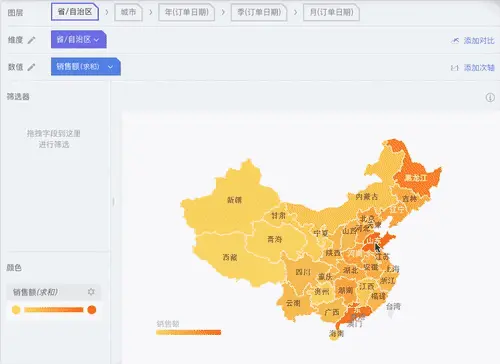
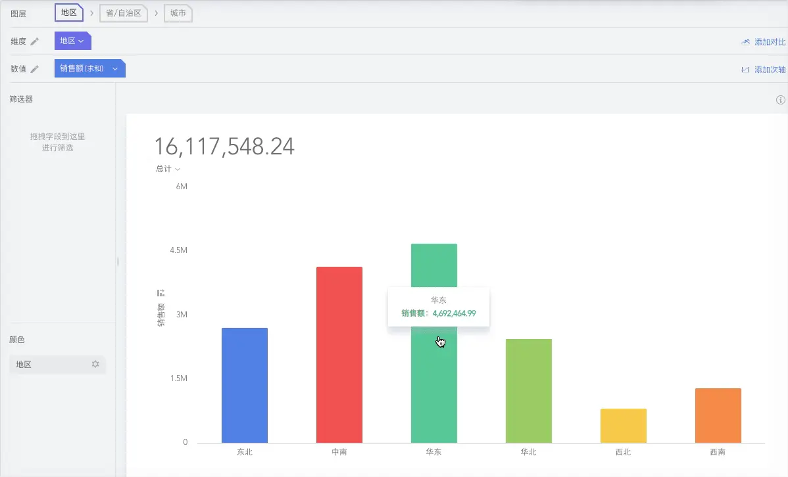
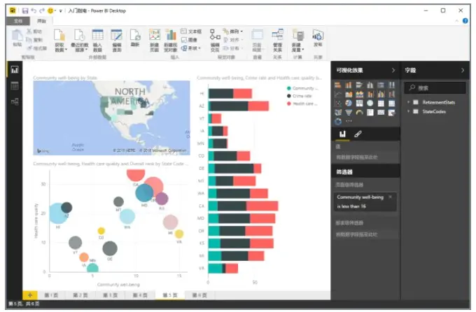
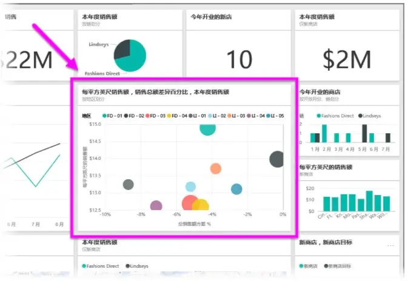
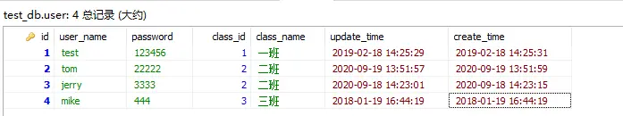
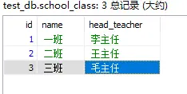
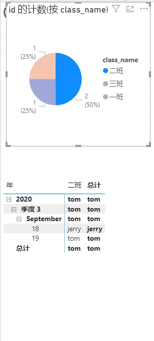
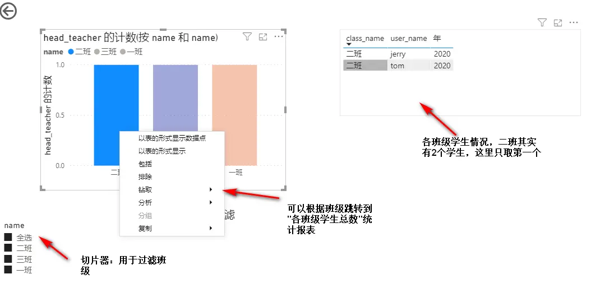
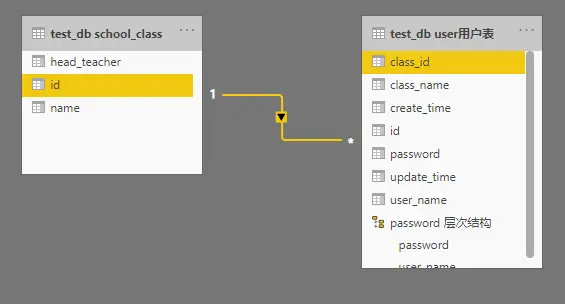

#### power bi介绍

其实Power BI的核心理念就是让我们用户不需要强大的技术背景，只需要掌握Excel这样简单的工具就能快速上手商业数据分析及可视化。

PowerBI是企业级BI工具，通常由IT或者数据团队进行报表开发，发布后，只读用户可通过web端访问，但修改和编辑需要desktop版本才能进行，灵活性有一定的限制。如果要推广至业务人员随时可开展数据分析工作，desktop版本的推广成本较高。另外，PowerBI处理数据需要学习DAX函数，功能强大，但学习成本较高。

PowerBI目前在数据挖掘这方面没有成熟的分析模块，只是简单的集成了一个R语言的执行脚本组件供用户书写代码集成使用。

##### 数据建模

使用的数据透视表的都知道，透视表只能从单个表中取数，如果想把其他表中的数据也放进来，只能先利用Vlookup把其他表的数据合并过来，然后再把这个字段放到透视表中。这只适用于数据非常简单的情况，如果数据量大或者维度很多，用透视表就无法满足需求了。 Power BI突破了这个限制，可以从多个表格、多种来源的数据中，根据不同的维度、不同的逻辑来聚合分析数据；而提取数据的前提是要将这些数据表建立关系，这个建立关系的过程就是数据建模。

<https://zhuanlan.zhihu.com/p/64149834> PowerBI数据建模：其实一点都不高深

---

#### 说明

##### 钻取

钻取是改变维的层次，变换分析的粒度。它包括向上钻取（roll up）和向下钻取（drill down），后面简称为上钻和下钻。

power bi中的钻取除了在同一个chart中上下钻取之外，还会钻取不同页面，以便捷、详细查看数据间的关系。

下钻：

是通过增加图层从汇总数据深入到细节数据进行观察。通过逐层下钻，数据更加一目了然，更能充分挖掘数据背后的价值，及时做出更加正确的决策。

drill down则相反，它从汇总数据深入到细节数据进行观察或增加新维。例如，用户分析“各地区、城市的销售情况”时，可以对某一个城市的销售额细分为各个年度的销售额，对某一年度的销售额，可以继续细分为各个季度的销售额。通过钻取的功能，使用户对数据能更深入了解，更容易发现问题，做出正确的决策。

举个例子：我想要了解山东省济南市2014年第3季度8月份的销售情况，那么只要点击“山东”―“济南”，然后依次点击“2014年”―“3季度”就能马上得到8月份的数据。

上钻：

它与下钻正好相反。比如下钻是年-月-日，那么上钻则是日-月-年。BDP的上钻效果如下，可通过点击下方的导航（或切换维度栏的各图层）上钻回更高的层级。

roll up是在某一维上将低层次的细节数据概括到高层次的汇总数据，或者减少维数；是指自动生成汇总行的分析方法。通过向导的方式，用户可以定义分析因素的汇总行，例如对于各地区各年度的销售情况，可以生成地区与年度的合计行，也可以生成地区或者年度的合计行。

---

#### 常见问题

##### 数据源刷新设置

Report结构是死的，但是数据是活的，如果需要获得最新数据情况，就需要不断的对数据进行刷新。

在Power BI Desktop版本中刷新数据只能手动进行操作，因为微软将Power BI Desktop版定位为Report Designer，主要是用来创建数据模板的。真正的数据共享需要通过Power BI Online实现。

在Desktop版中刷新数据主要有两种方式，一种是整体刷新，即点击Ribbon上的刷新button，刷新所有表中的内容进行；一种是单表刷新，点击表单旁边的…按钮，然后选择刷新，只会更新当前表数据。

看样子power bi desktop版本数据更新只有手动这种方式；在power bi online版本中可以配置定时任务刷新数据，刷新策略全表，增量等。

<https://blog.csdn.net/jessica_seiya/article/details/80974227> 在Power BI中刷新数据的哪些事儿

##### power bi名词

- 可视化效果

可视化效果（有时亦称为“视觉对象”）是数据的可视化表示形式，如图表、着色地图或可创建用来直观呈现数据的其他有趣效果。 Power BI 提供各种类型的可视化效果

- 数据集

数据集是 Power BI 用来创建可视化效果的数据集合。

可以有基于 Microsoft Excel 工作簿中一个表的简单数据集

- 报表

在 Power BI 中，报表是在一个或多个页面上显示的可视化效果集合。 就像为销售演示创建的其他任何报表或为学校作业编写的报表一样，Power BI 中的报表是彼此相关的项集合。 下图展示了 Power BI Desktop 中的报表。在此示例中，它是 6 页报表中的第 5 页。 也可以在 Power BI 服务中生成报表。

- 仪表板

如果已准备好共享报表中的一个页面或一系列可视化效果，便可创建仪表板。 Power BI 仪表板与汽车仪表板非常类似，它是一个页面中可与他人共享的视觉对象集合。 它通常是一组选定的视觉对象，旨在让人快速洞察数据或所要呈现的信息。

仪表板必须占满一个页面，这通常称为“画布”，即是 Power BI Desktop 或服务中用于放置可视化效果的空白背景。

- 磁贴

在 Power BI 中，磁贴是报表或仪表板上的一个可视化效果。 它是包含一个视觉对象的矩形框。 在下图中，可以看到一个磁贴（用亮色框突出显示），它的周围还分布着其他磁贴。

---

#### 示例

我们有一张学生表，和班级表；统计班级学生数，和班级的班主任人数，以图表形式呈现。

通过这个简单例子，来使用power bi功能。使用了钻取、切片器功能。

目录：OneDrive\Collection\domain\人工智能和大数据\大数据

*学生表*

*班级表*

*报表第一页：各班级学生总数统计*

*报表第二页：各班级班主任总数统计*

*power bi模型视图*

---
