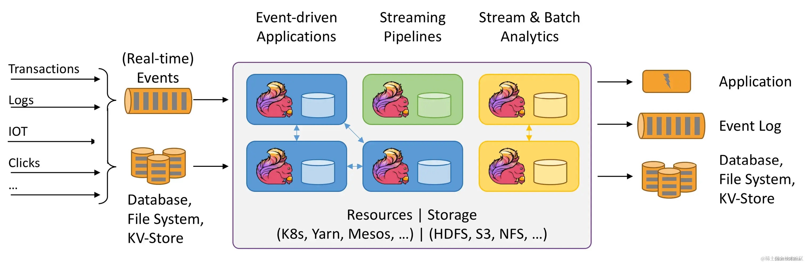
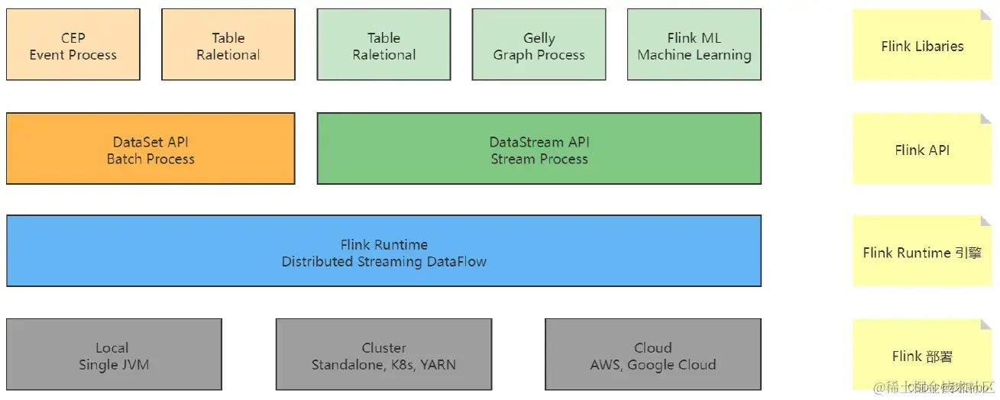
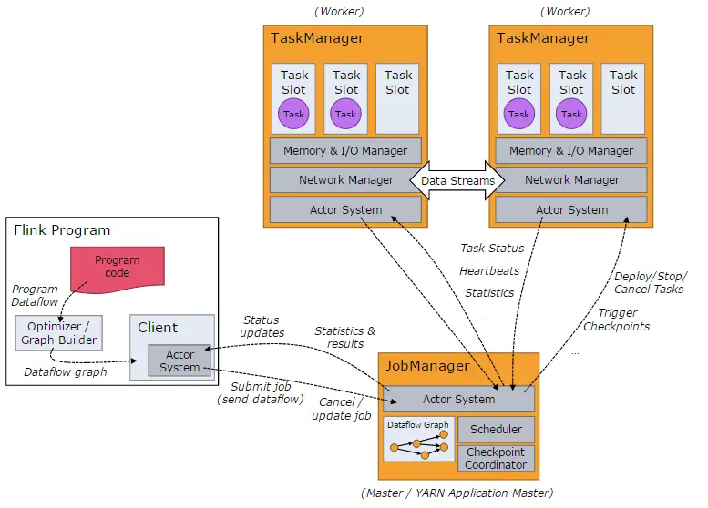
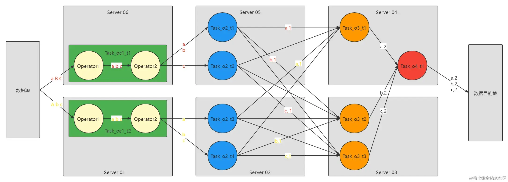
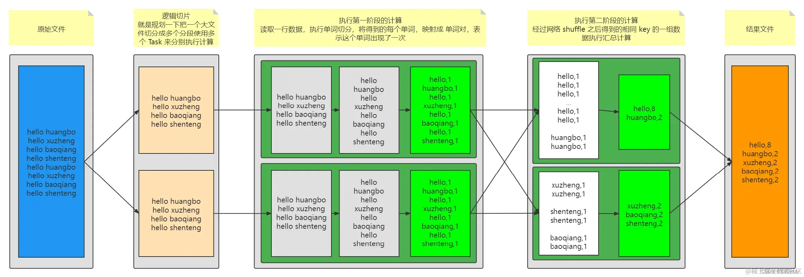
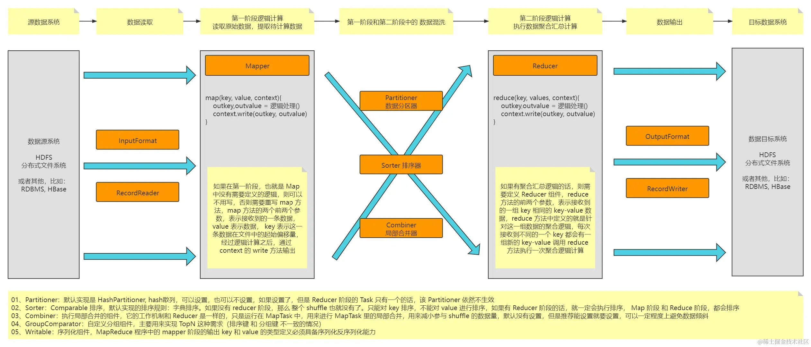
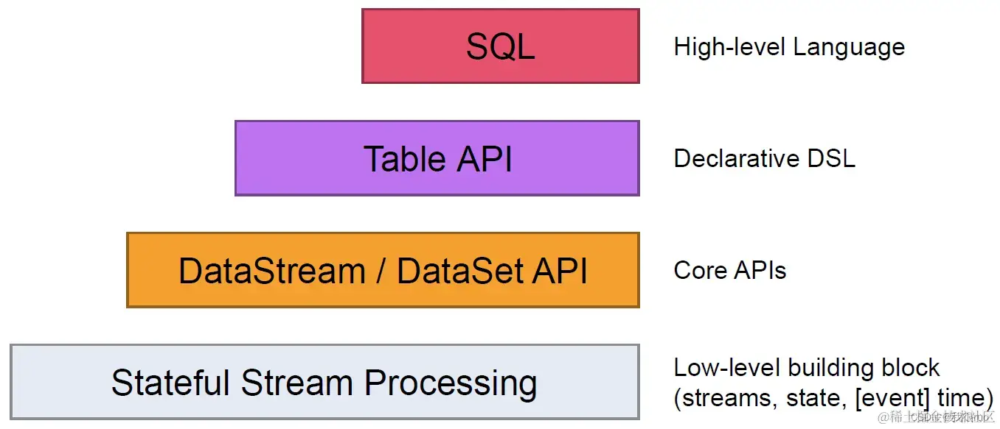
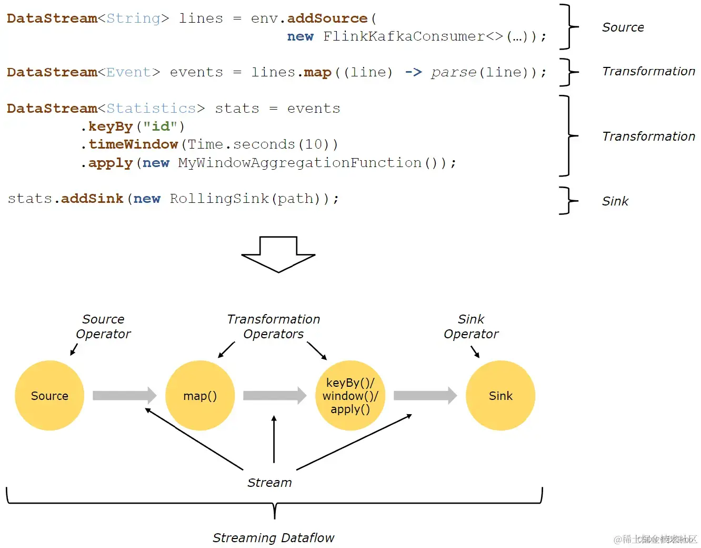
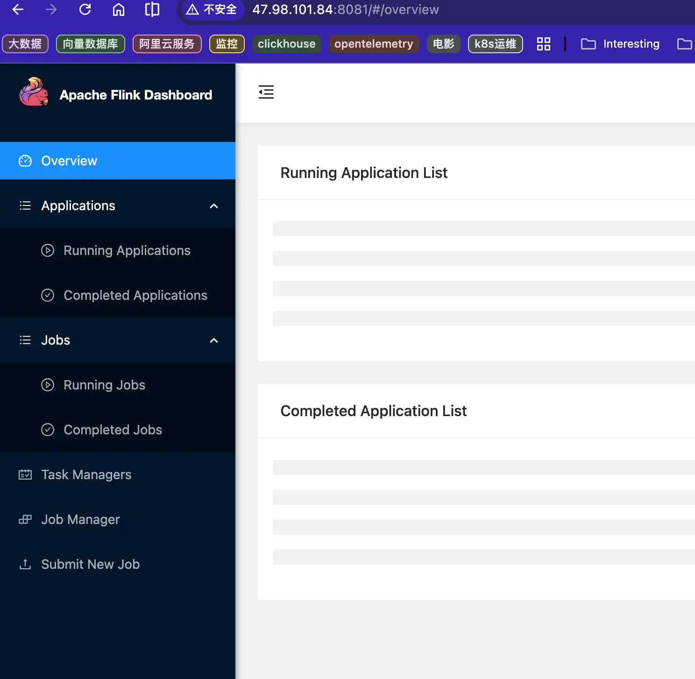

## 介绍
Apache Flink是一个框架和分布式处理引擎，用于在无边界和有边界数据流上进行有状态的计算。**擅长窗口聚合、多流关联和复杂事件处理**。Flink 能在所有常见集群环境中运行，并能以内存速度和任意规模进行计算。

Flink的核心特点是低延迟、高吞吐、精确一次(exactly-once)的状态一致性保证，以及丰富的状态管理和事件时间支持。

**应用场景**
- 事件驱动型应用
- 实时数据分析应用
- 实时数据仓库和ETL

## 主要优势
Flink的核心优势在于其流式优先的设计理念，通过多层图结构优化、高效的算子链合并、精确一次的状态管理和灵活的时间模型，实现了高吞吐、低延迟的流处理能力。其分布式快照机制和credit-based流控等技术，保证了系统在大规模分布式环境下的稳定性和可靠性。

- 真正的流处理引擎，而非微批处理
- 支持事件时间(event time)和处理时间(processing time)
- 精确一次的状态一致性保证
- 高吞吐和低延迟
- 灵活的窗口操作
- 容错机制轻量级且高效

## 架构
流批一体能力通常可以分成四层：
1. **数据集成层**：统一接入全量、增量、实时、离线数据。
2. **存储层**：统一存储格式，支持流写批读、批写流读。
3. **计算引擎层**：一个引擎同时执行流任务和批任务。
4. **编程模型层**：一套 API 或 SQL，流批通用。


*Flink架构模式*




*Flink架构层级*



*master-slave架构*



*Flink 核心概念和并行度*

- 图中的 o: Operator， oc 表示 OperatorChain， t 表示 Task。
- 图中的 圆圈 就是一个 Task，绿色的是 Task，只不过是包含两个 Operator， 箭头是数据流， Task 是预先启动不转移位置的，数据流中的数据是流动的。
- OperatorChain 可以理解成类似于 Spark 中的 Stage。
- OperatorChain 包含了多个 Operator，基于并行度并行运行成多个 Task。
- Stage 包含了多个 算子，其实包含了多个 RDD， Stage 中的 Task 数量取决于 这个 Stage 的 最后一个 RDD 的分区数量。

## MapReduce
思路：大数据-分片-多任务运算-统计汇总-存储；

*MapReduce执行引擎*


*MapReduce 的组件设计实现图*


## Flink能力
流批处理框架一般具备：统一 API、统一执行引擎、事件时间与窗口、状态管理、Checkpoint 容错、Exactly-Once 语义、低延迟高吞吐、统一存储连接、资源弹性调度等能力。它的本质是让实时流和离线批不再分成两套系统，而是用一套技术栈同时解决“快”和“准”的问题。

1. 统一编程模型：一套代码处理流和批
	- 统一 API：提供一套 API，既能处理实时流，也能处理离线批。比如 Flink 的 DataStream API、Table API、SQL。
	- 统一语义：同一套逻辑在流模式和批模式下执行，结果应该一致，避免“实时一套、离线一套”导致口径打架。
	- 统一 SQL / 查询能力：用户不需要关心底层是流还是批，直接写 SQL 就能跑。
2. 统一执行引擎：流和批共享一个引擎
	- 流处理：处理无界数据，比如 Kafka 实时日志、用户点击流、交易流水
	- 批处理：处理有界数据，比如历史日志、T+1 报表、全量补数
	- 统一调度：流任务常驻运行，批任务按阶段调度，资源统一协调
	- 统一 Shuffle：流批之间共享数据交换机制，减少架构割裂
3. 事件时间、窗口与水印能力
	流处理不能只看系统时间，因为数据可能乱序、延迟到达。
	流批框架通常需要具备：
	- 事件时间 Event Time：按数据真实发生时间计算，而不是到达引擎的时间。
	- Watermark 水印：用来判断“数据大概到齐了”，触发窗口计算。
	- 窗口计算：滚动窗口、滑动窗口、会话窗口等，比如你之前问的“每半小时统计一次用户请求次数”。
	- 迟到数据处理：允许一定延迟数据进入计算，避免结果偏差。
	这些能力对实时统计、风控、推荐、IoT 场景非常重要。
4. 状态管理能力
	流批框架和普通 SQL 引擎不一样，它通常是有状态的。
	比如你要统计“每个用户最近 30 分钟请求次数”，框架必须记住每个用户之前的累计值，这就是状态。
	流批框架需要具备：
	- Keyed State：按用户、订单、设备维度维护状态。
	- 窗口状态：维护窗口内的聚合结果。
	- 状态 TTL：状态过期清理，避免无限膨胀。
	- 大状态支持：支持状态大于内存，比如使用 RocksDB、远程存储等。
	状态管理是流批框架和普通批处理框架的重要区别。
5. 容错与一致性保证
	生产环境里，任务不能因为一个节点挂了就算错、丢数据、重复计算。
	流批框架通常要有：
	- Checkpoint 检查点：定期保存任务状态和消费位点。
	- 故障恢复：任务失败后能从最近检查点恢复。
	- Exactly-Once 精确一次：保证数据不丢、不重，尤其适合金融、对账、风控场景。
	- Savepoint：用于任务升级、迁移、补数、重新部署。
	批处理更强调吞吐和可重跑，流处理更强调低延迟和持续容错。流批框架要兼顾两者。
6. 低延迟与高吞吐
	流批框架需要同时满足两类需求：
	- 流处理：毫秒级、秒级响应，适合实时监控、风控、推荐、实时大屏。
	- 批处理：高吞吐、大规模扫描，适合离线报表、历史分析、全量 ETL。
	所以它既要能“算得快”，也要能“算得稳”。
7. 统一存储与数据湖能力
	现代流批一体不只是计算层统一，还会延伸到存储层。
	典型能力包括：
	- 统一数据格式：实时写入和离线查询使用同一份数据。
	- 数据湖表格式：如 Iceberg、Hudi、Paimon 等，支持 ACID、版本管理、增量读取。
	- 流式写入 + 批量查询：实时数据不断写入，离线任务可以查询历史快照。
	- CDC 接入：支持数据库变更日志的全量和增量同步。
	这样就能做到：一份数据，同时服务实时链路和离线链路。
8. 资源调度与弹性能力
	流批框架通常要运行在分布式集群上，所以需要：
	- 分布式执行：任务拆分成多个算子、多个并行度执行。
	- 资源调度：支持 YARN、Kubernetes 等资源平台。
	- 弹性扩缩容：流量高峰时扩容，低谷时缩容。
	- 背压处理：下游慢时能感知并控制上游流量，避免系统被打爆。
9. 生态连接能力
	流批框架不能孤立存在，必须能连接各种数据源和存储系统。
	常见连接对象包括：
	- 消息队列：Kafka、Pulsar
	- 数据湖：Iceberg、Hudi、Paimon
	- 文件系统：HDFS、S3、OSS
	- 数据库：MySQL、PostgreSQL、Oracle
	- OLAP：ClickHouse、Doris、StarRocks
	- 调度平台：Airflow、DolphinScheduler、K8s

## API体系


## Flink程序和数据流结构

用户实现的Flink程序是由Stream和Transformation这两个基本构建块组成，其中Stream是一个中间结果数据，而Transformation是一个操作，它对一个或多个输入Stream进行计算处理，输出一个或多个结果Stream。

当一个Flink程序被执行的时候，它会被映射为Streaming Dataflow。

一个Streaming Dataflow是由一组Stream和Transformation Operator组成，它类似于一个DAG图，在启动的时候从一个或多个Source Operator开始，结束于一个或多个Sink Operator。

下面是一个由Flink程序映射为Streaming Dataflow的示意图

**客户端Flink执行步骤**
1、获得一个执行环境：（Execution Environment） 
2、加载/创建初始数据：（Source） 
3、指定转换这些数据：（Transformation） 
4、指定放置计算结果的位置：（Sink） 
5、触发程序执行：（Action）




## Flink cdc机制
Flink CDC(变更数据捕获)是一个基于流的数据集成框架，利用变更数据捕获（CDC，Change Data Capture）技术，实现从各种数据库中实时捕获并处理数据增量变动。可以作为ETL工具来使用，具备数据清洗、转换和加载，从而构建出低延迟的实时数据管道能力；

部署位置：Flink CDC 是 Flink 的一个 Source 连接器，部署在 Flink 集群上。

**核心概念**
- 什么是 CDC：一种识别和捕获数据库中数据插入、更新、删除操作的技术，能实现近乎实时的同步，替代耗时的夜间批处理。
- 与 Flink 结合：它作为 Apache Flink 的扩展，直接读取数据库日志（如 MySQL 的 Binlog、PostgreSQL 的 WAL 等），无须借助第三方消息队列和复杂传输链路，降低了延迟与维护成本

Flink CDC 连接器在全量读取阶段会先按主键（或指定的分片键）将表切分成多个 Chunk（数据块），然后进行并行读取。

**pull or push**

| 阶段                              | 模式              | 说明                                        |
| ------------------------------- | --------------- | ----------------------------------------- |
| Flink CDC Source 读 MySQL 全量     | **Pull**        | Source 主动 SELECT 拉取                       |
| Flink CDC Source 读 MySQL Binlog | **Push（长连接推流）** | Source 发起pull请求(相当于注册)，MySQL持续push Binlog |
| Flink 算子间数据传输                   | **Push**        | 上游处理完主动推给下游                               |
| Flink Sink 写 Iceberg            | **Push**        | Sink 收到数据后主动写入                            |

## checkpoint机制

Checkpoint 保存的是故障发生前、某个一致时间点的全局状态快照（包括聚合结果和消费位点）。故障后，Flink 从最近一次成功的Checkpoint恢复；

**前提条件**：
- 上游数据源必须可重放
- 依赖 Checkpoint 正确保存了 offset

## Flink存储机制

Apache Flink的存储的内容是：工作状态和快照内容，存储机制实现核心是状态后端（State Backend）和检查点（Checkpoint）机制，它们负责在内存中快速计算并在分布式存储中持久化数据。

**状态分类 (State)**
- Keyed State (键控状态)：根据输入数据的 Key 组织，只能在 KeyedStream 的算子中使用。
- Operator State (算子状态)：与并行算子实例绑定，例如 Kafka 消费者的 offset 记录。

**状态后端类型 (State Backend)**
- HashMapStateBackend+CheckpointStorage：简单高效的堆内存方案
- EmbeddedRocksDBStateBackend+FileSystemCheckpointStorage：文件系统支持的可靠存储
	Flink状态数据存储在本地RocksDB，将状态存储从JVM堆内存迁移至Off-Heap区域；
	Checkpoint数据，可以存储在远端S3/HDFS文件系统，用于Flink故障恢复使用；
>工作状态存哪 → 由 State Backend 决定（HashMap 还是 RocksDB）;快照存哪 → 由 CheckpointStorage 决定（JobManager 内存还是 HDFS/S3）

**云环境最佳实践**
在2025年的云原生环境中，状态后端的选择还需结合云服务特性进行优化。例如，在AWS上部署时，可配合S3和EBS实现高可用存储；在Kubernetes环境中，通过动态存储卷配置实现RocksDB的弹性扩展。云厂商如阿里云和腾讯云也推出了针对Flink状态管理的优化服务，支持一键部署和自动调优。

**成本考量**
成本涉及硬件资源、维护复杂度及云服务费用。EmbeddedRocksDBStateBackend虽然需要更多的磁盘 I/O 和 CPU 资源，但其良好的扩展性能够通过横向扩容降低单机资源压力，从长期看可能更具成本效益。FileSystemCheckpointStorage依赖于分布式文件系统，可能需要额外的存储成本，但维护相对简单。

## 效果图



## QA：
### Q：flink的数据支持查询吗
Flink 内部存的是过程数据（状态），用于计算和容错，不对外直接开放查询。
业务结果数据必须通过 Sink 写入外部存储（MySQL、ClickHouse、数据湖等），才能被查询和展示。
如果希望"流式写入 + 即时可查"，可以考虑 Flink Table Store（Paimon），它天然支持流批统一读写。

### Q：flink sql和table sql等api的逻辑
这些sql，其实查的都是从外部数据源流经flink中的实时数据，根据sql规则，过滤出想要的数据进行计算。
比如：Flink SQL 查 Kafka，默认不查历史，而是订阅未来。它的查询是一个持续运行的作业，Kafka 来一条它处理一条。

### Q：为什么不在clickhouse中计算
Flink 是“数据在动的时候算”；
ClickHouse 是“数据存下来之后查的时候算”；

所以结论是：ClickHouse 可以“准实时”摄入和查询，但它做不了 Flink 那层“流式 ETL 和状态计算”。 把原始事件直接灌进 ClickHouse 再查询，等于把本该在传输中完成的聚合、去重、关联全部推迟到查询时，存储和计算成本都会失控

### Q：离线大数据的计算Flink适合吗
Flink 可以做离线大数据处理，但它不是离线场景的默认首选。 是否适合用 Flink，取决于你的核心诉求：如果追求流批一体、希望用一套代码覆盖实时和离线，Flink 是合理选择；如果只是纯离线场景且追求极致吞吐与生态成熟度，Spark 依然是事实标准。

### Q：某个历史记录变更后，Flink是怎么处理的
flink，从mysql的binlog来统计数据，如果更改了一个历史数据；已经存储的指标或统计怎么处理；
A：Flink 本身不负责“修正”下游数据库里已经存储的错误指标，它只负责把“数据变了”这个事实，以变更流的形式发往下游。下游数据库必须自己支持“覆盖更新”（Upsert），才能让历史指标被改对。

### Q：并行处理数据，如何聚合，聚合节点会有性能问题吗；

并行聚合靠 KeyBy 分片，每个子任务只处理一部分 key。聚合节点确实可能成为瓶颈，主要来自数据倾斜、状态过大和 shuffle 开销。Flink 通过 Local-Global 聚合、MiniBatch、两阶段聚合等机制来化解，核心思路是“先本地预聚合减少 shuffle，再打散热点 key 避免单点过载”。 聚合节点的性能瓶颈，本质上是数据分布问题，不是并行度不够。

### Q：otel collector搭配Flink架构解决聚合问题
OTel Collector 的聚合局限可以通过 Flink 来解决，这也是可观测性领域正在形成的标准架构。 核心逻辑很简单：OTel Collector 做不了有状态的长窗口聚合，而 Flink 天生就是干这个的。
OTel Collector 的定位是“无状态的边车/网关”，适合做格式转换、批处理和简单过滤。一旦涉及有状态的长窗口聚合、跨信号关联或复杂事件检测，就该把数据经Kafka送到 Flink。两者是流水线上的上下游，各干各擅长的活。

### Q：上游DDL变更，如何处理
Flink CDC 3.x 提供了 Schema Evolution 机制来解决这个问题

```
Source 检测到 DDL（binlog 中出现 ALTER TABLE）
    ↓
发送 SchemaChangeEvent 到数据流
    ↓
SchemaOperator 拦截，向 SchemaRegistry 报告
    ↓
SchemaRegistry 协调：暂停 Sink 写入，等待对齐
    ↓
在下游存储执行对应 DDL
    ↓
恢复数据流，继续同步
```

**五种行为模式**

| 模式              | 行为                         | 适用场景     |
| --------------- | -------------------------- | -------- |
| **LENIENT**（默认） | 宽容转换：加字段同步，删字段忽略，重命名列转为新增列 | 生产环境推荐   |
| **EVOLVE**      | 严格同步所有 DDL 到下游，失败则作业重启     | 开发/测试环境  |
| **TRY_EVOLVE**  | 尝试同步，失败不重启，容忍数据丢失或截断       | 需要一定容错性  |
| **IGNORE**      | 忽略所有 DDL，下游表结构不变           | 下游不支持变更  |
| **EXCEPTION**   | 遇到任何 DDL 直接报错终止            | 金融等强管控场景 |


## 参考
https://juejin.cn/post/7321779224338497563 深入理解 Flink（一）Flink 架构设计原理
https://flink.apache.org/ Flink
https://zhuanlan.zhihu.com/p/645618703 10分钟入门Flink--架构和原理
https://github.com/MoRan1607/BigDataGuide/blob/master/Flink/3%E3%80%81Flink%E8%BF%90%E8%A1%8C%E6%9E%B6%E6%9E%84.md Flink运行架构
https://lionheartwang.github.io/blog/2018/03/05/flink-framwork-introduction/ Flink架构及工作原理介绍