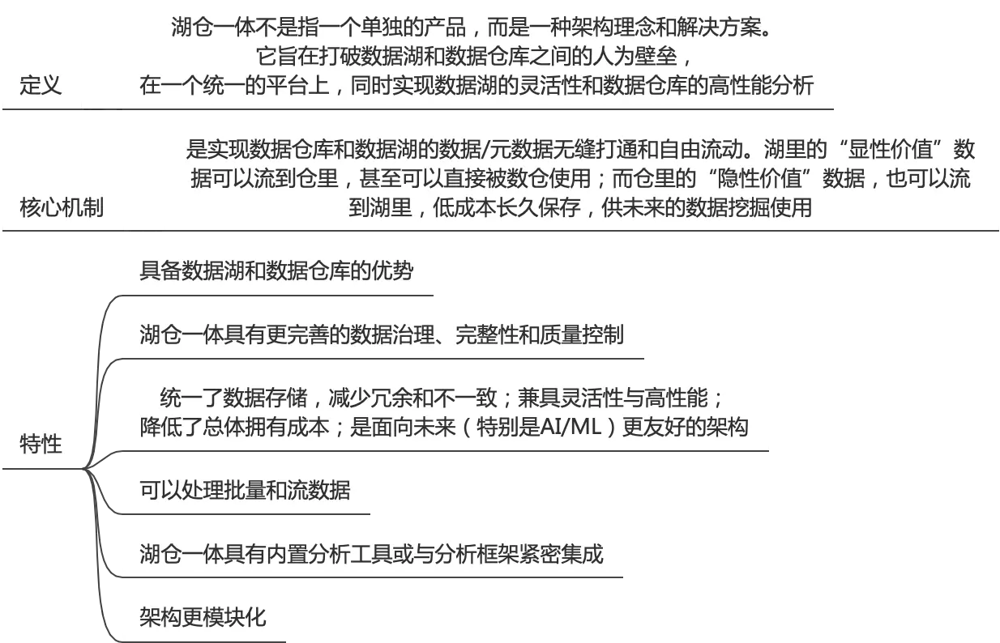
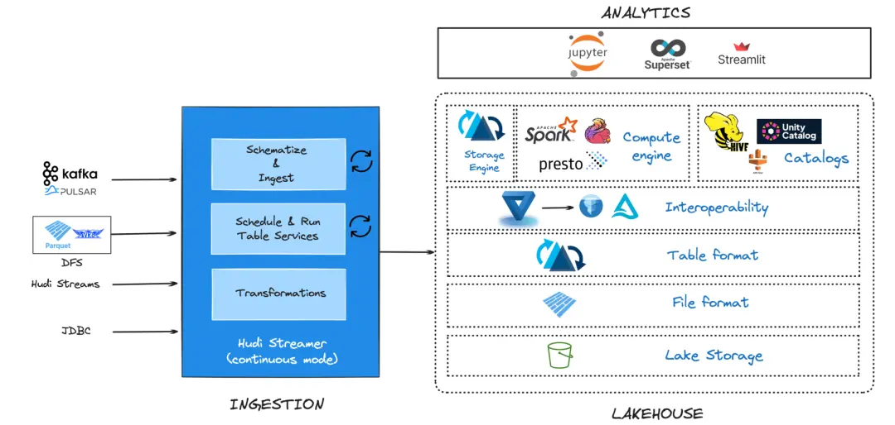
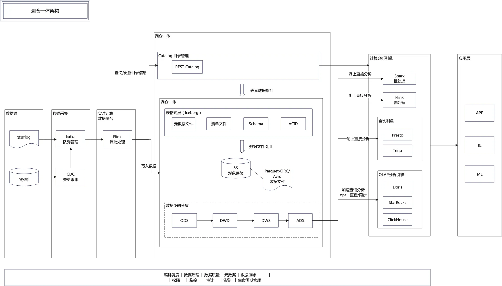
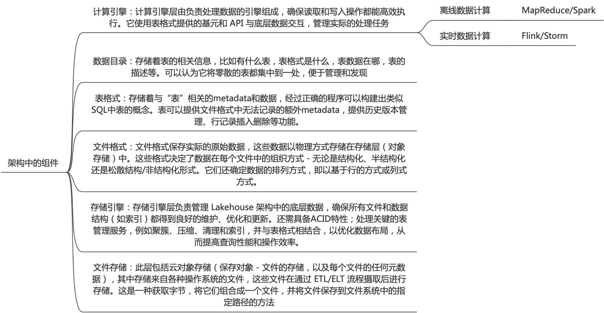

## 介绍
Lakehouse架构提供了一个参考蓝图或设计模式，该模式显示了系统的不同层和组件如何交互，以将数据仓库和数据湖的功能集成到一个统一的系统中。Lakehouse 架构由多个层组成，包括摄取、存储、元数据、事务数据库和消费服务，每个层在管理和处理数据方面都扮演着特定的角色。将其视为建筑物的蓝图，概述了不同的房间、公用设施和结构元素将如何布置和交互；如何建造建筑物的计划。

湖仓一体架构：在数据湖的开放存储架构之上，补齐数据仓库的 ACID 事务、高性能查询、Schema 管理和治理能力，让同一个平台既能存原始数据，又能做企业级分析。
>过去 Hadoop 体系下，数据湖（存原始数据）和数仓（存加工后数据）是分离的，数据要来回搬运。湖仓一体用 Iceberg、Hudi、Paimon 这类表格式，在对象存储上直接提供 ACID 事务、Schema 演化和快照查询，让“一份数据”既能被 Spark 批处理，也能被 Flink 流式读写。




注意：数据湖和湖仓一体不是两个并列的架构，而是同一个架构在不同成熟度阶段的叫法。当数据湖补上了表格式层和治理能力，它就成了湖仓一体。

## 架构&流程介绍
Lakehouse 架构将传统数据仓库的**紧密耦合组件解构为更加模块化的框架**。数据以开放文件和表格式存储在湖仓一体中，允许不同的计算引擎协同处理相同的数据，而事务数据库层提供传统 DBMS 的强大特性，确保不同工作负载的数据完整性和事务一致性。


*湖仓一体架构*



此架构：从数据源到->采集->流式聚合->入湖->计算引擎->应用，完整链路。可用于实时、离线场景；

### 架构组件
一般来说OLTP和OLAP系统在逻辑上可以划分为下面6个技术组件组成。湖仓一体架构中，也同样有这6个技术组件，差别是组件都是模块化的，可组装的；




## 湖仓一体数据流转处理过程
在湖仓一体架构总，数据从不同分层中如何流动，有什么方案；
比如ods->dwd-dws。针对增量和全量，实时和离线，具体的方案、工具、流程介绍

在湖仓一体架构中，基于数据时效性（实时 vs 离线）和数据更新范围（全量 vs 增量），主要分为以下四种流动方案：
### 方案 1：离线全量
- **数据流动与工具**：
  - **Source -> ODS**：通过 **DataX**、**SeaTunnel**、**Sqoop** 或 **Spark/Flink 批处理任务**，直接在夜间从业务 DB（如 MySQL/Oracle）抽取全量快照，写入 ODS 层（按日期分区格式，如 `dt=2026-09-21`）。
  - **ODS -> DWD**：使用 **Spark SQL**、**Trino** 或 **Hive on Iceberg/Delta** 运行 ETL 批处理逻辑，进行清洗和格式转换。
  - **DWD -> DWS**：通过 **Spark SQL / Trino** 调度任务，按天/按月进行重度汇总计算（全量覆盖或覆盖特定分区）。

### 方案 2：离线增量
- **应用场景**：海量数据同步（如每日产生的百亿级日志/订单）；节省计算与存储成本的 T+1 批处理。
- **数据流动与工具**：
    - **Source -> ODS**：按时间切片（如根据 `updated_at` 时间戳）提取前一天增量数据，或者解析前一天的 CDC 增量文件，写入 ODS 增量分区。
    - **ODS -> DWD**：
        - **Merge-on-Read (MoR) / Copy-on-Write (CoW)**：使用 **Spark/Flink** 批任务，通过湖仓一体格式提供的 `MERGE INTO` 语法，将 ODS 增量数据与 DWD 历史存量数据进行 Upsert（更新与插入）合并。
    - **DWD -> DWS**：使用 **Spark SQL** 提取 DWD 中昨天的增量/更新记录，使用**增量累加/滑动窗口计算**，更新 DWS 层对应的指标。

### 方案 3：实时增量
- **应用场景**：分钟级/秒级响应的数据分析（如实时大屏、实时风控、实时库存监控）。
- **数据流动与工具**：
    - **Source -> ODS**：利用 **Flink CDC**（或 Debezium + Kafka）捕获业务数据库（MySQL, PostgreSQL, MongoDB 等）的 Binlog 变更流，通过 **Flink Streaming** 直接实时写入 ODS 湖仓表（如 Iceberg/Delta/Hudi）。
    - **ODS -> DWD**：
        - 利用 Flink 实时读取 ODS 层的湖仓变更流（CDC/Changelog Stream），在内存中结合维度表（如通过 Redis 或 Hbase/Iceberg 维表Lookup）进行清洗与 Lookup Join，再实时写入 DWD 湖仓表。
    - **DWD -> DWS**：
        - 利用 **Flink** 滚动窗口（Tumbling Window）、滑动窗口（Sliding Window）或累加状态，将 DWD 变更流实时聚合，写入 DWS 汇总表。
- **湖仓特性支持**：
    - 湖仓表格式（如 Iceberg/Hudi）天然支持 Changelog（变动日志），Flink 可以将湖表同时作为 **Source**（流读）和 **Sink**（流写），实现纯流式的 **Lakehouse Streaming Pipeline**。

### 方案 4：流批一体 / 实时+全量初始化
Lambda & Kappa 融合架构
- **应用场景**：实时任务首次上线（需要用全量历史数据构建初始状态，后续接收实时增量）；实时指标补数据（Data backfill）。
- **流动方案与流程**：
    1. **全量初始化阶段**：利用 Spark / Flink 批处理抽取 MySQL 全量快照数据，批量写入 ODS / DWD 湖仓表，建立初始 Baseline。
    2. **增量无缝接轨**：记录全量抽取时的 Log/Binlog 位点（Offset），启动 Flink CDC 任务，从该 Offset 开始读取增量变更。
    3. **计算层融合**：使用 **Flink 混合数据源（Hybrid Source）** 或 Iceberg 的 `starting-strategy`，自动完成“先读全量快照，读完自动无缝切换到实时流”的过程，无需手动干预。

## demo示例

### 背景&技术
想要搭建湖仓一体架构，进行简单的操作CRUD操作；

需要服务
- Flink：jobmanager，taskmanager组件；计算引擎；
- 目录服务：Iceberg catalog rest服务；表元数据管理
- 存储S3：minio；

这就是一套简单的存算分离的湖仓一体架构；
>注意：此架构服务都是在单机上进行的，没有进行分布式相关配置；

### 服务安装

- Flink服务
需要先下载对应的jar包，然后挂载到flink容器中；
```
curl -fO https://repo.maven.apache.org/maven2/org/apache/iceberg/iceberg-flink-runtime-2.0/1.10.1/iceberg-flink-runtime-2.0-1.10.1.jar && \
curl -fO https://repo.maven.apache.org/maven2/org/apache/iceberg/iceberg-aws-bundle/1.10.1/iceberg-aws-bundle-1.10.1.jar && \
curl -fO https://repo.maven.apache.org/maven2/org/apache/hadoop/hadoop-client-api/3.4.2/hadoop-client-api-3.4.2.jar && \
curl -fO https://repo.maven.apache.org/maven2/org/apache/hadoop/hadoop-client-runtime/3.4.2/hadoop-client-runtime-3.4.2.jar
```

flink-docker-compose.yml配置
```
services:
  # Flink JobManager
  jobmanager:
    image: flink:latest
    hostname: jobmanager
    container_name: jobmanager
#    depends_on:
#      iceberg-rest:
#        condition: service_healthy
#    networks:
#      iceberg_net:
    command: jobmanager
    ports:
      - "8081:8081"
    volumes:
      - /usr/local/docker-data/flink/resource/iceberg-flink-runtime-2.0-1.10.1.jar:/opt/flink/lib/iceberg-flink-runtime-2.0-1.10.1.jar
      - /usr/local/docker-data/flink/resource/iceberg-aws-bundle-1.10.1.jar:/opt/flink/lib/iceberg-aws-bundle-1.10.1.jar
      - /usr/local/docker-data/flink/resource/hadoop-client-runtime-3.4.2.jar:/opt/flink/lib/hadoop-client-runtime-3.4.2.jar
      - /usr/local/docker-data/flink/resource/hadoop-client-api-3.4.2.jar:/opt/flink/lib/hadoop-client-api-3.4.2.jar
    healthcheck:
      test: ["CMD", "curl", "-f", "http://localhost:8081/overview"]
      start_period: 30s
      interval: 5s
      timeout: 3s
      retries: 5
    environment:
      FLINK_PROPERTIES: |
        jobmanager.rpc.address: jobmanager
        taskmanager.numberOfTaskSlots: 2
        parallelism.default: 2
        jobmanager.memory.process.size: 800m
      AWS_REGION: us-east-1
      AWS_ACCESS_KEY_ID: iceberg
      AWS_SECRET_ACCESS_KEY: icebergiceberg
      S3_ENDPOINT: http://minio:9000
      s3.path-style-access: 'true'

  # Flink TaskManager
  taskmanager:
    image: flink:latest
    hostname: taskmanager
    container_name: taskmanager
    depends_on:
      jobmanager:
        condition: service_healthy
#    networks:
#      iceberg_net:
    command: taskmanager
    volumes:
      - /usr/local/docker-data/flink/resource/iceberg-flink-runtime-2.0-1.10.1.jar:/opt/flink/lib/iceberg-flink-runtime-2.0-1.10.1.jar
      - /usr/local/docker-data/flink/resource/iceberg-aws-bundle-1.10.1.jar:/opt/flink/lib/iceberg-aws-bundle-1.10.1.jar
      - /usr/local/docker-data/flink/resource/hadoop-client-runtime-3.4.2.jar:/opt/flink/lib/hadoop-client-runtime-3.4.2.jar
      - /usr/local/docker-data/flink/resource/hadoop-client-api-3.4.2.jar:/opt/flink/lib/hadoop-client-api-3.4.2.jar
    deploy:
      replicas: 1
    environment:
      FLINK_PROPERTIES: |
        jobmanager.rpc.address: jobmanager
        taskmanager.numberOfTaskSlots: 1
        parallelism.default: 1
        taskmanager.memory.process.size: 1000m
      AWS_REGION: us-east-1
      AWS_ACCESS_KEY_ID: iceberg
      AWS_SECRET_ACCESS_KEY: icebergiceberg
      S3_ENDPOINT: http://minio:9000
      s3.path-style-access: 'true'    
```

- iceberg catalog rest服务配置
iceberg-docker-compose.yml：
```
# Iceberg REST Catalog
services:
  iceberg-rest:
    image: apache/iceberg-rest-fixture
    hostname: iceberg-rest
    container_name: iceberg-rest
#    depends_on:
#      - minio
    healthcheck:
      test: ["CMD", "curl", "-f", "http://localhost:8181/v1/config"]
      interval: 5s
      timeout: 3s
      retries: 5
    ports:
      - 8181:8181
    environment:
      AWS_REGION: us-east-1
      CATALOG_WAREHOUSE: s3://warehouse/
      CATALOG_IO__IMPL: org.apache.iceberg.aws.s3.S3FileIO
      CATALOG_S3_ENDPOINT: http://172.28.16.51:9000
      CATALOG_S3_PATH__STYLE__ACCESS: "true"
      CATALOG_S3_ACCESS__KEY__ID: iceberg
      CATALOG_S3_SECRET__ACCESS__KEY: icebergiceberg
```

- minio服务
minio-docker-compose.yml：
```
services:
  minio:
    container_name: minio
    image: minio/minio:RELEASE.2024-12-18T13-15-44Z
    environment:
      MINIO_ACCESS_KEY: minioadmin
      MINIO_SECRET_KEY: minioadmin
    ports:
      - "9001:9001"
      - "9000:9000"
    volumes:
      - /usr/local/docker-data/minio/store:/minio_data
    command: minio server /minio_data --console-address ":9001"
    healthcheck:
      test: ["CMD", "curl", "-f", "http://localhost:9000/minio/health/live"]
      interval: 30s
      timeout: 20s
      retries: 3
```


按照minio，iceberg catalog rest，flink顺序启动上述3个docker服务；
### 操作

进行Flink client：
```
docker compose -f flink-docker-compose.yml exec -it jobmanager ./bin/sql-client.sh
```

在Flink client进行crud操作：
```
-- 注册一个叫iceberg_catalog的连接，它指向某个 Iceberg 仓库，以后我用这个 Catalog 下的表，你就去那个仓库里读写
CREATE CATALOG iceberg_catalog WITH (
  'type'                 = 'iceberg',
  'catalog-impl'         = 'org.apache.iceberg.rest.RESTCatalog',
  'uri'                  = 'http://172.28.16.51:8181',
  'warehouse'            = 's3://warehouse/',
  'io-impl'              = 'org.apache.iceberg.aws.s3.S3FileIO',
  's3.endpoint'          = 'http://172.28.16.51:9000',
  's3.access-key-id'     = 'iceberg',
  's3.secret-access-key' = 'icebergiceberg',
  's3.path-style-access' = 'true'
);

USE CATALOG iceberg_catalog;

-- 创建数据库
CREATE DATABASE nyc;

use nyc;

-- 创建taxis表
CREATE TABLE iceberg_catalog.nyc.taxis (
    vendor_id BIGINT,
    trip_id BIGINT,
    trip_distance FLOAT,
    fare_amount DOUBLE,
    store_and_fwd_flag STRING
);


SET 'execution.checkpointing.interval' = '60s';


-- 插入输入
INSERT INTO iceberg_catalog.nyc.taxis
VALUES
    (1, 1000371, 1.8, 15.32, 'N'),
    (2, 1000372, 2.5, 22.15, 'N'),
    (2, 1000373, 0.9, 9.01, 'N'),
    (1, 1000374, 8.4, 42.13, 'Y');

-- 批读取（查询完就返回）
SET 'execution.runtime-mode' = 'batch';
SELECT * FROM iceberg_catalog.nyc.taxis;

-- 流读取（持续监控新快照）
SET 'execution.runtime-mode' = 'streaming';
SELECT * FROM iceberg_catalog.nyc.taxis /*+ OPTIONS('streaming'='true', 'monitor-interval'='10s') */;


SHOW CREATE CATALOG iceberg_catalog;
SHOW DATABASES;
SHOW TABLES;
```

## QA

### Q：湖仓一体化后，指标是不是不需要再用专门的数据仓库来存储了
在湖仓一体架构下，业务指标可以直接存储在基于数据湖（如 Iceberg、Delta Lake、Hudi）建好的应用层（ADS / DWS）表中，而不再强制要求将指标同步（Export）到独立的传统 MPP 数据仓库（如 Greenplum、Teradata）或传统 Hive 数仓中。

### Q：全量同步时有增量数据修改，如何保障数据一致性
比如Flink CDC工具：
1在全量同步读取数据开始前，会把大表切分多个chunk来同步
2读取每个chunk全量快照前，记录对应Binlog的当前position low；
3每个chunk全量Select 查完后，立刻记录当前的Binlog位点为new position high；
4修正全量同步期间的数据更改，这些变更落在\[low,high]之间，利用修改的binlog进行数据修正；
5当所有 Chunk 的全量数据都读取并修正完毕后，任务会计算出所有 Chunk 中最大的 $L_{high}$ 位点。
6后续正常进行cdc捕获即可；

注意：记录位置low->select chunk；这2步操作不是原子的，可能已经有binlog 位点对应的记录，已经在select chunk结果中了。flink cdc之类工具，还是可以\[low,high]重放所有变更来消除问题，基于**主键过滤与覆盖（Upsert/Delete）**，比如遇到insert、update的，直接覆盖，delete直接删除；

### Q：日志数据如何存储在湖仓架构中
湖仓一体化：日志文件和数据，一般如何存储；以源文件存储，后续解析使用；还是创建表结构，按字段拆分，入库；湖仓中需要存储业务日志数据吗
A：如果日志是文件形式，比较大的话，在使用湖仓统一管理企业数据时，还是通过表结构格式，通过建立基础表(即元数据)来管理日志文件。
比如：原始日志存入湖仓中；
```
-- 方法1：管理日志数据元数据
CREATE TABLE bronze.raw_logs (
    raw_data STRING,                -- 原始日志内容，完整保留，不解析
    source_system STRING,           -- 来源标识，如 "nginx-prod"、"app-backend"
    ingestion_timestamp TIMESTAMP,  -- 入库时间（处理时间），非业务时间
    date_partition DATE             -- 分区字段，通常取 ingestion_timestamp 的日期
)
USING DELTA
PARTITIONED BY (date_partition)
TBLPROPERTIES (
    'delta.autoOptimize.optimizeWrite' = 'true',   -- 自动优化文件大小，避免小文件
    'delta.autoOptimize.autoCompact' = 'true'       -- 自动合并小文件
);

-- 方法2：管理日志文件元数据
CREATE TABLE bronze.log_file_manifest (
    file_path STRING,           -- 如 s3://logs/nginx/2026-10-11/hour=10/xxx.log
    file_size BIGINT,           -- 文件字节数
    source_system STRING,       -- 来源，如 "nginx-prod"
    log_date DATE,              -- 从路径解析出的日期分区
    log_hour INT,               -- 从路径解析出的小时
    ingestion_timestamp TIMESTAMP,  -- 登记时间
    processed BOOLEAN           -- 是否已被下游解析，避免重复处理
)
USING DELTA
PARTITIONED BY (log_date);
```

## 参考
https://cloud.tencent.com/developer/article/2469957 一文聊透开放表格式和开放数据Lakehouse

