## 介绍
Apache Iceberg 是一种面向数据湖的表格式(规范)，同时提供了与之配套的 Catalog接口(也是一个规范)。Iceberg 定义了数据湖表的存储结构和管理机制，用于支持大规模、复杂数据操作。它为分区、数据更新、时间旅行、快照等提供了优化方案。Iceberg 的 Catalog 负责管理多个表的元数据，提供表发现和管理操作的入口。不同的 Catalog 实现（如 Hive Metastore、REST、Glue 等）可以用来存储和检索表的元数据，支持跨环境及引擎一致管理。
>iceberg并非【数据库】、【查询引擎】或【存储系统】
>它在【对象存储】（S3 / GCS / ADLS / HDFS）上的 Parquet/ORC/Avro 数据文件之上，叠加一层元数据与事务抽象，让原始文件拥有接近 SQL 表的语义（ACID、Schema 演化、隐藏分区、时间旅行）。

### Time Travel
在数据湖表格式的上下文中，时间旅行是指查询特定时间点存在的数据的能力。此功能对于回顾性分析、审计和合规性具有变革性的影响。想象一下，能够查看几周、几个月甚至几年前出现的数据湖，使您能够发现可能被忽视的趋势、异常和见解。

数据版本控制通过提供一种机制来捕获和保留数据随时间变化的不同快照或迭代，从而补充了时间旅行

## 表格式
它定义了数据湖中数据的组织、存储和访问方式。将其视为在庞大的数据湖中创建逻辑分区的一种方法，使管理、查询和分析数据变得更加容易。

**表格式介绍**
表格式是数据湖屋这种OLAP系统的一个组件，用于将数据文件组织起来，对上层提供“表”这一抽象。或者说得更通俗一点，就是让我们能在OLAP系统里用SQL执行数据定义和数据计算，类似功能的产品还有Hive, Hudi, Delta Lake等。

**表格式的实现和使用**
Apache Iceberg社区制定规范，iceberg-core等库实现规范，Spark/Flink/Trino等计算引擎集成库来提供用户接口。 表格式规范的逻辑主要在计算引擎侧执行，但“提交”这个关键动作需要 Catalog 服务端配合完成。

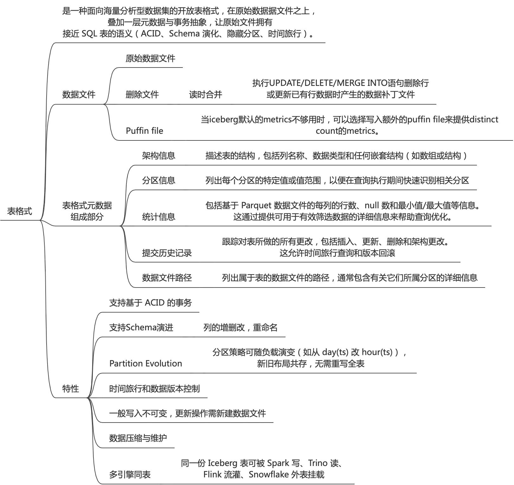

## iceberg rest catalog
Catalog的规范用于数据目录管理；

Catalog规范是由Iceberg社区推动定义的，规范以OpenAPI格式定义。社区创建这套REST 协议，是为了解决早期 Iceberg需要为每种Catalog单独实现客户端的问题。通过定义一套标准的REST API，任何语言或引擎（如Flink、Spark）只需要实现一个统一的REST客户端，就能连接所有兼容此规范的Catalog 服务（如Apache Polaris、Lakekeeper等）
>Catalog规范是iceberg社区定义的，但是此规范是开放的；
>Iceberg社区还实现了catalog规范，提供一个对外rest服务，即Iceberg-rest服务；

**核心概念与优势**
- 解耦计算与存储：通过统一的 HTTP 接口管理元数据，使多计算引擎（如 Spark、Flink、Trino、Dremio）能够轻松共享和发现表。 
- 多引擎与跨平台兼容：任何兼容 Iceberg REST 规范的客户端都可以直接接入，例如 Apache Polaris、阿里云 MaxCompute、AWS S3 Tables等。 
- 简化架构：避免了传统 Hive Metastore等组件对特定数据库或复杂客户端配置的依赖，提升了云原生环境下的可扩展性。

**主要功能端点 (API)**
- /v1/config：获取服务端指定的默认配置、重写规则和支持的操作端点。
- 命名空间 (Namespace)：提供类似数据库 Schema 的管理与查询能力（如 ListNamespaces、GetNamespace）。
- 表管理 (Table)：支持对托管 Iceberg 表的加载、创建、更新与删除（如 LoadTable、ListTables），并分发安全的存储访问凭证。

### catalog api
通过catalog rest api可以看出来提供了namespace、table、原子commit的管理；还有其他oauth、config等管理；

https://github.com/apache/iceberg/blob/main/open-api/rest-catalog-open-api.yaml
```
          - GET /v1/{prefix}/namespaces

          - POST /v1/{prefix}/namespaces

          - GET /v1/{prefix}/namespaces/{namespace}

          - DELETE /v1/{prefix}/namespaces/{namespace}

          - POST /v1/{prefix}/namespaces/{namespace}/properties

          - GET /v1/{prefix}/namespaces/{namespace}/tables

          - POST /v1/{prefix}/namespaces/{namespace}/tables

          - GET /v1/{prefix}/namespaces/{namespace}/tables/{table}

          - POST /v1/{prefix}/namespaces/{namespace}/tables/{table}

          - DELETE /v1/{prefix}/namespaces/{namespace}/tables/{table}

          - POST /v1/{prefix}/namespaces/{namespace}/register

          - POST /v1/{prefix}/namespaces/{namespace}/tables/{table}/metrics

          - POST /v1/{prefix}/tables/rename

          - POST /v1/{prefix}/transactions/commit
```

## 交互流程和时序
下面的交互是以Flink+Iceberg Catelog Rest+Minio架构进行的，其实就是湖仓一体化架构；
- Flink 负责计算
- REST Catalog 负责协调“表当前指向哪里”
- Iceberg Metadata 负责描述“这个表由哪些 Snapshot/File 构成”
- MinIO 负责保存这些实际文件。

### 总体流程

### 创建Catalog
获取基础信息
- Catalog endpoint
- Warehouse
- 认证配置
- Catalog capabilities
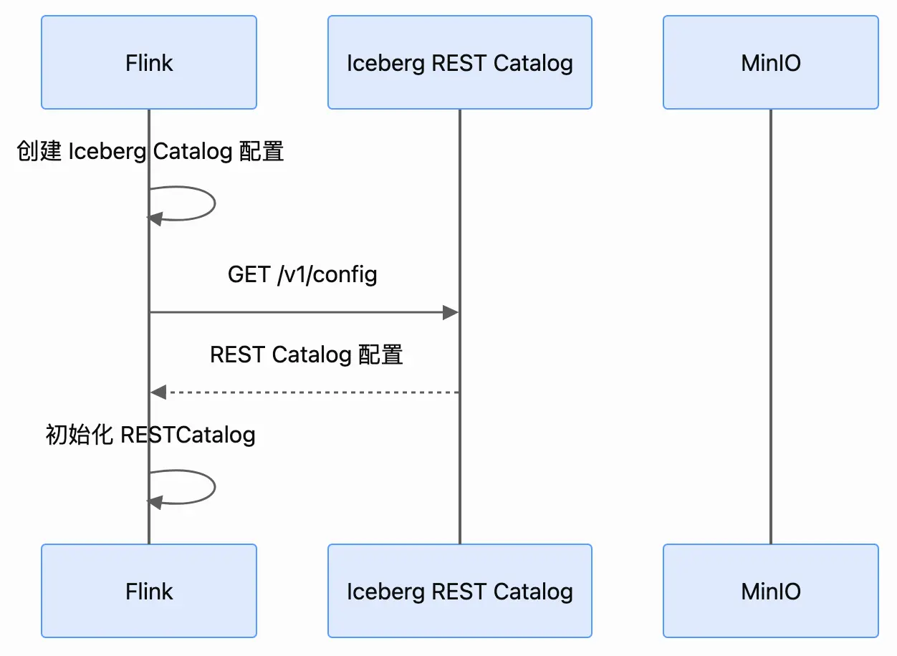
```
CREATE CATALOG iceberg_catalog WITH (
    'type' = 'iceberg',
    'catalog-type' = 'rest',
    'uri' = 'http://iceberg-rest:8181'
);

CREATE CATALOG iceberg_catalog WITH (
  'type'                 = 'iceberg',
  'catalog-impl'         = 'org.apache.iceberg.rest.RESTCatalog',
  'uri'                  = 'http://172.28.16.51:8181',
  'warehouse'            = 's3://warehouse/',
  'io-impl'              = 'org.apache.iceberg.aws.s3.S3FileIO',
  's3.endpoint'          = 'http://172.28.16.51:9000',
  's3.access-key-id'     = 'iceberg',
  's3.secret-access-key' = 'icebergiceberg',
  's3.path-style-access' = 'true'
);
```

### CREATE DATABASE / Namespace

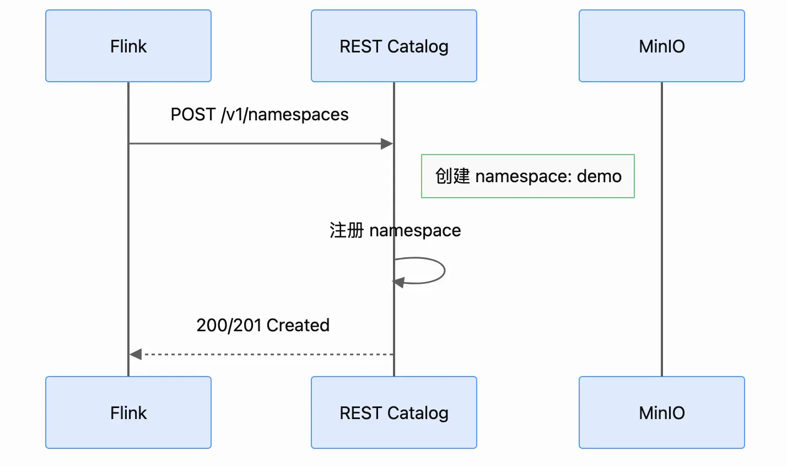
```
CREATE DATABASE demo;
```
在S3中会创建对应的bucket；

### CREATE TABLE
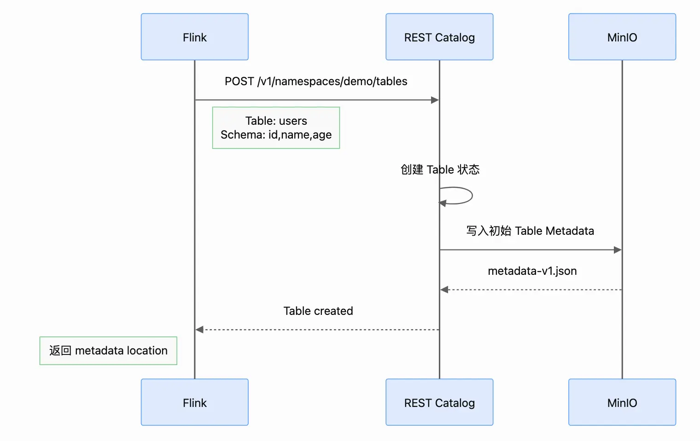

```
CREATE TABLE demo.users (
    id BIGINT,
    name STRING,
    age INT
);


#S3中生成文件
warehouse/
└── demo/
    └── users/
        └── metadata/
            └── v1.metadata.json
```

### INSERT 写入流程
流程如下：
① 获取当前 Table
② 获取当前 Snapshot
③ 生成/写 Data File
④ 生成 Manifest
⑤ 生成 Manifest List
⑥ 生成新的 Table Metadata
⑦ Commit
⑧ REST Catalog 更新当前 metadata

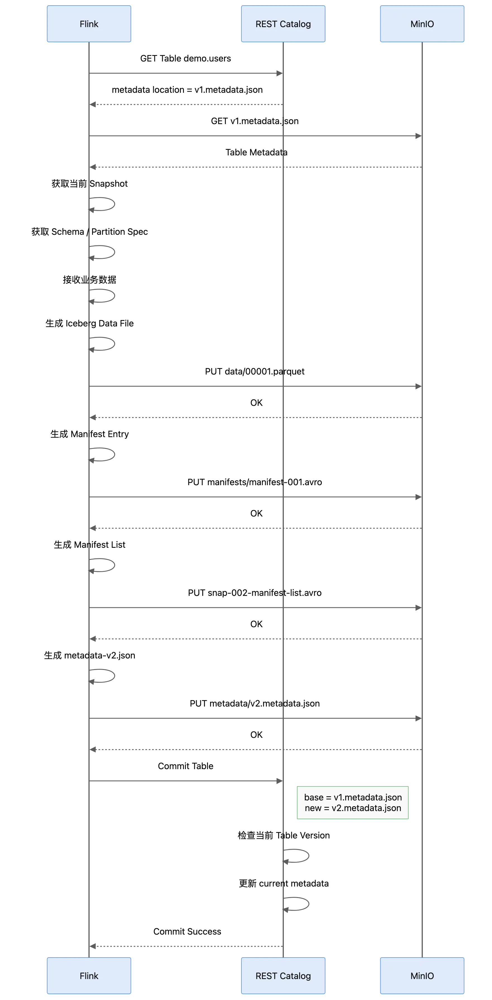

```
INSERT INTO demo.users VALUES (1, 'Alice', 20), (2, 'Bob', 30);

#生成文件和结构：
Data File
Manifest
Manifest List
Metadata

warehouse/
└── demo/
    └── users/
        ├── data/
        │   └── 00001.parquet
        │
        └── metadata/
            ├── v1.metadata.json
            ├── v2.metadata.json
            ├── manifest-list-xxx.avro
            └── manifest-xxx.avro
```

### SELECT 读取流程

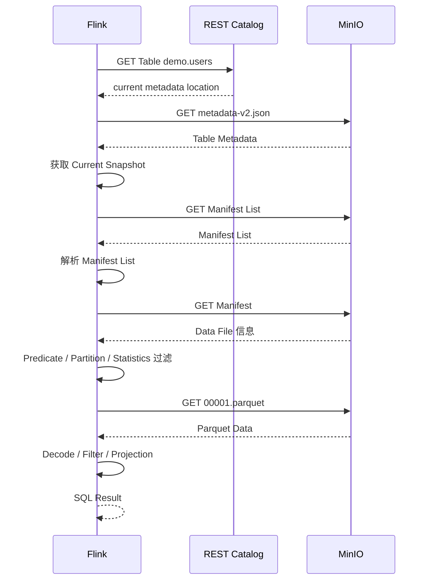
高效查询关键：Flink 并不会把所有 Parquet 都读出来再过滤，而是剪枝技术，根据元数据先过滤筛选，缩小查找文件范围；

partition 是否可能存在？
       ↓
Manifest 是否可能存在？
       ↓
Data File 是否可能存在？
       ↓
Parquet Row Group 是否可能存在？

### UPDATE
跟传统关系数据库在某行上进行更新不同，Iceberg Data File通常是不可变的，而是生成新的文件，后续通过一些合并手段，使更新数据的数据展示出来是一行效果。

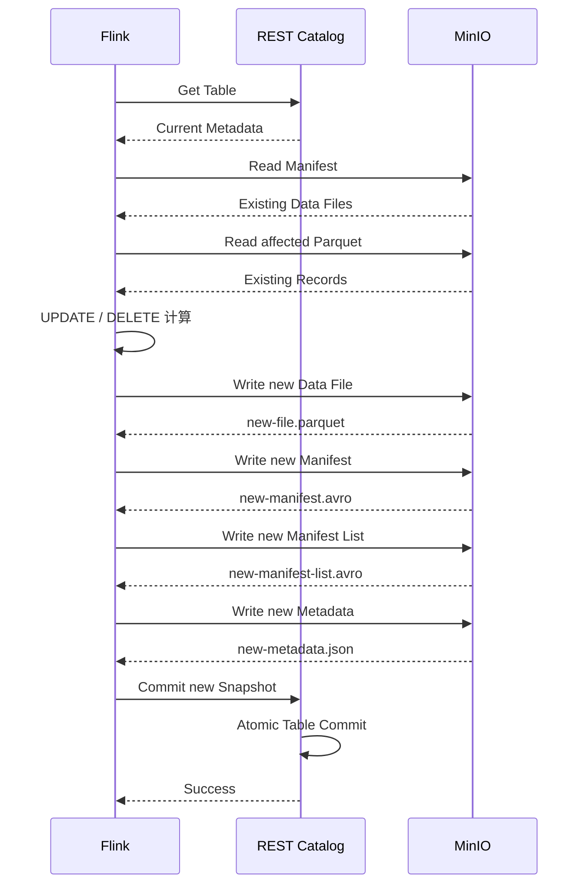

### DELETE
DELETE 也有两种非常重要的思路。
Copy-on-Write：也就是重新生成数据文件。
Merge-on-Read：读取的时候，通过Delete Files表示哪些数据需要删除

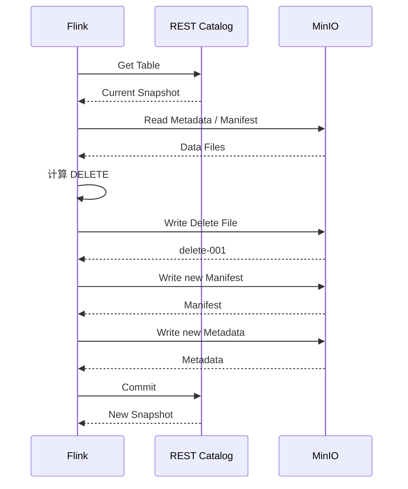

### Commit冲突处理

2个Flink Job同时写入时snapshot为10，rest catalog处理提交冲突，最终生成Snapshot 11，Snapshot 12；

Rest Catalog不是负责传输大量数据，而是负责协调Table状态。

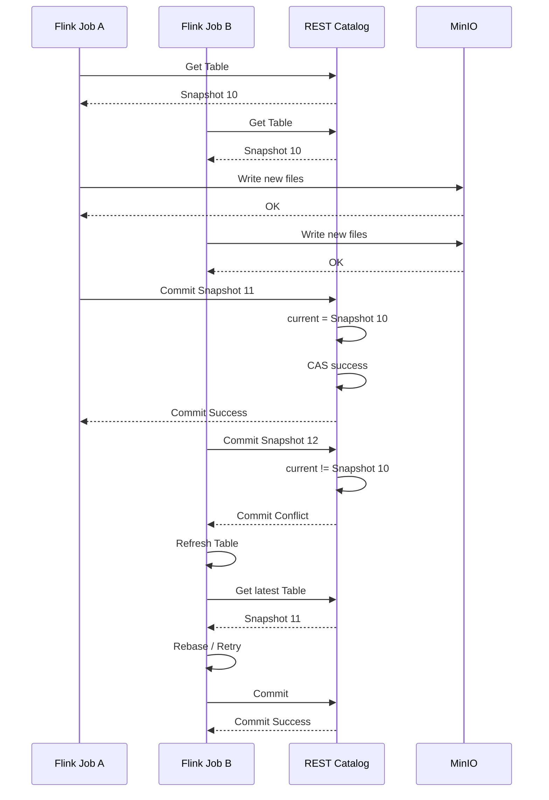

### Time Travel
在数据湖表格式的上下文中，时间旅行是指查询特定时间点存在的数据的能力。此功能对于回顾性分析、审计和合规性具有变革性的影响。想象一下，能够查看几周、几个月甚至几年前出现的数据湖，使您能够发现可能被忽视的趋势、异常和见解。

Iceberg 最大的特点之一就是Snapshot。可以有多个snapshot，可以读取历史snapshot。
每一个Snapshot都对应一个完整的表状态。
```
                Table
                  │
       ┌──────────┼───────────┐
       ▼          ▼           ▼
 Snapshot100  Snapshot101  Snapshot102
       │          │           │
       ▼          ▼           ▼
   Manifest     Manifest    Manifest
       │          │           │
       ▼          ▼           ▼
    Files        Files        Files
```


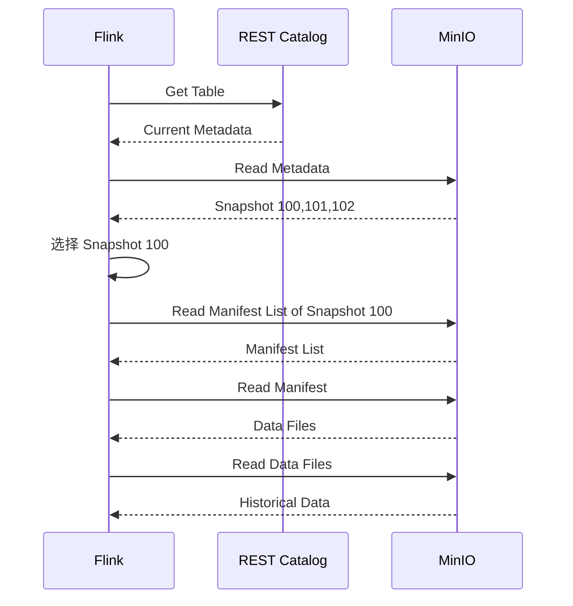

```
-- 当前数据
SELECT * FROM demo.users;

-- 按 Snapshot ID 查询
SELECT *
FROM demo.users /*+ OPTIONS('snapshot-id'='123456789') */;

-- 按时间查询
SELECT *
FROM demo.users /*+ OPTIONS('as-of-timestamp'='1758000000000') */;
```

### Schema变更

比如新增字段：age INT;
Iceberg 不需要重写所有Parquet。
Schema 变化->Metadata 变化->不一定需要重写历史数据
>Partition也类似

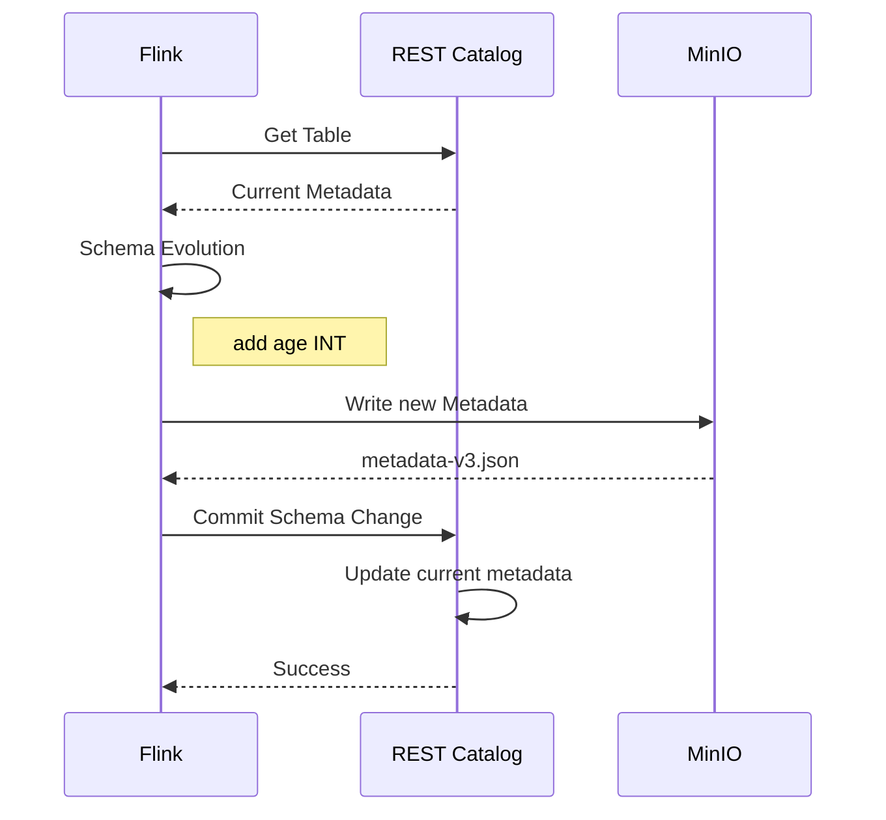

### 其他交互

还有小文件合并(本质是读取待合并文件到新的文件，待合并文件不删除，靠后续策略删除)&snapshot过期处理&回滚操作；


## 存储
Iceberg 表“存在哪”
- 【数据文件】在对象存储（S3/OSS/COS）或 HDFS；
- 【元数据】 JSON/manifest 在同表目录下metadata/；
- 表名→metadata的路径映射在 Catalog（HMS/Glue/REST）里。
三者分离，迁移数据时只要Catalog指针可换即可。

### 文件结构

```
/warehouse/db_name/table_name/
├── metadata/                             # 元数据层目录
│   ├── v1.metadata.json                  # 表级别的元数据文件（版本1）
│   ├── v2.metadata.json                  # 表级别的元数据文件（当前最新版本）
│   ├── snap-123456789-1-abc.avro         # Manifest List（快照/Manifest列表文件）
│   ├── 00000-1-xyz-manifest.avro         # Manifest File（清单文件）
│   └── 00001-1-xyz-manifest.avro         # Manifest File（清单文件）
└── data/                                 # 数据层目录
    ├── partition_col=A/
    │   ├── 00000-0-data-file1.parquet     # Data File（数据文件）
    │   └── 00000-0-delete-file1.parquet   # Delete File（位置/等值删除文件，仅v2格式支持）
    └── partition_col=B/
        └── 00001-0-data-file2.parquet
            

```

#### 表元数据文件 Table Metadata File
如：metadata/v1.metadata.json
- 入口与全局配置： 保存表结构的定义（Schema）、分区规格（Partition Spec）、排序规则（Sort Order）以及表的所有历史快照（Snapshots）列表。
- 原子更新标记： 每次对表进行 Commit（追加、修改表结构、清理文件等）都会产生一个新的 .json 文件。Catalog 内部保存的指针就是指向最新的这个 .json 文件。

```fold
{
  "format-version": 2,
  "table-uuid": "...",
  "location": "s3://warehouse/demo/users",
  "last-sequence-number": 5,

  "current-schema-id": 0,

  "schemas": [
    {
      "type": "struct",
      "schema-id": 0,
      "fields": [
        {
          "id": 1,
          "name": "id",
          "required": false,
          "type": "long"
        },
        {
          "id": 2,
          "name": "name",
          "required": false,
          "type": "string"
        },
        {
          "id": 3,
          "name": "age",
          "required": false,
          "type": "int"
        }
      ]
    }
  ],

  "current-snapshot-id": 103,

  "snapshots": [
    {
      "snapshot-id": 101,
      "sequence-number": 3,
      "manifest-list": "s3://warehouse/demo/users/metadata/snap-101.avro"
    },
    {
      "snapshot-id": 102,
      "sequence-number": 4,
      "manifest-list": "s3://warehouse/demo/users/metadata/snap-102.avro"
    },
    {
      "snapshot-id": 103,
      "sequence-number": 5,
      "manifest-list": "s3://warehouse/demo/users/metadata/snap-103.avro"
    }
  ]
}
```

#### 清单列表文件 Manifest List
路径与名称： metadata/snap-\<snapshot_id>-\<attempt_id>-\<uuid>.avro。
- 快照（Snapshot）的实体文件： 一次 Commit 就代表产生了一个新的 Snapshot，而 Manifest List 就是该 Snapshot 的元数据载体。
- 包含 Manifest 集合： 里面记录了当前 Snapshot 所包含的所有 Manifest File 的路径及其对应的统计元数据（如该 Manifest 中数据文件所在的分区范围、添加/删除状态等）。
- 加速剪枝（Pruning）： 查询引擎可以在读取 Manifest List 时，根据分区范围过滤掉不需要读取的 Manifest File。

#### 清单文件 Manifest File
如：metadata/\<uuid>-manifest.avro
- 数据文件的索引： 记录了具体数据文件（Data File）或删除文件（Delete File）的物理路径、文件格式、属于哪个分区等信息。
- 列级别统计（Column Metrics）： 存储了对应数据文件中每一列的 Min/Max 值、Null 值数量、NaN 数量、文件大小、记录数等详细统计信息。
- 谓词下推与精准裁剪： 查询引擎（如 Spark/Flink/Trino）在不需要扫描真实 Parquet/ORC 数据文件的情况下，可以直接解析 Manifest File 内的 Min/Max 值过滤掉大部分不满足条件的数据文件（Data Skip）。

#### 数据文件 Data Files & Delete Files
数据文件格式：.parquet / .orc / .avro，存放在 data/ 目录（或按分区划分的子目录）下
- Data File（数据文件）： 真正存放业务数据的列式存储文件（如 Parquet/ORC）。
- Delete File（删除文件，v2 规范特有）：
  - Position Delete File（位置删除文件）： 记录了被删除或更新的数据具体在哪个 Data File 的第几行（file_path + pos）。
  - Equality Delete File（等值删除文件）： 记录了被删除行匹配的具体列值（如 id=100）。

## 选型
在 Iceberg + Flink + 对象存储（S3/OSS/MinIO 等）​ 的生产架构里，Catalog 的选型原则：
- 新项目默认走 Iceberg REST Catalog（Polaris / 云厂商托管 REST / Nessie），Flink 侧统一用 RESTCatalog client；
- 只在"纯 AWS 且不想自运维"时考虑 Glue
- "已有 HMS 且不出 Hadoop 生态"才留 Hive
- JDBC Catalog 仅限中小规模或过渡。

## docker

iceberg rest catalog dock服务；仅仅有目录服务还是不行的，真正想要使用，还需要计算引擎和存储；具体参考[demo](Lakehouse湖仓一体.md#demo示例)

**docker配置**
iceberg catalog rest服务；使用minio s3作为存储层；

配置文件iceberg-docker-compose.yml：
```
# Iceberg REST Catalog
services:
  iceberg-rest:
    image: apache/iceberg-rest-fixture
    hostname: iceberg-rest
    container_name: iceberg-rest
#    depends_on:
#      - minio
    healthcheck:
      test: ["CMD", "curl", "-f", "http://localhost:8181/v1/config"]
      interval: 5s
      timeout: 3s
      retries: 5
    ports:
      - 8181:8181
    environment:
      AWS_REGION: us-east-1
      CATALOG_WAREHOUSE: s3://warehouse/
      CATALOG_IO__IMPL: org.apache.iceberg.aws.s3.S3FileIO
      CATALOG_S3_ENDPOINT: http://172.28.16.51:9000
      CATALOG_S3_PATH__STYLE__ACCESS: "true"
      CATALOG_S3_ACCESS__KEY__ID: iceberg
      CATALOG_S3_SECRET__ACCESS__KEY: icebergiceberg
#    networks:
#      - existing_minio_net

#networks:
#  existing_minio_net:
#    external: true
#    name: milvus

```

## QA

### **Q：iceberg行级更新和删除，**
iceberg 在规范层面明确支持行级更新和删除，这是它作为现代数据湖表格式的核心能力之一：
v1 格式：主要支持 Copy-on-Write。执行更新时，计算引擎会重写受影响的数据文件，生成新文件来替换旧文件，以保证原子性。
v2 格式：引入了行级更新和删除，支持 Merge-on-Read。它通过新增的“删除文件”来记录被删除的行，查询时再将数据文件与删除文件合并，从而避免全量重写数据文件。
所以，Iceberg 官方提供的是能力定义和底层 API，而不是一个可以直接运行 UPDATE 语句的客户端。

### **Q：表格式产品对比**
Apache Hudi、Apache Paimon，这些产品，也都是基于表格式规范，实现类似数据库功能的产品吗，产品是一体化的吗。还是像iceberg一样需要不同组件搭配使用。
A：
它们和 Iceberg 一样，本质上都是表格式规范，都需要搭配计算引擎使用。但它们的设计哲学和“一体化”程度有所不同。
可以这样理解：Iceberg 追求的是“开放与解耦”，Hudi 和 Paimon 则在不同程度上追求“与特定引擎的深度集成”，以此换取更简单的使用体验。
如果你的核心场景是 Spark 上的高频 Upsert 或 CDC 同步，Hudi 在该领域非常成熟。
如果你整个数据链路都围绕 Flink 流式处理构建，Paimon 提供了最顺滑的“流式湖仓”体验，它和 Flink 的“一体化”程度最高。

### **Q：iceberg，在改shcema的时候，历史数据如何处理。**
Iceberg 修改 Schema 时，历史数据文件本身不会被重写或修改，所有变更都只发生在元数据层。它通过一套基于“列 ID”的机制，让新旧数据在读取时能正确对齐。
Iceberg 在写入每个数据文件时，都会记录文件中每一列的唯一 ID，而不是列名或位置
int → string 是非法操作。变通方法可新增列来存储string，旧数据不用管；
int->bigint，float->double，删除列，添加列，重命名支持，只改元数据内容，不改旧数据文件内容；

### **Q:分区变更**
A：查询时，引擎会为不同分区版本的旧文件和新文件分别做规划（Split Planning）。需要计算引擎支持；
如月->天：
对旧的“按月”文件，用月级别的统计信息来过滤。
对新的“按天”文件，用天级别的统计信息来过滤。
最终结果正确，但需要引擎能正确处理这种混合布局。一些早期引擎可能对此支持不完善，需要确认你用的查询引擎版本是否兼容

### **Q：频繁写入（高频/小批次写入）如何解决**
如果写入粒度过细、频率过高，频繁的 Commit 会导致乐观锁（CAS）冲突激增，进而引发大量重试甚至失败，同时也会产生大量的微小文件（Small Files）和 Snapshot。优化方案：
1. Flink 侧：调整 Checkpoint 间隔（拉长批次，减少 Commit 频率）
2. 配置并发重试参数（避免直接失败）
3. 架构解耦：引入 Kafka/Pulsar 缓冲 + 批量写入
4. 定期合并小文件与清理 Snapshot（维护元数据健康度）

### **Q：从iceberg commit交互看出来是非常重的操作**
Iceberg 的这种“重型 Commit”设计，完全是为了牺牲写入的轻量性，来换取海量数据下的分析性能与可靠性：
- 解耦存储引擎，实现无锁高并发读
- 极速的数据裁剪（Data Skipping）
- 适配云原生/分布式存储

### **Q：多表关联支持吗**
Iceberg 作为一个数据湖表格式（Table Format），只负责在底层管理存储、元数据和 ACID 事务。而关联查询（JOIN）是上层计算引擎（如 Spark, Trino, Presto, Flink, StarRocks 等）的功能。

### **Q：查询的时候，是不是默认选定一个 Snapshot ID 来查询的**
- 自动锁定最新快照： 当你执行常规查询（如 SELECT * FROM table）且不显式指定 Snapshot 时，计算引擎会先去请求 Catalog，Catalog 会返回该表当前最新的一个 Snapshot ID（由最新的 vX.metadata.json 指向）。
- 读写隔离（快照隔离）： 查询一旦开始，引擎就会锁定这个 Snapshot ID 包含的所有 Manifest 文件进行读取。即使在此期间有其他任务向该表提交（Commit）了新的 Snapshot，你的查询也不会受到任何影响，更不会读取到写了一半的脏数据。

### **Q：catalog客户端**
大数据 Data Catalog（数据目录）并没有单一的“专属客户端”，用户通常通过Web可视化控制台、BI与SQL客户端工具或命令行/API/SDK来访问和管理它。
常见的 Catalog 访问与管理方式
- Web 可视化控制台：企业级 Data Catalog（如 阿里云数据湖构建 DLF 或各大云厂商的 Data Catalog 服务）自带 Web UI，用于资产检索、元数据浏览和权限管理。
- 通用 SQL/BI 客户端：通过 JDBC/ODBC 连接支持 Catalog 的计算引擎（如 StarRocks、Trino/Presto、Spark），使用 DBeaver、Navicat 或 Quick BI 等客户端进行跨库查询和元数据探索。
- 开源数据目录前端：像 Apache Atlas 或 LinkedIn DataHub，本身提供自带的 Web 交互客户端页面，供用户进行元数据搜索与血缘分析。

## 参考
https://www.cnblogs.com/johnnyzen/p/22110257 Apache Iceberg : 一种面向海量分析型数据集的开放表格式
https://www.cnblogs.com/jzssuanfa/p/19197778 Apache Iceberg介绍、原理与性能优化 - 详解
https://cloud.tencent.com/developer/article/2469957 一文聊透开放表格式和开放数据Lakehouse
https://cloud.tencent.com/developer/article/2290397 5分钟入门数据湖IceBerg