## 介绍
大数据（big data）：指无法在一定时间范围内用常规软件工具进行捕捉、管理 和处理的数据集合，是需要新处理模式才能具有更强的决策力、洞察发现力和流程 优化能力的海量、高增长率和多样化的信息资产。

### 概念
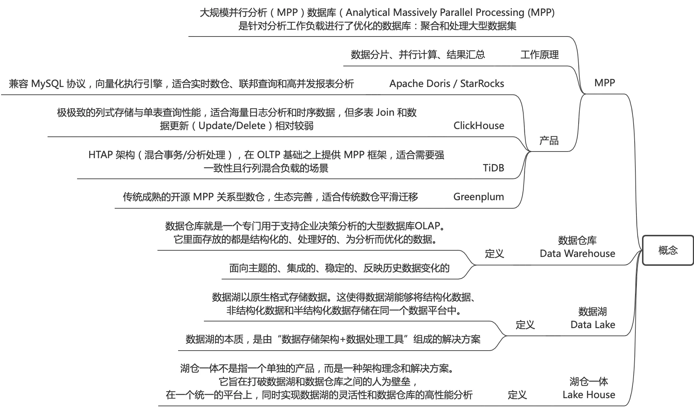

### 数据仓库
简单来说，就是最开始的OLAP分析数据库；
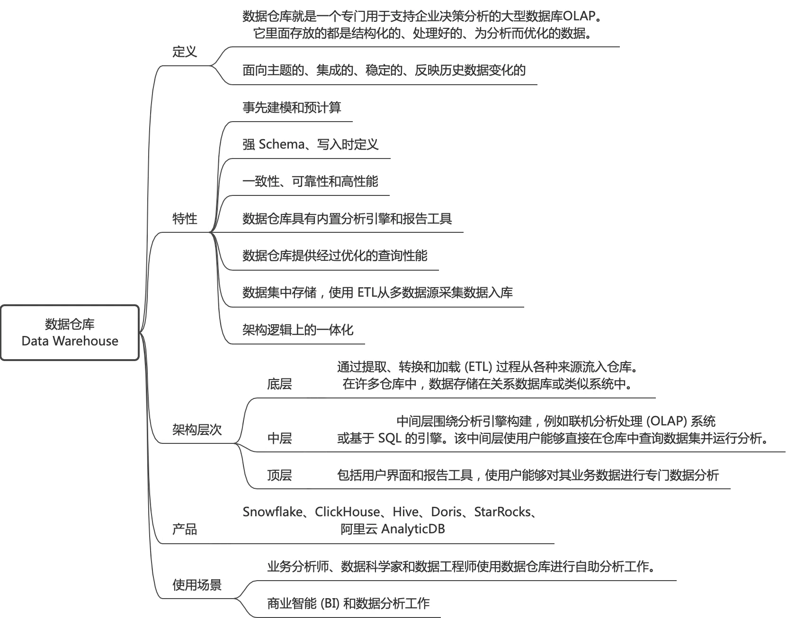

### 数据湖
数据湖最开始分离了存储和计算，存储格式容量和格式不受限制；数据湖补上了表格式层后，具备了ACID、schema、snapshot、压缩等表级能力，就已经是湖仓一体架构了；

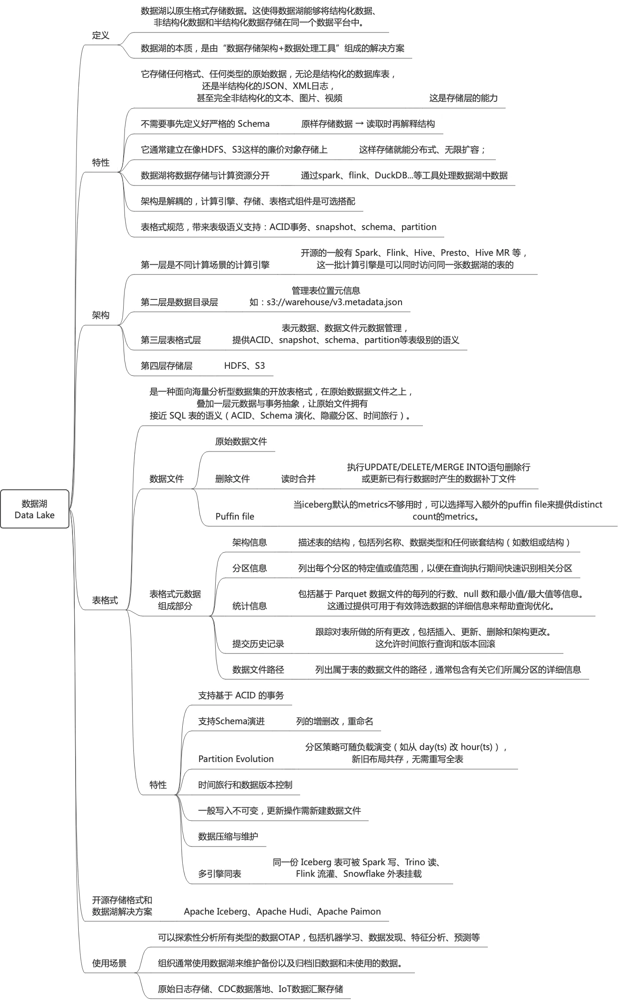

#### 数据湖通用架构
数据湖架构中的元素都是非捆绑的，包括 Storage 和 Compute；没有表格格式，也没有存储引擎。

对于数据湖架构，组织通常采用两层方法：在云数据湖中利用开放文件格式（如 Parquet）进行机器学习和高级分析工作负载；同时有选择地导出数据以添加到现有数据仓库中，以实现商业智能 （BI） 和临时查询支持。这种两层方法会增加复杂性和开销，通常会导致数据过时和额外的数据副本。

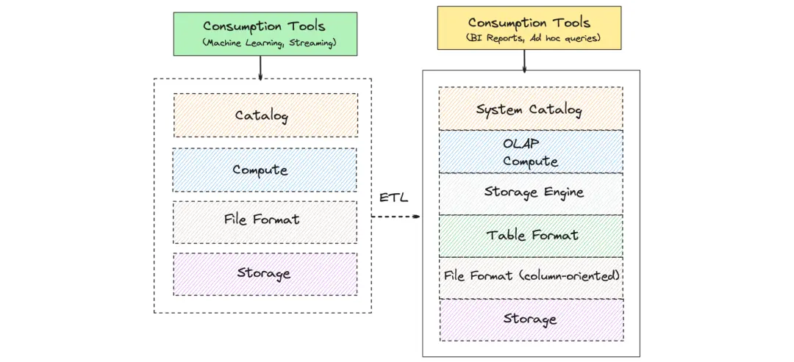
*数据湖架构的通用表示形式*

具有数据湖和数据仓库的两层架构。基于 ML 的工作负载在各种数据类型上运行，在数据湖中（左），而 BI 和 Ad Hoc 查询在数据仓库中的单独数据上运行（右）

### 湖仓一体
数据湖和湖仓一体不是两个并列的架构，而是同一个架构在不同成熟度阶段的叫法。当数据湖补上了表格式层和治理能力，它就成了湖仓一体。具体参考[Lakehouse湖仓一体](Lakehouse湖仓一体.md)

### 数据文件存储格式

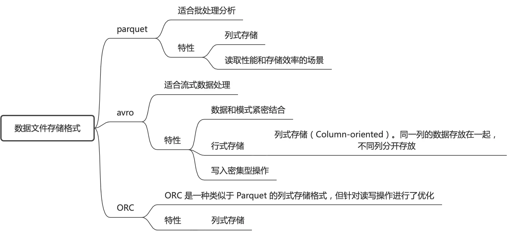
这些数据文件存储格式，基本都是写入不可改变的：这也是Iceberg这类现代数据湖表格式的一个核心设计原则。
>一个是如S3这类以文件为单位的存储，不适合源文件的更改；
>Parquet 和 ORC 是列式格式，文件末尾有 footer 记录所有 row group 的元数据。追加数据必须重写 footer，等于重写整个文件。Avro 虽然理论上支持 append 模式，但常规用法仍是一次写一个完整文件。

## 大数据发展简介

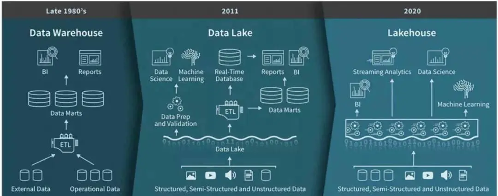

最开始的数据处理系统都以OLTP为主，因为OLTP是应用运行必须的组件。随着时间的发展，各家公司不仅要让产品能运行，还需要分析用户行为来指导产品设计，以在未来的竞争中占据上风，因此分析的需求也逐渐增加，慢慢演化出了OLAP系统。

最早开始OLTP和OLAP都在同一套存储中进行，但是这样会造成很多问题，比方说OLAP的大批量操作会影响OLTP系统性能。所以慢慢地，就将OLTP系统产生的数据传输到OLAP的专用组件中处理，发展出了数据仓库(Data Warehouse)，数据湖(Data Lake)，数据湖屋等(Data Lake House)等独立的OLAP组件。

关于OLAP系统的发展可以详见这篇文章TBD，这里简单介绍一下三个阶段：
1. 数据仓库（Data warehouse）：只能存储和处理结构化数据。数仓系统通常是一个完整（而不像数据湖屋是多个不同功能的组件组合而成）的软件，各个组件之间是强耦合的，存储数据的格式一般也不公开，但是性能通常比较高。看它的描述，可以理解为一个为OLAP负载设计的MySQL。
2. 数据湖（Data Lake）：可以存储各种数据，并使用MapReduce框架来分布式执行计算任务，代表是第一代Hadoop。可以认为它由一个云存储引擎和一个支持用户自定义计算逻辑的框架构成。
3. 数据湖屋（Data Lakehouse）：利用数据湖发展过程中形成的一批开源存储格式、表格式、计算引擎等OLAP组件组合而成的，运行在数据湖上的数据仓库。它通常处理的也是结构化数据，只不过存储更开放、成本更低廉、选择更多元

包括数据湖、湖仓一体，利于数据的集中管理、存储，但是是时效性上可以是>秒，偏向于OLAP场景；
传统OLTP数据库，由于各种体系是一体化的，适合时效性<秒的场景。缺点是数据是结构化的，数据容量的扩展是比较麻烦；

https://www.cnblogs.com/jzssuanfa/p/19197778 Apache Iceberg介绍、原理与性能优化 - 详解

## 技术架构
典型的大数据架构，从数据集成、存储、计算、调度、查询和应用，构成了一个完整的数据流。

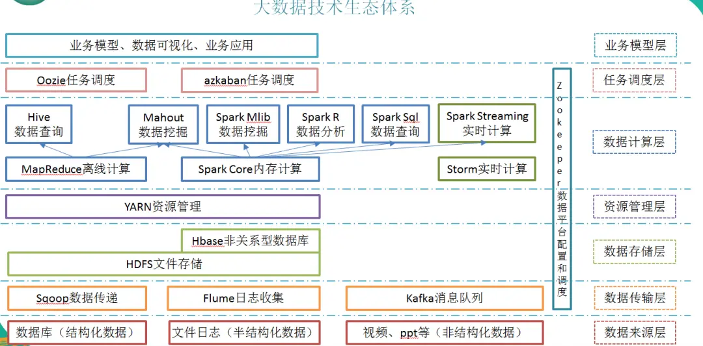

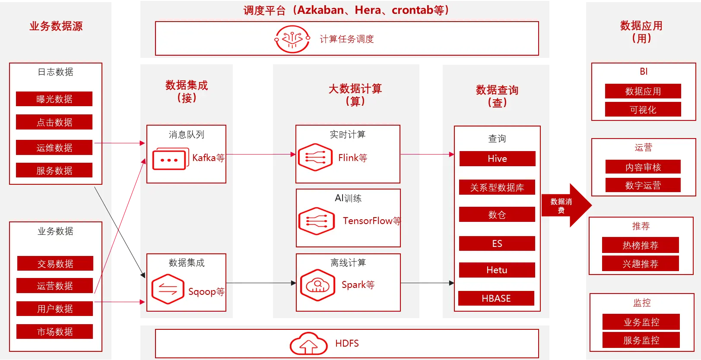

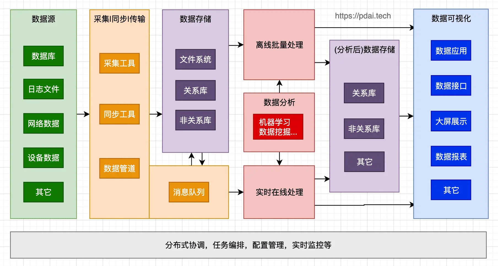

大数据架构通常包括以下几个核心组件和流程，企业可以根据实际需要选择云服务或自建大数据组件：
- **业务数据源：**
    业务数据源是大数据平台的数据输入来源，可以是传感器、网站日志、移动应用、社交媒体等各种数据源。通过数据采集和提取，将原始数据收集到大数据平台进行后续处理和分析。
- **数据集成：**
    数据集成是将来自不同数据源的数据进行整合和转换的过程。这包括数据清洗、数据预处理、数据格式转换、数据合并等操作，以确保数据的一致性和准确性。
- **数据存储：**
    大数据平台需要具备高效的数据存储能力，以承载海量的数据。常见的数据存储技术包括分布式文件系统（如HDFS）、列式数据库（如HBase）等。这些存储系统提供高可靠性、可扩展性和容错性，以支持大规模数据的存储和访问需求。
- **大数据计算：**
    大数据计算是对海量数据进行分布式、并行和实时处理的关键环节。主要的计算框架包括Hadoop、Spark、Flink等，它们支持分布式计算模型和任务调度。通过这些计算框架，可以进行数据处理、特征提取、机器学习、数据挖掘等复杂的计算和分析任务。
- **数据查询和分析：**
    对于大量的存储在大数据平台中的数据，需要提供灵活且高性能的查询和分析能力。这可以通过使用SQL查询引擎（如Hive）或分布式数据库（如Elasticsearch）等实现。这些工具和系统支持在海量数据集上进行查询、聚合和可视化，以提供数据洞见和决策支持。
- **任务调度：**
    大数据平台通常需要处理复杂的数据作业。任务调度系统（如Azkaban等）用于管理和调度各种数据处理作业，可以设置作业的依赖关系、调度频率、重试策略等，以确保作业的顺利执行和任务的准时完成。
- **数据应用**：
    大数据平台的最终目的是为业务提供有价值的数据应用。数据应用可以是基于大数据分析的实时报表、可视化仪表盘、智能推荐系统、欺诈检测系统等。通过将大数据的分析结果与业务流程集成，可以实现数据驱动的业务决策和创新。
### 体系结构

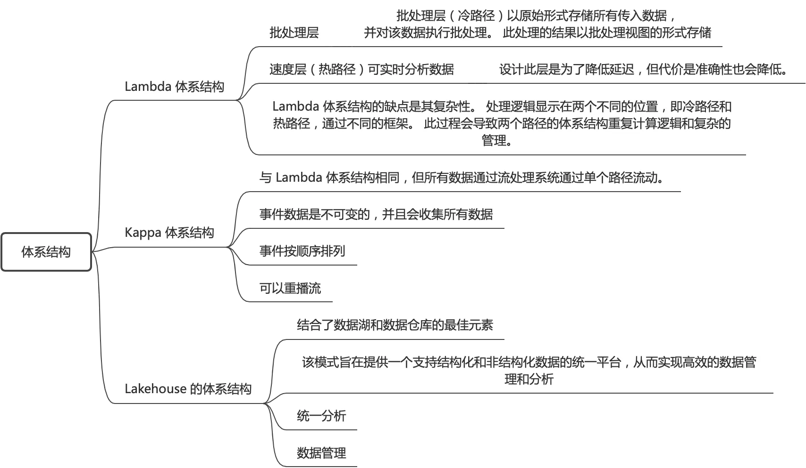

### 推荐系统架构

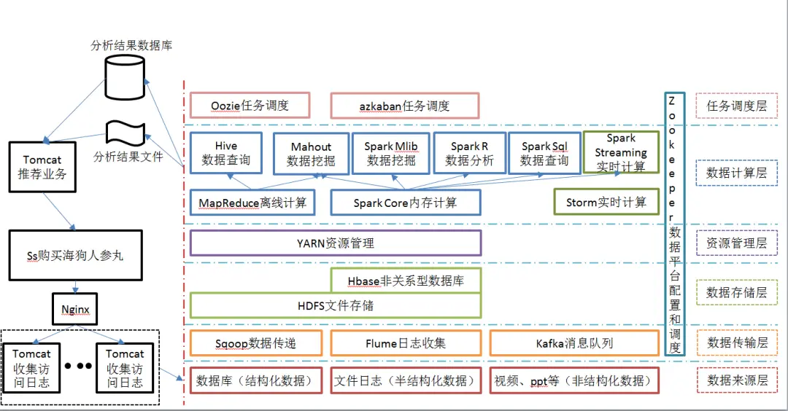

### 数据部组织架构

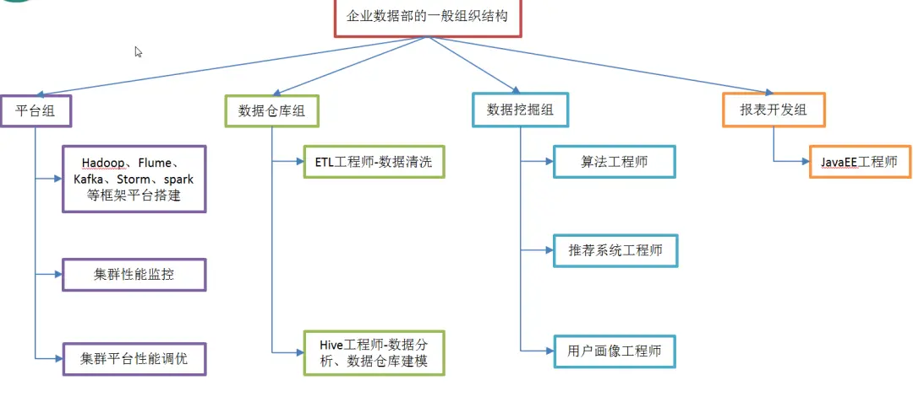

## 大数据架构体系演进

### 第一代：离线统计分析技术架构-2006
特点：
1、数据源通过离线的方式导入到离线数仓中;  
2、数据处理（Hadoop、Spark技术派系为主）：MapReduce、Hive、SparkSQL 等离线计算引擎。 架构及数据处理流程如下;
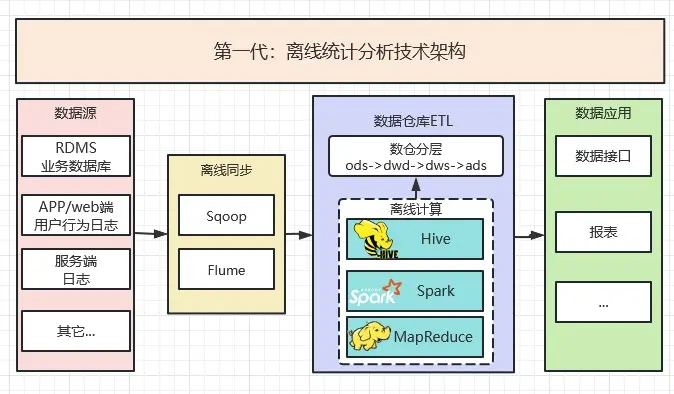

 ### 第二代：Lambda架构（离线+实时结合）--2011
 随着大数据应用的发展，人们逐渐对系统的实时性提出了要求，为了计算一些实施指标，就在原来离线数仓的基础上增加了一个实时计算的链路，并对数据源做流式改造(即把数据发送到消息队列)，实时计算去订阅消息队列，直接完成指标做增量的计算，推送到下游的数据服务中去，由数据服务层完成离线&实时结果的合并。Lambda架构如下图所示：
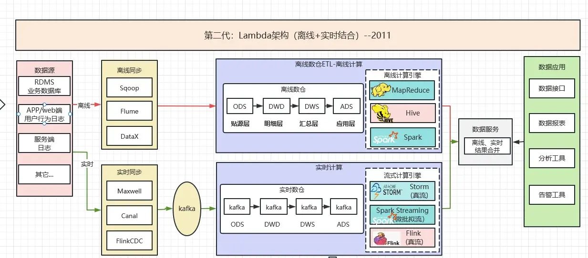

### 第三代：Kappa架构（批流一体）--2014
Lambda 架构虽然满足了实时的需求，但带来了更多的开发与运维工作，其架构背景是流处理引擎还不完善，流处理的结果只作为临时的、近似的值提供参考。 后来随着Flink等流处理引擎的出现，流处理技术很成熟了，这时为了解决两套代码的问题。 Linkedln 的 Jay Kreps 提出了 Kappa 架构，在实时计算中可以直接完成计算，也可以跟离线数仓一 样分层，取决于指标的复杂度，各层之间通过消息队列交互(多半是不分层的)，**Kappa 架构可以认为是 Lambda 架构的简化版**(只要移除 Lambda 架构中的批处理部分即可)。Kappa 架构如下图所示：
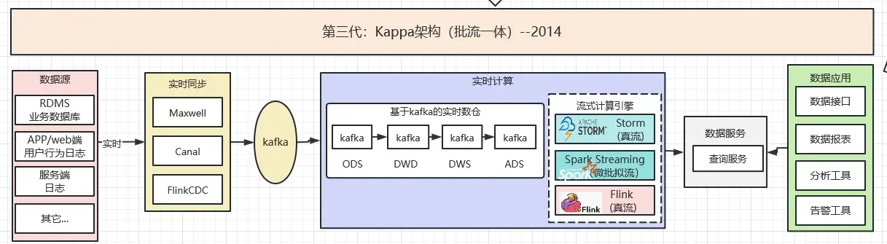

### 第四代：基于MPP数据库的实时统一数仓架构---数仓增强-2017
面对越来越强的OLAP数据分析需求，新一代高性能MPP数据库高速发展：2016年Clickhouse、2017年Doris相继面世。例如，Doris的实时数仓架构。其特点如下：
- 报表分析：面向用户或者客户的高并发报表分析（Customer Facing Analytics）。
- 即席查询（Ad-hoc Query）：面向分析师的自助分析，查询模式不固定，要求较高的吞吐。
- 统一数仓构建 ：一个平台满足统一的数据仓库建设需求，简化繁琐的大数据软件栈。
- 数据湖联邦查询：通过外表的方式联邦分析位于 Hive、Iceberg、Hudi 中的数据，在避免数据拷贝的前提下，查询性能大幅提升。
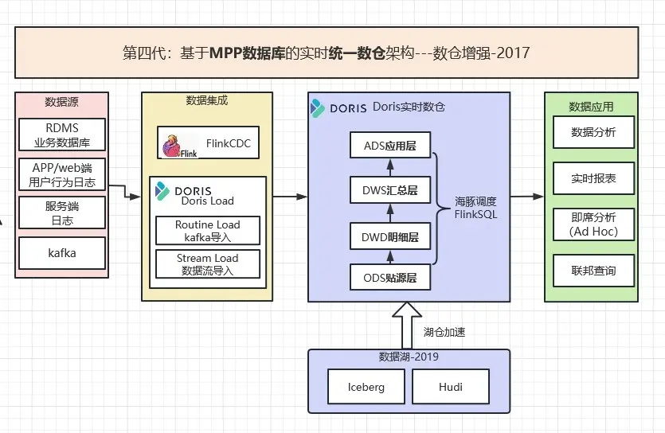

### 第五代：基于数据湖的实时数仓架构-数据湖增强(湖仓一体)-2019
数据湖最早是由Pentaho的创始人兼CTO， 詹姆斯·迪克森(James Dixon)，在2010年10月纽约Hadoop World大会上提出来的。但再国内一直到19年三大数据湖开源后，才真正火起来。其中又以Flink+Iceberg应用范围最广。该架构的特点如下：
- 支持ACID、schema变更。高效 Table Schema 的变更，比如针对增减分区，增减字段等功能.
- 统一存储的准实时数仓。湖仓一体：数据统一存储在数据湖中（Iceberg、hudi、Delta Lake）。批流一体：同时支持流批读写，不会出现脏读等现象.
- 支持高效upset。
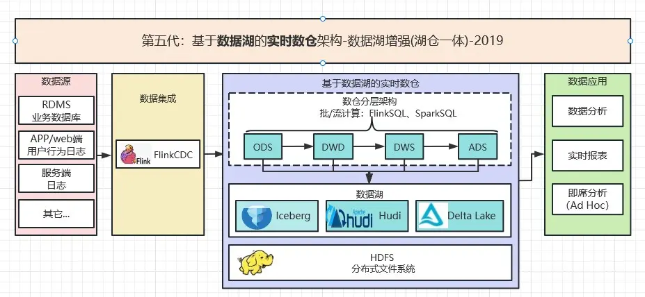

### 展望未来
数据仓库从传统数仓阶段-->大数据数据仓库（数据湖）阶段-->新一代实时数仓（湖仓一体）阶段，整体发展趋势可总结几点：

- 1.湖仓一体: 数据湖和数据仓库的边界正在慢慢模糊，数据湖自身的治理能力、数据仓库o延伸到外部存储的能力都在加强。湖仓一体已成为主流趋势，只是时间而已。中小企业可借助云平台快速实现，例如阿里云MaxCompute。
- 2.更简单的运维: 技术栈合并，一站式解决方案越来越火。例如Flink+Doris的批流一体OLAP架构（甚至Doris自己都可以）。摒弃大数据入门要学习数不清的工具+技术栈的尴尬境地。
- 3.新架构/新思想：尚未成熟，不建议接入，了解即可。
  - Data Fabric: 元数据驱动基于中心化，基于知识图谱的数据资产管理（元数据驱动）。
  - Data Mesh数据网格: 采用DDD领域驱动设计思想。数据治理拆分到各业务领域（类似微服务的服务拆分），分而治之，分别产出业务领域的数据产品。

https://www.cnblogs.com/dennyzhangdd/p/17262204.html 大数据（二）大数据架构发展史

## 数据分层建模
前比较成熟的数据分层：数据运营层ODS、数据仓库层DW、数据应用层ADS(APP)。数据仓库层又可以分为3个层：数据细节层DWD、数据中间层DWM、数据服务层DWS。

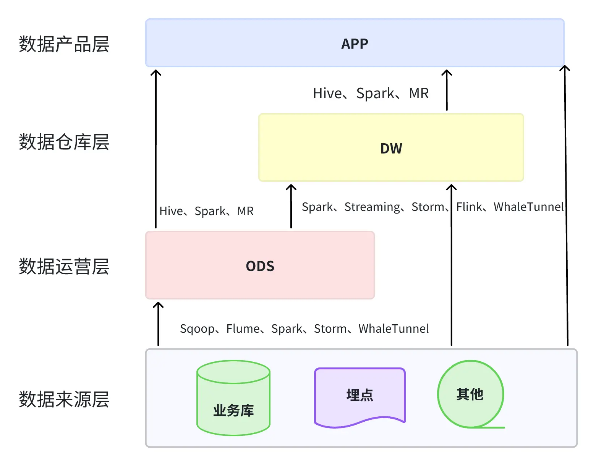
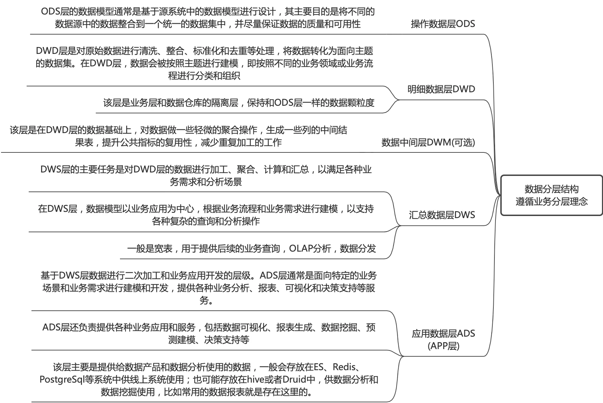

在实际落地中，“原则上优先通过 ADS/DWS 对外提供服务”，但针对明细查验、数据分析、风控审计等特定应用场景，DWD 乃至 ODS 也可以作为数据源对外提供特定服务。

## 技术栈

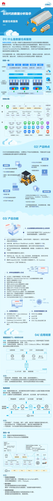

首先给出一个通用化的大数据处理框架，主要分为下面几个方面：数据采集与预处理、数据存储、数据清洗、数据查询分析和数据可视化。

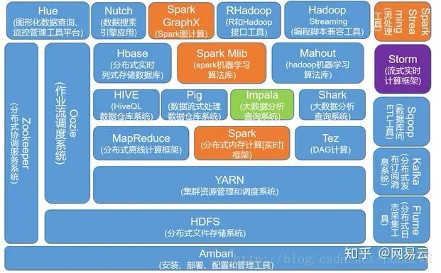

大数据经过十几年发展，已经形成了一条极长的工具链，每个环节都有多个竞品并存：

| 环节  | 代表组件                                      |
| --- | ----------------------------------------- |
| 采集  | Flume、Filebeat、Logstash、Sqoop、DataX       |
| 消息  | Kafka、Pulsar、RocketMQ                     |
| 存储  | HDFS、S3、HBase、Cassandra                   |
| 计算  | Spark、Flink、Hive、Presto、Impala            |
| 调度  | Airflow、DolphinScheduler、Azkaban          |
| 数仓  | Hive、ClickHouse、Doris、StarRocks、Snowflake |
| 数据湖 | Iceberg、Hudi、Paimon、Delta Lake            |
| 治理  | Atlas、DataHub、Griffin                     |

## 数据血缘
数据血缘是一种过程数据，很像是opentelemetry中的trace，跟踪数据流转的过程，并且分析数据表和字段间的依赖关系；是对数据运转的观测；

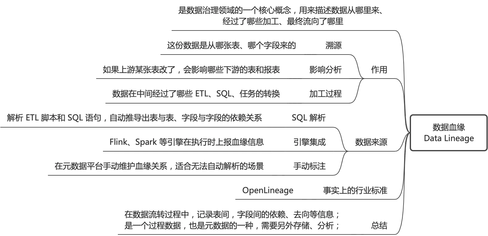

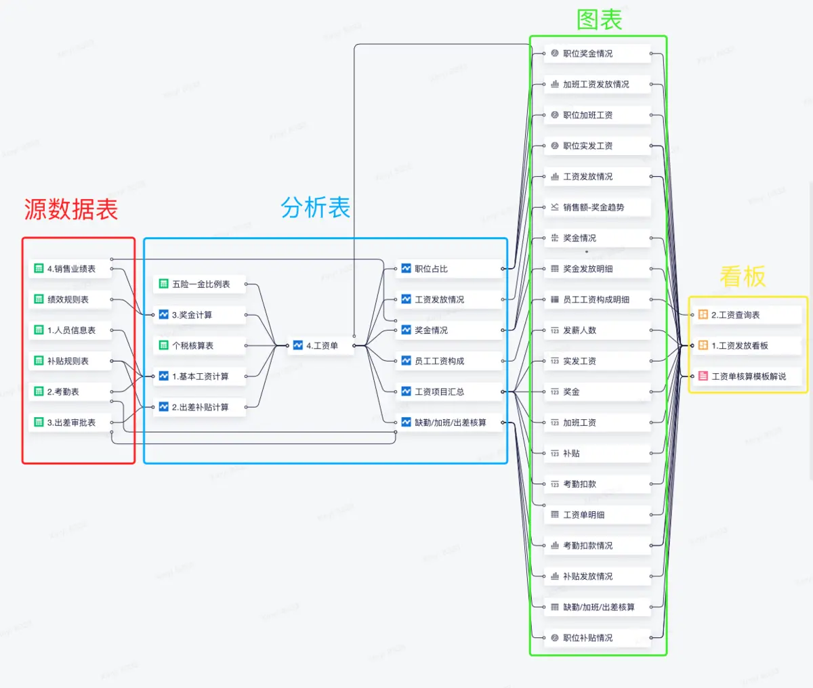

## 数据治理

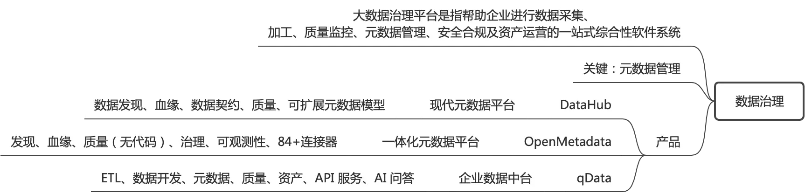

**产品**
DataHub、OpenMetadata、qData

**核心能力**

| 能力模块 | 解决的问题 | 典型功能 |
| --- | --- | --- |
| **元数据管理** | “有哪些数据？在哪？” | 自动采集技术元数据、业务元数据、血缘关系、影响分析 |
| **数据目录/发现** | “我要的数据在哪？谁能用？” | 搜索、标签、分类、资产热度、数据预览 |
| **数据血缘** | “数据从哪来？改了会影响谁？” | 表级/字段级血缘、影响分析、溯源 |
| **数据质量** | “数据准不准？全不全？” | 规则定义、质量监控、异常告警、质量评分 |
| **数据安全与权限** | “谁能看？谁能改？” | 分类分级、敏感数据识别、脱敏、访问控制 |
| **数据标准** | “字段该怎么定义？” | 命名规范、码值标准、数据字典 |
| **主数据管理** | “核心实体怎么统一？” | 客户/产品/组织等主数据的统一、清洗、分发 |
| **数据生命周期** | “数据存多久？怎么归档？” | 冷热分层、归档、销毁策略 |
| **数据服务/API** | “怎么把数据用起来？” | 数据 API 发布、查询服务、订阅 |
| **数据开发/调度** | “数据怎么加工？” | ETL 开发、任务调度、运维监控（部分平台内置） |
**能力如何串起来**
一个典型的数据治理平台，工作流大致是这样的：
1. **采集**：从各个数据源（数据库、数据湖、消息队列）自动采集元数据和技术血缘。
2. **编目**：把采集到的元数据组织成可搜索的数据目录，打上业务标签和分类。
3. **治理**：
    - 用**数据标准**规范字段定义。
    - 用**数据质量**规则监控数据。
    - 用**安全策略**做分类分级和脱敏。
4. **消费**：通过数据目录搜索资产，通过血缘做影响分析，通过 API 或查询引擎使用数据。
5. **反馈**：使用热度、质量问题、血缘变更反过来驱动治理优化。

## 大数据API平台

在实际工程落地中，大数据 API 框架主要分为 “自研/开源数据服务平台”、“数据虚拟化/GraphQL 引擎” 以及 “传统微服务 API 网关+ Serving 引擎” 三类：
1. 配置化/低代码数据服务平台（Data-as-a-Service, DaaS 框架）
2. 现代语义层与统一 API 框架（Semantic Layer / Metrics API）
3. 传统高性能 API 服务架构（自研微服务 + Serving 引擎）

**高并发，低延迟核心API方案**
对于高并发（> 10,000 QPS）、超低延迟（< 10ms）的核心业务 API，通常不会直接查湖仓或常规 API 配置平台，而是采用以下工程化落地方案：
技术栈组合：Spring Boot / Go (Gin/Fiber) / Rust + Redis (缓存) + StarRocks / Redis / HBase / MongoDB (高性能 Serving 库) + Kong / Apache APISIX (API 网关)。

| **应用场景**          | **典型业务**               | **QPS 要求**         | **响应延迟**     | **推荐 API 架构方案**                                                          |
| ----------------- | ---------------------- | ------------------ | ------------ | ------------------------------------------------------------------------ |
| **内部 BI / 运营看板**  | 管理层大屏、分析师看板、Ad-hoc 报表  | 中低 (< 500)         | 亚秒级 (~500ms) | **API 配置平台 / Cube.js** 直接查询 **StarRocks / Doris / Trino** 挂载的数据湖外表。      |
| **中台/微服务数据共享**    | 用户画像 API、推荐系统特征 API    | 中高 (1,000 ~ 5,000) | 毫秒级 (< 50ms) | API 网关 + **Go/Java 微服务** + **StarRocks / ClickHouse 本地表**（带 Redis 二级缓存）。 |
| **面向 C 端高并发 API** | 手机 App 个人年度账单、实时风控 API | 极高 (> 10,000)      | 极低 (< 10ms)  | 湖仓数据导出至 **Redis / HBase / Aerospike**，通过 **Golang / Rust 专用微服务** 暴露 API。 |

**总结**：数据API可视化平台，主要通过数据源+Http连接方式进行数据获取，提供可视化和SQL模式进行分析探索；

https://zhuanlan.zhihu.com/p/636158337 业界大厂数据治理方案架构整理汇总
https://cloud.tencent.com/document/product/1267/106198 腾讯数据开发治理平台WeData

## 计算引擎

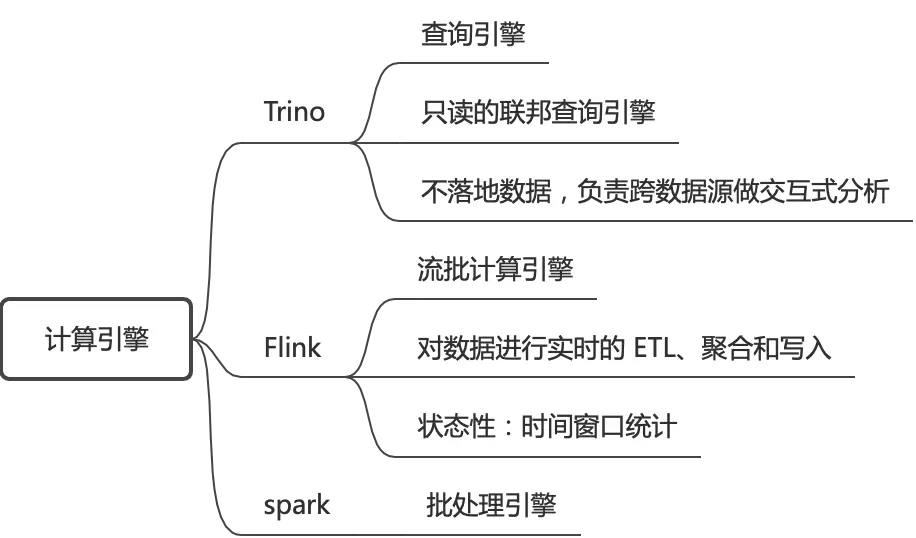

## QA

### Q大数据处理的原理
A：
- 分布式处理的原理 = 分片并行 + 调度本地性 + 分片级容错。
- 分片落地是关键，因为它是“数据本地性”和“独立重算”的物理基础——但落地形态取决于处理模式：批处理靠文件分片，流处理靠逻辑分区 + 状态落地。

## 参考
https://zhuanlan.zhihu.com/p/488818186 构建数仓和数据湖产品调研总结
https://cloud.tencent.com/developer/article/2469957
https://juejin.cn/post/7539112417151664167 大数据架构设计与技术选型-全方位
https://developer.cloud.tencent.com/article/2313111 一文了解大数据生态体系-Hadoop