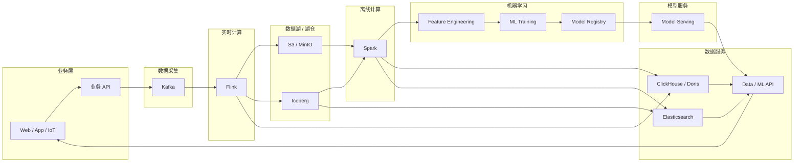

## 结合流程

数据产生->结果预测：大致流程

```
业务前端产生数据 → 数据进入消息/采集层 → Flink 实时处理 → S3/湖仓沉淀 → Spark 离线加工 → ML 训练 → 模型服务 → 前端/业务系统使用预测结果 → 结果再次进入数据链路
```


## 大数据和ML交互流程




## 数据变动示例

```
1 用户行为数据
U001 click P100
U001 click P200
U002 click P100
U001 buy   P100
U003 click P300
用户点击次数
用户购买次数
商品热度
最近5分钟点击量
用户最近一次行为
实时风控分数

2Flink实时计算
实时Feature：
click_count = 3
buy_count   = 1
last_product = P100

3模型推理预测
输入如：
click_count = 20
view_count = 50
buy_count = 2
avg_price = 200
last_login = 1h

预测：是否购买=1 或者 推荐列表；
```


## 代码示例

**背景**：可运行的最小 Demo，代码中各组件、框架都要有体现，实际上demo环境没安装这些组件，我们用模拟数据来代替，通过demo 代码来熟悉流程：
然后用一条真实数据，例如“用户点击商品 → 实时统计 → Iceberg → Spark 特征工程 → Python 训练 → 模型预测”，把每一个阶段的数据结构、表结构、文件结构、数据变化、组件之间的交互时序全部打印出来。这样会比单独学习 Spark/Flink/ML 更容易建立完整的大数据 + ML 系统观。


```python fold
from __future__ import annotations

import argparse
import json
import math
import shutil
import time
from dataclasses import dataclass, asdict
from pathlib import Path
from typing import Any

import joblib
import numpy as np
import pandas as pd
from sklearn.linear_model import LogisticRegression
from sklearn.preprocessing import StandardScaler
from sklearn.pipeline import Pipeline


ROOT = Path(__file__).resolve().parent
DATA = ROOT / "data"
KAFKA_DIR = DATA / "kafka"
FLINK_DIR = DATA / "flink"
ICEBERG_DIR = DATA / "iceberg" / "user_behavior"
FEATURE_DIR = DATA / "features"
MODEL_DIR = ROOT / "models"


def reset_dirs():
    for p in [KAFKA_DIR, FLINK_DIR, ICEBERG_DIR, FEATURE_DIR, MODEL_DIR]:
        if p.exists():
            shutil.rmtree(p)
        p.mkdir(parents=True, exist_ok=True)


def dump_json(path: Path, obj: Any):
    path.parent.mkdir(parents=True, exist_ok=True)
    path.write_text(json.dumps(obj, ensure_ascii=False, indent=2), encoding="utf-8")


def append_jsonl(path: Path, obj: Any):
    path.parent.mkdir(parents=True, exist_ok=True)
    with path.open("a", encoding="utf-8") as f:
        f.write(json.dumps(obj, ensure_ascii=False) + "\n")


def show(title: str, data: Any):
    print(f"\n{'=' * 88}")
    print(f"[DATA] {title}")
    print("-" * 88)
    if isinstance(data, pd.DataFrame):
        print(data.to_string(index=False))
    else:
        print(json.dumps(data, ensure_ascii=False, indent=2, default=str))


def event_log(component: str, action: str, detail: str = ""):
    now = time.strftime("%H:%M:%S")
    print(f"[{now}] [{component:<12}] {action:<28} {detail}")


def flow_only():
    print(r"""
========================================================================================
BIG DATA + ML END-TO-END FLOW
========================================================================================

Frontend
   |
   | POST /event
   v
Java Business API
   |
   | Event
   v
Kafka Topic: user_behavior
   |
   | consume
   v
Flink Streaming Job
   |
   +------------------------------+
   |                              |
   | realtime aggregation         | durable data
   v                              v
Online Feature              Iceberg Table
                                  |
                                  v
                           S3 / MinIO Object
                                  |
                                  v
                              Spark Job
                                  |
                                  v
                         Feature Engineering
                                  |
                                  v
                           Training Dataset
                                  |
                                  v
                         Python ML Training
                                  |
                                  v
                              Model V1
                                  |
                                  v
                           Model Serving
                                  ^
                                  |
                           Online Feature
                                  ^
                                  |
                                Flink

IMPORTANT:
- Feature != Model Parameter
- Flink realtime feature is normally an INPUT to the model.
- Model parameters are learned during training.
- Training and inference are two different flows.
========================================================================================
""")


@dataclass
class UserEvent:
    event_id: str
    user_id: str
    product_id: str
    event_type: str
    price: float
    timestamp: str


class MockKafka:
    """模拟 Kafka：重点展示 Topic / Message / Producer / Consumer 的边界。"""

    def __init__(self):
        self.topic = "user_behavior"
        self.messages: list[dict] = []

    def produce(self, event: UserEvent):
        msg = {
            "topic": self.topic,
            "partition": 0,
            "offset": len(self.messages),
            "key": event.user_id,
            "value": asdict(event),
        }
        self.messages.append(msg)
        append_jsonl(KAFKA_DIR / f"{self.topic}.jsonl", msg)
        event_log("Kafka", "produce", f"topic={self.topic}, offset={msg['offset']}")
        show("Kafka Message", msg)

    def consume_all(self):
        event_log("Kafka", "consume", f"{len(self.messages)} messages")
        return self.messages


class MockFlink:
    """
    模拟 Flink Streaming Job。

    真正的 Flink 会有：
      source -> operator -> keyed state/window -> sink

    这里用 Python dict 模拟 keyed state，
    用简单窗口聚合模拟实时 Feature。
    """

    def __init__(self):
        self.state: dict[str, dict[str, Any]] = {}

    def process(self, messages):
        event_log("Flink", "start streaming", "KafkaSource -> KeyBy(user_id) -> State -> Sink")

        for msg in messages:
            e = msg["value"]
            uid = e["user_id"]
            state = self.state.setdefault(uid, {
                "user_id": uid,
                "click_count": 0,
                "buy_count": 0,
                "click_amount": 0.0,
                "last_product": None,
                "last_timestamp": None,
            })

            if e["event_type"] == "click":
                state["click_count"] += 1
                state["click_amount"] += e["price"]
            elif e["event_type"] == "buy":
                state["buy_count"] += 1

            state["last_product"] = e["product_id"]
            state["last_timestamp"] = e["timestamp"]

            event_log(
                "Flink",
                "process event",
                f"user={uid}, event={e['event_type']}, state.click_count={state['click_count']}",
            )

        states = list(self.state.values())
        dump_json(FLINK_DIR / "keyed_state.json", states)
        show("Flink Keyed State / Realtime Feature", states)
        return states


class MockIceberg:
    """
    模拟 Iceberg。

    重点模拟：
      Catalog
        -> Table Metadata
        -> Snapshot
        -> Manifest
        -> Data File

    真正 Iceberg 的 data files 通常是 Parquet/ORC/Avro；
    本 Demo 为了零门槛使用 JSONL。
    """

    def __init__(self):
        self.metadata_dir = ICEBERG_DIR / "metadata"
        self.data_dir = ICEBERG_DIR / "data"
        self.metadata_dir.mkdir(parents=True, exist_ok=True)
        self.data_dir.mkdir(parents=True, exist_ok=True)
        self.snapshot_id = 0

    def append(self, records: list[dict]):
        self.snapshot_id += 1

        data_file = self.data_dir / f"data-{self.snapshot_id:05d}.jsonl"
        for r in records:
            append_jsonl(data_file, r)

        manifest = {
            "manifest_id": f"manifest-{self.snapshot_id:05d}",
            "data_files": [str(data_file.relative_to(ROOT))],
            "record_count": len(records),
        }

        snapshot = {
            "snapshot_id": self.snapshot_id,
            "timestamp": time.strftime("%Y-%m-%dT%H:%M:%S"),
            "operation": "append",
            "manifest": manifest,
        }

        dump_json(self.metadata_dir / f"snapshot-{self.snapshot_id:05d}.json", snapshot)
        dump_json(self.metadata_dir / "current_snapshot.json", snapshot)

        event_log(
            "Iceberg",
            "commit snapshot",
            f"snapshot={self.snapshot_id}, file={data_file.name}",
        )

        show("Iceberg Snapshot", snapshot)
        return snapshot


class LocalS3:
    """模拟 S3 / MinIO：对象就是本地文件。"""

    def put_object(self, key: str, content: str):
        path = DATA / "s3" / key
        path.parent.mkdir(parents=True, exist_ok=True)
        path.write_text(content, encoding="utf-8")
        event_log("S3/MinIO", "put object", key)


class MockSpark:
    """
    模拟 Spark Feature Engineering。

    真正 Spark 会把 Dataset/DataFrame 分布式处理。
    这里使用 pandas DataFrame 表示 DataFrame 的概念，
    重点展示 transform 的数据变化。
    """

    def run(self, events: list[UserEvent], realtime_states: list[dict]):
        event_log("Spark", "read", "Iceberg Table -> Spark DataFrame")

        raw = pd.DataFrame([asdict(e) for e in events])
        show("Spark Input DataFrame", raw)

        clicks = raw[raw["event_type"] == "click"].copy()

        features = (
            clicks.groupby("user_id")
            .agg(
                click_count=("event_id", "count"),
                avg_clicked_price=("price", "mean"),
                unique_products=("product_id", "nunique"),
            )
            .reset_index()
        )

        # 把 Flink 产生的实时状态也作为一类 feature 输入离线特征工程。
        state_df = pd.DataFrame(realtime_states)
        if not state_df.empty:
            state_df = state_df[["user_id", "buy_count"]]
            features = features.merge(state_df, on="user_id", how="left")

        features["buy_count"] = features["buy_count"].fillna(0)
        features["purchase_rate"] = (
            features["buy_count"] / features["click_count"].replace(0, np.nan)
        ).fillna(0)

        # Demo label：模拟“该用户是否最终购买”。
        # 生产环境 label 应来自未来窗口中的真实业务结果，而不是这样人工生成。
        features["label"] = (features["buy_count"] > 0).astype(int)

        show("Spark Feature DataFrame", features)

        path = FEATURE_DIR / "training_features.csv"
        features.to_csv(path, index=False)
        event_log("Spark", "write", f"training dataset -> {path}")

        return features


class MLTrainer:
    """真正执行 Python ML 训练。"""

    feature_columns = [
        "click_count",
        "avg_clicked_price",
        "unique_products",
        "buy_count",
        "purchase_rate",
    ]

    def train(self, features: pd.DataFrame):
        event_log("ML", "prepare training data", "X=features, y=label")

        X = features[self.feature_columns]
        y = features["label"]

        # 为了 Demo 能在极少量样本上运行，这里扩充一个确定性的训练集。
        # 生产环境必须使用真实历史样本，并按时间切分 train/validation/test。
        base = X.copy()
        y_base = y.copy()

        extra_rows = []
        extra_y = []

        rng = np.random.default_rng(42)
        for _ in range(80):
            click_count = int(rng.integers(1, 30))
            avg_price = float(rng.integers(20, 500))
            unique_products = int(rng.integers(1, min(click_count, 8) + 1))
            buy_count = int(rng.integers(0, min(5, click_count) + 1))
            purchase_rate = buy_count / click_count
            label = int(
                buy_count >= 2
                or (purchase_rate > 0.18 and click_count >= 5)
            )
            extra_rows.append(
                [click_count, avg_price, unique_products, buy_count, purchase_rate]
            )
            extra_y.append(label)

        train_X = pd.concat(
            [base, pd.DataFrame(extra_rows, columns=self.feature_columns)],
            ignore_index=True,
        )
        train_y = pd.concat(
            [y_base, pd.Series(extra_y, name="label")],
            ignore_index=True,
        )

        show(
            "Training Dataset",
            {
                "rows": len(train_X),
                "features": self.feature_columns,
                "sample_X": train_X.head(5).to_dict(orient="records"),
                "sample_y": train_y.head(5).tolist(),
            },
        )

        model = Pipeline([
            ("scaler", StandardScaler()),
            ("classifier", LogisticRegression(random_state=42)),
        ])

        model.fit(train_X, train_y)

        classifier = model.named_steps["classifier"]
        model_info = {
            "model_version": "model_v1",
            "algorithm": "StandardScaler + LogisticRegression",
            "features": self.feature_columns,
            "classes": classifier.classes_.tolist(),
            "coef": classifier.coef_.tolist(),
            "intercept": classifier.intercept_.tolist(),
        }

        MODEL_DIR.mkdir(exist_ok=True)
        model_path = MODEL_DIR / "model_v1.joblib"
        info_path = MODEL_DIR / "model_v1.json"
        joblib.dump(model, model_path)
        dump_json(info_path, model_info)

        event_log("ML", "train complete", f"model={model_path}")
        show("Model Parameters", model_info)

        return model_path, model_info


class ModelServing:
    """模拟在线 Model Serving，真正加载模型并预测。"""

    def predict(self, model_path: Path, online_feature: dict):
        model = joblib.load(model_path)

        x = pd.DataFrame([online_feature])[
            MLTrainer.feature_columns
        ]

        probability = float(model.predict_proba(x)[0][1])
        prediction = int(probability >= 0.5)

        result = {
            "user_id": online_feature["user_id"],
            "model_version": "model_v1",
            "features": online_feature,
            "purchase_probability": round(probability, 6),
            "prediction": prediction,
        }

        event_log("Serving", "predict", f"user={online_feature['user_id']}")
        show("Prediction", result)
        return result


def build_demo_events() -> list[UserEvent]:
    # 一条“真实业务事件链”：同一个用户连续产生点击/购买行为。
    return [
        UserEvent("e001", "U001", "P100", "click", 100.0, "2026-09-22T10:00:01"),
        UserEvent("e002", "U001", "P200", "click", 200.0, "2026-09-22T10:00:08"),
        UserEvent("e003", "U001", "P100", "click", 100.0, "2026-09-22T10:01:12"),
        UserEvent("e004", "U001", "P100", "buy",   100.0, "2026-09-22T10:02:10"),
        UserEvent("e005", "U002", "P300", "click", 300.0, "2026-09-22T10:03:00"),
        UserEvent("e006", "U002", "P400", "click", 400.0, "2026-09-22T10:03:10"),
    ]


def main():
    parser = argparse.ArgumentParser()
    parser.add_argument("--only-flow", action="store_true")
    args = parser.parse_args()

    if args.only_flow:
        flow_only()
        return

    reset_dirs()

    print("\n" + "#" * 88)
    print("# BIG DATA + ML LOCAL MINIMAL DEMO")
    print("# Kafka -> Flink -> Iceberg/S3 -> Spark -> ML -> Serving")
    print("#" * 88)

    events = build_demo_events()

    # -------------------------------------------------------------------------
    # 1. Frontend / Java Business API
    # -------------------------------------------------------------------------
    event_log("Frontend", "user action", "U001 clicks P100")
    show("Raw Business Event", asdict(events[0]))

    # -------------------------------------------------------------------------
    # 2. Kafka
    # -------------------------------------------------------------------------
    kafka = MockKafka()
    for event in events:
        kafka.produce(event)

    # -------------------------------------------------------------------------
    # 3. Flink
    # -------------------------------------------------------------------------
    messages = kafka.consume_all()
    flink = MockFlink()
    realtime_states = flink.process(messages)

    # -------------------------------------------------------------------------
    # 4. Iceberg + S3/MinIO
    # -------------------------------------------------------------------------
    iceberg = MockIceberg()
    snapshot = iceberg.append([asdict(e) for e in events])

    # 额外把 Snapshot 元数据作为一个 S3 对象进行模拟。
    s3 = LocalS3()
    s3.put_object(
        "iceberg/user_behavior/metadata/current_snapshot.json",
        json.dumps(snapshot, ensure_ascii=False, indent=2),
    )

    # -------------------------------------------------------------------------
    # 5. Spark Feature Engineering
    # -------------------------------------------------------------------------
    spark = MockSpark()
    features = spark.run(events, realtime_states)

    # -------------------------------------------------------------------------
    # 6. ML Training
    # -------------------------------------------------------------------------
    trainer = MLTrainer()
    model_path, model_info = trainer.train(features)

    # -------------------------------------------------------------------------
    # 7. Online Feature -> Model Serving
    # -------------------------------------------------------------------------
    # 模拟“模型训练结束以后，又来了一个新的实时点击”。
    new_event = UserEvent(
        "e007",
        "U001",
        "P500",
        "click",
        500.0,
        "2026-09-22T10:05:01",
    )

    event_log("Frontend", "new user action", "U001 clicks P500")
    kafka.produce(new_event)

    # Flink 从历史 state 继续处理新事件。
    realtime_states = flink.process([kafka.messages[-1]])
    online_feature = next(x for x in realtime_states if x["user_id"] == "U001")

    # Serving 只拿 Feature，不重新训练 Model。
    serving = ModelServing()
    serving.predict(model_path, {
        "user_id": online_feature["user_id"],
        "click_count": online_feature["click_count"],
        "avg_clicked_price": online_feature["click_amount"] / max(online_feature["click_count"], 1),
        "unique_products": 3,
        "buy_count": online_feature["buy_count"],
        "purchase_rate": online_feature["buy_count"] / max(online_feature["click_count"], 1),
    })

    # -------------------------------------------------------------------------
    # 8. Final file tree
    # -------------------------------------------------------------------------
    print("\n" + "=" * 88)
    print("[FILES] Generated local data / model structure")
    print("=" * 88)

    for path in sorted(ROOT.rglob("*")):
        if path.is_file() and ".venv" not in path.parts:
            print(path.relative_to(ROOT))

    print("\n" + "=" * 88)
    print("END")
    print("=" * 88)


if __name__ == "__main__":
    main()

```

**整体流程**
```
Frontend
   ↓
Business API
   ↓
Kafka
   ↓
Flink
   ├──────────────→ Realtime Feature
   │                       ↓
   │                  Model Serving
   │
   └──────────────→ Iceberg
                         ↓
                     S3/MinIO
                         ↓
                       Spark
                         ↓
                  Feature Engineering
                         ↓
                  Training Dataset
                         ↓
                    ML Training
                         ↓
                      Model V1
                         ↓
                   Model Serving
                         ↓
                    Prediction
                         ↓
                      API
                         ↓
                    Frontend
```

## QA

### Q：模型训是训练还是增量训练，频率如何
A：
全量训练：一般每天/周/月，考虑成本，拿历史全量数据进行训练；
增量训练：并不是所有 ML 模型都适合简单增量训练。有些算法天然支持 online learning / partial fit，有些深度学习模型可以继续 fine-tune，有些传统模型则更适合定期重新全量训练。增量训练适合每天按照增量数据来进行训练；一般是增加线性映射层或在原有权重旁加一个低秩增量，只训练新增模型参数；

### Q：flink实时计算特征作用
A：实时计算特征(如click_count_5min，click_count_P100)，用于模型输入，进行推理预测，预测是否买，商品推荐等等；

### Q：我们用ELK体系处理日志数据，需要存储到数据湖吗；
A：ELK存一份热数据(如7-30天)，用高性能磁盘；历史数据可按策略归档到S3；是会存储2份的；
