# 案例背景说明
通过实操腾讯云的大数据产品WeData，整理官方的操作说明，以及配置大量示例图，来对现代大数据开发流程有一个直观的了解；
>注意：主要从客户端侧可视化操作来进行大数据开发流程了解，而非大数据底层技术的说明；
>
>数据开发治理平台 WeData（以下简称 WeData）是位于云端的一站式数据开发治理平台，融合了包含数据集成、数据开发、任务运维的全链路 DataOps 数据开发能力，以及数据地图、数据质量、数据安全等一系列数据治理和运营能力，帮助企业在数据构建和应用的过程中实现降本增效，数据价值最大化。

整体流程如下：
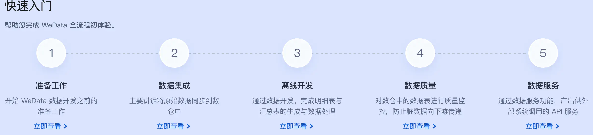


# 腾讯云 WeData 大数据开发实操手册

> 基于腾讯云 WeData 快速入门“商城订单分析”案例整理。以 MySQL 业务库为源、EMR Hive 为数仓引擎，完成数据接入、离线加工、依赖调度、质量监控，并给出可选的数据服务/API发布流程。
>
> 适用读者：数据开发人员、项目管理员。文中控制台菜单和计费规格可能随产品迭代调整；以实际控制台为准。购买云资源会产生费用，需由有权限的管理员执行。

## 1. 实战目标与链路

业务问题：统计每天、每个城市、每个商品品类的销售件数和销售额，为运营推广提供依据。

```text
MySQL（orders / products / categories / cities）
            │ WeData 离线同步
            ▼
EMR Hive ODS（原始层）
            │ Hive SQL 关联、清洗与汇总
            ▼
Hive DWD（订单商品明细） → Hive DWS（城市×品类×日期汇总）
            │ 可选：离线同步
            ▼
MySQL 汇总表 → 可选：WeData 数据服务 API / BI
```

本案例采用三层思路：ODS 保留源系统数据，DWD 形成业务明细，DWS 形成可直接消费的汇总指标。实际项目应根据数据量、保留周期和查询方式补充分区、生命周期及字段规范。

## 2. 开工前检查清单

### 2.1 账号、项目与权限

- 准备腾讯云账号并完成企业实名认证。
- 管理员创建开发子账号并授予 WeData 所需权限；遵循企业的最小权限要求。
- 开通 WeData，选择合适地域和版本，并创建项目/工作空间。
- 项目中添加数据开发人员，确认其有数据源、任务开发、运行和提交所需权限。

### 2.2 云资源与网络

- 准备 EMR 集群作为计算与 Hive 存储环境。
- 准备 MySQL 业务数据库及示例业务表：`orders`、`products`、`categories`、`cities`。
- 准备 WeData 集成资源组，用于 MySQL 与 Hive 之间的数据传输。
- 确认 MySQL、集成资源组、EMR 所在网络可互通，必要时检查 VPC、子网、安全组、白名单及端口。
- 资源地域、网络和可用区配置要相互匹配。试运行时的连通性检测不能通过时，先修网络与权限，不要直接忽略告警。
- 绑定 EMR 后，等待 Hive 数据源元数据采集完成；快速入门说明通常约需 10 分钟。

> WeData、EMR、MySQL、调度/集成资源组都可能产生费用。先核对地域、规格、计费方式和网络配置，再购买或创建。

## 3. 业务表与数仓表设计

### 3.1 源表与 ODS 对照

| 业务表（MySQL） | 目标表（Hive） | 用途 |
|---|---|---|
| `orders` | `ods_order_order` | 订单与订单商品行、金额、下单时间、收货城市 |
| `products` | `ods_product_product` | 商品及其品类 ID |
| `categories` | `ods_product_category` | 品类名称 |
| `cities` | `ods_order_city` | 城市名称 |

以下 SQL 示例统一使用 Hive 数据库 `emall`。如果你在项目中创建了其他数据库名，请统一替换所有 SQL 中的 `emall`。

订单 ODS 表建议保留订单源字段，并按下单日期分区：

```sql
CREATE TABLE IF NOT EXISTS emall.ods_order_order (
  order_id INT,
  product_id INT,
  quantity INT,
  unit_price DECIMAL(10,2),
  amount DECIMAL(10,2),
  order_time TIMESTAMP,
  shipping_city_id INT,
  shipping_address STRING
)
PARTITIONED BY (pt_date DATE)
STORED AS PARQUET;
```

其他三张表可按源表字段建表。若使用同步任务中的“一键创建目标表”，要检查并修改目标表名、分区字段和存储格式，避免直接沿用源端不适用的定义。

### 3.2 设计约定

- **分区字段**：订单按 `pt_date`（订单日期）分区，便于按天增量读写和控制扫描范围。
- **粒度**：DWD 一行表示一笔订单中的一个商品销售明细；DWS 一行表示某日、某城市、某品类的汇总。
- **金额口径**：示例直接汇总源字段 `amount`；正式上线前应核验它是行金额还是订单金额，确认退款、取消单、币种和精度口径。
- **字段含义**：字段注释、主键/业务键、时间口径和负责人应在项目中补齐。

## 4. 配置数据源并建立 ODS 同步

### 4.1 创建 Hive 数据库

进入项目的 **离线开发 → 编排空间 → 数据管理**，选择 EMR 自动接入的 `hive_emr-...` 数据源，新建数据库 `emall`。确认数据库已在数据源中可见。

### 4.2 创建工作流

在 **离线开发 → 编排空间** 新建文件夹“商城数据任务开发”，在该文件夹下新建周期工作流“商城数据开发”。周期工作流用于统一编排、调度每日同步及 SQL 任务。
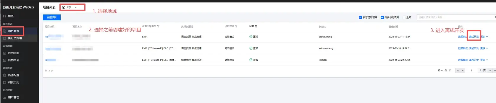


*图：从项目列表进入离线开发。*


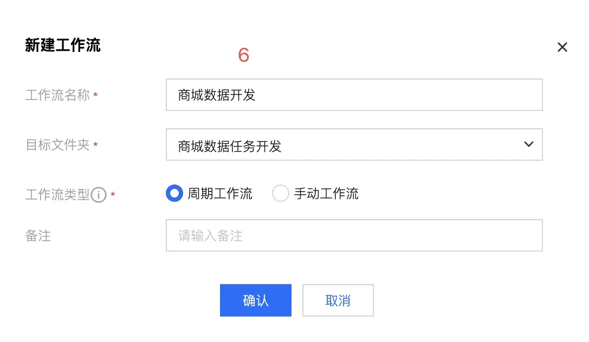

*图：创建“商城数据开发”周期工作流。*

### 4.3 配置基础表同步任务

创建以下三个 MySQL → Hive 离线同步任务：

| 任务名 | MySQL 源表 | Hive 目标表 | 初始案例策略 |
|---|---|---|---|
| `商城_同步商品类目` | `categories` | `emall.ods_product_category` | 全量，覆盖写入，每日 |
| `商城_同步城市信息` | `cities` | `emall.ods_order_city` | 全量，覆盖写入，每日 |
| `商城_同步商品信息` | `products` | `emall.ods_product_product` | 案例用全量，覆盖写入，每日 |

操作步骤：

1. 在工作流画布添加“离线同步”节点，选择表单模式并命名。
2. 配置 MySQL 数据源、数据库和源表。
3. 配置 Hive 目标数据源及 `emall` 数据库；创建或选择目标表，核对表名。
4. 检查源字段与目标字段映射；字段类型不一致时显式处理，不依赖猜测。
5. 对体量较小、变化不频繁的维表，本案例使用全量覆盖。按业务确定每天执行时间。
6. 指定集成资源组。确认资源组到 MySQL 和 EMR 都能连通。
7. 保存后先试运行，检查配置校验、网络检测、日志和目标数据，再提交。

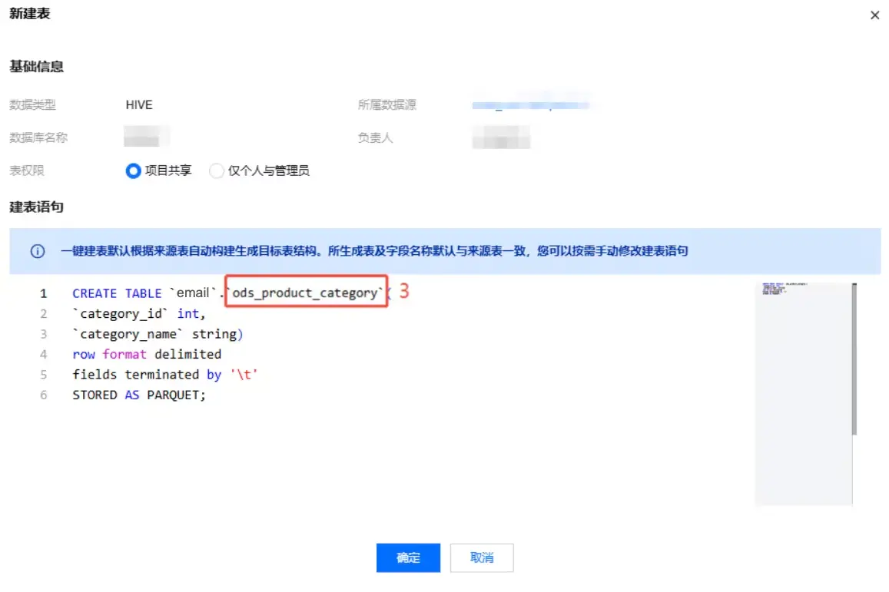


*图：修改目标 Hive 表名及建表结构。*

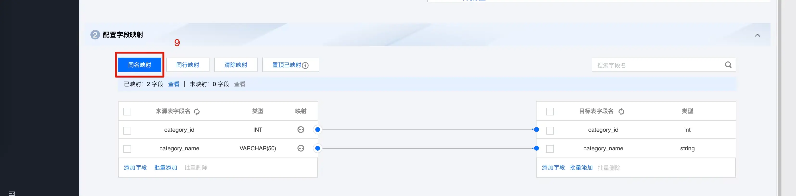


*图：检查源字段与 Hive 目标字段映射。*

> 正式业务通常不应因为“案例方便”就对大商品表持续做全量。要根据变更机制和数据量评估增量同步、全量初始化、周期性校准等方案。

### 4.4 配置订单增量同步

订单量通常最大，按 `order_time` 取前一天数据，并写入 Hive 的 `pt_date` 分区。

1. 新建离线同步任务“商城_同步订单信息”，源表选择 `orders`，目标表选择 `emall.ods_order_order`。
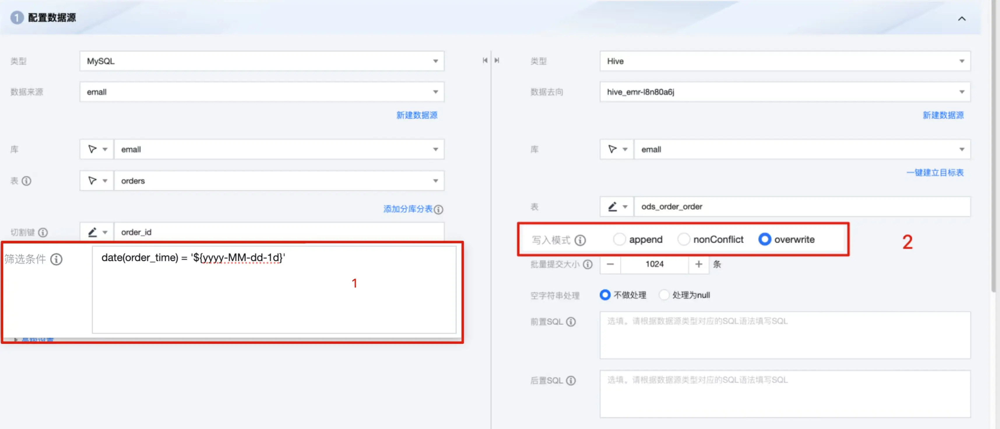
2. 增加目标分区字段 `pt_date`，类型为日期；字段映射中添加函数字段 `date(order_time)` 并映射至 `pt_date`。
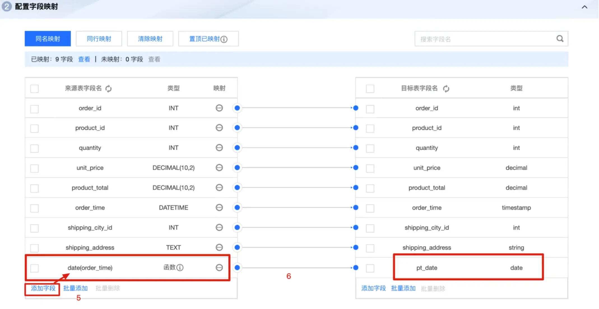
*图：把 `date(order_time)` 映射到目标分区字段 `pt_date`。*

3. 源端筛选条件按前一天的订单时间过滤，表达式示意：
   ```sql
   date(order_time) = '${yyyy-MM-dd-1d}'
   ```

4. 对目标分区使用覆盖写入，避免任务重跑后同一分区重复追加。需确认平台写入模式和分区行为与预期一致。
5. 执行时间安排在基础表同步完成后；案例中订单任务设为 00:10。
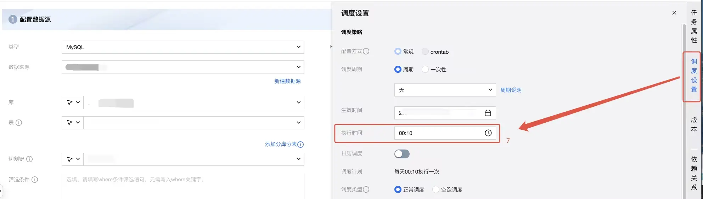

6. 试运行并核对 `pt_date`、记录数及金额，然后提交。

调度日期变量是平台运行时变量；确认项目时区及变量格式。若源端时间字段带时区、迟到订单较多或会回补历史，应调整窗口、回刷策略和幂等设计，而不应机械套用“昨天”。

## 5. 用 Hive SQL 开发 DWD 明细与 DWS 汇总

在“商城数据开发”工作流内创建 Hive SQL 任务。数据源选择 `hive_emr-...`，指定调度资源组。新建表任务设为一次性；每日加工任务设为周期调度。每项任务都先保存、运行验证，再提交。


*图：设置任务使用的资源组与调度时间。图片来自[腾讯云数据集成快速入门](https://cloud.tencent.com/document/product/1267/106201)。*

### 5.1 创建 DWD 明细表

```sql
CREATE TABLE IF NOT EXISTS emall.dwd_trade_order_ordercreate_productsales (
  order_id INT COMMENT '订单ID',
  product_id INT COMMENT '商品ID',
  product_name STRING COMMENT '商品名称',
  category_id INT COMMENT '商品品类ID',
  category_name STRING COMMENT '商品品类名称',
  quantity INT COMMENT '商品数量',
  unit_price DECIMAL(10,2) COMMENT '商品单价',
  amount DECIMAL(10,2) COMMENT '商品金额小计',
  order_time TIMESTAMP COMMENT '下单时间',
  shipping_city_id INT COMMENT '收货城市ID',
  shipping_city_name STRING COMMENT '收货城市名称',
  shipping_address STRING COMMENT '收货地址'
)
COMMENT '商品销售明细，一行表示一个订单商品行'
PARTITIONED BY (pt_date STRING)
STORED AS PARQUET;
```

1. 创建明细表任务
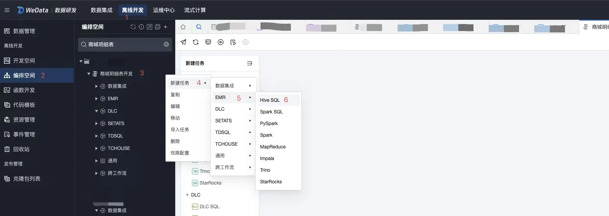


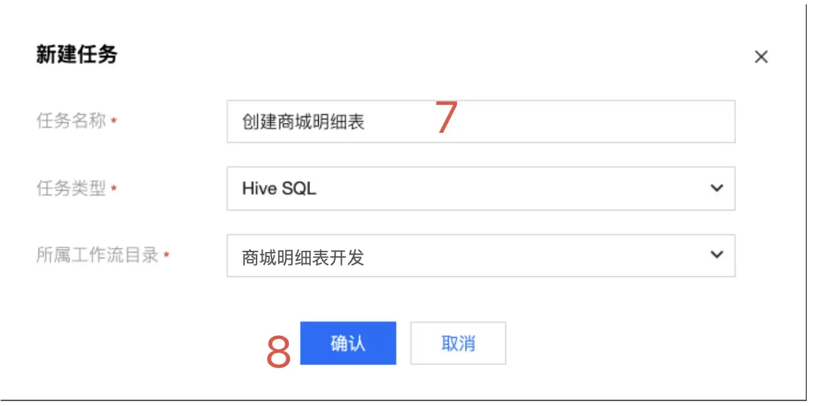

2. 执行创建明细表任务
任务周期：一次性；
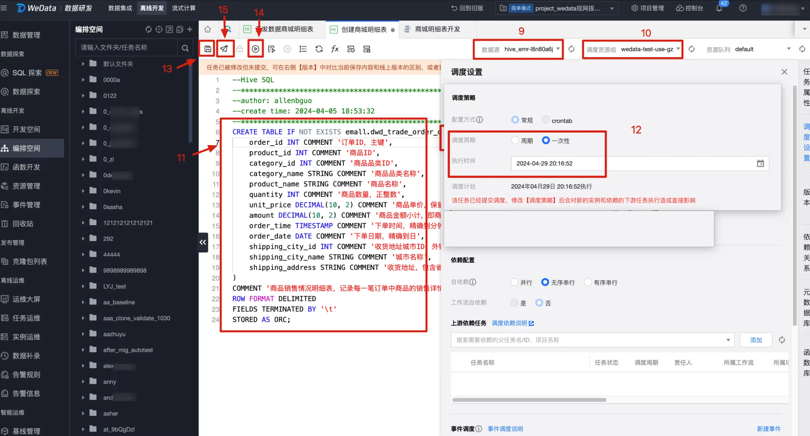

### 5.2 按天写入 DWD
下面我们将开始向明细表中写入数据：
>- 以下步骤均为配图里标明的步骤序号。
>- 在同一个工作流中，新建 HiveQL 节点；
>- 步骤7：命名为：插入数据到明细表；
>- 步骤9、10：这两个步骤比较容易忽略；
>- 步骤11：HiveQL语句如下；
>- 步骤12：
>- 调度周期改为：周期；执行时间设置为：01:00。
>- 说明：此任务需要每天运行1次。
>- 步骤14：无论有多熟悉操作，请记得在提交前后试运行一次，保证任务运行准确。


```sql
SET hive.exec.dynamic.partition.mode=nonstrict;

INSERT OVERWRITE TABLE emall.dwd_trade_order_ordercreate_productsales
PARTITION (pt_date)
SELECT
  o.order_id,
  o.product_id,
  p.product_name,
  p.category_id,
  c.category_name,
  o.quantity,
  o.unit_price,
  o.amount,
  o.order_time,
  o.shipping_city_id,
  ci.city_name,
  o.shipping_address,
  CAST(o.pt_date AS STRING) AS pt_date
FROM emall.ods_order_order o
JOIN emall.ods_product_product p
  ON o.product_id = p.product_id
JOIN emall.ods_product_category c
  ON p.category_id = c.category_id
JOIN emall.ods_order_city ci
  ON o.shipping_city_id = ci.city_id
WHERE o.pt_date = CAST('${yyyy-MM-dd-1d}' AS DATE);
```

这里用 `INSERT OVERWRITE` 写入目标日期分区，便于重跑当天数据。若 Hive 版本对日期转换或动态分区语法有差异，请按集群实际语法调整并先验证。若希望保留找不到维表匹配的订单，需评估 `JOIN` 是否改为 `LEFT JOIN`，并针对缺失维度设置质量规则。

以上我们完成了明细表的开发任务，每日凌晨待数据从原始表同步到 Hive 集群中后，系统将自动关联四张表，将数据汇总到明细表中。

### 5.3 创建 DWS 汇总表并计算
接下来我们将开始开发汇总表。
汇总表的创建和数据同步，跟DWD表的操作类似；
```sql
CREATE TABLE IF NOT EXISTS emall.dws_trade_order_productsales_1d (
  order_date DATE COMMENT '统计日期',
  city_id INT COMMENT '城市ID',
  city_name STRING COMMENT '城市名称',
  category_id INT COMMENT '商品品类ID',
  category_name STRING COMMENT '商品品类名称',
  quantity BIGINT COMMENT '商品总销量',
  amount DECIMAL(18,2) COMMENT '商品总销售额'
)
COMMENT '商品销售情况每日汇总表'
PARTITIONED BY (pt_date STRING)
STORED AS PARQUET;
```

```sql
SET hive.exec.dynamic.partition.mode=nonstrict;

INSERT OVERWRITE TABLE emall.dws_trade_order_productsales_1d
PARTITION (pt_date)
SELECT
  CAST(d.pt_date AS DATE) AS order_date,
  d.shipping_city_id AS city_id,
  d.shipping_city_name AS city_name,
  d.category_id,
  d.category_name,
  SUM(d.quantity) AS quantity,
  SUM(d.amount) AS amount,
  d.pt_date AS pt_date
FROM emall.dwd_trade_order_ordercreate_productsales d
WHERE d.pt_date = '${yyyy-MM-dd-1d}'
GROUP BY
  d.pt_date,
  d.shipping_city_id,
  d.shipping_city_name,
  d.category_id,
  d.category_name;
```

汇总字段类型可按数据量和引擎支持调整。特别是 `SUM(INT)` 可能超过 32 位整数范围，因此示例按 `BIGINT` 保存销量；金额精度需结合源字段及业务规模确认。

## 6. 配置 DAG 依赖并发布调度

在工作流画布建立以下依赖，保证数据先到位，再逐层计算：
>双击商城数据开发工作流，会弹出工作流画布，显示该工作流下所有任务，依次建立工作流之间的依赖关系，完成后单击提交按钮


```text
商城_同步商品类目 ─┐
商城_同步城市信息 ─┼→ 插入数据到明细表 → 插入数据到汇总表
商城_同步商品信息 ─┤          ↑                    ↑
商城_同步订单信息 ─┘   创建商城明细表       创建商城汇总表
```

同步任务依赖配置可参考下图。DWD、DWS 的 SQL 依赖还需按上述 DAG 在同一画布中补全。

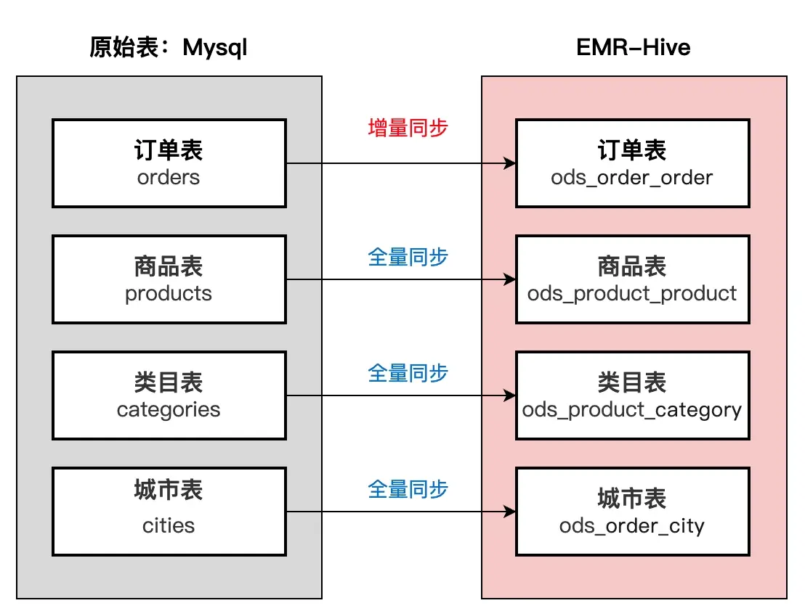

*图：腾讯云快速入门的数据源到目标表同步设计。DWD、DWS 的 SQL 依赖还需按上方 DAG 在工作流画布中补全。*

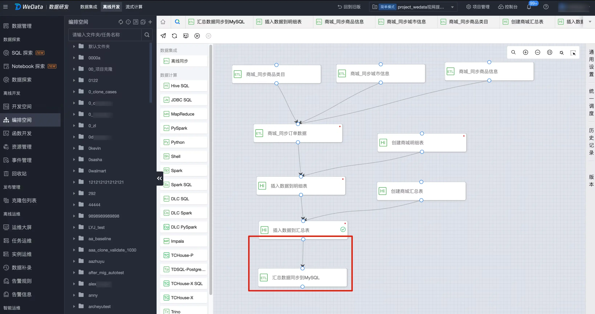
*图：任务依赖关系*

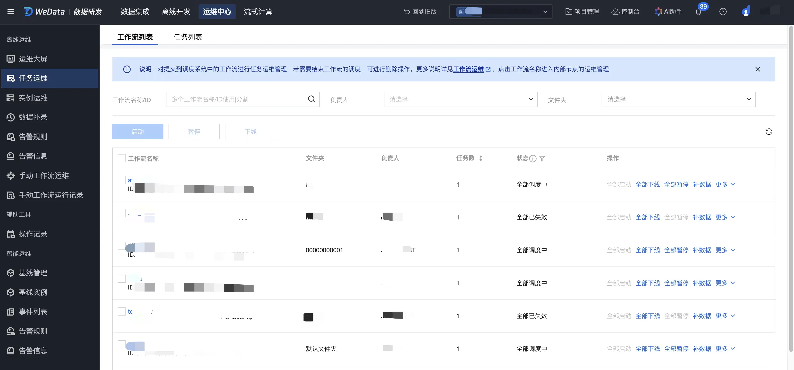
*图：查看工作流或离线任务的运行状态*

实施时核对：
- 三张维表同步及订单同步都先于 DWD 写入。
- 两张建表任务先于相应的插入任务。
- DWD 插入先于 DWS 插入。
- 订单同步窗口和 DWD/DWS 过滤分区一致。
- 保存工作流，逐节点试运行或按依赖运行；确认日志成功、分区有数据、汇总结果合理后再提交工作流。
- 提交后到运维中心观察实例生成与实际运行状态。不要只以“提交成功”作为数据已产出的依据。

## 7. 数据质量监控（建议启用）
目的：我们将完成对数仓中的数据表进行质量监控，防止脏数据向下游传递。

在 **数据质量 → 数据监控 → 新建监控** 中选择目标表，设定监控触发策略为关联生产任务完成后执行。至少配置：

- 关键字段非空：例如 `order_id`、`pt_date`、`amount`。
- 分区数据量：当天应有数据；可根据业务量设置最小记录数或波动阈值。
- 业务合理性：`quantity > 0`、`amount >= 0`，必要时校验金额与数量/单价关系。
- 维度匹配：商品、品类和城市关联失败的记录应可监控。

在规则中配置阈值、告警对象及通知方式；先试运行查看检测结果，再开启监控。高等级规则可能阻断上游任务或后续工作流，启用前先确认告警等级和阻断行为。运维时分别查看实例执行状态与规则检测状态。

1. 新建监控
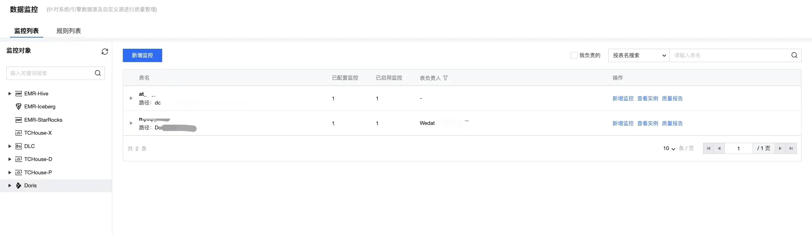
*图：新建监控*

2. 配置监控信息
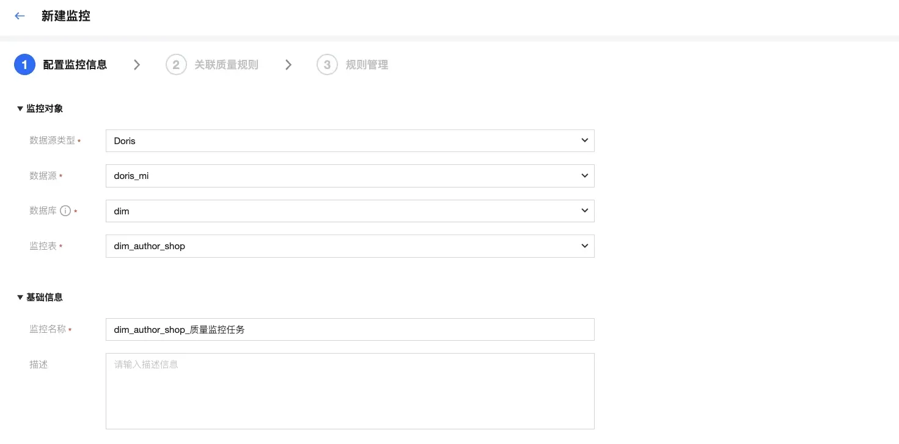
*图：配置监控信息*

3. 配置执行策略
当关联的数据集成任务周期调度执行完成后，就会触发执行该质量监控任务
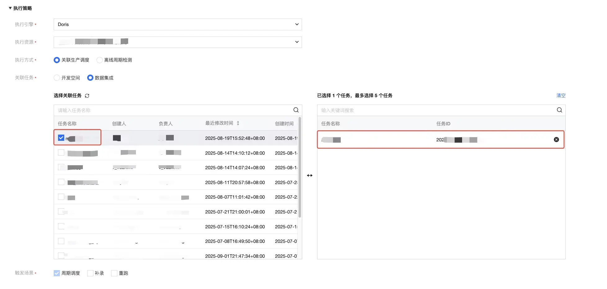
*图：配置执行策略*

4. 规则管理
新增规则：字段空值规则可设置目标字段、触发阈值和等级
>注意：如果触发等级选择“高”，当质量任务检测异常时会将关联的上游生产任务置为“失败”，直接阻断工作流后续任务节点。
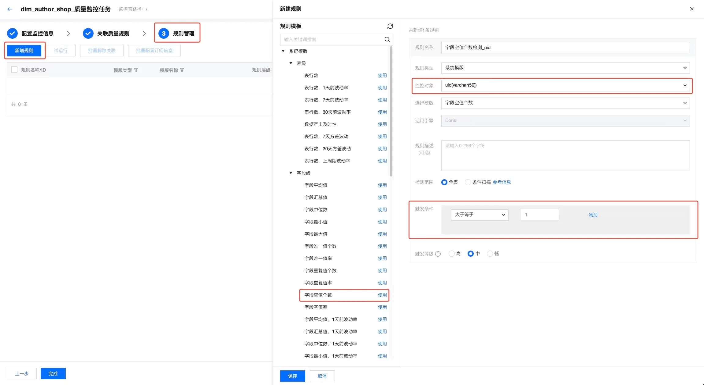
*图：字段空值规则可设置目标字段、触发阈值和等级。*

5. 配置告警订阅信息
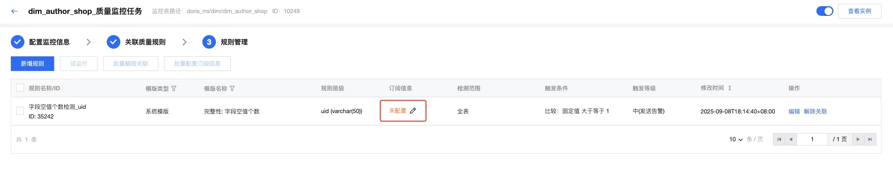

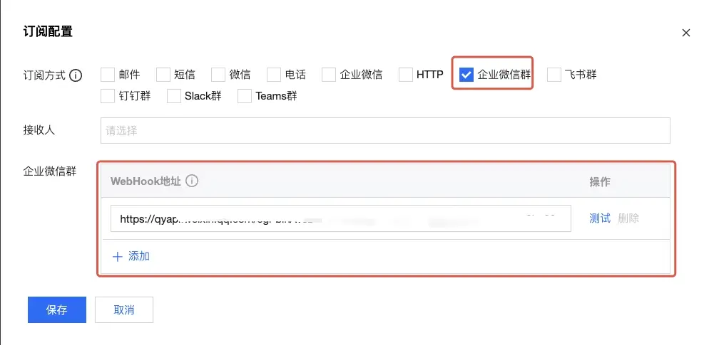
*图：配置告警订阅信息*

6. 质量监控任务运维
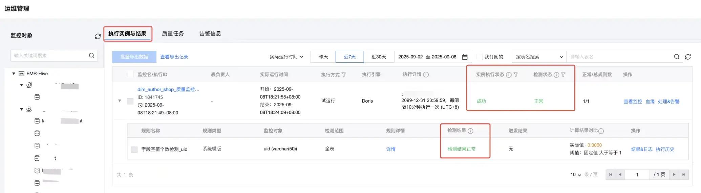
*图：质量监控任务运维*


## 8. 可选：把汇总结果发布为 API

关于商城明细表的数据应用，有多种方式：
- 通过 SQL 直接提数，查看每日销售情况，比较简单，在此教程中不做介绍。
- 通过 BI 软件（例如，腾讯云 BI）展示数据报表视图，相关文档请参见 腾讯云 BI 官网，本教程中不做介绍。
- 通过 WeData 数据服务功能，产出供外部系统调用的 API 服务，在本教程中将重点介绍此部分。
下面我们介绍如何通过 WeData 数据服务功能，产出供外部系统调用的 API 服务。

>Hive 擅长大规模分析，但通常不是低延迟 API 查询的最佳后端。快速入门将 Hive 汇总结果同步到 MySQL，再通过 WeData 数据服务发布查询 API。

1. 管理员准备 WeData 数据服务资源组、API 网关及与项目匹配的网络资源（该部分会产生费用）。
2. 在 MySQL 建汇总表：

   ```sql
   CREATE TABLE emall.dws_trade_order_productsales_1d (
     order_date DATE NOT NULL,
     city_id INT NOT NULL,
     category_id INT NOT NULL,
     city_name VARCHAR(50) NOT NULL,
     category_name VARCHAR(50) NOT NULL,
     quantity BIGINT NOT NULL,
     amount DECIMAL(18,2) NOT NULL,
     pt_date VARCHAR(50) NOT NULL
   );
   ```

3. 在工作流增加 Hive → MySQL 的离线同步任务，源端筛选前一天分区，写入模式按分区/目标表策略选择覆盖，时间设在汇总计算之后（案例为 01:00）。将任务接到 DWS 后面。
4. 进入 **数据服务 → 服务开发** 新建 API，选择 MySQL 汇总表作为数据源。
  - 创建API服务
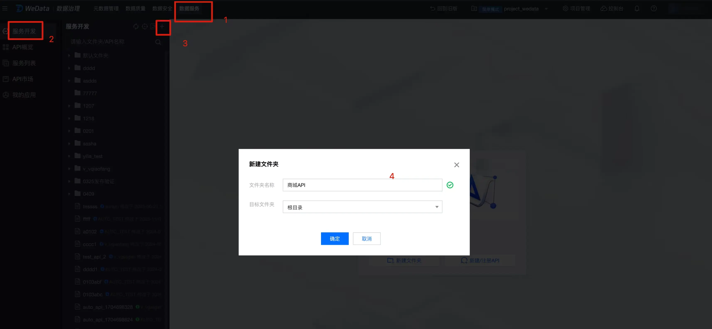
  
  - 配置API服务
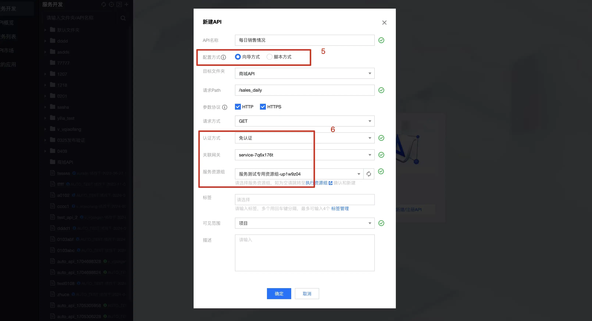
>服务资源组：就是我们的目标mysql数据库

  - 设置数据源
此处选择 MySQL 数据源，并选择之前创建的汇总表。
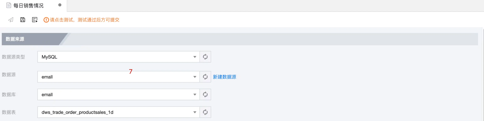

5. 配置请求参数：日期必填，城市 ID、品类 ID 可选；绑定数据库字段。配置响应字段及排序。
  - 配置出入参
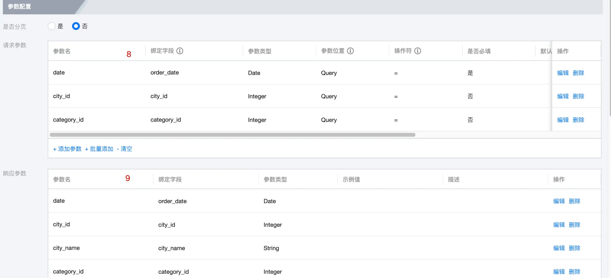

  - 配置排序
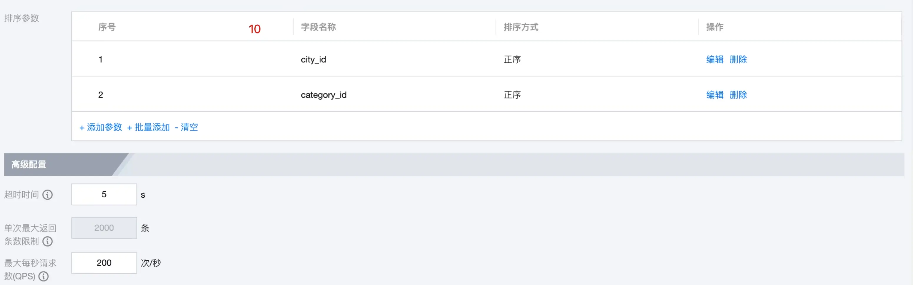

6. 使用有数据的日期试调用 API，检查返回字段与结果后提交发布。
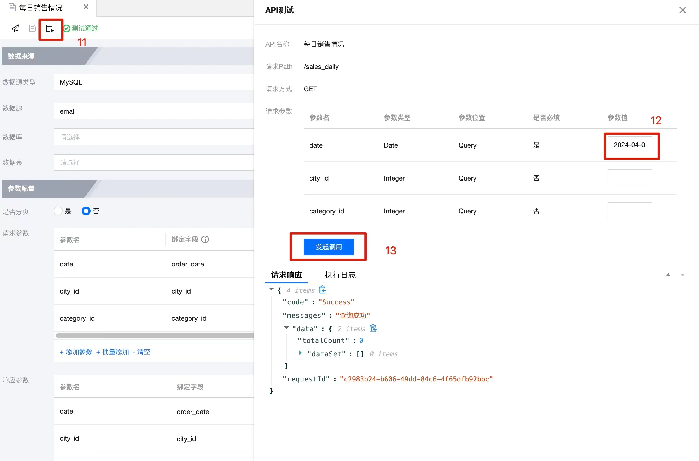
*图：提交前使用必填日期参数试调接口。*

7. 运维数据服务接口
数据服务 API 提交后，可在服务列表中查看此服务。并可在此列表对 API 进行管理，如设置可见性、设置告警、下线等操作。

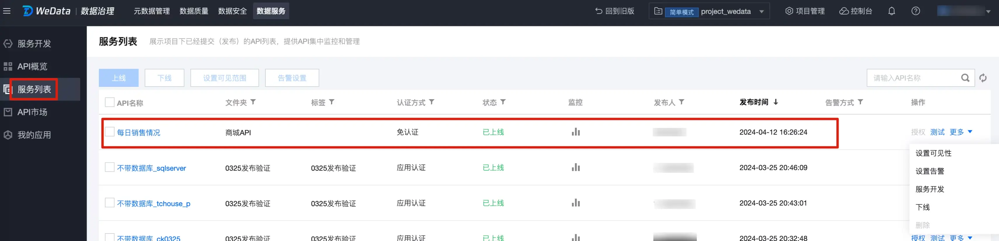


生产 API 不建议使用“免认证”作为默认方案。按调用方身份、数据敏感级别和企业安全要求配置认证、访问控制、限流与告警；遵循最小暴露原则。

## 9. 验收与故障排查

### 9.1 验收清单

- [ ] 四张源表都能从 MySQL 正常读取，Hive ODS 表名和字段正确。
- [ ] 每日订单只进入预期 `pt_date` 分区；重跑不会造成重复或丢失。
- [ ] DWD 行数、订单数、金额与源表抽样对账一致。
- [ ] DWS 按日期、城市、品类聚合结果正确，销量和金额口径经业务确认。
- [ ] DAG 依赖顺序正确，工作流已提交，运维中心可查看实例与日志。
- [ ] 质量任务可以按生产任务完成事件触发，并按预期通知/阻断。
- [ ] 如发布 API，接口参数、认证、响应内容及权限经过调用验证。

### 9.2 常见问题定位顺序

| 现象 | 优先检查 |
|---|---|
| 连接超时/连通性检测失败 | 集成资源组、MySQL、EMR 是否同地域且网络互通；VPC/子网/安全组/白名单/端口；账号密码与网络权限 |
| 找不到 Hive 数据源/库表 | EMR 是否绑定项目；等待元数据采集；数据源和数据库是否选对；表是否创建在当前库 |
| 同步字段错误或建表失败 | 源目标字段类型、字段映射、保留字、分区字段类型、目标表名及存储格式 |
| 订单分区为空 | `${yyyy-MM-dd-1d}` 解析日期、时区、`order_time` 类型及源数据是否覆盖该日 |
| 重跑后数据重复/金额翻倍 | 是否使用分区覆盖；写入模式；DAG 是否重复执行；JOIN 键是否唯一；源数据是否有重复订单行 |
| SQL 成功但汇总不合理 | 业务金额定义、过滤条件、关联键、迟到数据、空维度、聚合粒度及数值精度 |
| 定时任务未运行 | 工作流/任务是否提交、是否到生效时间、时区、调度资源组状态、上游依赖是否成功 |

## 10. 生产化建议

- 先做小样本验证，确认口径、数据量和资源开销后再扩大调度范围。
- 对大表优先采用可恢复、幂等的增量或分区重算策略；定义迟到数据和历史回刷规则。
- 将调度时间错开，避免同步、计算和质量检查同时争抢资源；根据耗时和 SLA 留出缓冲。
- 重要任务设置负责人、失败告警和重试策略；异常恢复后做分区级对账。
- 做好表/字段注释、命名规范、数据生命周期和权限治理。
- 资源规格与产品功能受地域、版本影响；投产前按当前控制台和价格说明复核。

## 参考文档

- [WeData 快速入门：整体介绍](https://cloud.tencent.com/document/product/1267/106198)
- [WeData 快速入门：准备工作](https://cloud.tencent.com/document/product/1267/106199)
- [WeData 快速入门：数据表结构设计](https://cloud.tencent.com/document/product/1267/106200)
- [WeData 快速入门：数据集成](https://cloud.tencent.com/document/product/1267/106201)
- [WeData 快速入门：离线开发（本文主要依据）](https://cloud.tencent.com/document/product/1267/106202)
- [WeData 快速入门：数据质量](https://cloud.tencent.com/document/product/1267/106203)
- [WeData 快速入门：数据服务](https://cloud.tencent.com/document/product/1267/106204)
- [WeData 数据开发快速入门：工作流与任务调度基础](https://cloud.tencent.com/document/product/1267/95279)
