## Spark

Spark 包括了四种不同的组件：Spark SQL、Spark MLlib、Spark Structured Streaming和GraphX。这些组件都与Spark 的核心容错引擎分开，即使是用API编写Spark 应用程序，Spark 也会将其转换为由核心引擎执行的DAG。

## DataHub(元数据管理平台)
DataHub 是一个为现代数据栈设计的元数据管理平台，它能够帮助企业更好地收集、管理、发现、理解和使用数据资产。采用模型优先的理念。

>DataHub操作的都是元数据，以及对元数据的标注；
>DataHub 管的是“关于数据的数据”，它通过 URN 把治理信息锚定到真实资产上。真正的数据控制，需要底层引擎（查询引擎、权限系统）主动去读 DataHub 的治理信息，然后自己执行。 DataHub 本身不碰业务数据，它是治理信息的“集散地”和“协作台”。

**特性**
- 元数据提取：支持通过推送（Push）和拉取（Pull）两种模式从各种数据源获取元数据
- 数据发现：支持通过关键词、过滤条件或高级运算符，在所有集成的数据资产中进行快速搜索
- 数据治理：DataHub 提供了策略管理功能，可以实现细粒度的访问控制，例如定义谁可以对哪些数据资源执行何种操作。同时还支持通过标签（Tag）、术语表（Glossary）和域（Domain） 等工具进行数据治理。
- 所有权管理：支持快速将数据资产的所有权分配给特定用户或用户组，并支持多种所有权类型。
- 数据血缘：DataHub 能够跨平台、数据集和数据管道追踪数据的端到端旅程，并通过线性血缘图等可视化工具展示。
- 数据质量控制：通过元数据测试、断言、数据新鲜度检查和数据契约提高数据质量。
- API 集成：DataHub 提供了丰富的 API 和 SDK，方便你将数据流集成到各种应用中。
- MCP 服务器： 实现了模型上下文协议，支持 LLM 和 AI 代理查询 DataHub 元数据并使用它来查找相关资产、遍历沿袭等。

**核心原理**
DataHub 的元数据模型有两个关键概念：实体（Entity） 和 方面（Aspect）。
实体是任何被治理的数据资产，用 URN（统一资源名称）唯一标识，比如`urn:li:dataset:(urn:li:dataPlatform:mysql,orders,PROD)`。方面描述实体的某个维度，分为两类：

| 方面类型                   | 特点               | 存储位置                  | 示例                   |
| ---------------------- | ---------------- | --------------------- | -------------------- |
| **版本化方面（Versioned）**   | 每次变更生成新版本，保留完整历史 | 关系数据库（MySQL）          | 所有权、标签、描述、Schema     |
| **时间序列方面（Timeseries）** | 带时间戳的事件，按时间范围查询  | Elasticsearch + Kafka | 数据画像（Profiling）、使用统计 |
这种分离设计的核心逻辑是：描述性元数据需要版本追溯（谁在什么时候改了什么），而监控性元数据需要时间序列分析（过去7天查询量趋势）

**架构**

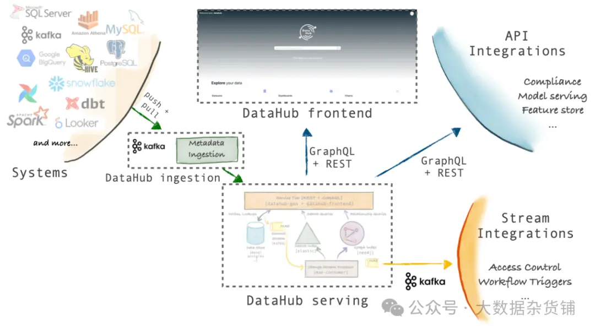

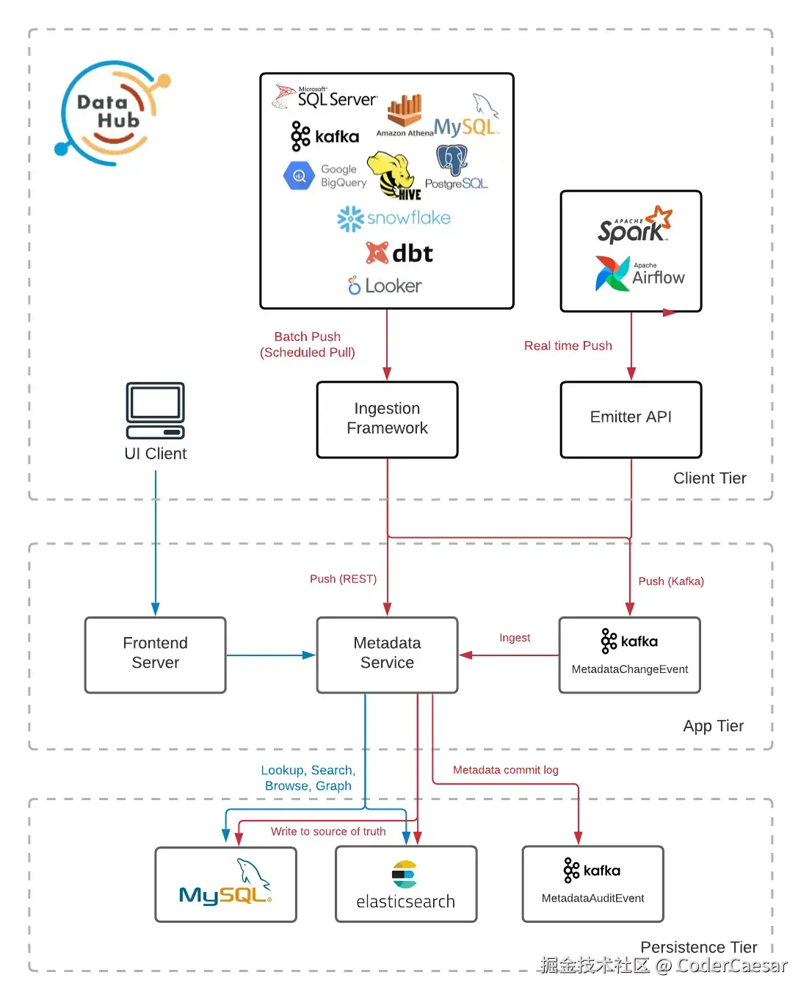
三个层级结构
- 客户端层：前端页面、数据摄取以及一些数据发射API
- APP层：为前端页面提供服务的server、元数据服务、存储元数据变更事件的kafka
- 持久化层
	- mysql：前端页面的查询数据
	- es：元数据
	- kafka：metadata commit log(MCL)

**在线体验**
DataHub 提供了一个免费的在线环境，可以直接通过浏览器进行访问，不需要注册：
https://demo.datahub.com/

**示例图**
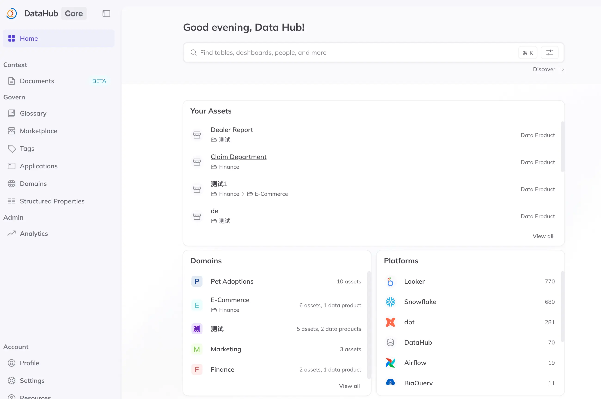

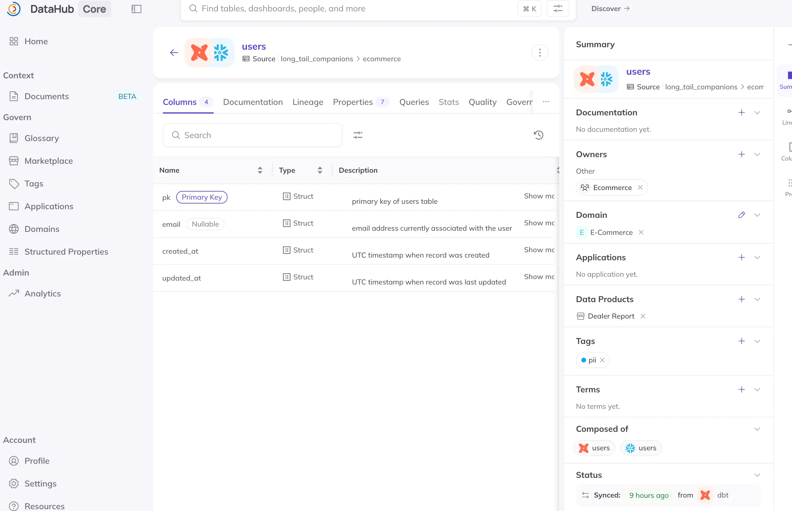

https://zhuanlan.zhihu.com/p/1956388064151700159 一个现代化的元数据管理平台
https://juejin.cn/post/7419995453200744467 DataHub元数据治理平台架构
## Trino(Sql查询引擎)
Trino是一个开源的分布式 SQL 查询引擎，旨在高效查询分布在多个异构数据源中的大型数据集

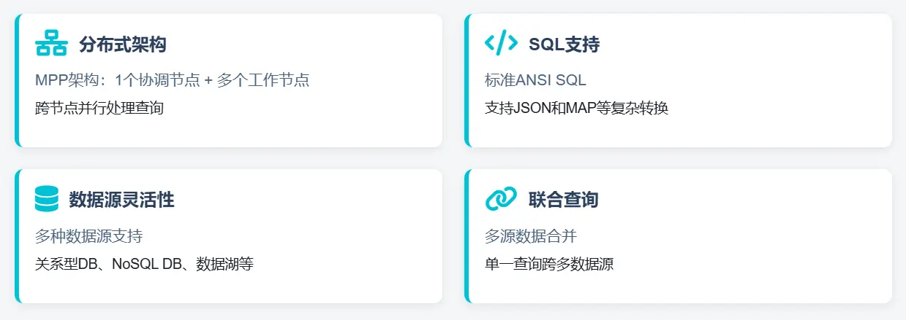

**特性**
- 联邦查询：Trino 允许使用一条 SQL 语句同时查询多个不同的数据源
- 秒级响应的高性能查询：Trino 主要在内存中进行数据处理，极大减少了磁盘 I/O 的瓶颈；同时它采用了流水线式执行方式
- 轻量级部署与资源弹性扩展
- 存储解耦：Trino 自身不存储数据，它通过连接器与各种数据源集成
- 标准 SQL：Trino 支持 ANSI SQL，学习成本低，大多数熟悉 SQL 的分析师和开发人员都可以直接上手使用。同时，它也支持窗口函数、公共表表达式（CTE）、近似查询等高级功能。
- 生态系统：可以与主流的 BI 工具（例如 Tableau、Superset、Metabase）、数据调度系统（例如 Airflow、DolphinScheduler）以及数据湖格式（例如 Iceberg）无缝集成。

**适用场景**
trino的核心目标就是提供【交互式查询】，也就是我们常说的 Ad-Hoc Query(即席查询)，很多公司都使用它作为 OLAP 计算引擎。
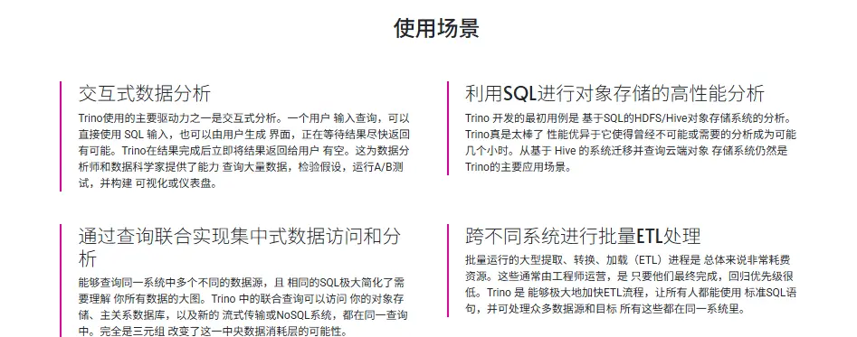

**查询执行流程**
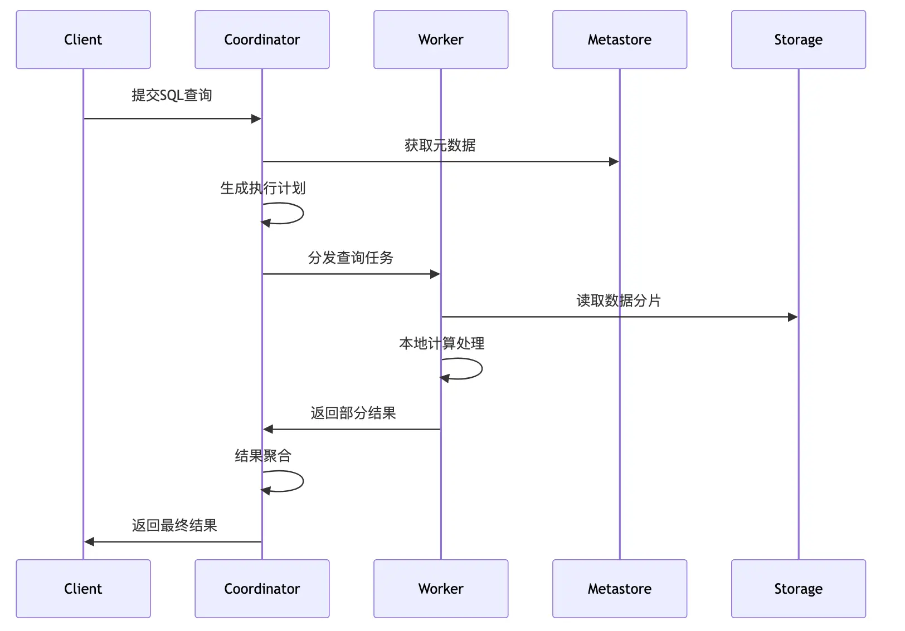

**连接器**
Trino的一大特色是其插件化的连接器架构（Connector），可支持丰富的数据源，包括：
关系型数据库：
- MySQL, PostgreSQL, SQL Server等
- 大数据存储：Hive, HDFS, Cassandra等
- 流处理系统：Kafka
- 对象存储：S3, MinIO等

**效果图**
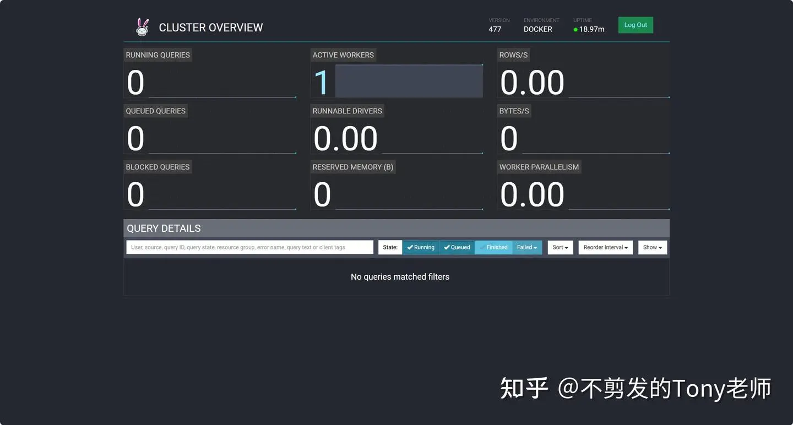
*集群状态*

https://www.cnblogs.com/johnnyzen/p/19385024 开源的分布式SQL查询引擎 
https://zhuanlan.zhihu.com/p/1959215827426444621 Trino：一个开源分布式大数据SQL查询引擎
## Airflow(任务编排)
Apache Airflow提供基于DAG有向无环图来编排工作流的、可视化的分布式任务调度，与Oozie、Azkaban等任务流调度平台类似。
- 采用Python语言编写，提供可编程方式定义DAG工作流
- 可以定义一组有依赖的任务，按照依赖依次执行
- 实现任务管理、调度、监控功能
- 可视化监控：提供了工作流节点的运行监控，查看每个节点的运行状态、运行耗时、执行日志等

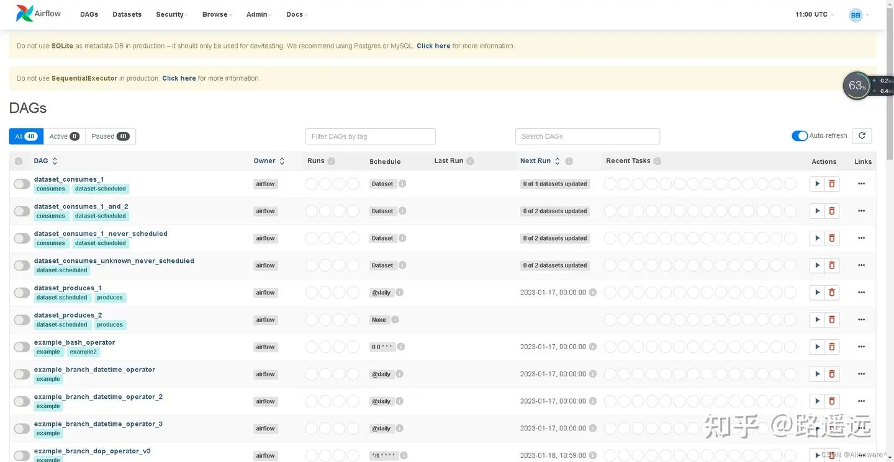

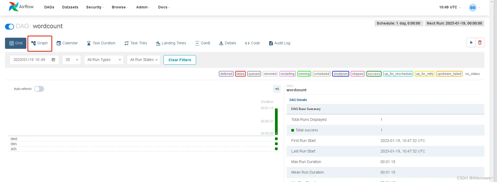

## Apache Superset(数据可视化)
Apache Superset 是一个开源的数据挖掘平台，支持丰富的数据源连接，多种可视化方式，并能够对用户实现细粒度的权限控制。该工具主要特点是可自助分析、自定义仪表盘、分析结果可视化（导出）、用户/角色权限控制，还集成了一个 SQL 编辑器，可以进行 SQL 编辑查询等。
>Superset 本身是一个开箱即用的 BI 产品，包括前后端服务；

**功能特性**
- 丰富的数据可视化集
- 易于使用的界面，用于浏览和可视化数据
- 创建和共享仪表板
- 与主要身份验证提供程序（数据库，OpenID，LDAP，OAuth和REMOTE_USER通过Flask AppBuilder集成）集成的企业就绪身份验证
- 可扩展的高粒度安全性/权限模型，允许有关谁可以访问单个要素和数据集的复杂规则
- 一个简单的语义层，允许用户通过定义哪些字段应显示在哪些下拉列表中以及哪些聚合和功能度量可供用户使用来控制如何在UI中显示数据源
- 通过SQLAlchemy与大多数SQL的RDBMS集成

**架构**

|层次|技术栈|说明|
|---|---|---|
|**前端**|React + TypeScript + Ant Design|负责界面展示和交互|
|**后端**|Python + Flask + SQLAlchemy|负责业务逻辑、数据查询、权限管理|
|**数据层**|支持 70+ 种数据库|MySQL、PostgreSQL、ClickHouse、Hive、Presto 等|

**效果图**

可视化库
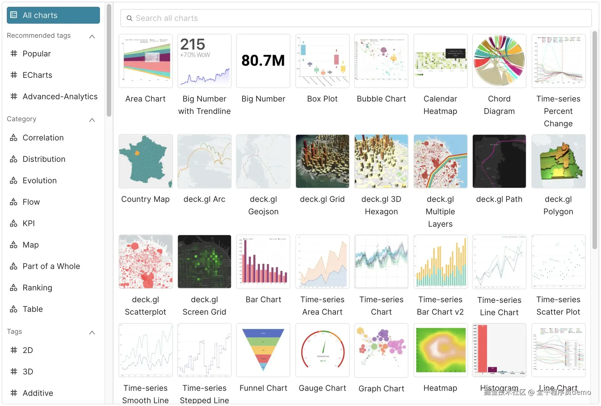

仪表板
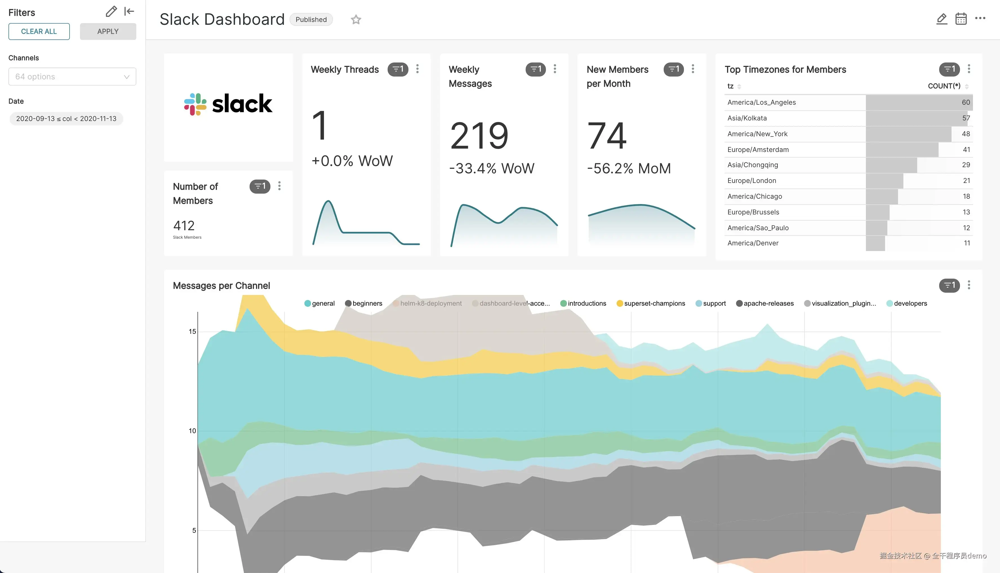

无代码图表生成器
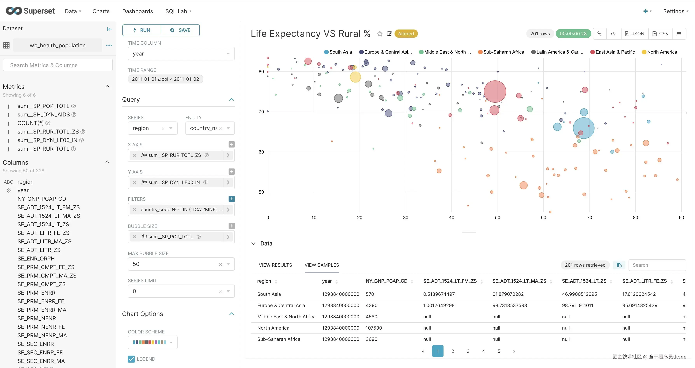

强大的 SQL 编辑器
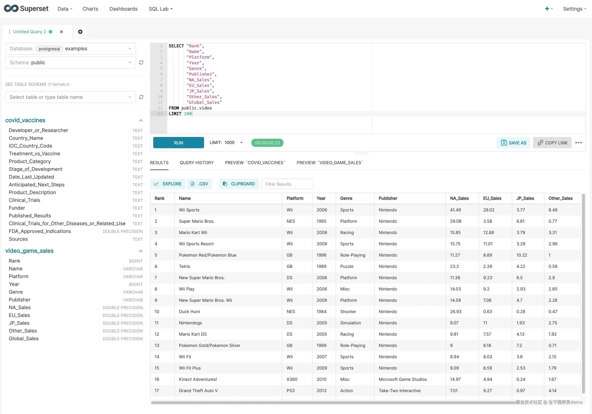

**与Tableau对比**

|维度|Tableau|Superset|
|---|---|---|
|内置预测函数|✅ 拖拽即用|✅ Prophet 插件|
|聚类分析|✅ 内置|❌ 不支持|
|调用 Python/R 模型|✅ TabPy / TRE|✅ Python 扩展|
|对接外部 ML 平台|✅ SageMaker、Databricks 等|❌ 需自行开发|
|无代码预测建模|✅ Einstein Discovery|❌ 不支持|
|生成式 AI / 自然语言|✅ Tableau Agent（LLM）|✅ MCP + 自然语言查询|
|解释数据（自动归因）|✅ Explain Data|❌ 不支持|
>💡 总结：Tableau 的 ML 能力比 Superset 更成熟、更完整，尤其在无代码预测建模和外部 ML 平台集成方面优势明显。但 Tableau 是商业付费产品，而 Superset 是开源免费的。如果你的场景需要深度 ML 集成且预算充足，Tableau 更合适；如果追求开源自主可控，Superset + Jupyter 的组合也能覆盖大部分需求。

https://juejin.cn/post/7434176200551792659 Apache superset 轻松搞定大数据可视化展示

## Tableau
Tableau是当今数据科学和商业智能（BI）专业人士使用率较高的数据可视化工具之一。
商业闭源的；
Tableau作为一款商业智能软件整合了数据管理、数据清洗、数据分析、数据可视化、数据预测等等数据分析过程，通过自助式和敏捷的手段高效传递数据信息、辅导商业决策。

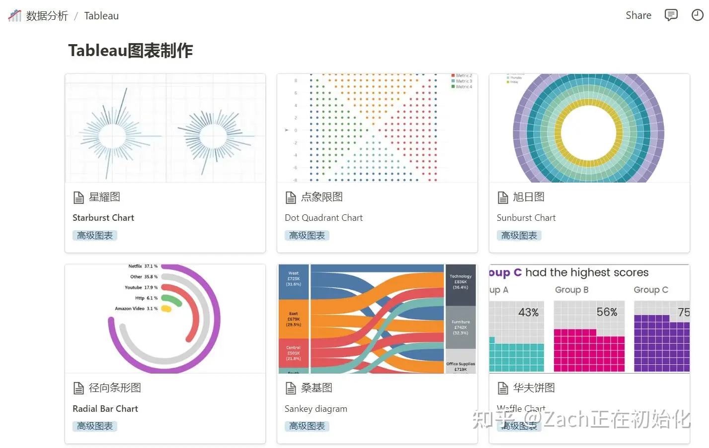

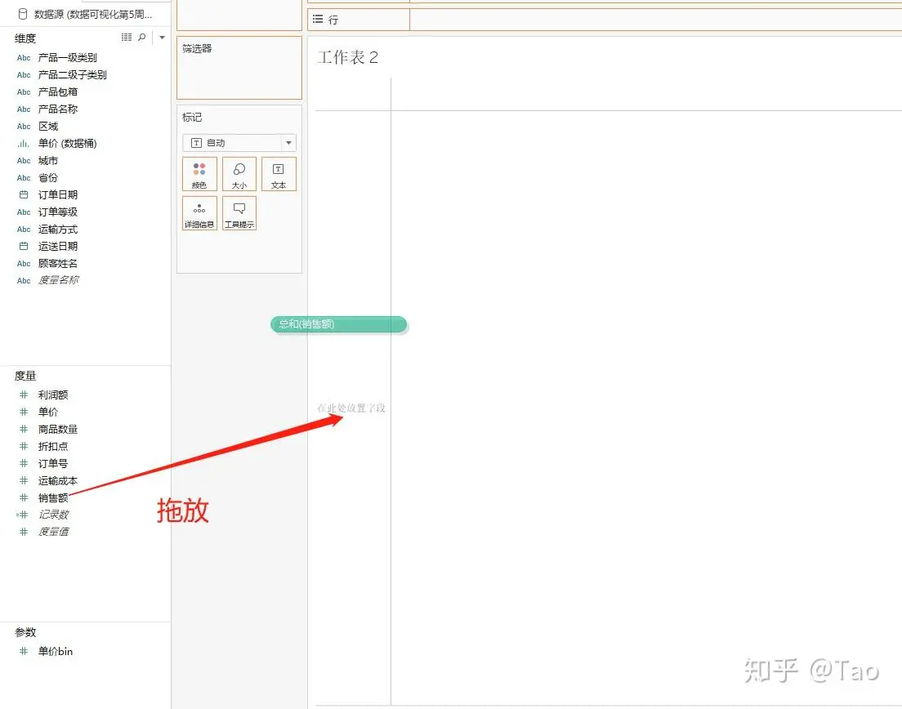

https://zhuanlan.zhihu.com/p/500983855 数据可视化：Tableau 新手入门教程
