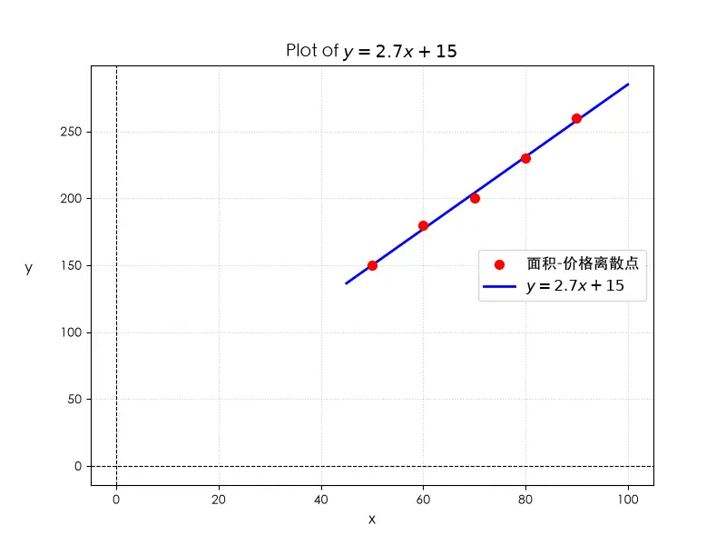
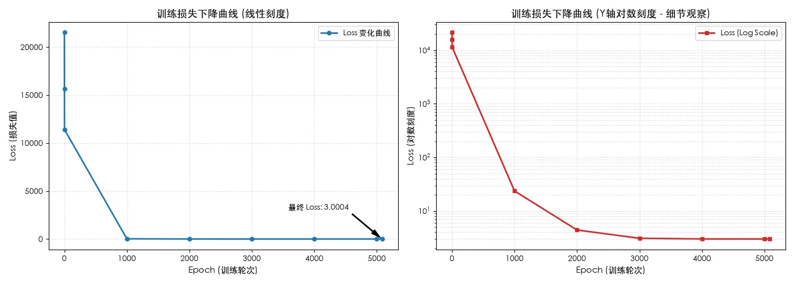

## 说明
通过案例，来一步步了解机器学习的流程、模型定义、算法作用，以及对应代码实现；从底层建立对机器学习的认知。

案例->机器学历流程->重要流程&知识点,标记单独介绍->形成机器学习底层原理认知(代码级)


## 房屋价格预测


### 背景

买卖房的人需要知道房屋价格，进而达成交易。

下方是一份“房屋面积-价格关系”表格；

| 房屋编号 | 面积（㎡） | 价格（万元） |
| ---- | ----- | ------ |
| 1    | 50    | 150    |
| 2    | 60    | 180    |
| 3    | 70    | 200    |
| 4    | 80    | 230    |
| 5    | 90    | 260    |
需求：一般我们是知道房子的面积的，期望预测出对应的价格。

### 问题分析

通过对业务目标，以及提供的“房屋面积-价格关系”表格的分析；

确定业务目标：计算房屋价格；

数据关系：接近于线性关系，采用线性回归模型；

```
价格(万元)
260 |                          * (90,260)
230 |                    * (80,230)
200 |              * (70,200)
180 |         * (60,180)
150 |    * (50,150)
    +----------------------------------
       50    60    70    80    90   面积(㎡)
```


### 数据收集

直接使用“房屋面积-价格关系”表格；

### 数据预处理

“房屋面积-价格关系”表格已经很标准、简洁了，可以直接使用；


### 模型设计


模型设计：就是明确机器学习的三要素：模型+策略+算法

>**线性回归**：是一种用于预测连续值的最基本的机器学习算法，它假设目标变量 y 和特征变量 x 之间存在线性关系，并试图找到一条最佳拟合直线来描述这种关系
>
>**损失函数（Loss Function ）**：就是单个样本的误差，预测值和真实值之间的差距，但是衡量差距的方式有很多种，但是大多数情况下采用距离或者做差  
>
>**代价函数（Cost Function ）**：它是整个训练集的损失，可以理解为所有样本数据的平均损失，但有时也可以不做平均，就是考虑总体损失  
>
>**目标函数（Object Function）**：它是最终我们需要优化的函数，它代表着我们模型的各方面能力，抗干扰性、精度方面等；$目标函数 = 损失函数 + 正则化项 + 其他约束$
>
>**注意**：很多资料和交流中，这三者都用损失函数代称，原因在于关注的重点是函数表达的是损失值(误差值)。
>
>**最小二乘法**：它通过最小化误差的平方和寻找数据的最佳函数匹配，使观测值与模型预测值之间的差的平方加起来最小，从而得到未知参数的近似解。
>
>**梯度下降**：是一种优化算法，通过迭代反复调整权重和偏差，逐步将目标函数的误差值降到最低，也就确定了最优模型参数：权重和偏差


#### 机器学习算法模型

线性回归：$\hat{y}_i=wx_i​+b$

>其中$x_i$是样本特征值(房屋面积)， $y_i$是样本标签值(表格中的房屋价格)， $\hat{y}_i$是模型预测值（模型计算得出的值），$w$：权重(房屋面积影响比重)。$b$：偏差/截距(地段等其他因素)，i表示第i个训练样本


#### 损失函数

损失函数1：$L=f(y_i,\hat{y}_i)$=$y_i-\hat{y}_i$=$y​_i-(wx_i​+b)$，即单个样本实际值与期望值的差值

损失函数2：$L^2=(y​_i-(wx_i​+b))^2$，即单个样本实际值与期望值的差值的平方；平方计算后，能放大差值，另外也能消除负值影响(比如2个样本，一个-10，一个10，后续相加为0，结果看起来没影响，跟实际不符)


#### 代价函数

**代价函数1(残差平方和 SSE)**
$SSE=\sum_{i=1}^{n}​(y_i-\hat{y_i}​)^2=\sum_{i=1}^{n}(​y​_i-(wx_i​+b))^2$
参数优化（最小二乘），即所有误差平方的总和，它衡量的是"预测值和真实值之间的总偏差"；

**代价函数2(均方误差 MSE)：**
对于线性回归问题，通常使用均方误差（MSE）作为损失函数

$MSE=\large\frac{SSE}{n}=\frac{1}{n}\sum_{i=1}^{n}​(y_i​−(wx_i​+b))^2$

用于模型评估与比较，它衡量的是"预测值和真实值之间的总平均偏差"，MSE与SSE的关系只是损失值的缩放关系

	J(w,b) 是机器学习中损失函数（Loss Function）或代价函数（Cost Function）的标准记号。它量化了模型在当前参数下的预测误差，是模型优化的核心目标。
	J代表损失函数/代价函数的名称，(w,b) 代表模型的可学习参数;
	J(w,b) 整体：代表参数到误差的映射关系;优化过程就是在这个曲面上寻找最低点（全局最小值或局部最小值）


#### 目标函数

这里面【代价函数2：均方误差(MSE)函数】，就是目标函数；我们模型训练的目的就是要优化目标函数；


#### 最小二乘法

它通过最小化误差的平方和寻找数据的最佳函数匹配，使观测值与模型预测值之间的差的平方加起来最小，从而得到未知参数的近似解。

结合前面目前函数的选择：

最小二乘法的数学公式：$\underset {(w,b)}{min(目标函数)}=\underset {(w,b)}{min(MSE)} = \underset {(w,b)}{min}\frac{1}{n}\sum_{i=1}^{n}​(y_i​−(wx_i​+b))^2$
我们的目标是通过调整 w 和 b ，使得 MSE 最小化。

核心思想
>定义了目标：误差使用平方，优化方向为使误差平方最小化；(最小二乘的误差计算，我们一般使用MSE)；
>寻找最优参数：达到目标的过程，就是求解[机器学习模型]中的{w,b}最优值的过程；


**一句话总结**：一元线性函数是"模型"（假设数据是线性的），最小二乘法是"学习方法"（怎么找到最好的那条线），两者结合就是**最简单的机器学习**——用数据自动学出一条最拟合的直线。


#### 优化算法：梯度下降
梯度下降法是一种迭代过程，可找到能最大限度减少损失的最佳权重和偏差。
梯度下降是一种优化算法，通过迭代反复调整权重和偏差，逐步将目标函数的误差值降到最低，也就确定了最优模型参数：权重和偏差。

 **梯度下降法的步骤**
1. **初始化参数**：初始化w和b的值（通常设为0 或随机值）。
2. **计算损失函数**：计算当前参数下的损失函数值 `J(w,b)`。
3. **计算梯度**：计算损失函数对 `w` 和 `b` 的偏导数。
4. **更新参数**：根据梯度更新 `w` 和 `b`。
5. **重复迭代**：重复步骤 2 到 4，直到损失函数收敛(达到0，即$min(目标函数)$)或达到最大迭代次数。


**梯度下降法数学推导**

梯度是损失函数对参数的偏导数，表示损失函数在参数空间中的变化方向。对于线性回归，梯度计算如下：
$J(w, b) = \frac{1}{2n} \sum_{i=1}^{n} (y_i - \hat{y}_i)^2 = \frac{1}{2n} \sum_{i=1}^{n} (y_i - (w x_i + b))^2$
> *说明： 这里的系数 $\frac{1}{2}$ 是为了后面求导时抵消平方项产生的数字 $2$；除以 $n$ 是为了求平均，防止样本量变化影响损失值的数量级。*

梯度下降算法需要知道损失函数 $J(w, b)$ 在当前点的变化率（即梯度），因此我们需要分别对 $w$ 和 $b$ 求偏导数。

w偏导数：$\huge \frac{\partial J}{\partial w} = - \frac{1}{n} \sum_{i=1}^{n} x_i (y_i - \hat{y}_i) = - \frac{1}{n} \sum_{i=1}^{n} x_i (y_i - (wx_i​+b))$

b偏导数：$\huge \frac{\partial J}{\partial b} = - \frac{1}{n} \sum_{i=1}^{n} (y_i - \hat{y}_i) = - \frac{1}{n} \sum_{i=1}^{n} (y_i - (wx_i​+b))$


梯度下降法通过以下规则更新参数 $w$ 和 $b$ ：
$\huge w := w - \alpha\frac{\partial J}{\partial w}$
$\huge b := b - \alpha\frac{\partial J}{\partial b}$

模型通过反复迭代执行上述更新，直到梯度接近 $0$（损失函数到达最小值），从而拟合出最佳的回归直线。

>梯度(gradient)：脚下的坡度，告诉你陡不陡，坡度方向
>α 是学习率（learning rate）：每一步迈多大，严格来说，学习率是步长的缩放系数；所以α的选择在梯度下降法中往往是很重要的！α不能太大也不能太小，太小的话，可能导致迟迟走不到最低点，太大的话，会导致错过最低点
>实际步长  $= learning\_rate \times \|\text{gradient}\|=\alpha\frac{\partial J}{\partial w}$
>$\huge \frac{\partial J}{\partial w}$含义:表示损失函数 $J$ 仅对权重 $w$ 的偏导数。它告诉我们：如果只改变 $w$，损失函数会怎么变；


代码中
早期停止收敛阈值 (tol = 1e-6): 当两次迭代 Loss 变化量小于该值时，判定梯度接近0、已收敛
把 tol 设置为 1e-6（$10^{-6}$）而不是 0，主要有以下几个核心原因

```python
def train_gradient_descent(model, x_scaled, y_train, lr=0.1, epochs=10000, tol=1e-6):  
    n = len(x_scaled)  
    prev_loss = float('inf')    
    for epoch in range(epochs):
        # 1. 前向传播计算预测值: y_hat_i = w * x_scaled_i + b
        y_pred = [model.predict(xi) for xi in x_scaled]

        # 2. 计算均方误差损失 Loss (MSE): Loss = (1 / 2N) * Σ (y_hat_i - y_i)^2
        loss = sum((yp - yi) ** 2 for yp, yi in zip(y_pred, y_train)) / (2.0 * n)

        # 3. 计算偏导数梯度:
        # dw = (1 / N) * Σ (y_hat_i - y_i) * x_scaled_i
        # db = (1 / N) * Σ (y_hat_i - y_i)
        dw = sum((yp - yi) * xi for yp, yi, xi in zip(y_pred, y_train, x_scaled)) / n
        db = sum(yp - yi for yp, yi in zip(y_pred, y_train)) / n

        # 4. 打印代表性节点 (第0, 1, 2次及后续每1000轮)
        if epoch in (0, 1, 2) or (epoch % 1000 == 0 and epoch > 0):
            print(f"{epoch:8d} | {loss:12.6f} | {model.w:11.4f} | {model.b:11.4f} | {dw:15.4f} | {db:15.4f}")

        # 5. 阈值判断：检查 Loss 是否收敛 (|prev_loss - loss| < tol)
        if abs(prev_loss - loss) < tol:
            print("-" * 70)
            print(f"✓【收敛阈值触发】: 第 {epoch} 轮 Loss 变化量 < {tol}，梯度接近 0，训练提前完成！")
            print(f"最终收敛 Loss = {loss:.6f}, 收敛梯度 dw = {dw:.6f}, db = {db:.6f}")
            break

        prev_loss = loss

        # 6. 参数更新: w = w - lr * dw, b = b - lr * db
        model.w -= lr * dw
        model.b -= lr * db
        
	# 将 w 还原回真实量纲 (元/㎡ 转为 万元/㎡): w_real = w_scaled / 100.0  
	w_real = restore_w(model.w)  
	b_real = model.b  
	print("-" * 70)  
	print(f"【训练完成】还原至真实物理量纲的拟合方程: y = {w_real:.4f} * x + ({b_real:.4f})")  
	  
	return w_real, b_real
```


>工程上：由于浮点数精度的限制，计算梯度或更新参数时会存在不可避免的舍入误差（Rounding Error）。 在极度接近极小值点时，梯度的理论值可能非常小（如 $10^{-12}$），但受限于浮点数精度，更新量可能会在 $10^{-8}$ 左右震荡，永远无法做到严格数学意义上的“改变量等于 0”。如果设为 0，代码很容易陷入死循环
>
>梯度下降是“无限逼近”的过程（渐近收敛）:在数学上，除了极少数简单的凸二次函数外，梯度下降算法对大多数损失函数的求解都是一个渐近逼近的过程
>
>结论：将 tol 设为 1e-6 是在工程实用性（速度与资源）和数学精确度之间取得的最佳平衡点。它告诉算法：“只要结果足够好，就不必追求极致的完美”。


#### 求解w和b的另一种方式(解析解)
在一元线性回归模型中，我们可以通过解析求解方式，直接用数学公式推到出结果，得到最优解答案。

$\underset {(w,b)}{min(目标函数)}=\underset {(w,b)}{min(MSE)} = \underset {(w,b)}{min}\frac{1}{n}\sum_{i=1}^{n}​(y_i​−(wx_i​+b))^2$

分别关于$w$和$b$求偏导，令导数为0，可以推导出闭式解：

$w = \huge \frac{ n\sum x_i y_i-\sum x_i\sum y_i }{ n\sum x_i^2-(\sum x_i)^2 }$

$b= \huge \frac{ \sum y_i-w\sum x_i }{ n }$


代入我们的数据计算：

| 计算项         | 值                                          |
| ----------- | ------------------------------------------ |
| $n$         | $5$                                        |
| $∑x_i$      | $50+60+70+80+90=350$                       |
| $∑y_i​$     | $150+180+200+230+260=1020$                 |
| $∑x_i​y_i​$ | $50×150+60×180+70×200+80×230+90×260=74100$ |
| $∑x_i^2​$   | $50^2+60^2+70^2+80^2+90^2=25500$           |
|             |                                            |

代入公式：

$w = \huge \frac{ 5 \times 74100 - 350 \times 1020 }{ 5 \times 25500 - 350^2 } = 2.7$

$b= \huge \frac{ 1020 - 2.7 \times 350 }{ 5 } = 15$


所以最优直线是：$y=2.7x−15$，最新模型参数w=2.7,b=15；
这个是用数据公式直接推导出来的结果，可以用来与梯度下降求得的最优(w,b)进行验证；




### 训练模型


#### 超参数设置
超参数设置：$\alpha(学习率) = 0.00001,epochs(迭代次数)=20000$,提前停止阈值 tol = 1e-06

#### 模型参数初始化
w和b初始化为0；


>超参数：用来控制模型训练的外部参数，需要在学习过程开始前设置，在模型训练过程中保持不变。它们无法通过训练数据自动学习得到，而是直接决定了模型的学习效率和最终性能。
>模型参数：根据训练数据自动计算和更新，构成模型本身的核心数值。


#### 执行训练

模型做出预测 → 损失函数计算误差 → 计算误差相对于各参数的梯度 → 沿负梯度方向更新参数 → 模型改进 → 重复


#### 数据变动

| 迭代次数<br>(总迭代次数：20000) | w      | b       | 损失（均方误差） | 状态         |
| :-------------------- | :----- | :------ | :------- | :--------- |
| 0                     | 0.0000 | 0.0000  | 34080.00 | 🏔️ 山顶（起点） |
| 2000                  | 1.2345 | 8.1234  | 1234.56  | 🚶 下山中     |
| 5000                  | 2.1234 | 12.3456 | 234.56   | 🚶 下山中     |
| 10000                 | 2.5678 | 14.2345 | 45.67    | 🚶 下山中     |
| 15000                 | 2.6789 | 14.8765 | 12.34    | 🚶 下山中     |
| 19999                 | 2.6998 | 14.9987 | 6.0001   | 🎯 接近谷底    |

随着每次更新权重和偏差，损失会越来越低。 在此示例中，我们在 6 次迭代后停止了训练。实际上，模型会一直训练，直到收敛为止。 当模型收敛时，额外的迭代不会进一步减少损失，因为梯度下降法已经找到了可将损失降至最低的权重和偏差。


```
----------------------------------------------------------------------
【超参数设置】: 学习率 lr = 0.1, 最大轮数 epochs = 10000, 提前停止阈值 tol = 1e-06
----------------------------------------------------------------------
Epoch 轮次 |    Loss 损失   |  w (缩放域)  |    b 偏置    | 梯度 dw (∂J/∂w) | 梯度 db (∂J/∂b)
----------------------------------------------------------------------
       0 | 21540.000000 |      0.0000 |      0.0000 |       -148.2000 |       -204.0000
       1 | 15657.791862 |     14.8200 |     20.4000 |       -126.3618 |       -173.2260
       2 | 11404.313610 |     27.4562 |     37.7226 |       -107.7915 |       -147.0581
    1000 |    23.612032 |    224.7012 |     47.1386 |         -0.6053 |          0.4295
    2000 |     4.421096 |    258.1057 |     23.4388 |         -0.1589 |          0.1128
    3000 |     3.097977 |    266.8769 |     17.2158 |         -0.0417 |          0.0296
    4000 |     3.006755 |    269.1799 |     15.5818 |         -0.0110 |          0.0078
    5000 |     3.000466 |    269.7847 |     15.1528 |         -0.0029 |          0.0020
    5083 |     3.000373 |    269.8073 |     15.1367 |         -0.0026 |         0.0018    
----------------------------------------------------------------------
✓【收敛阈值触发】: 第 5083 轮 Loss 变化量 < 1e-06，梯度接近 0，训练提前完成！
最终收敛 Loss = 3.000373, 收敛梯度 dw = -0.002575, db = 0.001827
----------------------------------------------------------------------
【训练完成】还原至真实物理量纲的拟合方程: y = 2.6981 * x + (15.1367)
```




左图：损失-训练轮次变化线性图；
右图：损失-训练轮次变化对数线性图；清晰展现模型在后期（1000~5000轮）的收敛细节

通过两图，可以看到在1000次训练后，损失值变化比较少，曲线开始收敛；最终在5083达到total阈值，收敛完成；


用训练后的模型，预测面积-房屋价格线性图；
可以看到实际房屋价格跟模型拟合度高，说明模型预测能力好；


https://developer.volcengine.com/articles/7382308729321947163 机器学习性能度量评价指标（MSE/R2/Acc/查准率/查全率/P-R/F1/ROC/AUC/KS）
### 评估模型


#### 评估指标


**MAE (平均绝对误差)**:$\large MAE=\frac{1}{n}\sum_{i=1}^{n}|​(y_i-\hat{y_i}​)|$，用来衡量预测值与真实值之间的平均绝对误差；越小越好；
**MSE（均方误差）**：$\large MSE=\frac{1}{n}\sum_{i=1}^{n}​(y_i-\hat{y_i}​)^2$，预测值与真实值之间误差的平方的平均；RMSE 对离群大误差惩罚更重，平方计算也消除了正负相抵消问题；越小越好；
**RMSE (均方根误差)**: $\large RMSE=\sqrt{MSE}=\sqrt{\frac{1}{n}\sum_{i=1}^{n}​(y_i-\hat{y_i}​)^2}$，用于指示模型在预测中会产生多大的误差，对大误差/离群点惩罚更重。MSE 开根号，将量纲还原回原始单位；越小越好；
**R² (决定系数):** 1 - (SSE / SST)，衡量回归模型对数据的拟合程度。衡量了因变量（真实值）的总变异中有多少比例可以被自变量（模型预测值）所解释；越接近 1 说明模型拟合越好；

>MAE(平均绝对误差)：MAE虽能较好衡量回归模型的好坏，但是绝对值的存在导致函数不光滑，在某些点上不能求导，可以考虑将绝对值改为残差的平方，这就是均方误差。
>MSE(均方误差)：平方函数光滑连续，天然适合梯度下降；平方操作会放大数据大的误差；平方计算后，单位也平方(非量纲)，解释性变差；
>RMSE (均方根误差)：MSE 开根号，将量纲还原回原始单位，便于解释理解；保留对大误差的敏感性；
>R²(决定系数)：作为无量纲量，不受数据具体单位影响，可以在不同数据集、不同模型之间横向比较；


>无量纲化是指将具有不同量纲的数据转换为无量纲形式的过程。通过这一过程，数据的单位被去除，使得不同指标之间可以直接进行比较。


| 维度      | MAE       | MSE    | RMSE      | R²      |
| :------ | :-------- | :----- | :-------- | :------ |
| 量纲      | 原始单位      | 原始单位²  | 原始单位      | 无量纲     |
| 可解释性    | ⭐⭐⭐       | ⭐      | ⭐⭐⭐       | ⭐⭐⭐     |
| 对离群点敏感度 | 低         | 高      | 高         | 高       |
| 可微性     | 零点不可微     | 处处可微   | 零点不可微     | —       |
| 适合做损失函数 | ✅（L1正则等价） | ✅（最常用） | ⚠️（零点不可微） | ❌（全局指标） |
| 适合模型比较  | 同数据集内     | 同数据集内  | 同数据集内     | 跨数据集    |

| 指标    | 含义        | 判断标准            |
| ----- | --------- | --------------- |
| R²    | 模型解释的变异比例 | >0.9 优秀，>0.8 良好 |
| 调整R²  | 惩罚参数数量的R² | 比R²更可靠，防止过拟合    |
| RMSE  | 预测误差的平方根  | 与y同量纲，越小越好      |
| MAE   | 平均绝对误差    | 对异常值不敏感，更稳健     |
| MAPE  | 百分比误差     | 便于跨数据集比较，<10%优秀 |
| 残差均值  | 系统性偏差检测   | 应≈0，显著偏离说明模型有偏  |
| 正负残差比 | 对称性检验     | 应大致均衡，失衡暗示非线性   |


#### 具体分析

单独看某一个指标容易产生盲区，只有组合起来横向与纵向对比，才能全面诊断模型的表现
R² 定方向 → RMSE 定量级 → MAE 查分布 → 残差图找病因

第一层：R² —— 模型有没有用
第二层：RMSE —— 模型准不准
第三层：MAE vs RMSE 一起看 —— 模型稳不稳

| **综合指标组合**                                  | **现象诊断**              | **潜在原因**                     | **推荐的优化动作**                                                                                        |
| ------------------------------------------- | --------------------- | ---------------------------- | -------------------------------------------------------------------------------------------------- |
| $R^2$ 高<br><br>  <br><br>RMSE $\approx$ MAE | **优秀模型**              | 拟合极好，且误差分布非常均匀               | 可直接上线部署。                                                                                           |
| $R^2$ 高<br><br>  <br><br>RMSE $\gg$ MAE     | **局部问题**              | 整体趋势拟合得很好，但存在少数极端的异常样本预测大幅偏差 | 1. 清理或特殊处理极端异常值；<br><br>  <br><br>2. 换用 Huber Loss / Smooth L1 重新训练；<br><br>  <br><br>3. 检查离群样本特征。 |
| $R^2$ 低<br><br>  <br><br>RMSE $\approx$ MAE | **欠拟合（Underfitting）** | 模型整体学习能力不足，未能捕捉数据特征与标签的有效关联  | 1. 增加模型复杂度；<br><br>  <br><br>2. 引入交叉特征/非线性特征；<br><br>  <br><br>3. 减少正则化强度。                         |
| 训练集全优秀<br><br>  <br><br>测试集全变差              | **过拟合（Overfitting）**  | 模型死记硬背了训练集噪声，泛化能力差           | 1. 增加正则化（L1/L2）；<br><br>  <br><br>2. 降低树深度或减少参数量；<br><br>  <br><br>3. 增加训练数据。                      |

#### 评估报告

```
--------------------------------------------------
逐点预测验证明细表
--------------------------------------------------
    面积       真实价格     预测价格       残差       残差平方
    55.0       100.0      163.53     -63.53     4036.15 
    65.0       300.0      190.51     109.49     11987.74
    75.0       120.0      217.49     -97.49     9504.73 
    85.0       400.0      244.47     155.53     24188.67

残差平方和 SSE = 49717.29
均方误差 MSE = 12429.323377

--------------------------------------------------
模型核心评估报告
--------------------------------------------------
预测数组 y_pred = [163.53, 190.51, 217.49, 244.47]
真实均值 y_mean = 230.000000 | 总平方和 SST = 62800.000000 | 残差平方和 SSE = 49717.293507

【拟合优度】
  R² (决定系数) = 0.208323
  解释: R² 越接近 1，说明模型对数据变化的解释能力越强、拟合越好。

【误差指标】
  RMSE (均方根误差) = 111.4869
  MAE  (平均绝对误差) = 106.5096
  解释: RMSE 对离群大误差惩罚更重；MAE 衡量平均偏差大小，越小越好。

【残差分布图形化呈现】
     x值        残差                 可视化 (字符画)
     55.0       -63.53 -░░░░░░░░░░░░░░░░░░░░░░░░░░░░░░░
     65.0       109.49 +██████████████████████████████████████████████████████
     75.0       -97.49 -░░░░░░░░░░░░░░░░░░░░░░░░░░░░░░░░░░░░░░░░░░░░░░░░
     85.0       155.53 +█████████████████████████████████████████████████████████████████████████████

--------------------------------------------------
【步骤 6】部署决策 (Deployment Decision)
--------------------------------------------------
【教学说明】:
  对比评估指标与工程设定的硬性上线门槛 (Thresholds)，判定是否能部署至生产环境。
上线判定硬性标准: R² 必须 >= 0.9 且 RMSE 必须 <= 15.0
当前测试指标结果: R² = 0.2083, RMSE = 111.4869

  ✕【评估结论】: [未通过 ❌]
  -> 执行动作: 未满足上线标准，触发【反馈循环】，拒绝部署！
  -> 未通过原因: R² (0.2083) 未达到标准 (0.9)；RMSE (111.4869) 超过允许上限 (15.0)；

```

### 发布模型

把模型参数导出为bin文件，提供别人访问的入口http或sdk包，发布到Hugging Face（AI 模型社区），这样其他人就可以下载使用了；


```
house-price-pred/
├── config.json              # [配置] 模型结构、版本与评价指标
├── model.bin                # [权重] 训练出来的 w 与 b 序列化二进制文件
├── pipeline.py              # [SDK] 供使用者一行代码调用的 API 接口
├── train_and_save.py        # [源码] 训练与导出权重的完整可复现脚本
├── app.py                   # [服务] 基于 FastAPI 的在线 RESTful 接口
├── Dockerfile               # [部署] 一键打包运行的环境镜像文件
├── requirements.txt         # [依赖] 运行项目所需的 Python 第三方库
├── LICENSE                  # [协议] 声明开源许可证 (如 MIT)
└── README.md                # [文档] 包含模型说明、Benchmark 和 QuickStart 示例
```


### 总结

通过demo，了解机器学习流程，数据变动情况，评估方法；

### QA
#### Q为什么要梯度要乘以一个负号？
 
 梯度前加一个负号，就意味着朝着梯度相反的方向前进！我们在前文提到，梯度的方向实际就是函数在此点上升最快的方向！而我们需要朝着下降最快的方向走，自然就是负的梯度的方向，所以此处需要加上负号

#### Q最小二乘法与MSE关系

最小二乘法是一种“优化思想/求解方法”，MSE是一种“损失函数/评价指标”。
最小二乘法是一种让平方误差最小的优化思想，而MSE是这个思想对应的损失函数形式。

MSE是目标函数的一种具体形式；最小二乘法是以平方误差为目标进行参数估计的方法。在线性回归中，最小二乘法通常通过最小化SSE/MSE来得到最佳模型参数。

在线性回归场景下，MSE也是通过平法误差来计算的(MSE计算还会除以样本数n，n是常数，不影响极值点位置，即不影响最优参数值)，正好可以作为最小二乘法的目标函数，即min(MSE)；同样的道理SSE也可以作为最小二乘法的目标函数；

## 图片查找


## QA
### Q梯度算法中，梯度(偏导数)数学推理是如何进行的
$$J(w, b) = \frac{1}{2n} \sum_{i=1}^{n} (y_i - \hat{y}_i)^2 = \frac{1}{2n} \sum_{i=1}^{n} (y_i - (w x_i + b))^2$$
1对权重 $w$ 求偏导
假设复合函数外层为 $g(u) = u^2$，内层为 $u = y_i - (w x_i + b)$：
1. 外层求导：$\frac{d}{du}(u^2) = 2u$
2. 内层对 $w$ 求导：$\frac{\partial u}{\partial w} = -x_i$
组合展开：
$$\frac{\partial J}{\partial w} = \frac{1}{2n} \sum_{i=1}^{n} 2 \cdot (y_i - (w x_i + b)) \cdot (-x_i)$$
约去常数 $2$ 并提出负号，得到：
$$\frac{\partial J}{\partial w} = - \frac{1}{n} \sum_{i=1}^{n} x_i (y_i - \hat{y}_i)$$

2对偏置 $b$ 求偏导：

同理，内层对 $b$ 求导时：$\frac{\partial u}{\partial b} = -1$
组合展开：
$$\frac{\partial J}{\partial b} = \frac{1}{2n} \sum_{i=1}^{n} 2 \cdot (y_i - (w x_i + b)) \cdot (-1)$$

约去常数 $2$ 并提出负号，得到：
$$\frac{\partial J}{\partial b} = - \frac{1}{n} \sum_{i=1}^{n} (y_i - \hat{y}_i)$$


## 参考
https://v3u.cn/a_id_296 人工智能机器学习底层原理剖析,人造神经元,您一定能看懂,通俗解释把AI“黑话”转化为“白话文”
https://developers.google.com/machine-learning/crash-course/linear-regression?hl=zh-cn google机器学习很多的资料，包括介绍、图形、代码操作都有
https://www.ibm.com/cn-zh/think/topics/machine-learning#7281535 IBM机器学习系统性资料
https://microsoft.github.io/ai-edu/%E5%9F%BA%E7%A1%80%E6%95%99%E7%A8%8B/ 微软人工智能学习的理论教程集合
https://www.runoob.com/ml/ml-intro.html 机器学习教程
