## 梯度算法

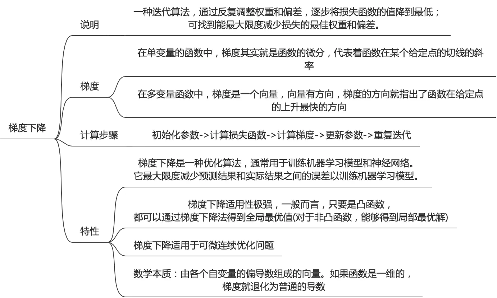


### 核心概念解析
在梯度算法中，**梯度**、**学习率**、**实际步长**和**梯度方向**共同决定了参数更新的轨迹。梯度是误差函数增长最快的方向与斜率大小；梯度反方向是下降最快的方向；学习率是人为设定的缩放系数；实际步长是二者相乘后的最终移动距离

**梯度（Gradient / 坡度）**：
  - 多元函数在某一点的导数向量，数学符号为 $\nabla$。
  - **物理意义**：代表当前位置下山时**最陡峭的坡度与方向**。梯度的大小（模长）表示坡度的陡峭程度，越陡梯度越大，越平缓梯度越小。 

**梯度方向（坡度方向）**：
- 数学上，梯度方向指向函数**增长最快（上坡）**的方向。
- 在机器学习的**梯度下降**中，我们需要减小误差，因此实际移动方向要取**梯度的反方向（负梯度方向 $-\nabla J$）**，即最快下山的方向。

**学习率（Learning Rate / 步长因子 $\eta$）**：
- 一个超参数（如 $0.01$、$0.001$），用来控制每一步迈得有多大。
- 它不是斜率本身，但它决定了面对同样大小的“斜率”时，算法愿意听从多少比例。 

**实际步长（Actual Step）**：
- 参数实际更新的公式为：$\Delta$。
- **实际步长 = 学习率 $\times$ 梯度幅值**。当坡度很陡（梯度大）时，实际步长会自动变大；当接近谷底、坡度变缓（梯度小）时，实际步长会自动变小。


它们之间的联动关系

**方向控制**：梯度向量决定了“往哪个方向走能最快降低误差”，始终与等高线垂直并指向外侧反方向。

**幅度调节**：
- **学习率过大**：导致实际步长过大，直接跨过最优解，甚至在谷底两侧来回震荡、发散。
- **学习率过小**：导致实际步长太短，下山速度极慢，可能在规定迭代次数内无法到达最低点。
- **自适应调整**：由于实际步长受“梯度幅值 $\times$ 学习率”共同影响，在刚开始训练时梯度大、步长大；接近终点时梯度变小、步长自动变微调，帮助算法平稳收敛。


导数/偏导数在梯度算法中是构成梯度的“分量”。每一个偏导数代表损失函数在某一个单独参数（维度）方向上的变化率和斜率。所有偏导数拼起来就形成了梯度向量，它指明了函数值增长最快的方向，而它的反方向则是梯度下降寻找到的最快下降方向。

### 梯度下降训练流程

**具体工作流程**
假设你有 10000 个训练样本，设置 `batch_size = 64`：
1. **打乱数据**：每个 epoch 开始时随机打乱数据集，防止模型记住样本顺序。
2. **切分批次**：将数据切分为 ⌈10000/64⌉ ≈ 157 个小批量。
3. **逐批训练**：对每个 mini-batch：
  - 前向传播，计算该批 64 个样本的平均 loss
  - 反向传播，先计算每个样本的梯度，再累加计算批次平均梯度
  - 用梯度更新一次参数
4. **重复迭代**：遍历完所有 batch 算一个 epoch，重复多个 epoch 直到收敛。

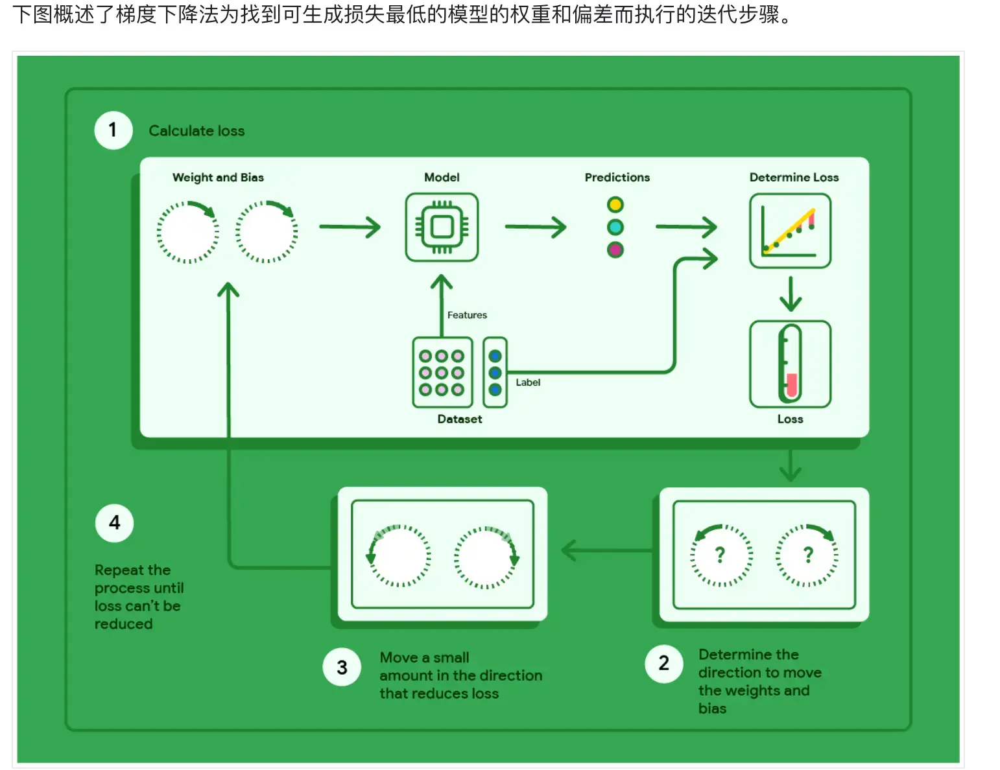

### 梯度下降法示例

针对线性回归场景，用梯度下降法来进行数学推导。

梯度是损失函数对参数的偏导数，表示损失函数在参数空间中的变化方向。对于线性回归，梯度计算如下：
$J(w, b) = \frac{1}{2n} \sum_{i=1}^{n} (y_i - \hat{y}_i)^2 = \frac{1}{2n} \sum_{i=1}^{n} (y_i - (w x_i + b))^2$
> 说明： 这里的系数 $\frac{1}{2}$ 是为了后面求导时抵消平方项产生的数字 $2$；除以 $n$ 是为了求平均，防止样本量变化影响损失值的数量级。
> 已知复合函数外层为 $g(u) = u^2$，则导数$\frac{d}{du}(u^2) = 2u$

梯度下降算法需要知道损失函数 $J(w, b)$ 在当前点的变化率（即梯度），因此我们需要分别对 $w$ 和 $b$ 求偏导数。

w偏导数：$\huge \frac{\partial J}{\partial w} = - \frac{1}{n} \sum_{i=1}^{n} x_i (y_i - \hat{y}_i) = - \frac{1}{n} \sum_{i=1}^{n} x_i (y_i - (wx_i​+b))$

b偏导数：$\huge \frac{\partial J}{\partial b} = - \frac{1}{n} \sum_{i=1}^{n} (y_i - \hat{y}_i) = - \frac{1}{n} \sum_{i=1}^{n} (y_i - (wx_i​+b))$


梯度下降法通过以下规则更新参数 $w$ 和 $b$ ：
$\huge w := w - \alpha\frac{\partial J}{\partial w}$
$\huge b := b - \alpha\frac{\partial J}{\partial b}$

模型通过反复迭代执行上述更新，直到梯度接近 $0$（损失函数到达最小值），从而拟合出最佳的回归直线。

>梯度(gradient)：脚下的坡度，告诉你陡不陡，坡度方向
>α 是学习率（learning rate）：每一步迈多大，严格来说，学习率是步长的缩放系数；所以α的选择在梯度下降法中往往是很重要的！α不能太大也不能太小，太小的话，可能导致迟迟走不到最低点，太大的话，会导致错过最低点
>实际步长  $= learning\_rate \times \|\text{gradient}\|=\alpha\frac{\partial J}{\partial w}$
>$\huge \frac{\partial J}{\partial w}$含义:表示损失函数 $J$ 仅对权重 $w$ 的偏导数。它告诉我们：如果只改变 $w$，损失函数会怎么变；

注意：梯度下降在每一批次中，并不是对"loss求和"后直接调整，而是对每个样本的loss分别求梯度，再取平均（或求和），然后用这个平均梯度来更新参数。

```python fold
def train_gradient_descent(model, x_scaled, y_train, lr=0.1, epochs=10000, tol=1e-6):
    n = len(x_scaled)
    prev_loss = float('inf')

    print("\n" + "=" * 70)
    print("【步骤 4】启动梯度下降训练 (Train Model - Gradient Descent)")
    print("=" * 70)
    print("【教学说明】:")
    print("  使用核心算法：批量梯度下降法 (Batch Gradient Descent)。")
    print("  通过不断计算预测值与真实值的误差，求导得到梯度，并沿负梯度方向更新参数。")
    print("\n【关键函数与算法数学公式映射】:")
    print("  1. 前向传播预测函数: y_hat_i = w * x_scaled_i + b")
    print("  2. 损失函数 (MSE 均方误差): Loss = (1 / 2N) * Σ (y_hat_i - y_i)^2")
    print("  3. 权重梯度求导函数 (dw): dw = (1 / N) * Σ (y_hat_i - y_i) * x_scaled_i")
    print("  4. 偏置梯度求导函数 (db): db = (1 / N) * Σ (y_hat_i - y_i)")
    print("  5. 参数更新迭代公式: w = w - lr * dw  |  b = b - lr * db")
    print("\n【训练阈值与终止条件说明】:")
    print(f"  - 早期停止收敛阈值 (tol = {tol}): 当两次迭代 Loss 变化量小于该值时，判定梯度接近0、已收敛。")
    print(f"  - 最大迭代轮数上限 (epochs = {epochs}): 防止无限循环的保底机制。")
    print("-" * 70)
    print(f"【超参数设置】: 学习率 lr = {lr}, 最大轮数 epochs = {epochs}, 提前停止阈值 tol = {tol}")
    print("-" * 70)
    print("Epoch 轮次 |    Loss 损失   |  w (缩放域)  |    b 偏置    | 梯度 dw (∂J/∂w) | 梯度 db (∂J/∂b)")
    print("-" * 70)

    for epoch in range(epochs):
        # 1. 前向传播计算预测值: y_hat_i = w * x_scaled_i + b
        y_pred = [model.predict(xi) for xi in x_scaled]

        # 2. 计算均方误差损失 Loss (MSE): Loss = (1 / 2N) * Σ (y_hat_i - y_i)^2
        loss = sum((yp - yi) ** 2 for yp, yi in zip(y_pred, y_train)) / (2.0 * n)

        # 3. 计算偏导数梯度:
        # dw = (1 / N) * Σ (y_hat_i - y_i) * x_scaled_i
        # db = (1 / N) * Σ (y_hat_i - y_i)
        dw = sum((yp - yi) * xi for yp, yi, xi in zip(y_pred, y_train, x_scaled)) / n
        db = sum(yp - yi for yp, yi in zip(y_pred, y_train)) / n

        # 4. 打印代表性节点 (第0, 1, 2次及后续每1000轮)
        if epoch in (0, 1, 2,9999) or (epoch % 1000 == 0 and epoch > 0):
            print(f"{epoch:8d} | {loss:12.6f} | {model.w:11.4f} | {model.b:11.4f} | {dw:15.4f} | {db:15.4f}")

        # 5. 阈值判断：检查 Loss 是否收敛 (|prev_loss - loss| < tol)
        if abs(prev_loss - loss) < tol:
            # 打印代表性节点(最后一次训练)
            if not (epoch in (0, 1, 2,9999) or (epoch % 1000 == 0 and epoch > 0)):
                print(f"{epoch:8d} | {loss:12.6f} | {model.w:11.4f} | {model.b:11.4f} | {dw:15.4f} | {db:15.4f}")

            print("-" * 70)
            print(f"✓【收敛阈值触发】: 第 {epoch} 轮 Loss 变化量 < {tol}，梯度接近 0，训练提前完成！")
            print(f"最终收敛 Loss = {loss:.6f}, 收敛梯度 dw = {dw:.6f}, db = {db:.6f}")
            break

        prev_loss = loss

        # 6. 参数更新: w = w - lr * dw, b = b - lr * db
        model.w -= lr * dw
        model.b -= lr * db

    # 将 w 还原回真实量纲 (元/㎡ 转为 万元/㎡): w_real = w_scaled / 100.0
    w_real = restore_w(model.w)
    b_real = model.b
    print("-" * 70)
    print(f"【训练完成】还原至真实物理量纲的拟合方程: y = {w_real:.4f} * x + ({b_real:.4f})")

    return w_real, b_real


```

### 梯度消失或爆炸
在神经网络中，假如存在以上4层的网络，第一个权重的更新值为 $w_1^{'} = w_1 + \eta \delta_1 x_1$ 

$$
\begin{equation} \begin{aligned} \delta_1 & = \frac{\partial J}{\partial b_1}= \frac{\partial J}{\partial b_4} \frac{\partial b_4}{\partial b_3} \frac{\partial b_3}{\partial b_2} \frac{\partial b_2}{\partial b_1} \\ &= f_1^{'}(b_1) w_2 \delta_2 = f_1^{'}(b_1) w_2 f_2^{'}(b_2) w_3 f_3^{'}(b_3) w_4 f_4^{'}(b_4)(y-t) \end{aligned} \end{equation}
$$
如果激活函数都为sigmoid，即 $f^{'}(x)=(1-f(x))f(x) = -(f(x)-\frac12)^2 +\frac14$ ,则\激活函数的导数最大为 $\frac14$ , 那么
$\left| f^{'}(b) w \right| \leq \frac14$ ， $\delta_1 \leq f^{'}_1(b1) (\frac14)^3(y-t)$ 

因此，前面的层比后面的层的梯度变化更小，导致变化更慢，从而导致梯度消失。与此类似，假如激活函数的导数大于1，随着层数的递增，梯度变化会以指数形式增加，则可能出现梯度爆炸。

**解决方案**

（1） 使用ReLU、 Leaky ReLU、ELU等激活函数
ReLU ： $f(x) = max(0,x)$ 
思想：若激活函数的导数为1，则每层网络的更新速度不会受到影响，不存梯度爆炸与消失的问题。

(2) 残差结构
残差神经网络（ResNets）是另外一种有效地解决梯度消失的方式,其核心思想是残差连接 skip connections。它将输入和输入的一个非线性变化进行线性叠加，如下图所示。
在反向传播中，当导数小于0时，链式法则会使得梯度的变化越来越小，从而可能造成梯度消失。但是通过skip connection, 神经元的输出变成了 f(x)+x, 其导数会加上一个1，所以尽管导数 $\frac{df(x)}{dx}$ 很小，这时候也能够继续反向传播。


https://cloud.tencent.com/developer/article/1194111 深入浅出--梯度下降法及其实现
https://cloud.tencent.com/developer/article/1451554 梯度下降原理讲解
https://developers.google.com/machine-learning/crash-course/linear-regression/gradient-descent?hl=zh-cn 线性回归：梯度下降

## 通用逼近定理
通用逼近定理（Universal Approximation Theorem）是深度学习和神经网络的数学基础之一。这个定理在理论上证明了神经网络的强大能力，即只要给定足够的神经元和合适的参数，神经网络可以逼近任何连续函数。

**定义**
通用近似定理（Universal Approximation Theorem）：令 $\phi ( \cdot )$ 是一个非常数、有界、单调递增的**连续**函数（激活函数）， $x$ 是一个 $D$ 维实数向量 ${[0,1]^D}$ ， $C(x)$ 是定义在 $x$ 上的连续函数集合（**输入是长度为 $D$ 的**向量)**，每个维度的值都是0到1之间的实数**）。

对于任意给定的一个函数 $f \in C(x)$ ，存在一个整数 $M$ ，和一组实数 $u,b \in \mathbb{R}$ 以及实数向量 $w \in {\mathbb{R}^D}$ ，我们可以定义函数 
$$
F(x) = \sum\limits_{m = 1}^M {{u_m}} \phi (w_m^Tx + {b_m})\\
$$
 作为函数 $f$ 的近似实现，即 
$$
|F(x) - f(x)| < \epsilon,\forall x \in {\iota _D}\\
$$
 其中 $\epsilon > 0$ 是一个很小的正数。
通用近似定理在 $D$ 维实数空间${\mathbb{R}^D}$ 中的有界闭集上依然成立。

todo：需要深入了解；比如sigmod可以近似看到3个线性函数来进行逼近，如何结合神经网络，通过数据来更好的理解此理论；

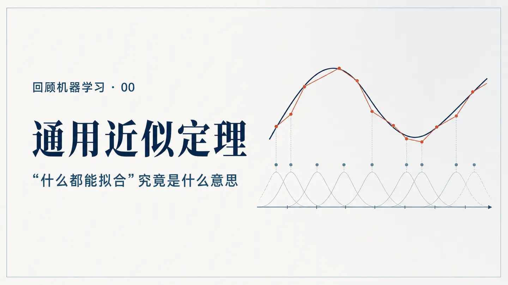

https://garden.maxieewong.com/000.wiki/%E9%80%9A%E7%94%A8%E9%80%BC%E8%BF%91%E5%AE%9A%E7%90%86/ 通用逼近定理
https://zhuanlan.zhihu.com/p/10247926150 通用近似定理（Universal Approximation Theorem）
https://zhuanlan.zhihu.com/p/2063195333186918210 回顾机器学习 00：通用近似定理——“什么都能拟合”究竟是什么意思
## R2(决定系数)
R² 的本质是衡量回归模型对数据的拟合程度。
衡量了因变量（真实值）的总变异中有多少比例可以被自变量（模型预测值）所解释。作为一个典型的无量纲量 ，它的取值不受数据具体单位（如万元、厘米、千克）的影响。


### 公式定义
1. $R^2$ 基础定义公式

$\huge R^2=1-\frac{SSE}{SST}$
 
2. 展开公式
$\huge R^2(y,\hat{y}) =1-\frac{SSE}{SST} = 1 - \frac{\sum_{i=1}^{n} (y_i - \hat{y}_i)^2}{\sum_{i=1}^{n} (y_i - \bar{y})^2}= 1 - \frac{\frac{1}{n}\sum_{i=1}^{n} (y_i - \hat{y}_i)^2}{\frac{1}{n}\sum_{i=1}^{n} (y_i - \bar{y})^2}=1-\frac{MSE(y,\hat{y})}{Var(y)}$
### 其他相关公式

$\huge  \bar{y} = \frac1{n} \sum _{i = 1}^{n} y^{i}$
$\huge  SSE=\sum_{i=1}^{n}​(y_i-\hat{y_i}​)^2$
$\huge MSE=\frac{SSE}{n}$
$\huge SST = {\sum_{i=1}^{n} (y_i - \bar{y})^2}$
$\huge  SSR = \sum_{i=1}^{n} (\hat{y}_i - \bar{y})^2$
$\huge Var=\frac{SSR}{n}$
$\huge \bar{y} = \frac1{n} \sum_{i=1}^{n} y_i$ 
是实际值的平均值。


>SSE 残差平方和：衡量模型预测值与真实值之间的误差；含义：真实值与预测值的差距。代表模型无法解释的误差，即模型预测完之后，依然猜不透的**剩余偏差**；因为 SSE 代表“无法解释的误差”，所以它的大小直接决定了模型的优劣
>SST 总平方和：衡量因变量的总体波动程度；含义：真实值与均值的差距。代表数据的原始总波动，即如果没有任何模型，数据自带的**总混乱程度**
>SSR 回归平方和：衡量模型预测值与均值之间的差异；含义：预测值与均值的差距。代表模型能够解释的波动，即有了模型后，模型成功预测出来的**规律波动**；
>Var 方差：衡量一组数据或随机变量离散程度（波动大小）的统计学指标，具体表现为数据偏离平均值的平方和的平均数
>$y_i$:实际值，$\bar{y}$:均值，$\hat{y}_i$:预测值
>其他：模型使用普通最小二乘法（OLS）进行参数估计，并且模型必须截距项，这2个条件满足时：SST=SSR+SSE
>MSE 均方误差


评估指标的选择取决于您的特定目标和数据的特点：
- 如果您想要一个在原始单位下易于解释的指标，并且异常值不是主要问题或不应受到不成比例的惩罚，请使用 **MAE**。
- 如果您想要一个在原始单位下的指标，但需要对大误差施加更显著的惩罚，请使用 **RMSE**。它通常是一个不错的默认选择。
- **MSE** 主要在其数学特性有利时使用（由于单位解释困难，在最终评估中较不常用）。
- 当您需要了解模型解释的方差比例，并提供相对的拟合优度衡量时，请使用 $R^2$。它对于比较模型的解释能力很有用，但不直接表示典型的预测误差大小。

通常，查看多个指标是有益的，以更全面地了解模型的表现。例如，高 $R^2$ 表示您的模型很好地捕捉了趋势，而低MAE或RMSE证实了典型的预测误差很小。


## 最小二乘法


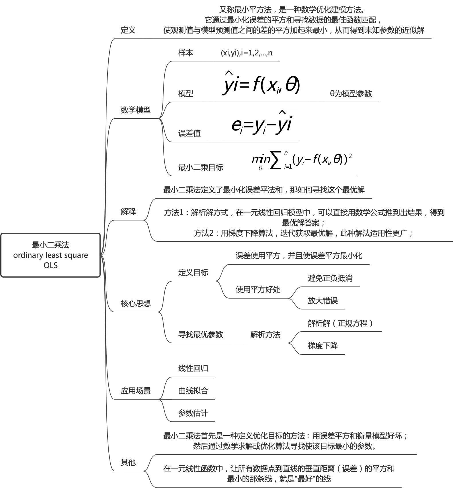

最小二乘法（Least Squares Method）是一种数学优化技术，它通过最小化误差的平方和寻找数据的最佳函数匹配，使观测值与模型预测值之间的差的平方加起来最小，从而得到未知参数的近似解。

核心作用
>定义了目标：误差使用平方，并且使误差平方最小化；(最小二乘的误差计算，我们一般使用MSE)；
>寻找最优参数：达到目标的过程，就是求解\[机器学习模型]中的{w,b}最优值的过程；


在机器学习领域中，很适合用在线性回归中，结合梯度算法，求解最佳模型，即进行曲线拟合；

### 一元线性回归的用法
在一元线性回归中，使用最小二乘法

线性回归公式：$\hat{y}_i=wx_i​+b$
最小二乘法的数学公式：$\underset {(w,b)}{min(目标函数)}=\underset {(w,b)}{min(MSE)} = \underset {(w,b)}{min}\frac{1}{n}\sum_{i=1}^{n}​(y_i​−(wx_i​+b))^2$

让"目标函数"误差平方和最小(即最优)的 $w和 b$
数学表达式：$min(目标函数)=min(J(w,b)$)；
明确了优化方向，最小化误差值，达到了这个目标，也就寻找到了模型参数最优解$(w,b)$。

最小二乘法，明确了目标函数优化的方向和最优解的判断标准，接下来还需要进行求解，可以采用梯度下降优化算法或者解析解(一元线性公式可直接求解)；

https://cloud.tencent.com/developer/article/2119490 机器学习十大经典算法之最小二乘法


找一个线性函数，线性函数的值，作为逻辑函数(Sigmoid)的入参，根据设定的阈值(如0.5)，转化为(0,1)的值；

## 逻辑回归
逻辑回归是一种数据分析技术，它使用数学来找出两个数据因子之间的关系。然后，使用此关系根据其中一个因子预测另一个因子的值。预测结果的数量通常是有限的，比如是或否。

机器学习中逻辑回归是一种监督式机器学习算法。它是一种预测离散或分类结果的**分类算法**。预测输出值属于某一特定类别的概率。

**优点**
1. **解释性强**：逻辑回归模型易于理解和解释。
2. **计算效率**：模型简单，训练和预测速度快。
3. **概率输出**：提供预测类别的概率，增加了解释性。

**局限性**
1. **线性边界**：逻辑回归假设数据是线性可分的，这在某些复杂场景下可能不成立。
2. **特征选择**：逻辑回归对于不相关的特征和特征之间的相互作用比较敏感。


**数学原理**
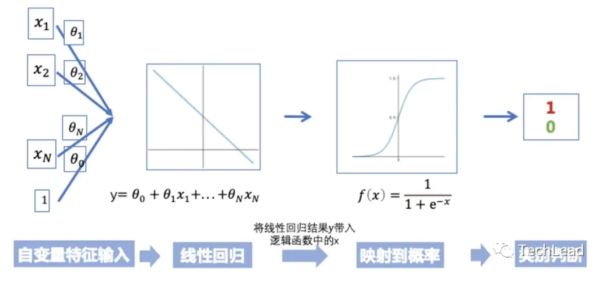

### Sigmoid
Sigmoid 函数是一个常见的数学函数，其图形呈字母“S”形。它能把任何实数输入变成 0 到 1 之间的小数，常用来表示概率或作为神经网络的激活函数，在逻辑回归中也作为逻辑函数使用。

**数学公式：** $S(x) = \frac{1}{1 + e^{-x}}$。

**主要特点**
- **输出范围**：结果总是在 0 和 1 之间。输入越大越接近 1，输入越小越接近 0。
- **S 形曲线**：在中间 0 附近变化最快，两端趋于平缓。
- **导数简单**：求导非常方便，写作 $S'(x) = S(x)(1 - S(x))$。
- Sigmoid函数是连续且平滑的，这意味着它的导数也是连续的。
- Sigmoid函数是Logistic函数的一种特殊形式
- Sigmoid是一个非线性函数
- 中心对称性：Sigmoid函数关于点(0,0.5)中心对称。这意味着，如果输入x是负数，则输出σ(x)小于0.5；如果输入x是正数，则输出σ(x)大于0.5。

**主要用途**
- **逻辑回归**：在分类任务中把得分变成发生的概率
- **神经网络**：作为激活函数提供非线性能力

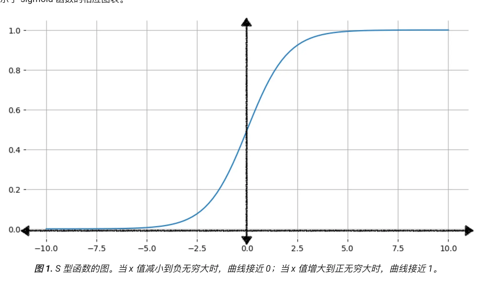

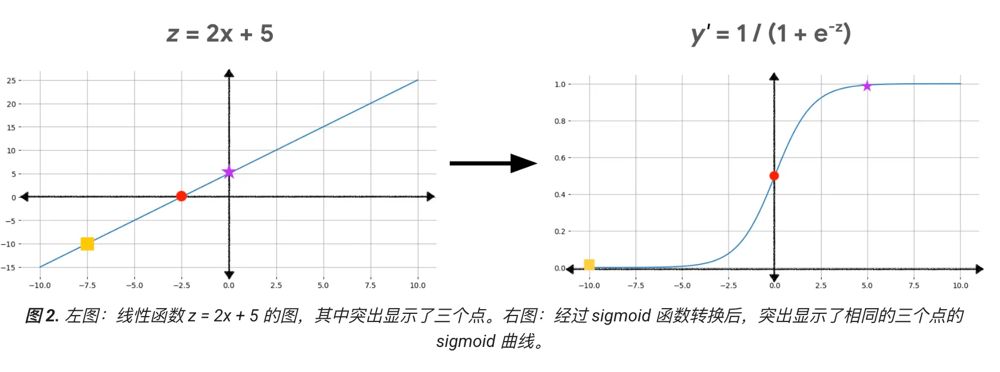

线性方程成为 S 型函数的输入，该函数将直线弯曲成 S 形。

#### 决策边界与S函数关系
 Sigmoid 函数，和线性拟合的结合，如何能够完成分类问题，并且得到清晰可解释的分类器判定「决策边界」。
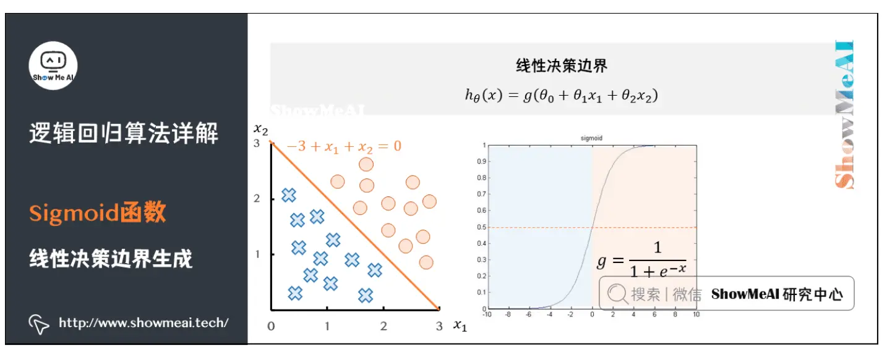
如果我们以0.5为判定边界，则线性拟合的直线变换成了一条决策边界（这里是线性决策边界）。


### 对数损失函数(或交叉熵损失)
对数损失函数也叫交叉熵损失（Cross-Entropy Loss），是机器学习分类问题中最核心、最常用的损失函数之一。它用来衡量**预测概率分布与真实标签分布之间的差距。**

逻辑回归的损失函数是**对数损失函数**。对数损失函数返回的是变化幅度的对数，而不仅仅是数据与预测之间的距离。对数损失的计算方式如下：

对数损失$\text{对数损失}=-\frac {1}{N}\sum_{i=1}^{N}[{y}_{i}log⁡({y}_{i}^{′})+(1-{y}_{i})log⁡(1-{y}_{i}^{′})]$ 

其中：
- $N$是数据集中的已标记示例数量
- $i$是数据集中示例的索引（例如， $({x}_3,{y}_3)$是数据集中的第三个示例）
-  ${y}_{i}$是第 $i$个示例的标签。由于这是逻辑回归，因此 ${y}_{i}$必须是 0 或 1。 
-  ${y}_{i}^{′}$ 是模型针对第 $i$个示例的预测值（介于 0 和 1 之间），由 ${x}_{i}$中的特征集得出。

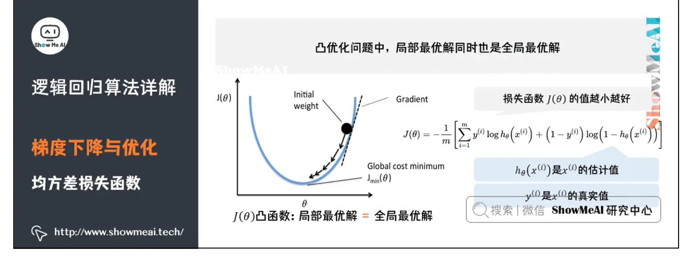

>逻辑回归模型的变化率不是恒定不变的。正如您在计算概率中所看到的，sigmoid 曲线呈 S 形，而不是线性。当对数几率 ($z$) 值接近 0 时，$z$ 的小幅增加会导致 $y$ 的变化远大于 $z$为较大的正数或负数时的变化。

>此形式的对数损失函数用于计算数据集中所有点的平均对数损失。在实践中，使用平均对数损失函数（而非总对数损失函数）是可取的，因为这样可以分离批次大小和学习速率的调整。


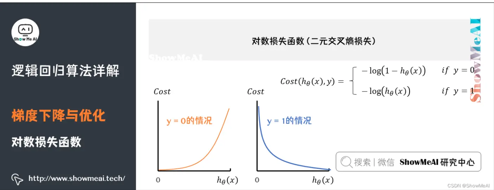

-  $y^{(i)}=0$：当一个样本为负样本时，若  的结果接近1（即预测为正样本），那么$-ln(1-h_\theta(x))$的值很大，那么得到的惩罚就大。
- $y^{(i)}=1$：当一个样本为正样本时，若  的结果接近0（即预测为负样本），那么$-ln(h_\theta(x))$的值很大，那么得到的惩罚就大。

>$h(x) = \frac{1}{1 + e^{-x}}$
>其中$y^{(i)}$表示样本取值，在其为正样本时取值为1，负样本时取值为0，我们分这两种情况来看看：


ln(x)，x\[0,1]区间的图像
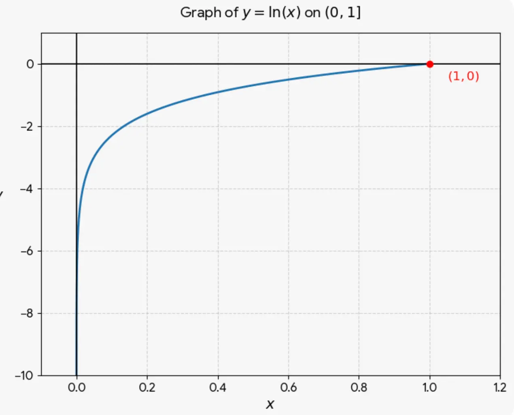

### 最大似然估计法 (MLE) 

这是一种针对模型参数进行估计的优化算法。通过优化损失函数，算法试图找到最有可能解释观测数据的模型参数


### 总结

关键点：模型的目标不是比较"样本1 vs 样本2 谁更像类别1"，而是让每个样本都尽量接近自己的真实标签。
模型要做的不是判断"谁更像真实的鸢尾花"，而是根据特征值，判断属于哪个类别的概率。

流程：特征值选择->线性或非线性函数（作为决策边界）->S函数(概率分布)->对数损失函数->损失值->梯度下降来修复损失->找到最优模型参数；

| 步骤  | 名称            | 作用       | 输入      | 输出      |
| --- | ------------- | -------- | ------- | ------- |
| 1   | **特征选择**      | 决定模型能看什么 | 原始数据    | 特征矩阵 X  |
| 2   | **决策边界函数**    | 定义模型形式   | X       | z（线性组合） |
| 3   | **Sigmoid函数** | 概率映射     | z       | p（预测概率） |
| 4   | **对数损失函数**    | 量化误差     | p, y    | 损失值     |
| 5   | **梯度计算**      | 找下降方向    | 损失函数    | 梯度      |
| 6   | **参数更新**      | 修复损失     | 梯度, 学习率 | 新参数     |
| 7   | **迭代收敛**      | 找最优解     | 重复2-6   | 最优参数    |


https://www.ibm.com/cn-zh/think/topics/logistic-regression#684929715 什么是逻辑回归
https://www.showmeai.tech/article-detail/188 图解机器学习 | 逻辑回归算法详解
https://cloud.tencent.com/developer/article/2352934 机器学习-逻辑回归：从技术原理到案例实战


## Softmax算法(归一化指数函数)

Softmax是一种激活函数，它可以将一个数值向量归一化为一个概率分布向量，且各个概率之和为1。Softmax可以用来作为神经网络的最后一层，用于多分类问题的输出。Softmax层常常和交叉熵损失函数一起结合使用。

**数学公式**
给定一个 K 维向量 $\mathbf{z}$，其中每个元素 $z_{i}$ 代表某个类别的原始得分（Logits），第 i 个元素的 Softmax 函数输出 $\sigma$ 计算公式为：
$$
\sigma (\mathbf{z})_{i}=\frac{e^{z_{i}}}{\sum _{j=1}^{K}e^{z_{j}}}\quad \text{for\ }i=1,2,\dots ,K
$$

**特性**
- **概率转换**：输出的所有值都在 0 到 1 之间，总和严格为 1，完美符合概率分布的定义。
- **“软”最大值（Soft Max）**：与传统的 `argmax`（硬最大值，只保留最大项、其余归零）不同，Softmax 会放大最大值的作用，但依然会给其他较小的项分配微小的概率，使分布更平滑。
- **多分类支持**：将线性层的多个输出分数转化为不同类别的预测概率，通常与交叉熵损失（Cross-Entropy Loss）结合使用。

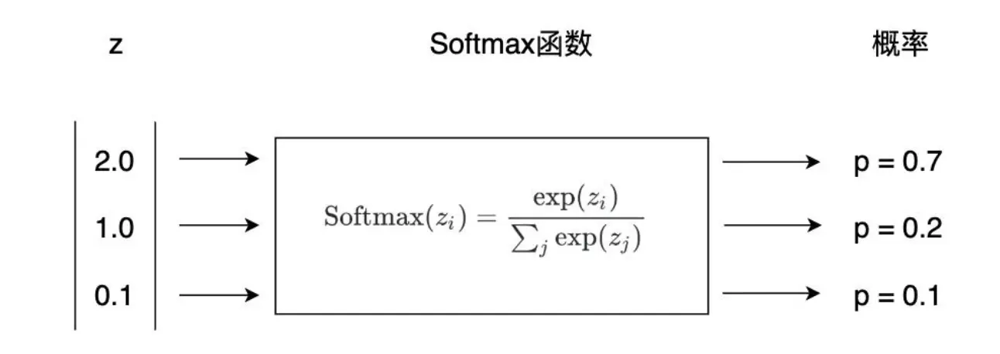

Softmax函数可以将上一层的原始数据进行归一化，转化为一个$(0,1)$之间的数值，这些数值可以被当做概率分布，用来作为多分类的目标预测值。Softmax函数一般作为神经网络的最后一层，接受来自上一层网络的输入值，然后将其转化为概率。

>实际上，Sigmod函数是Softmax函数的一个特例，Sigmod函数一般用于预测值为0或1的二元分类


https://zhuanlan.zhihu.com/p/168562182 
https://www.zhihu.com/tardis/zm/art/35709485?source_id=1003 损失函数｜交叉熵损失函数

## 多元线性回归模型

$y=w^Tx+b$，根据数据点在某个方向上的位置，计算预测值。

>w:不是简单的一堆参数。它实际上代表了一个方向
>$w^Tx$：把数据点 x 投影到 w 所代表的方向上。

最小二乘法在多元回归模型中目的：寻找一个超平面，使所有数据点总体离它尽可能近
多元线性回归，本质上就是在高维数据空间中寻找一个超平面。简单来说所有数据点之和，距离这个超平面最短，理论为0；

## 多项式回归

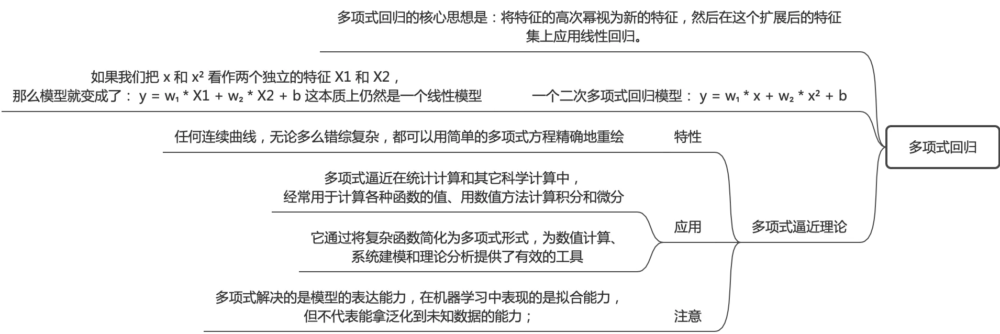

## K-Means(聚类)

K-means算法是一种经典的无监督学习聚类算法，它能将数据点自动划分为 K 个不同的类别（簇），让同一个簇内的数据点尽量紧密，不同簇间的数据点尽量疏远。

**K-Means计算步骤**
K-means算法通过迭代（重复）计算来优化聚类中心（质心）
1. 初始化：随机选择 K 个数据点作为初始的聚类中心（质心）。
2. 分配数据：计算每个数据点到各个质心的距离（通常用欧氏距离），把数据点划分到距离它最近的那个质心所在的簇中。
3. 更新质心：重新计算每个簇中所有数据点的平均值，将平均值作为该簇的新质心。
4. 重复循环：不断重复“分配数据”和“更新质心”这两步，直到质心不再发生变化，或者达到设定的最大迭代次数，算法收敛结束。


**常见应用场景**
- 客户细分：根据消费行为把客户分成不同群体以进行精准营销。
- 图像分割：把图片中颜色相似的像素点归为一类以压缩或识别图像。
- 文档聚类：将大量主题相近的文章或文本自动归类。

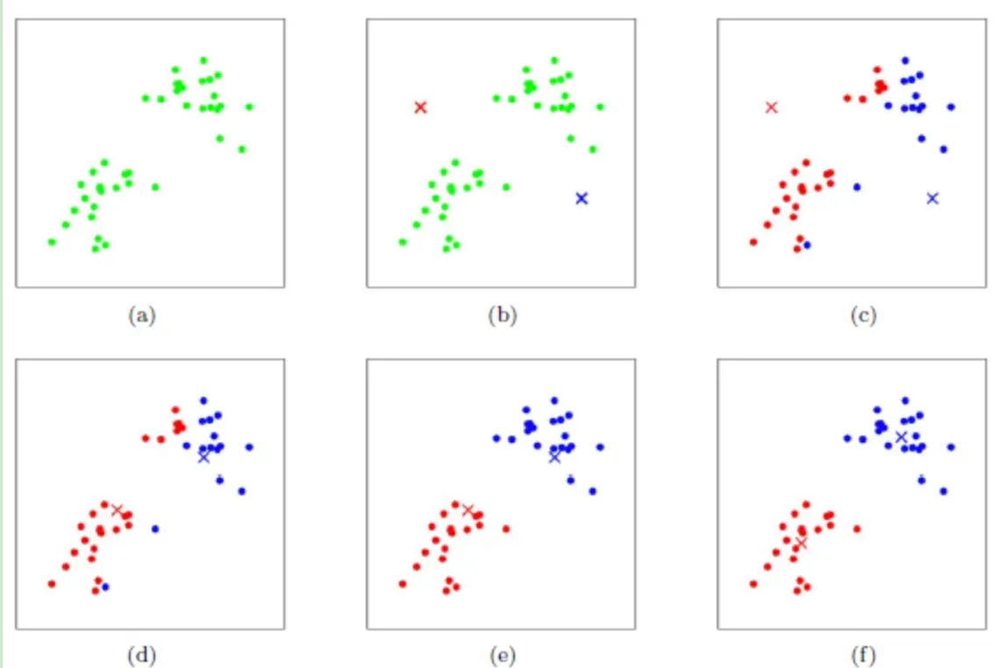

https://www.cnblogs.com/pinard/p/6164214.html K-Means聚类算法原理 

## PCA
主成分分析（Principal Components Analysis，简称PCA）是最重要的数据线性降维方法之一。在数据压缩消除冗余和数据噪音消除等领域都有广泛的应用。

它的目标是为数据找到一组新的坐标轴（称为"主成分"），使得数据在这些新轴上的投影方差最大(保留的原始信息最多)。

通过矩阵乘法，批量计算每个向量在新坐标轴上的点积（投影），从而实现降维。

降维就是减少数据集特征数量的过程。它通过某种数学变换，将原始高维空间中的数据点，映射到一个新的、维度更低的空间中。

**降维作用**
- 可视化：人类最多能直观理解三维空间。通过降维到 2D 或 3D，我们可以将高维数据画出来，直观地观察其结构、分组和异常点。
- 提升效率：更少的数据维度意味着更小的存储空间、更快的训练速度和更低的计算成本。
- 去除噪声与冗余：许多算法（尤其是距离计算类算法如KNN）在高维空间中会因不相关或重复的特征而性能下降。降维可以提炼出数据的精华。
- 缓解维度灾难：在高维空间中，数据会变得极其稀疏，导致许多机器学习模型难以找到有效的模式。


**PCA算法步骤**
设有m条n维数据。降维成k×n维；
1）将原始数据按列组成n行m列矩阵X
2）去中心化：将X的每一行（代表一个特征）特征值减去这一行的平均值。使数据分布的中心移动到坐标原点
3）计算协方差矩阵：求出协方差矩阵$C = \frac{1}{m}XX^T$，这个矩阵描述了数据各个特征之间的相关性。
  >C是一个对称矩阵，其对角线分别个各个特征的方差(方差是协方差的一种特殊情况，即cov(a,a)，两个变量相同)，而第  行  列和  行  列元素相同，表示  和  两个特征之间的协方差。

4）特征值分解：求出协方差矩阵C的特征值及对应的特征向量。**特征向量**指明了新坐标轴（主成分）的方向，**特征值**则代表了数据在该方向上的方差大小。特征值越大，该方向包含的信息越多。
5）选择主成分：将特征向量按对应特征值大小从上到下按行排列成矩阵，取前k行组成投影矩阵P。
6）数据转换：将原始数据乘以这个投影矩阵：Y=PX，就得到了降维到 k 维的新数据。

**PCA原理**
PCA的工作就是从原始的空间中顺序地找一组相互正交的坐标轴，新的坐标轴的选择与数据本身是密切相关的。其中，第一个新坐标轴选择是原始数据中方差最大的方向，第二个新坐标轴选取是与第一个坐标轴正交的平面中使得方差最大的，第三个轴是与第1,2个轴正交的平面中方差最大的。依次类推，可以得到n个这样的坐标轴。通过这种方式获得的新的坐标轴，我们发现，大部分方差都包含在前面k个坐标轴中，后面的坐标轴所含的方差几乎为0。于是，我们可以忽略余下的坐标轴，只保留前面k个含有绝大部分方差的坐标轴。事实上，这相当于只保留包含绝大部分方差的维度特征，而忽略包含方差几乎为0的特征维度，实现对数据特征的降维处理。

### PCA示例

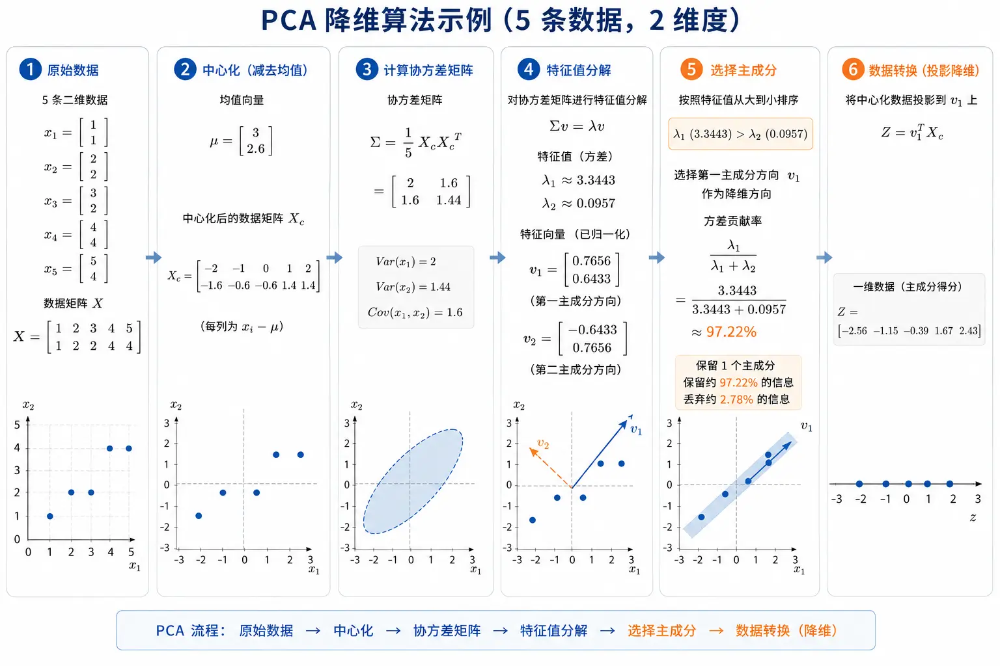

PCA运算相关概念

| 概念 | 在 PCA 中的角色 | 现实意义 |
| --- | --- | --- |
| **协方差矩阵 $\Sigma$** | 描述数据在各个方向上的“拉伸程度” | 衡量原始特征之间的相关性和方差 |
| **特征向量 $v$** | 数据云团的主轴方向 | 一个“综合指标”的权重组合（如“体格大小”） |
| **特征值 $\lambda$** | 沿该主轴的方差大小 | 这个综合指标有多重要（信息量有多大） |
| **投影 $v \cdot x$** | 把数据点压到主轴上 | 计算出每个样本在这个综合指标上的“得分” |


**原始数据**
数据矩阵：$X= \begin{bmatrix} 1&2&3&4&5\\ 1&2&2&4&4 \end{bmatrix}$
均值$\mu= \begin{bmatrix} 3\\ \frac{13}5 \end{bmatrix} = \begin{bmatrix} 3\\ 2.6 \end{bmatrix}$

**中心化后**
减去平均值：$x_i'=x_i-\mu$，$X_c= \begin{bmatrix} -2&-1&0&1&2\\ -1.6&-0.6&-0.6&1.4&1.4 \end{bmatrix}$

协方差矩阵：$\Sigma = \frac1mX_cX_c^T = \begin{bmatrix} 2&1.6\\ 1.6&1.44 \end{bmatrix}$
两个维度具有较强的正相关性。

>协方差矩阵：通过向量外积运算，构建协方差矩阵，描述的是“特征”之间的线性关系(形状、方向)
>对角线：每个维度自身的方差。2：第一维数据的离散程度，1.44：第二维数据的离散程度
>非对角线：两个维度之间的协方差。1.6：第一维变大时，第二维通常也在变大

**协方差矩阵的特征值分解**

>特征向量：是输出的结果，即数据云团的“主轴方向”

协方差矩阵×方向=该方向的方差×方向​
现在：$\Sigma= \begin{bmatrix} 2&1.6\\ 1.6&1.44 \end{bmatrix}$
我们要求：$\Sigma v=\lambda v$

特征方程：$|\Sigma-\lambda I|=0$
即：$\left| \begin{bmatrix} 2-\lambda&1.6\\ 1.6&1.44-\lambda \end{bmatrix} \right| =0$
计算行列式：$(2-\lambda)(1.44-\lambda)-1.6^2=0$
得到：$\lambda^2-3.44\lambda+0.32=0$

求解：$\lambda_1\approx3.3443$，$\lambda_2\approx0.0957$

>特征值告诉我们：λ=数据在对应特征向量方向上的方差​
>λ=3.3443：表示数据沿第一主成分方向扩散得非常大
>λ=0.0957：表示数据沿第二个方向几乎没有扩散

**计算特征向量**
求出：$\lambda_1\approx3.3443$，代入：$(\Sigma-\lambda_1I)v_1=0$
即：$\begin{bmatrix} 2-3.3443&1.6\\ 1.6&1.44-3.3443 \end{bmatrix} \begin{bmatrix} a\\b \end{bmatrix} =0$
第一行：$-1.3443a+1.6b=0$，因此：$b\approx0.8402a$

所以方向可写成：$v_1= \begin{bmatrix} 1\\ 0.8402 \end{bmatrix}$
但此时还没有归一化：原始特征向量长度：$\sqrt{1^2+0.8402^2} \approx1.306$，所以它还不是单位向量
**进行归一化**：$v=\frac{v}{\|v\|}$
得到第一主成分方向：$\boxed{ v_1= \begin{bmatrix} 0.7656\\ 0.6433 \end{bmatrix} }$，第二特征向量：$\boxed{ v_2= \begin{bmatrix} -0.6433\\ 0.7656 \end{bmatrix} }$

 两个向量互相垂直：$v_1^Tv_2=0$
因此：$\boxed{ V= \begin{bmatrix} 0.7656&-0.6433\\ 0.6433&0.7656 \end{bmatrix} }$，是一个正交矩阵。

>特征向量归一化后：真正表示数据在该方向上的**投影长度**
>v1：二维空间中的一个方向，数据方差最大的方向；
>v2：是与第一主成分v1垂直的第二主成分方向；

**主成分选择**
$\frac{\lambda_1}{\lambda_1+\lambda_2} = \frac{3.3443}{3.44} \approx 97.22\%$

第一主成分解释97.22%的数据变化
>原始二维数据虽然有两个维度，但它的主要变化几乎全部集中在第一主成分方向。第二个方向包含的信息很少，可以丢弃。

而是：$\boxed{ z_1=0.7656x_1'+0.6433x_2' }$，也就是说：
>  新维度是原来两个维度按照主成分方向进行线性组合得到的。

对于 PCA：$\boxed{ z=v_1^T(x-\mu) }$
因此：$z= \begin{bmatrix} 0.7656&0.6433 \end{bmatrix} \begin{bmatrix} x_1-3\\ x_2-2.6 \end{bmatrix}$
$0.7656^2+0.6433^2≈1$

**计算新的1维数据**
第一个数据：$x_1= \begin{bmatrix} 1\\1 \end{bmatrix}$
中心化：$x_1'= \begin{bmatrix} -2\\ -1.6 \end{bmatrix}$
投影：$z_1=v_1^Tx_1'= \begin{bmatrix} 0.7656&0.6433 \end{bmatrix} \begin{bmatrix} -2\\ -1.6 \end{bmatrix}≈−2.5605$
同样计算5条数据：$Z= \begin{bmatrix} -2.56& -1.15& -0.39& 1.67& 2.43 \end{bmatrix}$


我们得到了降维问题的优化目标：将一组 N 维向量降为 K 维，其目标是选择 K 个单位正交基(即特征向量)，使得原始数据变换到这组基上后，各变量两两间协方差为 0，而变量方差则尽可能大（在正交的约束下，取最大的 K 个方差）。

**总结**：PCA算法还是比较复杂，难理解。需要线性代数的高级知识才能深入理解。对于协方差矩阵、求解特征向量、以及降维后的映射关系，比较难从数学公式和现实意义进行对照、理解。还需相关知识补充。
PCA不涉及迭代运算、优化运算。本身具备解析解。

步骤简介：原始数据构建向量->按照一个标准(如方差)求得向量间的某个线性关系(即矩阵->线性变换关系)->特征向量(求最值，落到这个特性向量上方差最大)->原始数据进行矩阵映射

### QA
**Qpca中，协方差构成的矩阵，解析的特征向量，为什么是方差最大的方向**
A特征向量指向的方向，就是使得数据投影后“散布”（方差）达到极值（最大或最小）的方向，而特征值就是这个极值的大小。
这里面的解法有拉格朗日乘法。
从几何线性关系来看，也是通过矩阵、偏导数、特征向量等知识点来从几何上理解，是求极限值，这块如果不能很好的理解的话，就无法直观感受pca的底层逻辑。

**Qpca的几何理解**
方差矩阵：代表了原始数据的线性关系，“特征之间如何协同变化”的幅度。在2×2矩阵上(即2个特征值)；这个矩阵的几何图像：由这两个方向向量作为骨架（主轴），通过“旋转角度 + 长度缩放”共同描绘出来的，一般是椭圆。
特征向量求解：求特征向量本质是获取极限值（方差最大）吗？ 是的。 但更准确地说，是获取“极值方向”。
特征向量下的原数数据投影：特征向量定义了新的坐标系基底，原始向量通过“投影”到这些基底上，才变成新向量（主成分得分）


https://www.showmeai.tech/article-detail/198 图解机器学习 | 降维算法详解
https://www.runoob.com/ml/ml-dimensionality-reduction.html 无监督学习 - 降维
https://www.cnblogs.com/zwt20120701/p/11008275.html 特征向量&特征值及其应用
https://www.cnblogs.com/pinard/p/6239403.html 主成分分析（PCA）原理总结 


## 马尔可夫决策(MDP)
马尔可夫决策过程（Markov Decision Process，简称 MDP）是一个数学框架，用来模拟在结果部分随机、部分受控环境下的序贯决策问题。它是现代强化学习的核心基础蓝图

强化学习问题通常被建模为马尔可夫决策过程。这个名字听起来复杂，但其实它只是将我们上面提到的要素用数学形式组织起来，描述智能体与环境互动的一个标准框架。

强化学习的基本框架可以总结为：智能体通过与环境进行马尔可夫决策过程式的交互，根据获得的奖励信号，不断优化其策略（通常通过学习和更新价值函数来实现），最终目标是最大化长期累积奖励。


**核心五元组要素**
MDP 通常由一个五元组 $\langle S, A, P, R, \gamma \rangle$来完整定义
- **状态集合 (S)**：环境中所有可能状态的集合。
- **动作集合 (A)**：决策者（智能体）在各个状态下可以执行的所有动作的集合。
- **状态转移概率 (P)**：在当前状态执行某动作后，转移到下一个状态的概率分布（体现马尔可夫性质：未来状态只依赖于当前状态与动作，与过去无关）。
- **奖励函数 (R)**：智能体在执行动作并发生状态转移后获得的即时奖励。
- **折扣因子 (γ)**：介于 0 到 1 之间的数值，用来权衡即时奖励与长远未来奖励的重要性。

**交互与优化目标**
在 MDP 框架中，智能体与环境按照时间离散步骤不断循环交互： 
1. 智能体观察当前状态。
2. 依据策略（Policy）选择一个动作。
3. 环境根据状态转移概率给出下一个状态，并反馈奖励。
4. 目标是寻找最优策略，最大化长期累积折扣奖励的总和

### 马尔可夫性质
当且仅当某时刻的状态只取决于上一时刻的状态时，一个随机过程被称为具有马尔可夫性质。简单来说：“未来只与现在有关，而与过去无关“

用公式表示为$P(S_{t+1}|S_t) = P(S_{t+1}|S_1, \dots, S_t)$。也就是说，当前状态是未来的充分统计量，即下一个状态只取决于当前状态，而不会受到过去状态的影响。若随机变量序列表示随时间演化的状态，给定当前时刻 t 的状态 $S_{t}$，未来时刻 $S_{t+1}$ 的条件概率与过去的和 $S_1$ 均无关：

### 马尔可夫过程
马尔可夫过程（Markov process）指具有马尔可夫性质的随机过程，也被称为马尔可夫链（Markov chain）。

可以用一个元组<S,P>表示
- S是有限数量的状态集
- P是状态转移概率矩阵

数学定义：
$$
P[S_{t+1}| S_{t}] = P[S_{t+1}| S_1, \ldots,S_{t}]
$$
从上式可知，当前状态包含了历史中的所有相关信息


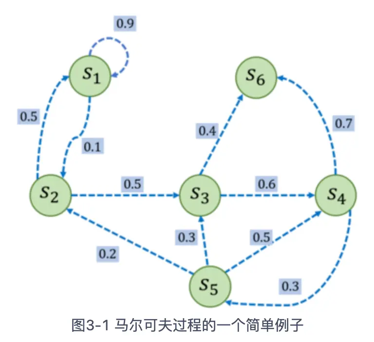
给定一个马尔可夫过程，我们就可以从某个状态出发，根据它的状态转移矩阵生成一个状态**序列**（episode），这个步骤也被叫做**采样**（sampling）。例如，从s1出发，可以生成序列s1->s2->s3->s6或序列s1->->s1->s2->s3->s4->s5等。生成这些序列的概率和状态转移矩阵有关。

### 马尔可夫奖励过程
马尔可夫奖励过程在马尔可夫过程的基础上增加了奖励R和折扣系数$\gamma$ 。
马尔可夫奖励过程是一个元组$<S,P,\color{red} R,γ\color{default}>$，其中
- S是有限数量的状态集
- P是状态转移概率矩阵
- **R是一个奖励函数，$R_{s} = E[R_{t+1} | S_{t} = s]$**
- **$\gamma$是一个折扣因子，$\gamma\in$ \[0, 1]**

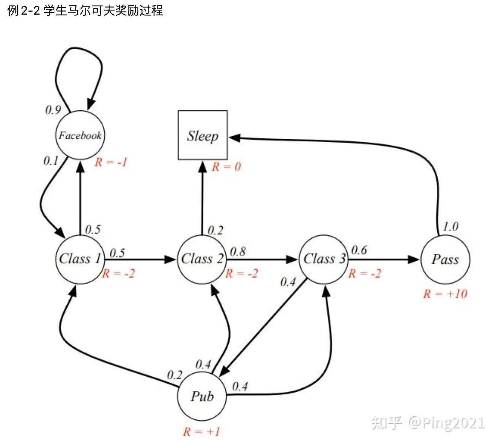

**回报（Return）**
回报（或译为“收益”）$G_{t}$为从时间步t开始带折扣的奖励总和。公式如下：
$G_{t} = R_{t+1} + \gamma R_{t+2} + \ldots = \sum_0^\infty \gamma^k R_{t+k+1}$


**价值函数**
状态价值函数（state-value function）的定义：马尔可奖励过程的状态价值函数$V(s)$是从该状态s开始的**回报的期望**，即$v(s) = \mathbb E[G_{t} | S_{t} = s]$
价值函数$V(s)$给出了某一状态的长期价值。
>注：价值函数其实包括状态价值函数V(s)和动作价值函数Q(s,a),也分别称为V值和Q值，如果没有特别强调，价值函数一般指状态价值函数V(s)，即V值。Q值将在本讲后面介绍。

展开为：
$$\begin{aligned} V(s) &= \mathbb{E}[G_t | S_t = s] \\ &= \mathbb{E}[R_t + \gamma R_{t+1} + \gamma^2 R_{t+2} + \dots | S_t = s] \\ &= \mathbb{E}[R_t + \gamma(R_{t+1} + \gamma R_{t+2} + \dots) | S_t = s] \\ &= \mathbb{E}[R_t + \gamma G_{t+1} | S_t = s] \\ &= \mathbb{E}[R_t + \gamma V(S_{t+1}) | S_t = s] \end{aligned}$$
在上式的最后一个等号中，一方面，即时奖励的期望正是奖励函数的输出，即 $\mathbb{E}[R_t | S_t = s] = r(s)$ ；另一方面，等式中剩余部分 $\mathbb{E}[\gamma V(S_{t+1}) | S_t = s]$ 可以根据从状态从状态s出发的转移概率得到，即可以得到
$$V(s) = r(s) + \gamma \sum_{s' \in \mathcal{S}} p(s'|s)V(s')$$
上式就是马尔可夫奖励过程中非常有名的**贝尔曼方程** (Bellman equation) 对每一个状态都成立。

求解较大规模的马尔可夫奖励过程中的价值函数时，可以使用动态规划（dynamic programming）算法、蒙特卡洛方法（Monte-Carlo method）和时序差分（temporal difference）

### 马尔可夫决策过程
马尔可夫过程和马尔可夫奖励过程都是自发改变的随机过程；而如果有一个外界的“刺激”来共同改变这个随机过程，就有了马尔可夫决策过程（Markov decision process，MDP）。我们将这个来自外界的刺激称为智能体（agent）的动作，在马尔可夫奖励过程（MRP）的基础上加入动作，就得到了马尔可夫决策过程（MDP）。

马尔可夫决策过程是一个元组$<S,\color{red}A,\color{default}P,R,γ>$，其中
- S是有限数量的状态集
- **A是有限数量的动作集**
- P是状态转移概率矩阵
    > $P_{ss'}^{a} \color{default}= \mathbb P[S_{t+1} = s'|S_{t}=s,A_{t} =a]$
- R是一个奖励函数，$R_{s}^a = E[R_{t+1} | S_{t} = s,A_{t} =a]$
- $\gamma$是一个折扣因子，$\gamma\in [0, 1]$

从上面定义可以看出，马尔可夫决策过程的**状态转移概率和奖励函数不仅取决于智能体当前状体，还取决于智能体选取的动作**。而马尔可夫奖励过程仅取决于当前状态。
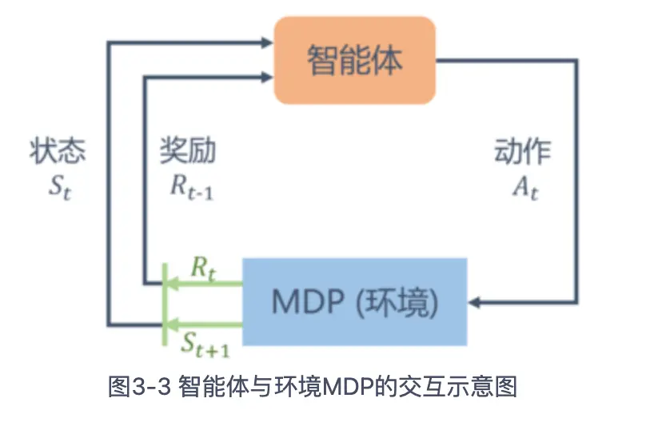
**强化学习中的MDP**
强化学习问题通常被建模为马尔可夫(MDP)决策过程。

一次完整的 MDP 交互周期如下：
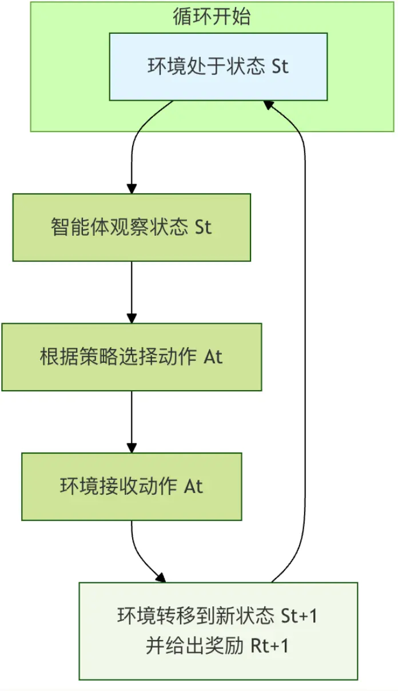
智能体的目标，就是通过不断经历这个循环，学习到一个策略 π*，使得从任意初始状态开始，获得的累积奖励的期望值（即回报）最大化。


**策略**
定义：策略$\pi$是给定状态时，关于动作a的分布，即$\pi(a|s) = \mathbb P[A_{t} = a | S_{t} = s]$

一个策略完整地定义了智能体的行为方式，即策略定义了智能体在各种状态下可能采取的动作，以及在各种状态下采取各种动作的概率。MDP的策略仅与当前的状态有关，与历史信息无关；同时某一确定的策略是静态的，与时间无关；但是个体可以随着时间更新策略。


**价值函数**
定义：MDP的**状态价值函数**（state-value Function）$v_\pi(s)$，是从状态s开始，执行策略所获得的收获的期望；或者说在执行当前策略$π$时，衡量智能体处在状态s时的价值大小。数学定义如下：
$$V_\pi(s) = \mathbb E_\pi [ G_{t} | S_{t} = s]$$

 定义: **行为价值函数**(action-value function) $Q_\pi(s,a)$（又称为Q函数），是从状态s开始，采取动作a, 执行策略所获得的收获的期望；或者说在遵循当前策略$π$时，衡量对当前状态执行动作a的价值大小。行为价值函数一般都是与某一特定的状态相对应的，更精细的描述是状态行为对的价值函数。行为价值函数的数学定义如下：

$$
Q_\pi(s,a) = \mathbb E_\pi [ G_{t} | S_{t} = s, A_{t} = a]
$$

**V和Q的关系**状态价值函数$v_\pi(s)$可以通过行为价值函数$Q_\pi(s,a)$来定义，状态价值函数定义为行为价值函数关于动作$a$的期望，数学描述为：

$$
V_\pi(s)= \mathbb E_{a\sim \pi(a|s)}[ Q_\pi(s,a) ]=\sum_{a\in A} \pi(a|s) Q_\pi(s,a)
$$

行为价值函数$Q_\pi(s,a)$描述的是状态$s$时，采取动作$a$的价值函数，是状态-动作对（s,a）的价值；而状态价值函数$v_\pi(s)$是在状态$s$时的价值函数。上式两者关系可以理解为，$v_\pi(s)$等于$Q_\pi(s,a)$，在状态$s$时，根据策略采取所有可能动作$a$的平均性能动作$\bar a$和状态s的Q值，即可以理解为$v_\pi(s)=Q_\pi(s,\bar a)$,所以$v_\pi(s)$描述的是状态$s$下，平均性能动作的价值，因此，我们只关注状态。

### 马尔可夫与贝尔曼方程关系

MDP 是“问题”的数学框架，贝尔曼方程是“求解”这个问题的核心工具。

MDP成为描述任何序贯决策问题的通用语言。而贝尔曼方程，特别是贝尔曼最优性方程，则成为了所有深度强化学习算法设计时，那个“损失函数”的数学源头。

**历史背景**
20世纪50年代，数学家和工程师们面临一个难题：如何对多阶段决策过程（比如工厂几个月内如何分配库存、火箭如何分阶段调整轨道）进行数学建模和优化。

理查德·贝尔曼在研究这个多阶段决策问题时，同时提出的概念(Dynamic Programming书籍)。
- 贝尔曼方程：作为求解动态规划问题的核心递推公式。
- 马尔可夫决策过程（MDP）：作为能够应用贝尔曼方程的理想化问题框架。
>关键历史事实：贝尔曼方程和MDP是一起被“设计”出来的。贝尔曼先想出了“把大问题拆成小问题”的思想（动态规划），然后为了能让这个思想有严谨的数学载体，他定义了MDP这个框架；为了求解这个框架，他又写下了贝尔曼方程。它们从诞生之初就是不可分割的“一体两面”。


https://www.bohrium.com/sciencepedia/feynman/keyword/markov_decision_processes # 马尔可夫决策过程 (MDP)
https://hrl.boyuai.com/chapter/1/%E9%A9%AC%E5%B0%94%E5%8F%AF%E5%A4%AB%E5%86%B3%E7%AD%96%E8%BF%87%E7%A8%8B/ 马尔可夫决策过程
https://zhuanlan.zhihu.com/p/494755866 

## 贝尔曼方程(动态决策)

贝尔曼方程（Bellman Equation，也称作动态规划方程）是将动态规划问题转化为递归形式的核心数学方程。
此方程将“决策问题在特定时间点的值”以“**来自初始选择的报酬**及由**初始选择衍生的决策问题的值**”的形式表示。藉这个方式将动态最佳化问题变成较简单的子问题，而这些子问题遵守由贝尔曼所提出的“最佳化原理”。

Bellman 方程是理解动态规划和强化学习的基石，它优雅地表达了决策问题中的递归结构。通过将长期价值分解为即时奖励和未来价值的组合，Bellman 方程为我们提供了一个强大的工具来求解复杂的序贯决策问题。

掌握 Bellman 方程不仅能帮助你理解各种强化学习算法，还能培养一种分解复杂问题的思维方式。无论是在理论研究还是实际应用中，这个方程都展现出了持久的价值和广泛的适用性。

**特性**
- **定义**：它把一个复杂的多阶段决策问题，拆解为**当前阶段的收益**与**未来状态的价值**之和。
- **递归特性**：通过“套娃”式的递归关系，将长期的最优控制问题简化为求解相邻状态的关系。
- **应用领域**：它是运筹学、动态规划以及**强化学习**（如Q学习、策略迭代）的基石。

**概念**
- 状态（State）：系统在某个时刻的配置或情况，用 s 表示
- 动作（Action）：在某个状态下可以采取的行动，用 a 表示
- 奖励（Reward）：执行某个动作后获得的即时回报，用 r 表示
- 策略（Policy）：决定在每个状态下采取什么动作的规则，用 π 表示
- 价值函数（Value Function）：从某个状态开始，遵循某个策略能获得的期望累积奖励
- 折扣因子（Discount Factor）：用 γ (gamma) 表示，范围在 [0,1]，用于平衡即时奖励和未来奖励

### 贝尔曼方程

贝尔曼方程描述的是当前状态的价值和下一状态的价值的关系，有了这个关系，就可以通过下一个状态的价值来迭代更新上一状态的价值【这样就可以通过最后一个状态逐步往前倒着推】。
$$
V(s)=\underset{\text{即时奖励}}{\underset{⏟}{R(s)}}+\underset{\text{未来奖励的折扣总和}}{\underset{⏟}{\gamma\underset{{s}^{′}\in S}\sum p({s}^{′}∣s)V({s}^{′})}}
$$
>V(s)：当前状态 s 的价值（Value）。
>π(a|s)：在状态 s 下采取动作 a 的概率（策略）。
>P(s', r | s, a)：环境转移概率，即指从当前状态转移到未来状态的概率，即执行动作 a 后到达新状态 s' 并获得回报 r 的概率。
>$S$ 代表 state（状态）的集合； $A$ 代表 action（动作）的集合； $P$ 为一个 state 到另一个 state 的概率；$R$ 为 reward（回馈/奖励）函数
>γ（折扣因子）：权衡即时回报与长远回报的重要参数（0 ≤ γ < 1）。
>V(s')：下一状态的价值折现总和($R_{t+1}+\gamma R_{t+2}+\gamma^2R_{t+3}+\gamma^3R_{t+4}+\ldots+\gamma^{T-t-1}R_T$)；

>当前状态的价值，是根据“下一状态已经知道的价值”计算出来的。这样就能通过多次递归迭代方法，A->B->C，一步步把C的价值传递到A，由于γ的约束，最终会收敛，得到最终价值；
>如果没有贝尔曼方程，智能体要计算当前的价值，就必须把未来无限步的奖励全部加起来，这在计算上是不可行的。
>贝尔曼方程通过极其巧妙的递归方式，将问题分解为：当前状态的价值 = 即时奖励 + 折扣的未来状态价值。它让智能体无需从头计算每个状态的总回报，从而完美处理了不确定环境和无限期问题。

**贝尔曼期望方程**
贝尔曼方程一般写作**期望形式**（Bellman Expectation Equation）
$V(s)=\sum _{a}\pi (a|s)\sum _{s^{\prime },r}P(s^{\prime },r|s,a)\left[r+\gamma V(s^{\prime })\right]$

这个方程表示：状态 s 的价值等于在该状态下执行所有可能动作的概率，乘以对应动作带来的即时奖励加上转移到下一个状态价值的折现总和。

>贝尔曼期望方程关注的是“按照策略 $\pi$ 行动”的收益有多大，相当于说：“我如果现在选择按照这个导航规划走，每一步听它的，预计能多快到达。”是一个对某一特定策略 $\pi$ 的价值评估公式。

**贝尔曼最优方程**
$V^*(s) = \max_{a} \sum_{s'} P(s'|s, a)[R + \gamma V^*(s')]$
最优 Bellman 方程的关键在于用 max 替换了期望，因为我们寻求的是最优策略。

>在所有可能动作中，选择哪个最好。贝尔曼最优方程则进一步追问：“如果我可以在每一步都做出最优决策，那我能以最快/最优的方式抵达目的地吗？”这就是最优方程的核心，它要求我们在每一步都选取最优动作，并据此构建整个最优策略。它不依赖已有策略，而是用于寻找最优策略

在强化学习中，当我们有个策略 $\pi$（如：70% 左转，30% 右转）时，贝尔曼方程告诉我们“这套策略下，每个状态值是多少”，被称为策略评估（Policy Evaluation）；而贝尔曼最优方程则用于策略提升和控制（Policy Improvement and control），它不再局限于某个策略，而是追求每一步都做出最优选择，递归地构建起整体最优路径。

**总结**：贝尔曼最优方程是策略无关的，可以发现在上述两个公式当中并未出现任何和策略有关的变量，这点与贝尔曼期望方程相区别，期望方程的目的是求出在当前策略下状态的价值，而最优方程是直接求解一个最优策略。求出贝尔曼最优方程之后，可以利用q的值很方便的得到最优策略。


### 贝尔曼最优化原理(Principle of Optimality)
“无论初始状态和初始决策是什么，对于前面决策所形成的当前状态而言，余下的所有决策必须构成一个最优决策序列。”
>如果某条决策路径在整体上是最优的，那么从其中任意一个时点开始往后的决策，也必须是最优的。否则，整体就不可能是最优。这一思想使得我们不必一次性解决“无限期”问题，而可以把问题拆解为“当前 + 未来”的递归结构。

最优化原理：最优化策略有这样的性质，即无论初始状态和初始决策是什么，余下的决策必定构成一个与由初始决策导致的状态有关的最优化策略。
>如：假设为了解决某一优化问题，需要依次作出n个决策D1，D2，…，Dn，如若这个决策序列是最优的，对于任何一个整数k，1 < k < n，不论前面k个决策是怎样的，以后的最优决策只取决于由前面决策所确定的当前状态，即以后的决策Dk+1，Dk+2，…，Dn也是最优的。
>如：你计划从北京开车到深圳，且这条路线是最优（最省时）的。那么只要你开到了武汉，接下来“武汉到深圳”的这半段路程，也必须是你当前状态下能选的最优路线。如果你在武汉能找到一条更快的路去深圳，那你原本“北京到深圳”的方案就绝对不是最优的。

最优化原理为[动态规划](../../技术/computer/数据结构和算法/Note_算法.md#动态决策、动态规划与贝尔曼方程关系)的基础，应用动态规化需满足状态符合最优化原理及无后效性条件。动态规划通过划分阶段、确定状态变量、建立状态转移方程等步骤，将多阶段问题转化为单阶段问题求解，常见于投资优化、资源分配等领域。


### 贝尔曼方程成立条件
**先决条件**
- 马尔可夫性：下一个状态 $s'$ 只依赖于当前状态 $s$ 和当前动作 $a$，与更早的历史无关。如股票交易，仅知道今天的股价不够，还需要知道昨天的走势、交易量等历史信息才能做决策。
- 奖励只依赖于当前状态和动作：即时奖励 $R(s, a, s')$ 只与当前状态、动作和下一状态有关，与历史无关。比如依赖过去“连续三次向上走才给奖励”，贝尔曼方程就无法用单步递归来表达。即无后效性；

**保证收敛的数学条件**
- 折扣因子 $\gamma < 1$（或任务有明确终止）：有明确终止状态，$\gamma$ 可以等于1。$\gamma < 1$ 使得贝尔曼算子是一个**压缩映射**（Contraction Mapping），保证迭代会收敛到唯一的不动点。
- 状态空间有限或可枚举：状态集合 $S$ 和动作集合 $A$ 是有限的
- 环境动态特性已知：状态转移概率 $P(s'|s,a)$ 和奖励函数 $R(s,a,s')$ 是已知的

### 求解Bellman方程的方法

两条Bootstrap（自举）路径：值迭代和策略迭代(都属于动态规划算法)
值迭代可以被看作是“只进行了一步策略评估的策略迭代”。值迭代是策略迭代的一种“截断”（Truncated）或“近似”形式。
#### 策略迭代(Policy Iteration)

算法步骤：
1. 初始化一个随机策略 π
2. 策略评估：计算当前策略下的 $V^π(s)$
      > 固定一个策略 $\pi$ ，使用Bellman 方程求解对应值函数 $v^\pi(s)$ ；评估必须迭代算到完全收敛为止。
      > $V^\pi(s) = R(s, \pi(s)) + \gamma \cdot V^\pi(s')$
3. 策略改进：$π' ← greedy(V^π)$
      > 使用如下策略提升规则：
      > $\pi’(s) = \arg\max_a \sum_{s’} p(s’ \mid s, a)\left[ r(s,a,s’) + \gamma v_\pi(s’) \right]$ 
      > 即：在每个状态选择带来最大“预期未来收益”的动作。
4. 重复步骤2-3直到策略不再改变
      >策略迭代（Policy Iteration）：
      >不断交替执行评估与改进步骤，策略和对应值函数会收敛于最优策略 $\pi^*$ *和最优值函数 *$v^*$ ，此时有：$v(s) = \max_a \sum_{s’} p(s’ \mid s, a) \left[ r(s,a,s’) + \gamma v(s’) \right]$ 
      >这正是 BOE 的形式。每一步都在用旧的估计更新自己，这就是 bootstrap。

用贝尔曼期望方程评估策略，再用贪婪法改进策略
#### 值迭代(Value Iteration)
- **视角二：值迭代（Value Iteration）——从任意值函数出发逼近最优值**

算法步骤：
1. 初始化所有状态的价值函数 $v_0(s)$（通常设为全零或任意常数）
2. 重复更新：每轮迭代都在用当前的 $v_k$ 来估算“下一步价值”，从而得到 $v_{k+1}$。
      >这个过程本质上是： $v_{k+1}(s) = \max_a \sum_{s’} p(s’ \mid s, a)\left[ r(s,a,s’) + \gamma v_k(s’) \right]$ 
3. 直到价值函数收敛

> 通过 max 动作选择，结合当前值函数，逐步逼近最优值函数。计算高效：相比策略迭代，它将策略评估和提升合并为一步，适合状态空间较大的环境
> $v_k$：k 表示迭代的步数（次数），而 $v_{k}$ 表示在第 k 轮迭代时计算出的状态值函数；随着 k 趋近于无穷大，$v_{k}$ 会收敛并等于最优值函数 $v^{*}$。

>我不管策略是什么，先把每个状态的最优价值算出来，策略自然就有了

### 示例

**环境设置**
```
+-------+-------+-------+
| 1陷阱 | 2     | 3     |
| (-10) |       |       |
+-------+-------+-------+
| 4     | 5     | 6     |
|       |       |       |
+-------+-------+-------+
| 7     | 8     | 9终点 |
|       |       | (+10) |
+-------+-------+-------+
```

- 普通格子（2-8）：每走一步（进入新格子）扣 -1
- 陷阱1：进入得 -10，结束
- 终点9：进入得 +10，结束
- 折扣因子：𝛾=0.9
- 动作：上下左右，不能出界

目标：获取最优价值路径

#### 方法1：价值函数迭代方式

**数学工具**
值迭代公式：$V{k+1}(s) = \max{a} \left[ R(s,a) + \gamma \times V_k(s') \right]$
其中 $R(s,a)$ 是执行动作后进入目标格子获得的奖励。

核心：每个格子看所有合法动作，选 $R + 0.9 \times V_0(s')$ 最大的那个。

**值迭代的“扩散”可视化**

| 轮次  | 2号价值     | 3号价值    | 4号价值     | 5号价值    | 6号价值  | 7号价值    | 8号价值  |
| --- | -------- | ------- | -------- | ------- | ----- | ------- | ----- |
| 初始  | 0        | 0       | 0        | 0       | 0     | 0       | 0     |
| 第1轮 | -1       | -1      | -1       | -1      | **8** | -1      | **8** |
| 第2轮 | -1.9     | **6.2** | -1.9     | **6.2** | 8     | **6.2** | 8     |
| 第3轮 | **4.58** | 6.2     | **4.58** | 6.2     | 8     | 6.2     | 8     |
| 第4轮 | 4.58     | 6.2     | 4.58     | 6.2     | 8     | 6.2     | 8     |
每一轮，用上一轮的价值表计算新值，计算方式是当前格子下一步的最大价值：max(V上|V下|V左|V右)。最终发现价值的更新是从终点(格子8)向外扩散；

```
+-------+-------+-------+
| -10   | 4.58  | 6.2   |
+-------+-------+-------+
| 4.58  | 6.2   | 8     |
+-------+-------+-------+
| 6.2   | 8     | 10    |
+-------+-------+-------+
```

**扩散规律**：
- **第1轮**：6号、8号（离终点1步）→ 8
- **第2轮**：3号、5号、7号（离终点2步）→ 6.2
- **第3轮**：2号、4号（离终点3步）→ 4.58
- **每轮向外扩散一层**，就像往池塘里扔石头，涟漪一圈一圈往外推。


**最优路径**
在每个格子，只看一步：选择能带你到达“价值最大”的那个邻居的方向，就是最优(即最有价值)路径。

>一旦价值迭代收敛，我们得到了每个格子的最优价值 $V^*(s)$，最优策略（即最佳路径）的提取就是一个“贪心查表”过程。这就是所谓的贪婪策略提取（Greedy Policy Extraction），因为贝尔曼最优方程已经保证了“局部最优”就是“全局最优”。


**关键要点总结**

| 要点          | 说明                                                    |
| ----------- | ----------------------------------------------------- |
| **公式**      | $V_{k+1}(s) = \max_a [R + \gamma \times V_k(s')]$     |
| **每一轮做什么**  | 对所有状态，枚举所有动作，计算 $R + \gamma \times V_k(目标)$，取最大值作为新价值 |
| **为什么能收敛**  | 因为 $\gamma < 1$，越远的未来对当前影响越小，价值波会自然衰减                 |
| **停止条件**    | 当所有状态的价值变化小于某个极小阈值（如0.0001）时停止                        |
| **收敛后得到什么** | 每个状态的最优价值（$V^*$），以及对应的最优策略（指向最高价值的动作）                 |

#### 方式2：策略迭代方式

**数学工具**
固定策略下的贝尔曼期望方程（没有 max）：$V(s) = R(s, \pi(s)) + \gamma \times V(s')$；求解对应值函数
 使用如下策略提升规则：$\pi’(s) = \arg\max_a \sum_{s’} p(s’ \mid s, a)\left[ r(s,a,s’) + \gamma v_\pi(s’) \right]$ ；在每个状态选择带来最大“预期未来收益”的策略。

**初始化**
第0步：初始化一个随机策略
我们从最简单的策略开始：所有格子都向上走（如果向上出界，就停在原地不动）。

**第一轮策略迭代**
- 步骤1：策略评估（固定 π₀，算价值）
固定策略下的贝尔曼期望方程（没有 max）：$V(s) = R(s, \pi(s)) + \gamma \times V(s')$
因为所有格子互相依赖（比如2号撞墙回到自己，5号走到2号），我们只能用迭代法反复更新，直到价值收敛。

评估迭代第0次（初始化）
```
所有普通格子价值为0：
V(2)=V(3)=V(4)=V(5)=V(6)=V(7)=V(8)=0

固定
V(1) = -10,  V(9) = 10
```

评估迭代第1次（k=0 → k=1）
```
+-------+---------+---------+
| -10   | -1      | -1      |
+-------+---------+---------+
| -10   | -1.9    | -1.9    |
+-------+---------+---------+
| -10   | -2.71   | 10      |
+-------+---------+---------+
```

评估迭代第2次（k=1 → k=2）
用上一轮的价值继续更新：
```
+-------+---------+---------+
| -10   | -1.9    | -1.9    |
+-------+---------+---------+
| -10   | -2.71   | -2.71   |
+-------+---------+---------+
| -10   | -3.439  | 10      |
+-------+---------+---------+
```

评估迭代第n次（k=1 → k=n）
继续评估迭代，直到收敛
```
+-------+---------+---------+
| -10   | -10     | -10     |
+-------+---------+---------+
| -10   | -10     | -10     |
+-------+---------+---------+
| -10   | -10     | 10      |
+-------+---------+---------+
```
为什么全部是-10？
- 格子2和3：向上撞墙，无限循环扣-1 → $-1/(1-0.9) = -10$
- 格子4和7：向上走到陷阱1 → $-1 + 0.9 \times (-10) = -10$
- 格子5、6、8：最终都通向撞墙或陷阱 → 也是-10
结论：在“全部向上走”这个愚蠢策略下，除了终点9，所有格子都永远到不了终点，所以价值全部是-10。

- 步骤2：策略改进（根据价值更新策略）
现在我们在每个格子，枚举所有合法动作，选择能到达价值最高邻居的动作，更新策略。
当前价值表（全是-10，除了终点10）：
逐格检查：

|格子|合法动作（目标价值）|最优动作|
|---|---|---|
|**2**|左→1(-10)，右→3(-10)，下→5(-10)|都一样，保留向上（或随便选）|
|**3**|左→2(-10)，下→6(-10)|都一样，保留向上|
|**4**|上→1(-10)，右→5(-10)，下→7(-10)|都一样，保留向上|
|**5**|上→2(-10)，下→8(-10)，左→4(-10)，右→6(-10)|都一样，保留向上|
|**6**|上→3(-10)，**下→9(10)**，左→5(-10)|**改为向下到9！**|
|**7**|上→4(-10)，右→8(-10)|都一样，保留向上|
|**8**|上→5(-10)，**右→9(10)**，左→7(-10)|**改为向右到9！**|
改进后的新策略 π₁：
- 格子6：向下 → 9（终点）
- 格子8：向右 → 9（终点）
- 其他格子：仍然向上（因为所有选择价值相同，暂时不变）

**第二轮策略迭代**
- 步骤1：策略评估（固定 π₁，算价值）
评估迭代第0次（初始化）
```
所有普通格子价值为0：
V(2)=V(3)=V(4)=V(5)=V(6)=V(7)=V(8)=0

固定
V(1) = -10,  V(9) = 10
```

评估迭代第1次（k=0 → k=1）
```
+-------+---------+---------+
| -10   | -1      | -1      |
+-------+---------+---------+
| -10   | -1.9    | 8       |  ← 6号变正了！
+-------+---------+---------+
| -10   | 8       | 10      |  ← 8号变正了！
+-------+---------+---------+
```
评估迭代第2次（k=1 → k=2）
```
+-------+---------+---------+
| -10   | -1.9    | -1.9    |
+-------+---------+---------+
| -10   | -2.71   | 8       |  ← 6号变正了！
+-------+---------+---------+
| -10   | 8       | 10      |  ← 8号变正了！
+-------+---------+---------+
```
继续评估迭代，直到收敛
```
+-------+---------+---------+
| -10   | -10     | -10     |
+-------+---------+---------+
| -10   | -10     | 8       |
+-------+---------+---------+
| -10   | 8       | 10      |
+-------+---------+---------+
```
解释：
- 格子6和8：能一步到终点，价值为 8（$-1 + 0.9 \times 10 = 8$）
- 格子5：向上到2（-10），所以价值也是-10
- 格子2、3、4、7：仍然被困在向上循环或陷阱中，价值-10

- 步骤2：策略改进（根据价值更新策略）
逐格检查，更新策略：

|格子|合法动作（目标价值）|最优动作|
|---|---|---|
|**2**|左→1(-10)，右→3(-10)，下→5(-10)|都一样，暂时保留向上|
|**3**|左→2(-10)，**下→6(8)**|**改为向下到6！**|
|**4**|上→1(-10)，右→5(-10)，下→7(-10)|都一样，保留向上|
|**5**|上→2(-10)，**下→8(8)**，左→4(-10)，**右→6(8)**|**改为向下或向右！**|
|**6**|上→3(-10)，下→9(10)，左→5(-10)|**保持向下到9**|
|**7**|上→4(-10)，**右→8(8)**|**改为向右到8！**|
|**8**|上→5(-10)，右→9(10)，左→7(-10)|**保持向右到9**|

改进后的新策略 π₂：
- 格子3：向下 → 6
- 格子5：向下 → 8（或向右 → 6）
- 格子7：向右 → 8
- 格子6、8：保持去终点
- 格子2、4：仍然向上（因为所有选择价值相同）

**第三轮策略迭代->第n轮策略迭代**
策略评估->策略改进，重复直至收敛；
```
+-------+-------+-------+
| -10   | 4.58  | 6.2   |
+-------+-------+-------+
| 4.58  | 6.2   | 8     |
+-------+-------+-------+
| 6.2   | 8     | 10    |
+-------+-------+-------+
```


**最后再来一轮策略迭代（验证收敛）**
策略评估->策略改进，都已经一遍；
之前收敛完成后，每个格子都已经有最优策略了。
再验证一遍，每个格子的价值不会再变了，说明整体是最优了。

**最优路径**
在每个格子，只看一步：选择能带你到达“价值最大”的那个邻居的方向，就是最优(即最有价值)路径。

**策略迭代方式总结**
1随机选择策略，开始进行；
2策略评估：初始化格子价值(都为0，固定格子-10,10)，按照策略进行迭代直到格子价值收敛；
3策略改进：按格子进行策略改进(改进方向：值更高)，记录下来每个格子改进后的策略；
4策略改进之后，进行评估，重复2-3步骤；策略不再有更改，即表示整体已经是最优策略；
5最后进行一遍策略验证；

Q为什么每次策略迭代，价值表都重新初始化；
A：因为策略变了，旧的价值表在新的策略下不再有效，必须重新初始化（或至少重新评估）。

**策略迭代代码**

```python title:策略迭代代码 fold
import numpy as np

# ============================================================
# 1. 环境定义：3×3 网格世界
# ============================================================
# 格子编号：0-8
# 0: 陷阱 (-10),  8: 终点 (+10)
# 普通格子移动一步扣 -1
# 动作：0=上, 1=下, 2=左, 3=右

class GridWorld:
    def __init__(self):
        # 奖励定义
        self.rewards = {
            0: -10,   # 陷阱
            8: 10,    # 终点
        }
        # 普通格子移动一步的奖励
        self.step_reward = -1
        self.gamma = 0.9  # 折扣因子
        
        # 定义每个格子的合法动作及其目标格子
        # 动作: 0=上, 1=下, 2=左, 3=右
        self.actions = {
            0: [],  # 陷阱，没有动作
            1: [2, 4],      # 格子1: 右→2, 下→4
            2: [0, 3, 5],   # 格子2: 左→0, 右→3, 下→5
            3: [2, 6],      # 格子3: 左→2, 下→6
            4: [0, 5, 7],   # 格子4: 上→0, 右→5, 下→7
            5: [2, 8, 4, 6],# 格子5: 上→2, 下→8, 左→4, 右→6
            6: [3, 9, 5],   # 格子6: 上→3, 下→9, 左→5
            7: [4, 8],      # 格子7: 上→4, 右→8
            8: [5, 9, 7],   # 格子8: 上→5, 右→9, 左→7
            9: [],  # 终点，没有动作
        }
        # 动作对应的方向名称（用于打印）
        self.action_names = {
            0: '上', 1: '下', 2: '左', 3: '右'
        }
        # 将格子编号转为0-8（因为Python列表从0开始）
        # 注：原编号1-9，现在统一减1变成0-8
        self.n_states = 9
        self.terminal_states = [0, 8]  # 陷阱和终点

    def get_reward(self, state):
        """获取进入某个格子的即时奖励"""
        if state in self.rewards:
            return self.rewards[state]
        return self.step_reward

    def get_next_state(self, state, action_idx):
        """执行动作后到达的目标格子（确定性环境）"""
        # action_idx 是 actions[state] 列表中的索引
        return self.actions[state][action_idx]


# ============================================================
# 2. 策略迭代算法
# ============================================================

def policy_iteration(env, max_iter=100, eval_threshold=1e-6, verbose=True):
    """
    策略迭代主函数
    
    参数:
        env: 环境对象
        max_iter: 最大迭代轮数
        eval_threshold: 策略评估收敛阈值
        verbose: 是否打印详细信息
    
    返回:
        V: 最终收敛的价值函数
        policy: 最终最优策略
    """
    
    n_states = env.n_states
    gamma = env.gamma
    terminal_states = env.terminal_states
    
    # ============================================================
    # 步骤0：初始化
    # ============================================================
    # 初始化价值函数 V(s) = 0
    V = np.zeros(n_states)
    
    # 初始化策略：每个格子默认选择第一个合法动作（如果合法动作存在）
    policy = {}
    for s in range(n_states):
        if s in terminal_states:
            policy[s] = None
        else:
            policy[s] = 0  # 默认选第一个动作
    
    if verbose:
        print("=" * 60)
        print("策略迭代开始")
        print("=" * 60)
        print(f"\n初始策略（每个格子选择的动作索引）:")
        print_policy(policy, env)
        print("\n初始价值表:")
        print_value_table(V)
    
    # ============================================================
    # 主循环：策略评估 + 策略改进
    # ============================================================
    for iteration in range(max_iter):
        if verbose:
            print(f"\n{'='*60}")
            print(f"第 {iteration + 1} 轮策略迭代")
            print(f"{'='*60}")
        
        # ----------------------------------------------
        # 步骤1：策略评估（Policy Evaluation）
        # 固定当前策略，用贝尔曼期望方程迭代计算 V^π
        # ----------------------------------------------
        V = policy_evaluation(env, V, policy, eval_threshold, verbose)
        
        if verbose:
            print(f"\n策略评估完成，当前价值表:")
            print_value_table(V)
        
        # ----------------------------------------------
        # 步骤2：策略改进（Policy Improvement）
        # 根据当前价值，贪心地选择最优动作
        # ----------------------------------------------
        policy_stable = True
        new_policy = {}
        
        for s in range(n_states):
            if s in terminal_states:
                new_policy[s] = None
                continue
            
            # 枚举所有合法动作，计算每个动作的价值
            actions = env.actions[s]
            best_action = actions[0]  # 默认第一个
            best_value = -float('inf')
            
            for a_idx, next_s in enumerate(actions):
                # 注意：next_s 是目标格子编号（0-8）
                # 进入 next_s 的奖励
                reward = env.get_reward(next_s)
                # 贝尔曼期望方程：Q(s,a) = R + γ * V(next_s)
                q_value = reward + gamma * V[next_s]
                
                if q_value > best_value:
                    best_value = q_value
                    best_action = a_idx
            
            new_policy[s] = best_action
            
            # 检查策略是否发生变化
            if policy[s] != best_action:
                policy_stable = False
        
        # 更新策略
        policy = new_policy
        
        if verbose:
            print(f"\n策略改进完成，当前策略:")
            print_policy(policy, env)
            print(f"策略是否稳定: {policy_stable}")
        
        # 如果策略不再变化，算法收敛
        if policy_stable:
            if verbose:
                print(f"\n✅ 策略收敛！共进行 {iteration + 1} 轮策略迭代")
            break
    else:
        if verbose:
            print(f"\n⚠️ 达到最大迭代次数 {max_iter}，未完全收敛")
    
    return V, policy


# ============================================================
# 3. 策略评估子函数
# ============================================================

def policy_evaluation(env, V_init, policy, threshold=1e-6, verbose=True):
    """
    策略评估：固定策略，迭代计算价值函数
    
    参数:
        env: 环境对象
        V_init: 初始价值猜测
        policy: 当前策略（每个状态选择的动作索引）
        threshold: 收敛阈值
        verbose: 是否打印详细信息
    
    返回:
        V: 收敛后的价值函数
    """
    V = V_init.copy()
    gamma = env.gamma
    n_states = env.n_states
    terminal_states = env.terminal_states
    
    iteration = 0
    while True:
        delta = 0
        V_new = V.copy()
        
        # 遍历所有非终止状态
        for s in range(n_states):
            if s in terminal_states:
                continue
            
            # 当前策略指定的动作
            a_idx = policy[s]
            next_s = env.actions[s][a_idx]
            
            # 进入 next_s 的奖励
            reward = env.get_reward(next_s)
            
            # 贝尔曼期望方程：V(s) = R + γ * V(next_s)
            V_new[s] = reward + gamma * V[next_s]
            
            # 记录最大变化量
            delta = max(delta, abs(V_new[s] - V[s]))
        
        V = V_new
        iteration += 1
        
        # 每轮打印评估进度（只在verbose时）
        if verbose and iteration % 5 == 0:
            print(f"  评估迭代第 {iteration} 次, delta = {delta:.6f}")
        
        # 判断是否收敛
        if delta < threshold:
            if verbose:
                print(f"  评估收敛于第 {iteration} 次迭代, delta = {delta:.6f}")
            break
    
    return V


# ============================================================
# 4. 辅助函数：打印价值表和策略
# ============================================================

def print_value_table(V):
    """打印3×3价值表"""
    print("┌─────────┬─────────┬─────────┐")
    for i in range(3):
        row = []
        for j in range(3):
            idx = i * 3 + j
            val = V[idx]
            if val >= 0:
                row.append(f" {val:7.3f} ")
            else:
                row.append(f"{val:8.3f} ")
        print(f"│{row[0]}│{row[1]}│{row[2]}│")
        if i < 2:
            print("├─────────┼─────────┼─────────┤")
    print("└─────────┴─────────┴─────────┘")

def print_policy(policy, env):
    """打印策略（方向箭头）"""
    action_names = env.action_names
    terminal_states = env.terminal_states
    
    print("┌─────┬─────┬─────┐")
    for i in range(3):
        row = []
        for j in range(3):
            idx = i * 3 + j
            if idx in terminal_states:
                if idx == 0:
                    row.append(" 陷阱")
                else:
                    row.append(" 终点")
            else:
                a_idx = policy[idx]
                # 需要将动作索引映射为方向
                # 但 env.actions 存储的是目标格子，不是动作索引
                # 我们通过查找当前格子的动作列表，找到 a_idx 对应的方向
                actions = env.actions[idx]
                # 这里简化：直接打印动作索引
                row.append(f"  {action_names[a_idx]}  ")
        print(f"│{row[0]}│{row[1]}│{row[2]}│")
        if i < 2:
            print("├─────┼─────┼─────┤")
    print("└─────┴─────┴─────┘")


# ============================================================
# 5. 运行主程序
# ============================================================

if __name__ == "__main__":
    # 创建环境
    env = GridWorld()
    
    # 运行策略迭代
    V, policy = policy_iteration(env, max_iter=100, eval_threshold=1e-6, verbose=True)
    
    # 打印最终结果
    print("\n" + "=" * 60)
    print("最终结果")
    print("=" * 60)
    print("\n最优价值函数 V*:")
    print_value_table(V)
    
    print("\n最优策略（每个格子该往哪个方向走）:")
    print_policy(policy, env)
    
    # 验证：格子编号对应关系
    print("\n格子编号对应关系:")
    print("┌─────┬─────┬─────┐")
    print("│  0  │  1  │  2  │")
    print("├─────┼─────┼─────┤")
    print("│  3  │  4  │  5  │")
    print("├─────┼─────┼─────┤")
    print("│  6  │  7  │  8  │")
    print("└─────┴─────┴─────┘")
    print("其中: 0=陷阱, 8=终点")
```

#### 总结
两种方式，本质都是用贝尔曼方程在传播奖励源的价值，直到收敛；

|  | **值迭代 (Value Iteration)** | **策略迭代 (Policy Iteration)** |
| --- | --- | --- |
| **核心思路** | 直接计算**最优价值**，策略是副产品 | 先评估**当前策略**的价值，再**改进策略**，循环往复 |
| **算法结构** | 单层循环（只迭代价值） | 双层循环（评估迭代 + 改进迭代） |
| **核心方程** | 贝尔曼**最优方程**（带 max） | 贝尔曼**期望方程**（无 max）+ 贪心改进 |
| **策略何时出现** | 价值收敛后，一次性贪心提取 | 每轮都在显式维护和改进策略 |

>值迭代：先算好价值地图，再根据地图找路。
>策略迭代：先定个走法，试试好不好，再改进走法，循环直到满意。


Q值迭代，每一轮沿用上一次的价值表；策略迭代，每一轮的价值表需要重置；
A：值迭代：这个载体里流淌的是“最优价值”这一种信息。我们每一轮都在优化它，所以可以一直用。策略迭代：这个载体里流淌的是“当前策略的价值”这一种信息。只要策略一变，载体里的信息就过期作废了。也可以从公式上看出区别，值迭代函数是连续迭代逼近，价值函数没变；策略迭代是每一次策略变换，价值函数就变了$V^{π_{k+1}}$。

Q第二个格子如果一直往上走，价值如何变化
A规律：$V_{k+1} = -1 + 0.9 \times V_k$
$V_k = -10 + 10 \times (0.9)^k$
当 $k \to \infty$ 时，$(0.9)^k \to 0$，所以 $V_k \to -10$。

| 迭代次数 (k)  | 当前价值 V[0] | 计算公式                 | 新价值 V_new[0] |
| --------- | --------- | -------------------- | ------------ |
| **0**（初始） | 0         | —                    | 0            |
| **1**     | 0         | `-1 + 0.9 * 0`       | **-1**       |
| **2**     | -1        | `-1 + 0.9 * (-1)`    | **-1.9**     |
| **3**     | -1.9      | `-1 + 0.9 * (-1.9)`  | **-2.71**    |
| **4**     | -2.71     | `-1 + 0.9 * (-2.71)` | **-3.439**   |
| ...       | ...       | ...                  | ...          |
| **∞**     | —         | 极限值                  | **-10**      |
|           |           |                      |              |

### 穷举法&动态规划&贝尔曼方程&Qlearns关系


动态规划（Dynamic Programming）是一种“把穷举搜索优化掉”的通用算法思想；贝尔曼方程则是把这种思想形式化，用来解决多阶段决策问题的数学递推关系。
>很多可以用动态规划解决的问题，本质上原本可以通过枚举所有决策组合来求解，只是计算量会指数爆炸。

动态规划是一种通过利用最优子结构和重复子问题，避免多阶段决策问题中大量重复穷举的算法思想；贝尔曼方程则把这种“当前问题依赖下一阶段子问题最优解”的关系数学化，因此成为动态规划求解多阶段决策问题的核心递推方程。

再进一步说：
- 动态规划是思想，贝尔曼方程是数学表达，价值/策略迭代是求解方法
- 而 Q-learning 可以看成把这个动态规划/Bellman 思想搬到了“未知环境 + 只能通过经验学习”的场景中。


```
                 多阶段决策问题
                       │
                       ▼
                 原始方法：穷举
                       │
                  计算量爆炸
                       │
                       ▼
                 动态规划思想
                       │
             ┌─────────┴─────────┐
             │                   │
        重复子问题           最优子结构
             │                   │
             └─────────┬─────────┘
                       ▼
                  贝尔曼方程
                       │
             “当前最优 = 当前收益
              + 下一阶段最优”
                       │
          ┌────────────┼────────────┐
          ▼            ▼            ▼
       策略迭代       价值迭代      Q-learning
          │            │            │
       已知模型       已知模型       不需要模型
          │            │            │
     评估→改进       Bellman      经验采样
                       backup      更新
          │            │            │
          └────────────┼────────────┘
                       ▼
                    最优策略
```


### QA
Q想要更深层理解贝尔曼方程，需要什么知识
A我们了解了一些基本的数学工具，例如度量空间，完备度量空间，柯西序列，压缩映射和巴拿赫不动点定理。基于这些数学工具，在数学上证明了用于求解 MDP 的贝尔曼最优方程的唯一性和最优性。

https://zhuanlan.zhihu.com/p/381821556 强化学习笔记 - 贝尔曼方程（Bellman Equation）
https://developer.aliyun.com/article/1256788 强化学习从基础到进阶-案例与实践[2]：马尔可夫决策、贝尔曼方程、动态规划、策略价值迭代
https://zhuanlan.zhihu.com/p/1924409358093099292 Bellman 最优方程：理性智能体的「最短路径」
https://cloud.tencent.com/developer/article/1589952 强化学习中无处不在的贝尔曼最优性方程，背后的数学原理为何？
https://juejin.cn/post/7435177344862928896 “贝尔曼方程”那些事儿:含贝尔曼方程详细推导，通俗易懂
https://www.cnblogs.com/zxhoo/p/19587537 Bellman 方程详解

## Q-Learns
Q-Learning(Q学习)作为一种经典的强化学习算法，其核心在于通过交互式学习构建最优决策策略，而无需事先了解环境模型（即"无模型(Model-Free)"方法）。该算法的独特之处在于能够处理具有随机转换和奖励的复杂环境，通过试错学习找到最优解。

### 算法核心思想

Q-Learning的核心思想是维护一个状态-动作值函数（Q函数），它估计在给定状态下执行特定动作的长期价值。随着智能体与环境的不断交互，这些估计值会逐渐收敛到真实值，从而指导智能体做出最优决策。

让智能体不断在网格中试错，每走一步就拿当前经验修正一个 $Q(s,a)$，随着大量经验积累，奖励信息逐渐从终点向前传播，最终让 Q-table 中每个状态对应的最大 Q 值指向一条通往高奖励的路径。

不直接学习“最优策略”，而是不断学习“在状态 $s$ 下采取动作 $a$ 到底有多好”，最终从 Q 值中自然得到最优策略。
```
智能体状态转移方向：
A → B → C → D → G

价值传播方向(最靠近奖励源头的状态，反向传播)：
A ← B ← C ← D ← G


随着智能体一遍遍迭代，最终奖励信息会慢慢从终点(奖励源头)传播回起点，达到收敛；
```

以网格迷宫为例：智能体的目标是找到通往出口（奖励为10分）的最短路径。在每个交叉路口，Q-Learning会为不同方向的移动赋予不同的价值。如果右转能更快到达出口，随着学习的进行，右转动作的Q值将高于左转，从而引导智能体选择最优路径。

### 理论保证

Q-Learning的理论基础十分扎实：对于任何有限马尔可夫决策过程(MDP)，在给定足够的探索时间和部分随机策略的条件下，Q-Learning能够确定最优行动策略，即从当前状态开始，最大化所有后续步骤的总期望奖励。

名称"Q"来源于算法计算的函数：Quality of Action（动作的质量）—在给定状态下采取特定动作的预期长期回报。

### 数学公式
Q函数基于贝尔曼最优方程，该方程提供了一种递归方式来计算状态-动作对的价值：
$Q(s,a) = R(s,a) + \gamma \max_{a'} Q(s',a')$

在实际应用中，Q值通过以下公式迭代更新：
$Q(S, A) \leftarrow Q(S, A) + \alpha [ R + \gamma \max Q(S', a') - Q(S, A) ]$

>Q(s,a) ：状态-动作值函数，是状态 s 下采取动作a的长期回报
>R(s, a)	即时奖励：在状态 s 执行动作 a 后获得的直接奖励
>α 是学习率
>r 是即时奖励
>γ 是折扣因子
>max(Q(s')) 是下一状态 s' 的最大 Q 值

>$Q_{\text{new}} = Q_{\text{old}} + \alpha ( Target-Q_{\text{old}} )$
>$Target=R+\gamma\max Q(s',a')$

### Q-Table
在Q-Learning算法中，Q-Table（Q表）是存储和更新智能体知识的关键数据结构。它本质上是一个查找表，记录了在每个状态下执行各种动作的预期价值。

Q表是一个二维矩阵，其中：
- 行数等于状态空间的大小
- 列数等于动作空间的大小
- 每个单元格Q(s,a)表示在状态s下执行动作a的预期长期回报
比如5×5格子表示的状态，动态有上下左右4个；
Q值有25×4=100个；

初始时，所有Q值通常被设置为0，表示智能体对环境一无所知。随着学习的进行，Q表会不断更新，逐渐反映智能体对环境的理解。


### 与贝尔曼决策方程关系

[贝尔曼方程](#贝尔曼方程(动态决策))是动态规划和强化学习的理论基石。
贝尔曼方程的核心思想是：当前状态-动作对的价值等于即时奖励加上折扣后的下一状态最大价值。这一递归关系为Q-Learning算法提供了理论基础，也是Q表更新的数学依据。
贝尔曼最优方程可表示为：
$V(s) = \max_{a} \left( R(s, a) + \gamma \sum_{s'} P(s' \mid s, a) V(s') \right)$

在Q-Learning中，我们不需要知道转移概率 $P(s'|s,a)$ ，而是通过实际交互来学习Q值，这使其成为一种"无模型"（model-free）的强化学习方法。

贝尔曼最优方程 是站在“上帝视角”的数学理想，它假设已知环境的全部规则，通过全局迭代一次性算出最优价值。
Q-Learning 是站在“凡人视角”的工程实现，它不知道环境规则，只能通过一次次实际尝试，逐步逼近那个理想的解。

**两者对比**

| 维度       | 贝尔曼最优方程                                                                           | Q-Learning                                                                    |
| -------- | --------------------------------------------------------------------------------- | ----------------------------------------------------------------------------- |
| **核心公式** | $V(s) = \max_{a} \left( R(s, a) + \gamma \sum_{s'} P(s' \mid s, a) V(s') \right)$ | $Q(S, A) \leftarrow Q(S, A) + \alpha [ R + \gamma \max Q(S', a') - Q(S, A) ]$ |
| **环境知识** | 需要知道完整的状态转移概率 $P$ 和奖励 $R$<br>相当于：知道未来衍化的概率分布                                      | **不需要**知道 $P$ ，靠实际交互采样<br>相当于：通过不断试错，获得未来最优衍化方向                               |
| **更新方式** | **全局同步更新**：每轮更新所有状态的价值                                                            | **局部异步更新**：每步只更新当前访问的状态-动作对                                                   |
| **计算方式** | 期望（对所有可能的下一状态求和）                                                                  | 采样（只使用实际观察到的那一个下一状态）                                                          |
| **收敛条件** | 价值函数变化小于阈值                                                                        | 学习率衰减 + 充分探索所有状态-动作对                                                          |
| **适用场景** | 环境已知、状态空间小（如我们的3×3网格）                                                             | 环境未知、状态空间大（如围棋、自动驾驶）                                                          |
| **哲学**   | **计划（Planning）**：算出来再走                                                            | **学习（Learning）**：边试边走                                                         |

QA：
Q：“已知环境的全部规则”在算法层面的含义
A：“已知规则”解决的是“不用试错”，但“如何计算”仍然是一个需要求解的数学问题。
- **已知规则 → 可以用“期望”计算**
如果你知道 `P(s'|s,a)`（执行动作 a 后有 80% 到 A，20% 到 B），你可以写出：
$$
V(s) = \max_a \sum_{s'} P(s'|s,a) \left[ R(s,a,s') + \gamma V(s') \right]
$$
用**所有可能性的加权平均**来算价值。

- **未知规则 → 只能用“采样”近似**
你不知道 `P` 和 `R`，只能实际走一步，看到去了 `s'`、得了 `R`，然后更新：
$$
Q(s,a) \leftarrow Q(s,a) + \alpha \left[ R + \gamma \max_{a'} Q(s',a') - Q(s,a) \right]
$$
用**这一次实际观察到的样本**来近似“期望”。

**两者协作关系关系**
1. 贝尔曼最优方程说： $Q^*(s,a) = \sum P(s'|s,a)[R + \gamma \max Q^*(s',a')]$ 
2. 智能体说：我不知道 $P$ ，但我亲自走了一步，拿到了真实的 $R$ 和真实的 $S'$ 。
3. 于是，智能体用单次采样的结果 $[R + \gamma \max Q(S',a')]$ 强行代替了 $\sum P(...)$ 。
4. 为了防止单次采样的误差把 Q 表带偏，又加上了一个学习率 $\alpha$ 进行平滑更新。
5. 最终诞生了： $Q(S, A) \leftarrow Q(S, A) + \alpha [ R + \gamma \max Q(S', a') - Q(S, A) ]$

**求解目标不同：状态价值 vs 动作价值**
- **贝尔曼最优方程**：
求解的是  $V^*(s)$ （状态价值函数）。它回答的问题是：“在这个状态 $s$ 下，如果我未来每一步都走得完美，我这一生能拿到的期望总分是多少？”它**不关心具体走哪一步**，只关心这个位置的“风水”好不好。
- **Q-Learning 更新公式**：
求解的是 $Q(s, a)$ （动作价值函数）。它回答的问题是：“在状态 $s$ 下，如果我**具体执行**动作 $a$ ，我这一生能拿到的期望总分是多少？”它不仅评估位置，还把具体的动作也绑定了。

### QA
Q：一个格子固定一个动作，价值会收敛吗。
A：假设智能体在一个格子里，永远执行“向右”的动作，但右边是一堵墙它的总价值公式就变成了一个无穷等比数列：$V = -1 + \gamma(-1) + \gamma^2(-1) + \gamma^3(-1) + \dots$。如果γ =0.9，会收敛到-10；

Q：奖励能使动态的吗，会收敛吗
A：奖励不仅可以是动态的，而且在现实世界中，奖励绝大多数都是动态的！它依然可以收敛，但收敛的条件会变得非常苛刻；
如果现实中真的遇到了这种“真动态奖励”，强化学习有一套极其优雅的解决方案：把“历史”变成“状态”！
改造后的状态：State = (x, y, 连续向右的次数)
一旦你把动态的“历史轨迹”打包进了“状态（State）”里，这个动态奖励就又变成了“伪动态”。它重新满足了马尔可夫性质，Q-Learning 就能再次完美收敛！

Q:Qlearns收敛数学基础
A:γ<=1 使贝尔曼最优算子具有压缩性质，为价值迭代提供了收敛基础；Q-learning 则是在随机采样条件下，通过逐步逼近这个贝尔曼最优固定点。

最优性原理（Principle of Optimality）”。它确实是 Q-Learning 能够一步步往前推、并且最终收敛的绝对前提
在数学上对应的是马尔可夫决策过程（MDP）的无后效性（Markov Property）。它的含义是：一个状态 $S'$ 的真实价值，只取决于 $S'$ 本身以及未来的所有可能路径，而绝对不取决于智能体是“怎么走到 $S'$ 的”。(离目标越近期望价值越高(存在γ<=1的原因))
物理上的“价值传递”：像水波一样向外扩散

### 示例

**环境设置**
- 状态（State）：一个 5x5 的网格，共 25 个状态。代码通过 pos_to_state 将二维坐标 (x, y) 映射为一维索引（如 (2,3) 变成 13），方便存入 Q 表。
- 动作（Action）：上下左右 4 个动作。
- 奖励（Reward）设计：这是强化学习的灵魂。
	- 到达终点：+100（终极目标）。
	- 碰到障碍：-50（严厉惩罚，让它长记性）。
	- 每走一步：-1（时间惩罚，逼迫智能体寻找最短路径，而不是在原地打转）。
- 起点：(0,0)
- 终点：(4,4)（奖励 +100）
- 障碍： (1,1)、(2,2)、(3,1)（惩罚 -50）
- 步数惩罚：每走一步 -1
- 学习率 $\alpha$ ：0.1(决定这次的误差有多少是要被学习)，折扣因子 $\gamma$ ：0.9(对未来reward的衰减值)
- 探索率epsilon：0.1（是用在决策上的一个策略，比如epsilon = 0.9的时候，就说明百分之90的情况我会按照Q表的最优值选择行为，百分之10的时间随机选择行为）

目标：寻找到达终点的最优路径

**数学工具**
$$
\boxed{ Q_{\text{new}} = Q_{\text{old}} + \alpha \left( \underbrace{R+\gamma\max Q(S',a')}_{Target} - Q_{\text{old}} \right) }
$$

**更新逻辑**
```
S
↓
执行 A
↓
得到 R、S'
↓
查看 S' 的最大 Q
↓
计算 Target
↓
计算 TD Error
↓
修正 Q(S,A)
```
 

**Q-learning 的价值传播数据变动表格**

| 时刻       | 当前状态 S  | 动作 A   | 下一状态 S′ | Reward |    旧 Q | max⁡Q(S′) |    Target |  TD Error |       新 Q |
| -------- | ------- | ------ | ------- | -----: | -----: | --------: | --------: | --------: | --------: |
| 初始化      | —       | —      | —       |      — |      — |         — |         — |         — |  **全部 0** |
| 第1步      | `(0,0)` | ↑      | `(0,0)` |     -1 |      0 |         0 |        -1 |        -1 |  **-0.1** |
| 第2步      | `(0,0)` | ↓      | `(1,0)` |     -1 |      0 |         0 |        -1 |        -1 |  **-0.1** |
| ……       | ……      | ……     | ……      |     …… |     …… |        …… |        …… |        …… |        …… |
| 第1次到终点   | `(3,4)` | ↓      | `(4,4)` |   +100 |      0 |         0 |   **100** |   **100** |    **10** |
| 第2次到终点   | `(3,4)` | ↓      | `(4,4)` |   +100 |     10 |         0 |   **100** |    **90** |    **19** |
| 第3次到终点   | `(3,4)` | ↓      | `(4,4)` |   +100 |     19 |         0 |   **100** |    **81** |  **27.1** |
| 第4次到终点   | `(3,4)` | ↓      | `(4,4)` |   +100 |   27.1 |         0 |   **100** |  **72.9** | **34.39** |
| ……       | `(3,4)` | ↓      | `(4,4)` |   +100 |     …… |         0 |       100 |        …… |        …… |
| 价值开始向前传播 | `(2,4)` | ↓      | `(3,4)` |     -1 |      0 |    **10** |     **8** |     **8** |   **0.8** |
| 下一次      | `(2,4)` | ↓      | `(3,4)` |     -1 |    0.8 |    **19** |  **16.1** |  **15.3** |  **2.33** |
| 再下一次     | `(2,4)` | ↓      | `(3,4)` |     -1 |   2.33 |  **27.1** | **23.39** | **21.06** | **4.436** |
| ......   | ......  | ...... | ......  | ...... | ...... |    ...... |    ...... |    ...... |    ...... |
| 第1000轮结束 | (3,4)   | ↓      | (3,4)   |   +100 |   约100 |         0 |       100 |       趋近0 |     趋近100 |

>抽取真实运行过程中的几个关键 checkpoint，而不是假设每一轮只发生一次特定更新
>第1000轮结束，基本收敛了；更严格收敛增加判断：$\Delta=\max_{s,a}|Q_{new}(s,a)-Q_{old}(s,a)| < 阈值$；
>由于 Q-learning 的更新依赖“当前时刻下一状态已有多少 Q 值”，所以价值传播不是一条链一次性计算完成，而是随着后续访问逐步建立。
>时间差分误差 (TD error)：δ = r + γ maxₐ' Q(s',a') - Q(s,a)，即：实际奖励+最优未来价值-原估计；


**最优Q值和Action表格**
下面是跑了100000次，结果更收敛；
```
=== 学习完成后的最优策略（按网格排版）===
 起点right(42.61)| right(48.46)| down(54.95)| down(62.17)| down(70.19)
 up(37.35)|  障碍物  | right(62.17)| down(70.19)| down(79.10)
 up(32.60)| left( 1.03)|  障碍物  | down(79.10)| down(89.00)
 down( 4.39)|  障碍物  | right(79.10)| down(89.00)| down(100.00)
 right(22.81)| right(65.68)| right(89.00)| right(100.00)|   终点   
```

对应最优策略：从起点开始，按照Q最大的一步步找下去就是最优路径；
直觉来说，应该有好几条路径都是相同最优的，应该还是迭代次数或者学习率需要优化；


https://apframework.com/blog/notes/2025-06-17-Q-Learning Q-Learning 精解：从数学原理到代码实现的深度探索


## 独热编码(One-Hot Encoding)
One-Hot Encoding（独热编码）是一种将分类变量（Categorical Data）转换为机器学习模型能够理解的二进制向量的预处理技术。

**核心原理**
- 一位有效编码：使用 N 位状态寄存器来对 N 个状态/类别进行编码。
- 唯一为1：每个类别对应一位，在任意时刻向量中只有一个位的值为 1（表示存在该类别），其余所有位的值全为 0。
- 等距与正交：它将每个类别映射到欧几里得空间的不同轴上，保证所有类别之间的距离相等，消除数字大小带来的人为先后或大小顺序偏差。


**编码示例**
假设有一个特征“颜色”（Car Color），包含三种类别：红色、蓝色、绿色。经过独热编码后，它们的表现形式为：
- 红色：`[1, 0, 0]`
- 蓝色：`[0, 1, 0]`
- 绿色：`[0, 0, 1]`


其他：：如果分类特征的类别非常多（如邮政编码、英文单词等），编码后的维度会急剧膨胀，导致内存消耗大、训练速度变慢。此时通常改用嵌入（Embedding）或哈希技巧。

## 参考
https://www.showmeai.tech/ 图解机器学习