## 介绍
机器学习（Machine Learning）是人工智能（AI）的一个分支，它使计算机系统能够利用数据和算法自动学习和改进其性能。

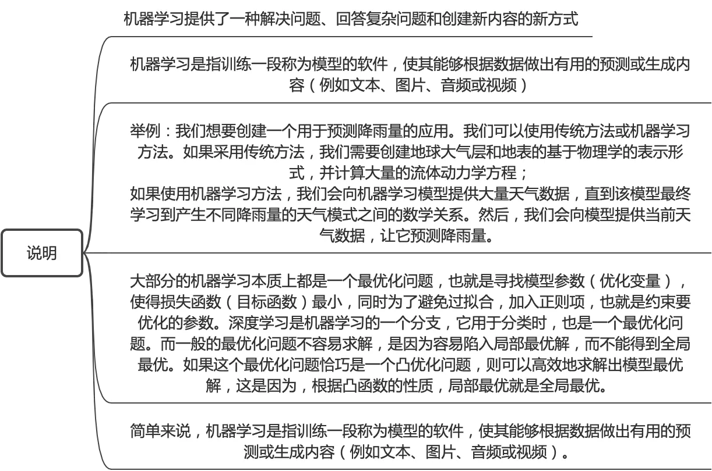


### 机器学习与传统编程的区别

| 传统编程            | 机器学习            |
| --------------- | --------------- |
| 程序员编写明确的规则      | 计算机从数据中学习规则     |
| 适用于问题明确、规则清晰的情况 | 适用于复杂、规则难以明确的情况 |
| 例子：编写计算器程序      | 例子：编写识别垃圾邮件的程序  |


## 机器学习基础认知

### 一般概念

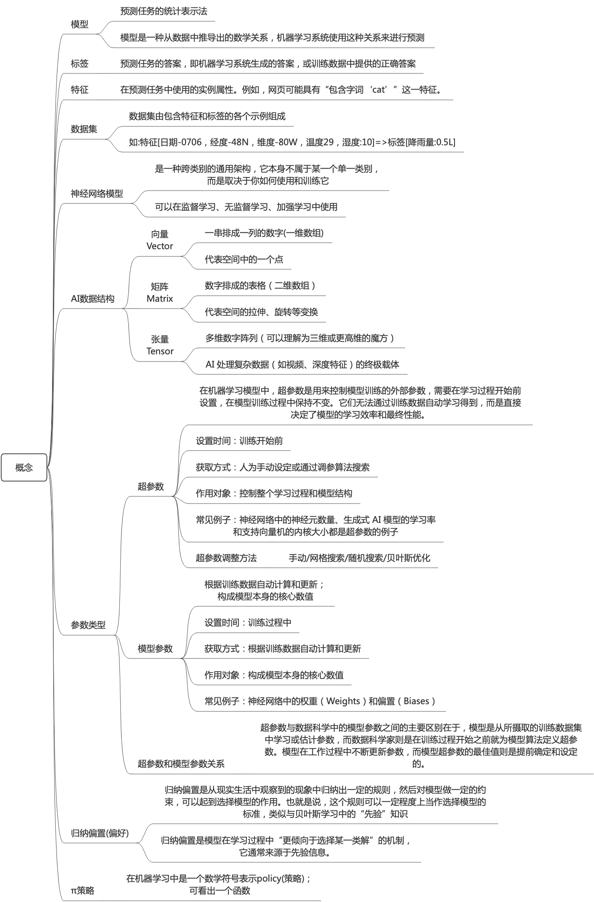

### 概念认知


```
数学
  ↓
公式（描述计算关系，=>怎么算）
  ↓
算法（描述解决问题的方法，=>怎么找到合适的参数）
  ↓
函数（代码中的计算单元）
  ↓
程序（工程实现算法，程序=算法+数据结构）
  ↓
模型（结构+参数）
  ↓
大模型（大规模模型）
  ↓
AI应用（Agent/RAG/助手，AI应用利用模型解决问题）
```


机器学习训练过程
```
输入数据 X
    ↓
模型参数 θ
    ↓
模型预测 Y'
    ↓
计算损失 Loss(Y,Y')
    ↓
梯度下降调整 θ
    ↓
新的模型参数
    ↓
重复以上过程
```


```
                 机器学习建模
                     |
                     v
              定义模型 y=f(x,θ)
                     |
                     v
              定义误差衡量方式
                     |
        --------------------------------
        |                              |
    均方误差MSE                    交叉熵Loss
        |                              |
        v                              v
   最小二乘目标                  分类优化目标
        |
        v
  求 θ 最优值
        |
 -------------------------
 |                       |
解析方法              数值优化方法
 |                       |
正规方程              梯度下降
```


### 机器学习三要素(模型/策略/算法)

机器学习方法可以概述如下：出发点是给定的、有限的训练数据集，假设这些数据遵循独立同分布。同时，假定待学习的模型属于一个特定的函数集合，即假设空间。根据特定评价准则，从假设空间中选择一个最优模型，该模型能够在该准则下对已知训练数据和未知测试数据实现最优预测。该最优模型的确定由相应算法完成。

机器学习方法由三大要素构成：模型的假设空间、评价准则以及学习算法，分别简称为模型（model）、策略（strategy）和算法（algorithm）。机器学习方法的差异主要源于其模型、策略与算法的不同。一旦这三者被确定下来，相应的机器学习方法便随之确立
- 模型：谈到机器学习，经常会谈到机器学习的“模型”。在机器学习中，模型的实质是一个假设空间，这个假设空间是“输入空间到输出空间所有映射”的一个集合，这个空间的假设属于我们的先验知识。然后，机器学习通过“数据+三要素”的训练，目标是获得假设空间的一个最优解，翻译一下就是求模型的最优参数。
- 策略：在模型部分，机器学习的学习目标是获得假设空间（模型）的一个最优解，那么问题来了，如何评判优还是不优？策略部分就是评判“最优模型”（最优参数的模型）的准则或方法。
- 算法：在策略部分，机器学习的学习目标转换成了求目标函数的最小值，而算法部分就是对函数最优解的求解方法。


**模型&策略&算法关系表**

| **机器学习模型**      | **1. 模型 (假设空间)**                                         | **2. 策略 (评估准则)**                | **3. 算法 (求解优化)**           |
| --------------- | -------------------------------------------------------- | ------------------------------- | -------------------------- |
| **线性回归**        | 线性函数 $y = \mathbf{w}^T\mathbf{x} + b$                    | 均方误差 (MSE Loss)                 | 最小二乘法 (解析解) 或 梯度下降法        |
| **逻辑回归**        | Sigmoid 压缩的线性组合 $y = \sigma(\mathbf{w}^T\mathbf{x} + b)$ | 对数似然损失 / 交叉熵 Loss               | 梯度下降法 / 拟牛顿法 (L-BFGS)      |
| **支持向量机 (SVM)** | 线性/非线性分离超平面 $\mathbf{w}^T\mathbf{x} + b = 0$             | Hinge Loss + $L_2$ 正则化 (最大间隔准则) | 序列最小优化算法 (SMO)             |
| **深度神经网络**      | 多层非线性复合函数                                                | 交叉熵 / MSE + Weight Decay        | 反向传播算法 (BP) + Adam/SGD 优化器 |

#### 模型

模型是机器学习的起点，它定义了输入与输出之间的关系，以及如何通过参数调整来优化这种关系。模型的选择对于机器学习的效果至关重要，不同的模型适用于不同的数据特征和问题类型。例如，线性回归模型适用于变量之间具有线性关系的场景，而神经网络则更擅长处理复杂的非线性问题。

机器学习首先要考虑的问题是学习什么样（形式）的模型。是监督学习还是无监督学习，是分类还是回归，是聚类还是降维等等，主要根据当前的任务以及数据的特征先初步确定要学习的模型。


如：线性模型、树形模型、神经网络、K近邻、逻辑回归、决策树、支持向量机等等

#### 策略

策略就是挑选最优模型的标准和准则，是用来衡量这个模型对已知数据和未知数据学的好不好的指标。通过损失函数来计算预测值和真实值的差距，指导机器判断哪个模型更好。


**关键名称**：欠拟合（Underfitting）、过拟合（Overfitting）、经验风险（Empirical risk）、经验风险最小化（Empirical risk minimization, ERM）、结构风险（Structural risk）、结构风险最小化（Structural risk minimization, SRM）、损失函数（Loss function）、代价函数（Cost function）、目标函数（Object function）、正则化（Regularization）

如：
经验风险最小化：希望在训练集上的误差最小（如均方误差 MSE、交叉熵 Loss）
结构风险最小化：既希望训练误差小，又希望模型足够简单（即：损失函数 + 正则化项，如 $L_1/L_2$ 正则化，防止过拟合）。

#### 算法

算法就是求解目标函数极小化（或极大化）问题的具体数值计算方法。
在策略部分，机器学习的学习目标转换成了求目标函数的最小/大值，而算法部分就是对函数最优解的求解方法。

如：
解析解：直接解方程组
数值优化解：迭代更新参数（如梯度下降法 SGD、Adam、牛顿法、坐标下降法）。


#### 三要素的要一种说法(数据、模型和算法)
也存在另一种说法：机器学习的三要素为数据、模型和算法。数据是机器学习的基础，需要进行特征工程和标注。模型是通过训练得到的，可以将输入数据映射为输出结果（策略隐含在模型构建中）。算法则是用于优化模型的方法。在机器学习中，数据的质量往往比算法更重要。业界广为流传的一句话是：“数据和特征决定了机器学习的潜力上限，而模型和算法则负责逼近这一上限。”


https://zhuanlan.zhihu.com/p/48914251  机器学习·总览篇 IV 机器学习的三要素


### 损失函数&目标函数&代价函数


- 损失函数（Loss Function ）：就是单个样本的误差，预测值和真实值之间的差距，但是衡量差距的方式有很多种，但是大多数情况下采用距离或者做差  
- 代价函数（Cost Function ）：它是整个训练集的损失，可以理解为所有样本数据的平均损失，但有时也可以不做平均，就是考虑总体损失  
- 目标函数（Object Function）：它是最终我们需要优化的函数，它代表着我们模型的各方面能力，抗干扰性、精度方面等

一般情况来说我们的目标函数为：目 标 函 数 = 损 失 函 数 / 代 价 函 数 + 结 构 风 险 （ 正 则 项 ）
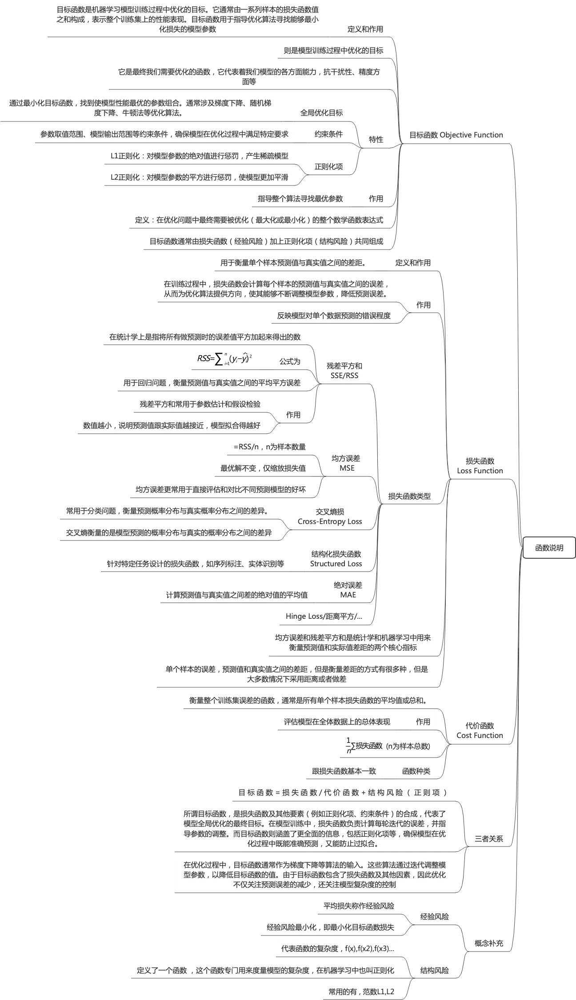

前面的损失函数有时也成为经验风险，它你就可以理解为这个函数的值可以评估模型的精度或者误差之类的，它的值越小，说明我们模型此时的精度越好（针对于训练集），我们有时可以直接采用损失函数作为最终的目标函数进行优化，也就是我们只关心精度或者误差，我们可以优化该函数进行优化达到使训练集的误差最小，但是有时我们希望提高模型的泛化能力，减少过拟合，那么此时如果仍使用损失函数作为目标函数就不太合适了，就应该在损失函数的后面添加正则项，这个作为我们最终的目标函数，我们此时的目标就是同时重视模型的精度误差和模型的泛化能力。

总的来说，我们的目标函数就是可以衡量模型的多方面能力，而损失函数只可以衡量精度或者损失方面，看你的目标是什么，如果你的目标就是精度，此时完全可以把损失函数作为目标函数进行优化，如果要注重其它方面，此时损失函数只是目标函数的一部分。

>其实有些时候把损失函数和代价函数混用，大多数情况都叫损失函数，不是特别严格。

https://developer.aliyun.com/article/1144098 【机器学习】损失函数、代价函数、目标函数之间有什么区别
https://www.zhihu.com/question/52398145 机器学习中的目标函数、损失函数、代价函数有什么区别？


### 经典算法对应关系

| 算法          | 损失函数          | 代价函数        | 目标函数    |
| ----------- | ------------- | ----------- | ------- |
| 线性回归        | 平方损失          | MSE         | 最小化误差   |
| 逻辑回归        | 交叉熵           | Log Loss    | 最大似然    |
| SVM         | Hinge Loss    | Margin Loss | 最大间隔    |
| 决策树         | 熵/Gini        | 节点纯度        | 最大信息增益  |
| KMeans      | 距离平方          | SSE         | 最小簇内距离  |
| 神经网络        | MSE/CE        | Batch Loss  | 最小化Loss |
| Transformer | Cross Entropy | Token Loss  | 最大似然    |
| VAE         | 重构Loss+KL     | ELBO        | 最大化下界   |
| GAN         | 对抗Loss        | MinMax      | 纳什均衡    |
| 强化学习        | Reward        | 累计Reward    | 最大期望收益  |


### 机器学习训练中的概念


| 概念    | 作用          | 例子           |
| ----- | ----------- | ------------ |
| 模型    | 定义预测关系      | y=wx+b       |
| 损失函数  | 单个误差如何计算    | (y-y^)²      |
| 目标函数  | 整体优化目标      | Σ(y-y^)²     |
| 最小二乘法 | 定义平方误差最小化原则 | Min Σ(y-y^)² |
| 优化算法  | 寻找参数的方法     | 梯度下降、正规方程    |
| 参数    | 最终学习结果      | w,b          |
|       |             |              |


### 期望风险&经验风险&泛化误差

**在统计学中**

- **期望风险**（Expected Risk, $R(f)$）： 指的是模型 $f$ 在真实的数据总体（真实世界）上预测损失的数学期望。它是模型在未见过的真实分布上的真正总误差

- **经验风险**（Empirical Risk, $R_{emp}(f)$）： 指的是模型 $f$ 在训练集样本（大小为 $N$）上的平均损失（即你在代码训练时算出的 Loss）：

- **泛化误差**（Generalization Error / Generalization Gap）：数学上，泛化误差是“期望风险”与“经验风险”之间的差值（Gap）！它衡量的是模型把训练集上的能力“泛化/迁移”到未见过的总体数据的落差

简单来说：
	经验风险=已知数据集误差
	期望风险=全总体（已知+未知）数据集误差
	泛化误差=期望风险-经验风险
	期望风险= 泛化误差+经验风险

目标就是“期望风险”最小；其实也代表期望泛化误差和经验风险都要小；

终极目标： 机器学习的目标是通过“经验风险最小化（ERM） + 正则化约束”来最小化期望风险。

期望风险最小：相当于一个预测函数，当然是预测未知数据的结果，跟真实越接近越好，即误差越小。

**在机器学习领域中**

经验风险=训练集误差；反映模型对已知数据的拟合程度
期望风险≈=测试集误差
泛化误差=期望风险-经验风险≈=测试集误差-训练集误差
>注意：由于全量的数据集，现实中基本不可能获得，所以理论的期望风险、泛化误差是获取不到的；在实际落地时，划分出“测试数据集”代表全部的未知数据集，这样就能计算期望风险、泛化误差。即真实期望误差≈=测试集误差，真实泛化误差≈=测试集误差-训练集误差；通常情况下我们也直接说等于(实际是约等于)。

>测试集误差在统计学上被称为期望风险的**无偏估计（Unbiased Estimator）**。只要测试集是从总体中独立同分布（i.i.d.）抽样出来的，且样本量足够大，根据大数定律，测试集误差在概率上趋近于期望风险

训练集误差和测试集误差，我们是可以计算、控制的；训练集误差通过机器训练(如梯度)降下来，测试集误差通过训练的模型计算得到；继而得出泛化误差；

泛化误差 = 测试集误差-训练集误差，如果很小，我们确信期望风险很小，模型是可行的；
即好的模型，训练集误差、测试集误差、泛化误差都要小；

期望风险的分析可以参考[偏差-方差分解](#偏差-方差分解)

Q：那期望风险和经验风险如果能进行计算，这两个的误差值需要采用相同的数学公式？
A:必须的

**总结**：监督学习中纯粹优化“经验风险最小化（ERM）”容易导致过拟合（高方差）。因此在实际工程中，我们将目标函数换成“结构风险最小化（SRM）”，即：
$$
\text{目标函数} = \text{经验风险 (Loss)} + \text{正则化项 (如 L1/L2)} -> \text{最小化}
$$

## 机器学习分类


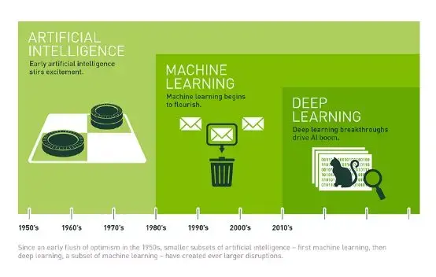

机器学习（Machine Learning）是人工智能（AI）的一个分支，它使计算机系统能够利用数据和算法自动学习和改进其性能。

### 监督学习
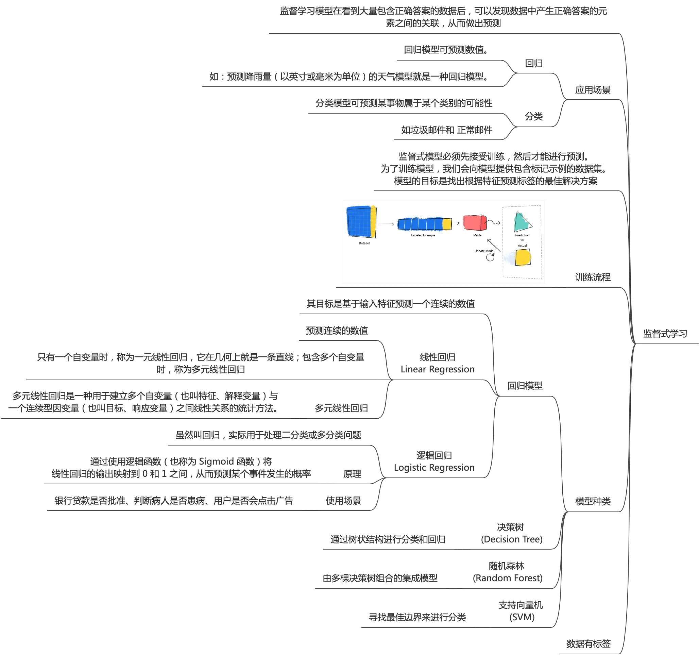


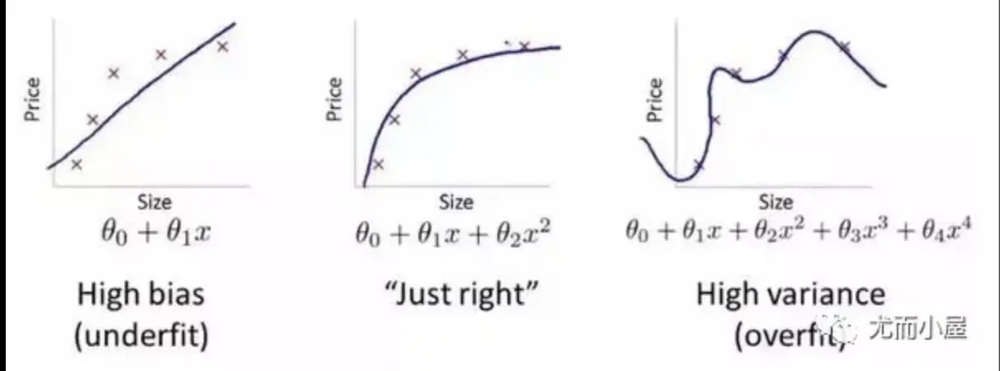
*一元到多项式函数图形*

### 非监督学习
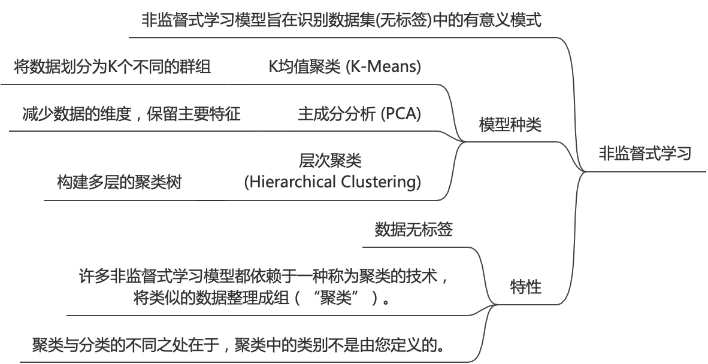

### 强化学习

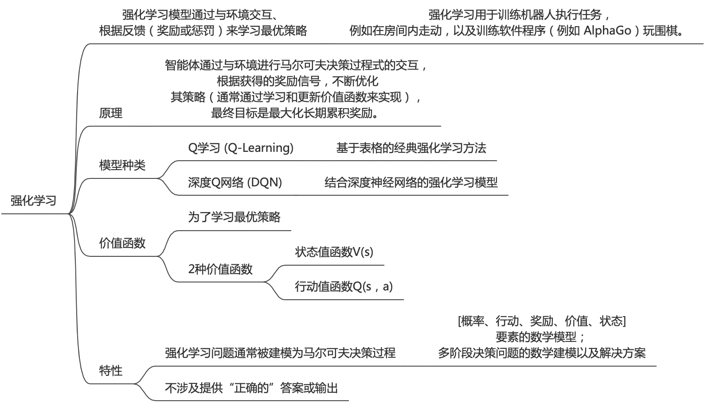


**强化学习框架**
智能体与环境：这是强化学习中最基本的一对互动关系
- 智能体： 就是学习的主体，是做出决策的实体。在上面的例子中，小狗就是智能体。在计算机中，它可以是一个算法、一个程序或一个机器人。
- 环境： 是智能体所处的外部世界，智能体与之互动。对于小狗来说，环境就是你、零食、地板等一切外部事物。环境会接收智能体的动作，并给出新的状态和奖励。
- 
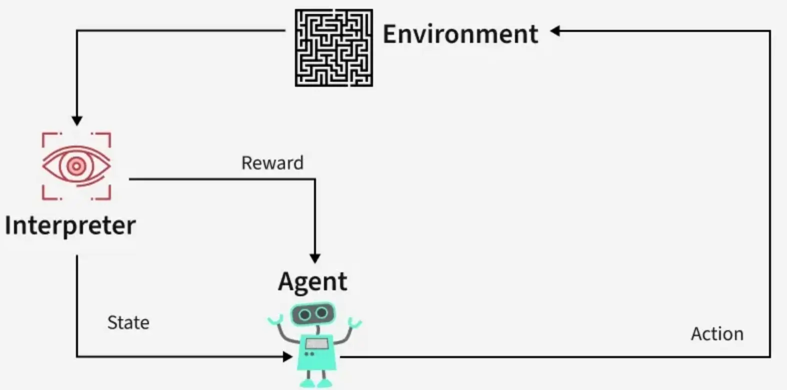
智能体观察环境 -> 做出动作 -> 环境反馈新的状态和奖励 -> 智能体再次观察.

强化学习的典型交互循环可概括为以下步骤：
1. 智能体观察当前环境状态
2. 基于特定策略选择并执行动作
3. 环境根据智能体的动作转换到新状态
4. 智能体接收奖励信号
5. 智能体根据获得的经验更新其策略
6. 重复上述过程，直至找到最优策略
这一过程通常会重复数千甚至数百万次，直到智能体学会在各种状态下做出最优决策。

### 深度学习

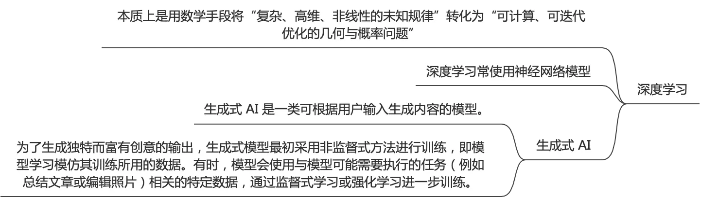

### 总结

| **范式 / 领域** | **核心理论基石**                                         | **追求的终极目标**                                       | **关键数学表达**                                                            |
| ----------- | -------------------------------------------------- | ------------------------------------------------- | --------------------------------------------------------------------- |
| **监督学习**    | **统计学习理论** (SLT)<br><br>  <br><br>经验风险/结构风险最小化     | **期望风险最小**<br><br>  <br><br>(未来预测误差最小)            | $\min \mathbb{E}_{(x,y)}[L(y, f(x))]$                                 |
| **非监督学习**   | **信息论 / 极值估计**<br><br>  <br><br>最大似然 / 变分推断 / 几何聚类 | **重构误差最小 / 数据分布似然最大**<br><br>  <br><br>(还原数据真实结构) | $\max \mathbb{E}_{x}[\log P(X)]$ 或 $\min \Vert{}X - \hat{X}\Vert{}^2$ |
| **强化学习**    | **马尔可夫决策过程 (MDP)**<br><br>  <br><br>贝尔曼方程 / 策略迭代   | **累积期望回报最大**<br><br>  <br><br>(长远收益最大化)           | $\max_\pi \mathbb{E}_\pi \left[\sum \gamma^t R_t\right]$              |
| **生成式深度学习** | **概率图模型 / 统计物理**<br><br>  <br><br>隐式正则化 / 扩散理论     | **分布距离最小**<br><br>  <br><br>(生成真实感极强的数据)          | $\min D_{KL}(P_{data} \parallel P_{model})$                           |


## 机器学习流程

机器学习从数据准备到上线流程：

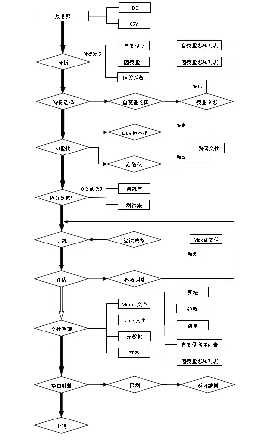


1. 数据源：
机器学习的第一个步骤就是收集数据，这一步非常重要，因为收集到的数据的质量和数量将直接决定预测模型是否能够建好。我们可以将收集的数据去重复、标准化、错误修正等等，保存成数据库文件或者csv格式文件，为下一步数据的加载做准备。
2. 分析：
这一步骤主要是数据发现，比如找出每列的最大、最小值、平均值、方差、中位数、三分位数、四分位数、某些特定值（比如零值）所占比例或者分布规律等等都要有一个大致的了解。了解这些最好的办法就是可视化，谷歌的开源项目facets可以很方便的实现。另一方面要确定自变量(x1...xn)和因变量y，找出因变量和自变量的相关性，确定相关系数。

3. 特征选择：
特征的好坏很大程度上决定了分类器的效果。将上一步骤确定的自变量进行筛选，筛选可以手工选择或者模型选择，选择合适的特征，然后对变量进行命名以便更好的标记。命名文件要存下来，在预测阶段的时候会用到。

4. 向量化：
向量化是对特征提取结果的再加工，目的是增强特征的表示能力，防止模型过于复杂和学习困难，比如对连续的特征值进行离散化，label值映射成枚举值，用数字进行标识。这一阶段将产生一个很重要的文件：label和枚举值对应关系，在预测阶段的同样会用到。

5. 拆分数据集：
需要将数据分为两部分。用于训练模型的第一部分将是数据集的大部分。第二部分将用于评估我们训练有素的模型的表现。通常以8:2或者7:3进行数据划分。不能直接使用训练数据来进行评估，因为模型只能记住“问题”。

6. 训练：
进行模型训练之前，要确定合适的算法，比如线性回归、决策树、随机森林、逻辑回归、梯度提升、SVM等等。选择算法的时候最佳方法是测试各种不同的算法，然后通过交叉验证选择最好的一个。但是，如果只是为问题寻找一个“足够好”的算法，或者一个起点，也是有一些还不错的一般准则的，比如如果训练集很小，那么高偏差/低方差分类器（如朴素贝叶斯分类器）要优于低偏差/高方差分类器（如k近邻分类器），因为后者容易过拟合。然而，随着训练集的增大，低偏差/高方差分类器将开始胜出（它们具有较低的渐近误差），因为高偏差分类器不足以提供准确的模型。

7. 评估：
训练完成之后，通过拆分出来的训练的数据来对模型进行评估，通过真实数据和预测数据进行对比，来判定模型的好坏。模型评估的常见的五个方法：混淆矩阵、提升图&洛伦兹图、基尼系数、ks曲线、roc曲线。混淆矩阵不能作为评估模型的唯一标准，混淆矩阵是算模型其他指标的基础。

完成评估后，如果想进一步改善训练，我们可以通过调整模型的参数来实现，然后重复训练和评估的过程。

8. 文件整理：
模型训练完之后，要整理出四类文件，确保模型能够正确运行，四类文件分别为：Model文件、Lable编码文件、元数据文件（算法，参数和结果）、变量文件（自变量名称列表、因变量名称列表）。

9. 接口封装：
通过封装封装服务接口，实现对模型的调用，以便返回预测结果。

10. 上线

<https://blog.csdn.net/qq_27567859/article/details/79666969> 机器学习流程介绍

### 训练流程

几乎所有机器学习训练过程，都可以抽象为：
```
输入数据 X
    ↓
模型参数 θ
    ↓
模型预测 Y'
    ↓
计算损失 Loss(Y,Y')
    ↓
梯度下降调整 θ
    ↓
新的模型参数
    ↓
重复以上过程
```

## 特征工程

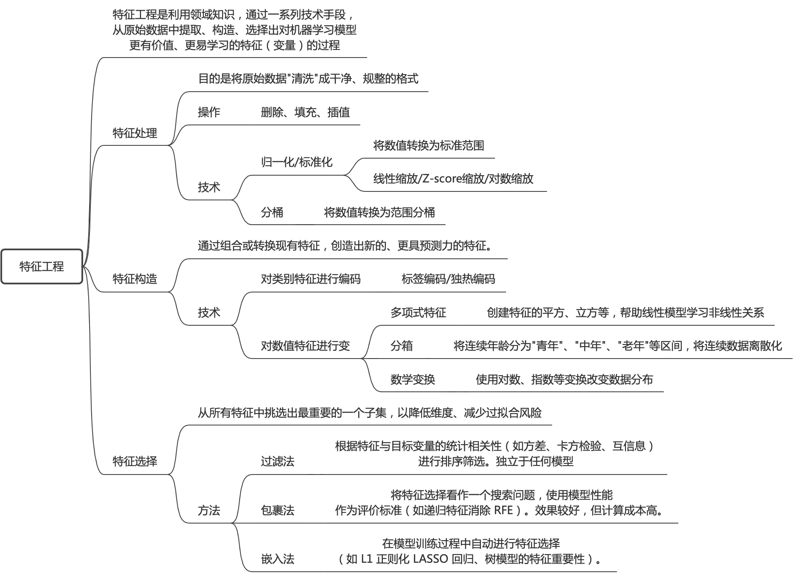


## 训练模式

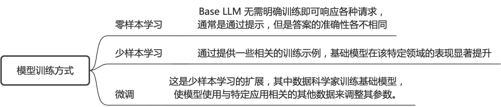


### 预训练
预训练是在原始架构不变的前提下，用海量数据训练参数，不增加层。微调时才会在预训练模型上增加少量任务相关层（如分类头），原来模型冻结。
>冻结层提供通用特征，微调层做任务适配

微调：部分微调常选最后几层，其他冻结。反向传播时，梯度仍然会传到冻结层（链式法则要求），但冻结层不保存梯度、不更新参数。训练结束后梯度收敛，收敛的是“被选择层的参数 + 新增头”。

>梯度下降在凸问题上保证收敛。神经网络是非凸的，但实践中通常能收敛到局部最优。

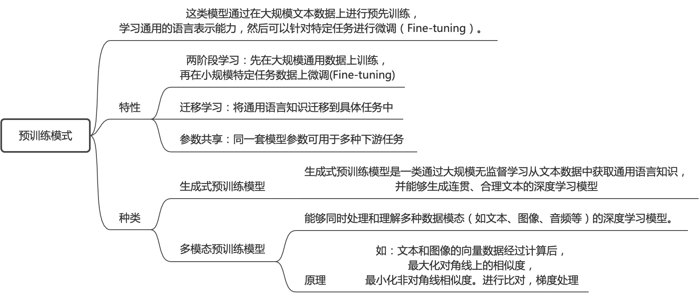

## 正则化(Regularization)

正则化是机器学习中一种常用的技术，其主要目的是在训练过程中控制模型复杂度(使模型变简单)，减小过拟合(对训练集预测误差可能增大，但是也能很好的拟合数据)，从而增强模型泛化能力(对测试集预测误差减少)。最基本的正则化方法是在原目标（损失）函数中添加惩罚项，对复杂度高的模型进行惩罚。

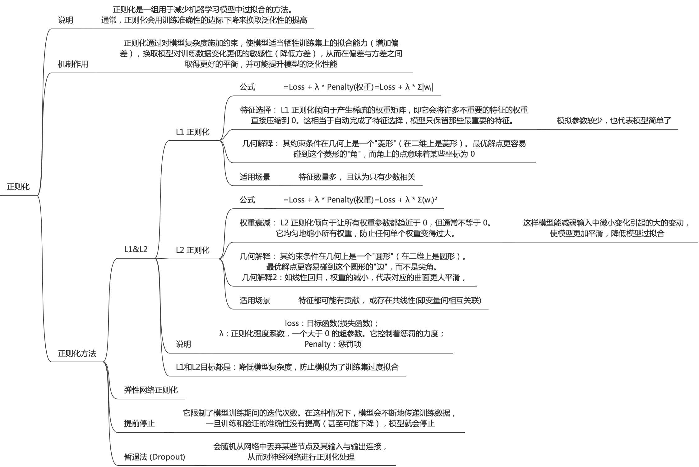

数学公式：$Loss + λ * Penalty$
>loss：损失函数
>λ：正则化强度系数，一个大于 0 的超参数。它控制着惩罚的力度；
  Penalty：惩罚项


>模型复杂度：模型能够表达多么复杂的函数关系，以及它能够对数据进行多么剧烈、精细的拟合。简单来说：模型复杂度体现在模型结构复不复杂，模型参数多不多，模型在几何表现上拟合、陡峭还是平滑；

L1数学公式
$Loss + λ * Penalty(权重)=Loss + λ * Σ|w_i|$

L2数学公式
$Loss + λ * Penalty(权重)=Loss + λ * Σ(w_i)²$


普通线性回归：
$$
\min_w L(w)
$$

加入 L2 正则化以后：
$$
\boxed{ \min_w L(w)+\lambda\|w\|_2^2 }
$$

 不仅希望预测误差 $L(w)$ 小，还希望参数 $w$ 不要太大。
$$
\boxed{ \min_w L(w) \quad \text{s.t.}\quad \|w\|_2\le t }
$$

只在一个有限范围内寻找最优参数，并且要求参数整体规模不能超过 $t$。

$s.t. ∥w∥≤t​$
约束 $w$ 的范数不能超过 $t$
>s.t. ：是 **subject to** 的缩写，含义是在满足某个约束条件的前提下，进行优化


| L2 正则化形式                     | 约束形式                                   |
| ---------------------------- | -------------------------------------- |
| $\min L(w)+\lambda\|w\|_2^2$ | $\min L(w)\quad s.t.\quad\|w\|_2\le t$ |
| 给“大参数”增加惩罚                   | 直接限制参数不能太大                             |
| 软约束                          | 硬约束                                    |
| (\lambda) 控制惩罚强度             | (t) 控制允许的参数范围                          |


这种通过增加训练误差来减少测试误差的做法称为偏差-方差权衡(**Bias-Variance Tradeoff)

>偏差-方差权衡：偏差-方差的最佳点，使总误差最小。正则化通过对模型复杂度施加约束，使模型适当牺牲训练集上的拟合能力（增加偏差），换取模型对训练数据变化更低的敏感性（降低方差），从而在偏差与方差之间取得更好的平衡，并可能提升模型的泛化性能

https://zhuanlan.zhihu.com/p/29360425 深入理解L1、L2正则化
https://www.runoob.com/ml/ml-model-optimization-regularization.html 正则化
https://www.ibm.com/cn-zh/think/topics/regularization 正则化
https://zhuanlan.zhihu.com/p/376000306 理解L1, L2正则化的正确姿势
[偏差&方差&拟合&泛化](#偏差&方差&拟合&泛化)

## 归一化&标准化


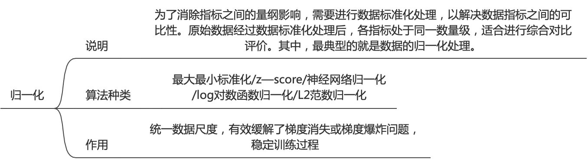

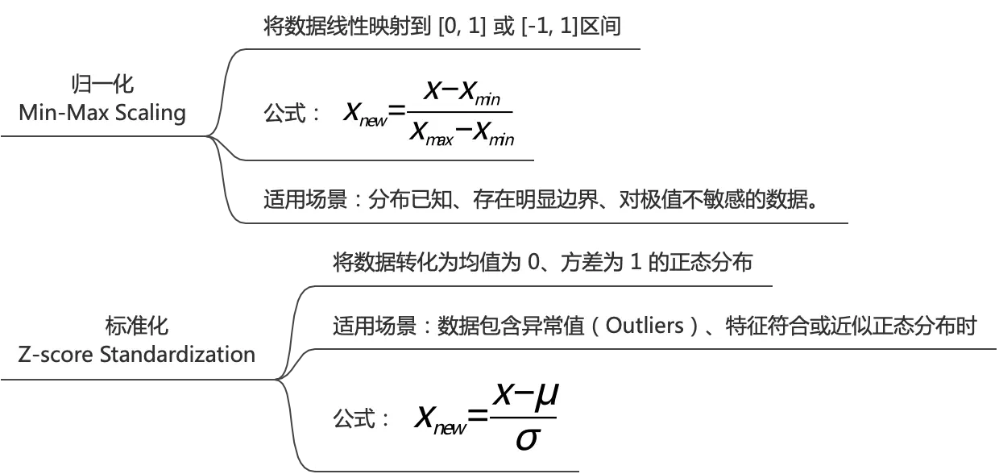

广义上，标准化是归一化的一种；狭义上，两者并列（归一化 = Min-Max，标准化 = Z-Score）。实际使用中常互换。

| 层级     | 术语                   | 含义                  |
| ------ | -------------------- | ------------------- |
| **大类** | 归一化（Normalization）   | 把数据调整到统一尺度的**所有方法** |
| **子类** | 标准化（Standardization） | Z-Score，均值 0 方差 1   |
| **子类** | Min-Max 归一化          | 缩放到 \[0, 1]         |
| **子类** | Robust 标准化           | 用中位数和 IQR           |
| **子类** | MaxAbs 归一化           | 缩放到 \[-1, 1]        |
| **子类** | Log 变换               | 压缩长尾                |
| **子类** | Box-Cox 变换           | 让数据接近正态             |

### 归一化(Min-Max Normalization)
归一化目的是把数据调整到某个范围或分布。

Min-Max归一化把数据缩放到 \[0, 1]，保留原始分布形状。

**数学公式**：$x' = \frac{x - \min}{\max - \min}$

**使用场景**：数据范围固定；如图像处理（像素 0-255 → 0-1）。


### 标准化(Z-score Standardization)
标准化是把数据调整到统一尺度的操作。
经过Z-score标准化处理后的数据，其均值为0，标准差为1。保留原始分布形状。

**作用**：
- 消除量纲影响。
- 让不同特征在同一尺度上。
- 加速训练，提升模型效果。

**Z-score计算公式**：$z=\frac{x-\mu }{\sigma }$
>𝑥：原始数据
>𝜇：原始数据的均值
>𝜎：原始数据的标准差
>𝓏：处理后的标准化数据

**使用场景**：数据分布近似正态分布时

### 归一化和标准化对比
数据近似正态、用距离模型，选 Z-Score；数据有明确边界、图像处理，选 Min-Max。有异常值先处理，树模型不标准化。

| 维度       | Z-Score      | Min-Max             |
| -------- | ------------ | ------------------- |
| 公式       | `(x-μ)/σ`    | `(x-min)/(max-min)` |
| 输出范围     | 无固定          | \[0, 1]             |
| 对异常值     | 较敏感          | 极敏感                 |
| 分布假设     | 近似正态         | 无                   |
| 适用模型     | 大多数          | 图像、神经网络             |
| 训练/推理一致性 | 用训练集统计量      | 用训练集 min/max        |
| 常见场景     | SVM、KNN、线性回归 | CNN、图像              |

**是否线性，是否可逆**

| 方法        | 线性？     | 可逆？ | 需要保存什么      |
| --------- | ------- | --- | ----------- |
| Z-Score   | ✅       | ✅   | μ, σ        |
| Min-Max   | ✅       | ✅   | min, max    |
| MaxAbs    | ✅       | ✅   | max         |
| Robust    | ✅       | ✅   | median, IQR |
| Log       | ❌       | ✅   | 无           |
| Box-Cox   | ❌       | ✅   | λ           |
| 单位向量      | ❌       | ❌   | 无           |
| Softmax   | ❌       | ❌   | 无           |
| BatchNorm | ⚠️ 数据依赖 | ✅   | μ, σ        |
| LayerNorm | ⚠️ 数据依赖 | ✅   | μ, σ        |
线性归一化（Z-Score、Min-Max、Robust）都是可逆的，保存统计量即可还原。非线性归一化中，Log、Box-Cox 可逆，Softmax、单位向量不可逆。可逆性对回归任务、生成模型很重要。

## 激活函数

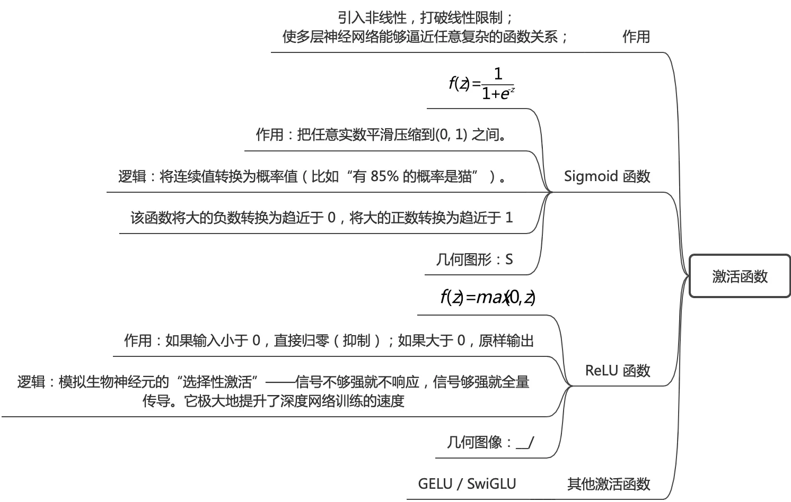


激活函数通常具有非线性的特性，这使得神经网络能够拟合非线性的复杂函数，从而提高其性能和准确度。
如果没有激活函数，无论你的神经网络叠加了多少层（100 层还是 1000 层），整个网络数学上依然等价于一个单层的线性回归模型。
>引入激活函数是为了增加神经网络模型的非线性。没有激活函数的每层都相当于矩阵相乘。就算你叠加了若干层之后，无非还是个矩阵相乘罢了。


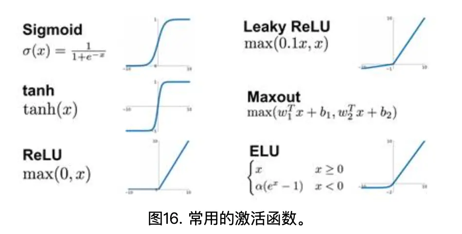

## 偏差&方差&拟合&泛化

拟合状态->决定泛化能力->泛化误差分解成"偏差-方差关系"来进行底层原因分析；


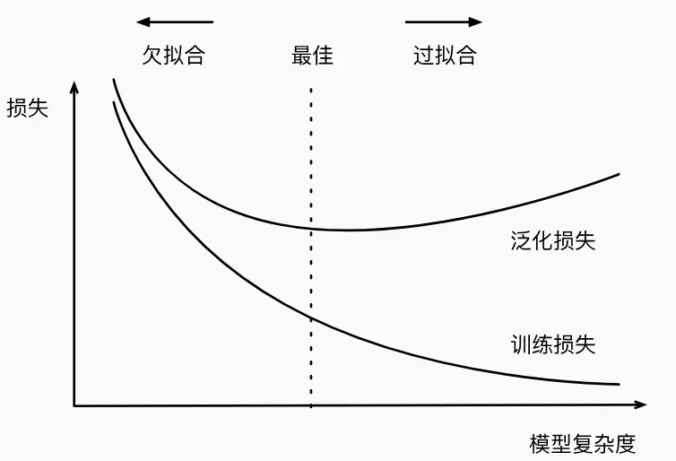
<font color="#7f7f7f">模型复杂度对欠拟合和过拟合的影响</font>

### 拟合&泛化

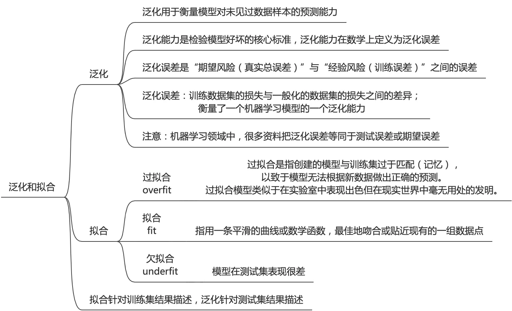

机器学习的目的是得到最优模型，以能正确预测未知数据；
所以机器学习要解决2个问题
- 训练的优化问题(即拟合程度问题)
- 预测的泛化问题

优化问题，往往在训练中，通过优化算法进行训练，能得出最优模型；接下来这个最优模型需要进行未知数据预测，预测好坏，就用泛化能力来衡量；

泛化能力的本质，就是模型提取“客观规律”并无视“随机噪声”的能力，要数学可计算得话，我们就要计算泛化误差(期望误差)，误差越小，泛化能力越强；

数学公式：$泛化误差 = E_{x,y}[(f(x) - y_{true})^2]$

>$x, y_{true}$ ：代表**未来真实世界中**所有可能出现的数据和真实标签。
 $f(x)$ ：你的模型预测的值。
 $E$ ：期望（求平均）。

既然泛化能力是针对“未来所有未知数据”的，而人类不可能拥有未来的数据，所以我们永远无法在训练时，直接算出模型真实的泛化能力。在工程落地中有多种方法进行泛化能力评估；
#### 泛化评估方法

**数据集划分与验证方法**
  - 数据集划分法（Hold-Out Validation）
  - 交叉验证法（Cross-Validation）
	  >把数据切分成好几份，轮流当测试集，最后取平均值，让估计更准确
  - 自助法（Bootstrapping）
  - 留出法（Hold-out）
    >我们狠心把现有的数据藏起 20% 绝对不让模型看（这就是测试集）。模型训练完后，我们用这 20% 的数据去测试它。测试集上的表现，就是我们用来近似估计泛化能力的唯一指标。

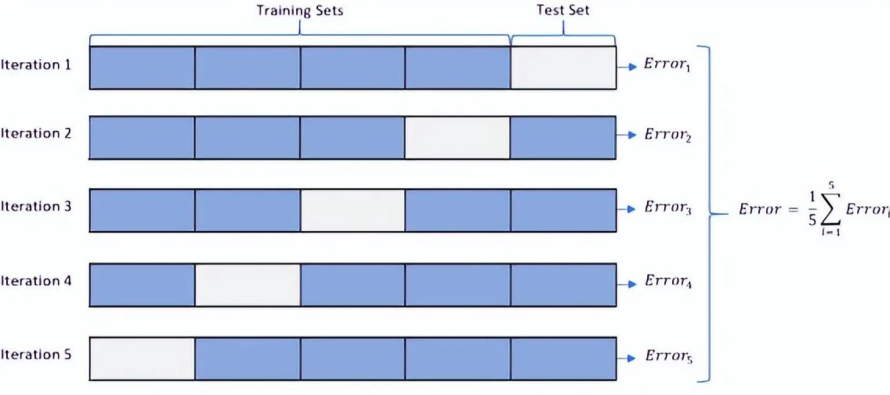
<center><font color="#a5a5a5">K折交叉验证</font></center>

**量化评估指标**
  - 分类任务指标：包括准确率（Accuracy）、精确率（Precision）、召回率（Recall）、F1分数以及 ROC-AUC 等
  - 回归任务指标：包括均方误差（MSE）、均方根误差（RMSE）、平均绝对误差（MAE）以及决定系数（R²）等


 工程评估法（测试集、交叉验证）：看“表象”
- **做法**：拿一部分数据不让模型看，然后算 MSE 或 Accuracy。
- **作用**：它只能告诉你一个**总数**（即泛化误差的总和）。
- **局限**：如果你发现测试集误差很高，它**不会告诉你为什么**。是因为模型太笨（高偏差）？还是因为模型太敏感（高方差）？工程评估法给不出答案。

 理论评估法（偏差-方差分解）：看“病因”
- **做法**：通过数学公式 $E[(y - f(x))^2] = \text{Bias}^2 + \text{Var} + \text{Noise}$ ，把泛化误差强行拆解。
- **作用**：它不仅评估了泛化能力，还直接给出了**诊断书**。
  - 如果算出来 **Bias 很大** $arrow$ 评估结论：模型欠拟合，需要增加复杂度。
  - 如果算出来 **Var 很大** $arrow$ 评估结论：模型过拟合，需要加正则化或增加数据。

**概述**：上述方法告诉你模型误差有多大，模型好不好，更深层的问题没有解释，不能指导我们如何进行模型调整；接下来我们可以采用如偏差-方差分解法进行分析，给出误差产生的原因，以及后续模型优化方向；


##### 泛化分析理论方法

现代机器学习理论从误差构成、几何拓扑、信息论、统计学习界限、经验风险最小化等多个维度给出了非常完备的解释框架

| **理论框架**                          | **解释泛化能力的切入视角**               | **核心结论 / 如何提升泛化**                  |
| --------------------------------- | ----------------------------- | ---------------------------------- |
| **偏差-方差分解**                       | 预测误差拆解为方差、偏差、噪声，模型拟合、欠拟合、稳不稳定 | 寻求模型复杂度的平衡（Trade-off）              |
| **VC 维 / Rademacher**             | 模型族吸收/拟合任意噪声的能力上限             | 控制模型容量，使其远远小于样本量 $N$               |
| **平坦最小值 (Flat Minima)**           | 参数空间中 Loss 极小点周围的几何曲面形态       | 使用带噪声的优化器（如大学习率 SGD）落入平坦区          |
| **算法稳定性 (Stability)**             | 移除/修改单个训练样本对模型的扰动程度           | 引入正则化（$L_1/L_2$）、Data Augmentation |
| **信息瓶颈 (Information Bottleneck)** | 模型对输入数据的特征提取与噪声遗忘能力           | 让模型学会压缩无用细节，仅保留与任务相关的特征            |


https://zh.d2l.ai/chapter_multilayer-perceptrons/underfit-overfit.html#id3 模型选择、欠拟合和过拟合


### 偏差&方差

偏差和方差，在不同领域解释稍有不同，下面主要针对机器学习领域来进行说明的；

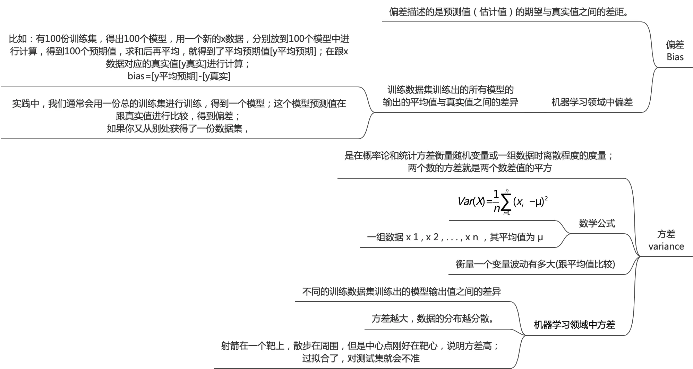

#### 偏差-方差分解方法

##### 说明
偏差-方差分解法（Bias-Variance Decomposition）是一种重要的理论分析方法与数学工具。它不能直接用来训练模型，而是用来解释和诊断学习算法泛化性能的理论框架。学习算法除了通过实验估计其泛化能力，偏差-方差分解法还能解释“为什么”具有这样的性能。

在现实中我们无法完美算出真实的偏差和方差数值（因为我们不知道真实规律和无穷多的数据集），但我们利用它的理论思想，通过比较训练集误差与验证集误差来进行工程诊断。

**核心概念**
- **误差分解**：它通过数学推导，将学习算法的期望误差拆解为三项：偏差（Bias）、方差（Variance）和噪声（Noise）；
- **指导设计**：它从理论上揭示了为什么模型会发生过拟合或欠拟合，指导人们如何通过调整模型复杂度来平衡偏差与方差
- **解释算法**：它常用于理论上解释集成学习中不同策略的作用，例如分析 Bagging 方法主要用于降低方差，而 Boosting 方法主要用于降低偏差

模型的泛化误差（Expected Generalization Error）可以严格分解为三个部分：
$$
\text{期望误差(泛化误差)} = $E[(y - f(x))^2]  = \text{偏差}^2 (\text{Bias}^2) + \text{方差} (\text{Variance}) + \text{不可消除的噪声} (\sigma^2)
$$
>在很多口头讨论或非严格教材中，人们常把“模型在未见过的测试集上的预测误差/表现”统称为“泛化性能”或“泛化误差”。在这个广义语境下，人们说“泛化误差由偏差、方差、噪声组成”，这里的“泛化误差”实际上指的就是期望风险（测试总误差）。
>严格上的泛化误差：衡量的是测试集与训练集的误差差距（衡量模型是否把训练集上的能力成功迁移到了测试集）。
  这个章节里面泛化误差等同于测试集误差，也等同于期望误差；


**偏差：训练数据集训练出的所有模型的输出的平均值与真实值之间的差异；**
偏差度量了学习算法的期望预测与真实结果的偏离程度，即刻画了学习算法本身的拟合能力。
对比对象：不同训练集训练处的不同模型间的平均预期值与真实值的对比；

偏差数学公式：
$$\text{Bias}(x) = E_D \left[f_D(x) \right] - y_{true}$$

**方差：不同的训练数据集训练出的模型输出值之间的差异；**
白话：反应了每一个具体模型的预测值，偏离‘所有模型平均预测值’的平均程度
方差衡量的是模型的预测随不同训练数据集的变化程度
对比对象：不同训练集训练出来的不同模型间的预期值对比；
 

方差数学公式：
$$
\text{Var}(x) = E_D \left[ (f_D(x) - E_D[f_D(x)])^2 \right]
$$

>$x$ ：你要预测的某个具体的输入数据
 $D$ ：代表“所有可能的训练数据集”
 $f_D(x)$ ：代表“用某一个训练集 $D$ 训练出的模型，对 $x$ 的输出值”
 $E_{D}[… ]$ ：最外层的期望（求平均）
 $E_D \left[ f_D(x) \right]$ ：这就是那句话里的核心——“所有模型输出的平均值”。在数学上， $E$ 代表期望（Expectation），也就是把所有可能的 $f_D(x)$ 加起来求平均
 $y_{true}$ ：代表$x$数据对应的“真实模型的输出值”（即绝对正确的客观真理）
 $E_D \left[ f_D(x) \right] - y_{true}$ ：这就是那句话的后半句——“与真实值的差异”，即偏差
 $f^{D}(x) - E^{D}[f^{D}(x)]$ ：某一个具体模型的预测值，与“所有模型平均值”之间的差距
 Var(x)=$E^{D}[(…)^2]$ ：最外层的期望（求平均）。意思是，把所有可能的训练集产生的这种“平方差距”，全部加起来求平均


**噪声：数据本身蕴含的不可避免的随机干扰（如传感器误差）。任何模型都无法消化的系统下限。**
简化模型，噪声=0；


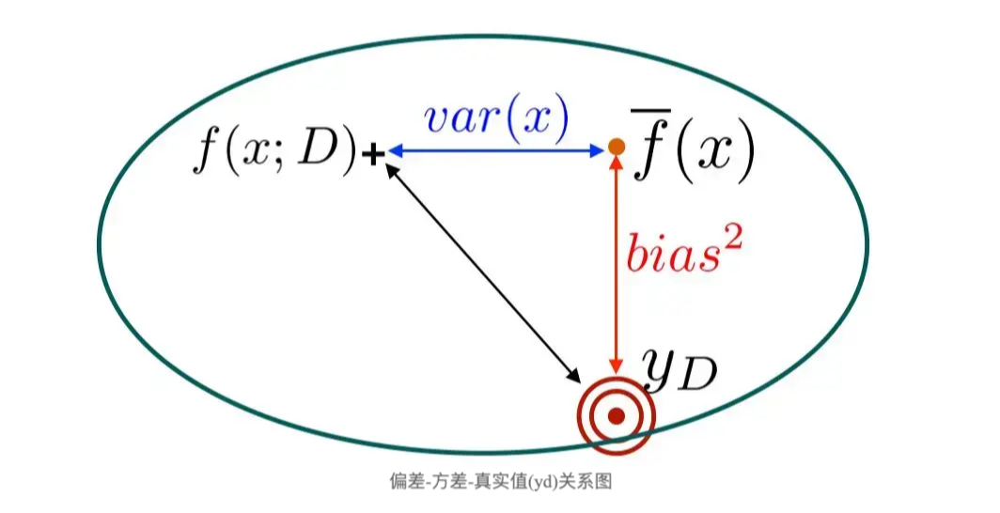

*泛化误差、方差、偏差关系图*
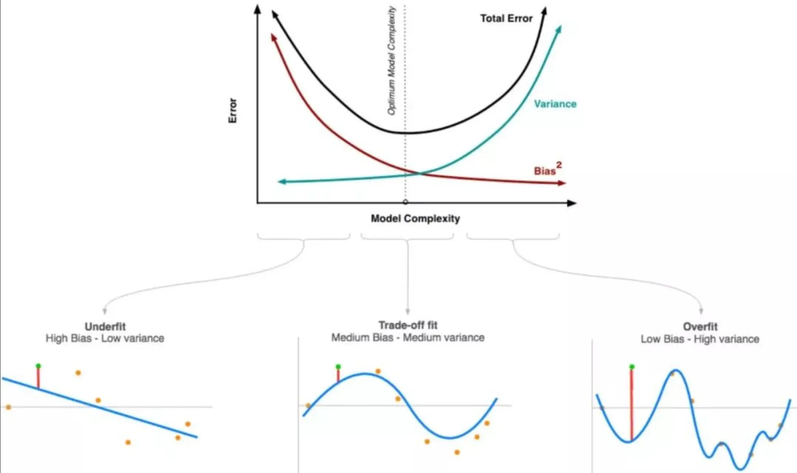

##### 例子讲解
假设我们想评估模型在 “80㎡房屋” 上的预测方差、偏差。
我们从总体数据分布中随机抽取了 **3 组不同的训练集**（$D_1, D_2, D_3$），并分别训练出了 3 个模型：
- **训练集 $D_1$ 训练出的模型 1：** 预测 80㎡ 的房价为 **220 万元**（$f_{D_1}(80) = 220$）
- **训练集 $D_2$ 训练出的模型 2：** 预测 80㎡ 的房价为 **235 万元**（$f_{D_2}(80) = 235$）
- **训练集 $D_3$ 训练出的模型 3：** 预测 80㎡ 的房价为 **238 万元**（$f_{D_3}(80) = 238$）

第一步：计算“平均预测值” $\bar{f}(x)$

把所有单一模型的预测值相加，求平均数：

$$
\bar{f}(80) = \frac{220 + 235 + 238}3 = \frac{693}3 = 231 \text{ 万元}
$$

第二步：每个单一模型都要参与，计算与平均值的偏差平方

**必须针对每一个模型单独计算：**
- **模型 1 的偏差平方：** $(220 - 231)^2 = (-11)^2 = 121$
- **模型 2 的偏差平方：** $(235 - 231)^2 = (4)^2 = 16$
- **模型 3 的偏差平方：** $(238 - 231)^2 = (7)^2 = 49$

第三步：将所有模型的偏差平方相加，求平均（即得到方差）
$$
\text{Variance}(80) = \frac{121 + 16 + 49}3 = \frac{186}3 = 62
$$


第四部：计算偏差
偏差：
$$\text{Bias}(80) = \bar{f}(80) - y = 231 - 230 = 1 \text{ 万元}$$

$偏差^2$=1


##### 分析

偏差，偏差体现了模型对训练数据的拟合能力。把模型比喻成一支猎枪，预测的目标是靶心

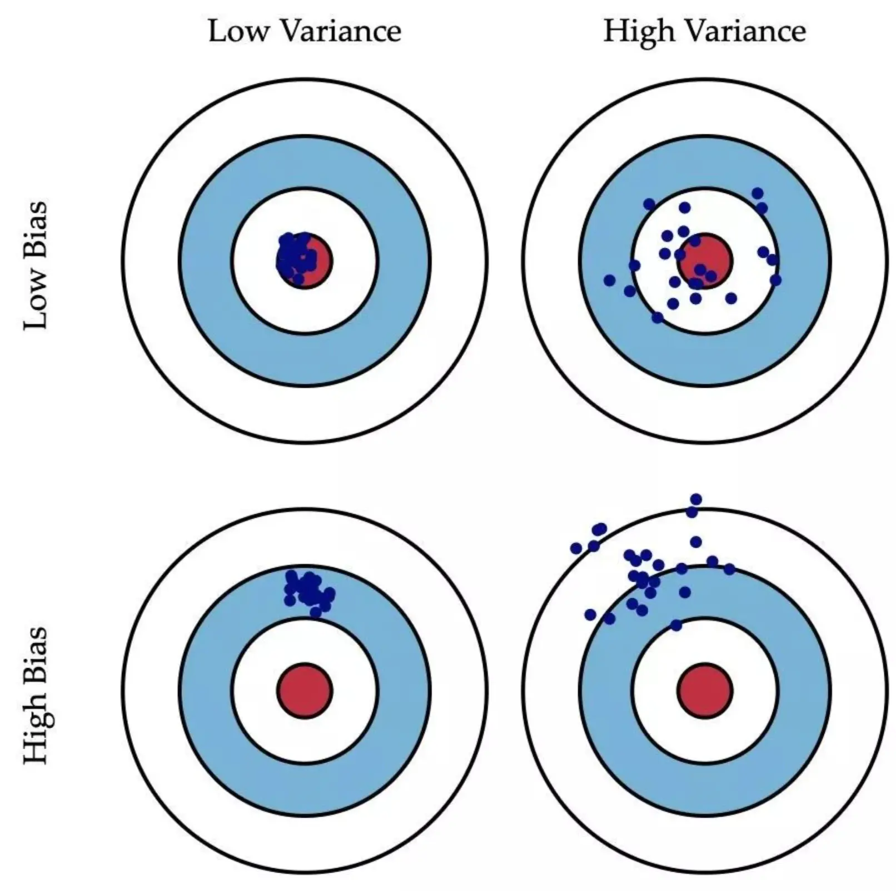

**方差高：过拟合**
- 说明：训练完成的时候，一般来说已经是拟合的了，但是这个拟合的模型，在另一个数据集上进行测试，方差高，说明数据比较离散，预测能力差，也就说明了训练的模型是过拟合的；简单来说就是模型在训练集和测试集表现差很大；
- 本质原因：模型太复杂了，它不仅学到了真实规律，还把训练集里的“随机噪声”也当成了规律死死记住。它对训练数据极其敏感
- 结论：增加训练数据量（更多数据能有效抑制方差）。降低模型复杂度（剪枝、限制树深度）。
- 改进策略：增强正则化（加大 $L_1/L_2$ 正则化，引入 Dropout 等）。使用集成学习中的降低方差方法（如随机森林 Random Forest / Bagging）。


**偏差高：欠拟合**
- 说明：模型在训练集和测试集上表现都差；
- 本质原因：模型太简单了、数据集太少或不合理等，连训练集里的真实规律都学不到
- 结论：模型太简单，连训练集里的基本规律都学不会，根本谈不上泛化
- 改进策略：增加特征数量/特征交叉（如引入平方项、交叉乘积项）。增加模型复杂度（如增加神经网络层数、增加树的深度）。减少正则化强度（如减小 $L_1/L_2$ 惩罚系数 $\lambda$）。


**总结**：一般来说，随着训练进行，偏差减少，方差增加，最终是找到方差-偏差的平衡点。在实际的训练过程中会用到validation set，会用到诸如early stopping以及regularization等方法来避免过学习的发生，然而没有一种固定的策略方法适用于所有的task和data，所以bias和variance之间的权衡(tradeoff)应该是机器学习永恒的主题。


https://www.zhihu.com/question/27068705/answer/129656963 
https://zhuanlan.zhihu.com/p/45241528 机器学习模型的偏差与方差、过拟合和欠拟合
https://developer.cloud.tencent.com/article/1441999 如何理解算法中的偏差、方差和噪声？
http://shichaoxin.com/2019/04/17/%E6%9C%BA%E5%99%A8%E5%AD%A6%E4%B9%A0%E5%9F%BA%E7%A1%80-%E7%AC%AC%E4%BA%94%E8%AF%BE-%E5%81%8F%E5%B7%AE%E4%B8%8E%E6%96%B9%E5%B7%AE/ 【机器学习基础】第五课：偏差与方差
https://www.ultralytics.com/zh/glossary/bias-variance-tradeoff Bias-Variance Tradeoff
https://zhuanlan.zhihu.com/p/369874722 Note | 经验风险、期望风险、结构风险、泛化误差界、偏差和方差

## 机器学习项目协议和规范

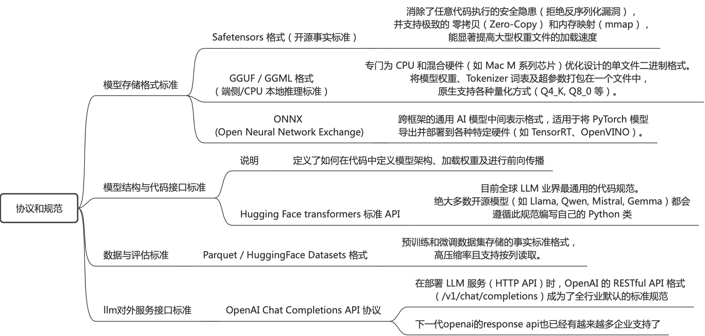

## 维度在机器学习领域的意义

一维/二维空间：是一条“直线”

### 核心逻辑
如果一个函数有 $N$ 个输入自变量（如 $x_1, x_2, \dots, x_N$），再加上 $1$ 个输出因变量（$y$），它们加在一起共有 $N + 1$ 个变量 。
这 $N + 1$ 个变量共同构成了一个 $N + 1$ 维的整体空间 。
如果没有任何约束，这 $N+1$ 个变量可以在空间里随意组合，填满整个 $N+1$ 维的实心体积 。
但是，一旦写出函数关系式 $y = f(x_1, x_2, \dots, x_N)$，$y$ 的值就被彻底锁死了 。只要你选定了自变量（有 $N$ 个自由选择的方向），$y$ 必须乖乖服从计算，不能自己乱动 。
这种“等式约束”消耗掉了 $y$ 轴方向上的自由度 。因此，最终能自由变化的维度只有自变量的个数 $N$，比总空间维度 $(N+1)$ 恰好少了 1 维 。

### 从低维到高维逐级推演
【1个自变量】$\rightarrow$ 2维空间中的 1维“线”
- **表达式：** $y = f(x)$（例如 $y = 2x + 1$）
- **整体空间：** 输入 $x$ + 输出 $y$ $\rightarrow$ **2维平面** $(x, y)$。
- **图形维度：** $x$ 可以自由变化，但 $y$ 被锁死。无数个点 $(x, y)$ 连起来，构成的是一条**1维的线/曲线**（有长度，但没有宽度）。
- **结果：** $2 - 1 = 1$ 维。

【2个自变量】$\rightarrow$ 3维空间中的 2维“面”
- **表达式：** $y = f(x_1, x_2)$（例如 $y = 3x_1 + 2x_2 + 1$）
- **整体空间：** 输入 $x_1, x_2$（地面长、宽） + 输出 $y$（垂直高度） $\rightarrow$ **3维空间** 。
- **图形维度：** 你可以在地面的东西方向（$x_1$）和南北方向（$x_2$）自由走动，但你的高度（$y$）必须严格由公式计算出来 。这就像在 3 维房间里拉了一张无限延伸的薄纸，构成的是一个**2维的平面/曲面**（只有长宽面积，没有厚度）。
- **结果：** $3 - 1 = 2$ 维 。

【N个自变量】$\rightarrow$ (N+1)维空间中的 N维“超平面”
- **表达式：** $y = f(x_1, x_2, \dots, x_N)$
- **整体空间：** $N + 1$ 维空间 。
- **图形维度：** 内部可以自由移动的方向只有 $N$ 个自变量的方向，构成一个 **$N$ 维超曲面/超平面（Hyperplane）** 。
- **结果：** $(N+1) - 1 = N$ 维 。

| **自变量个数 (N)** | **约束等式**                 | **整体空间维度 (N+1)** | **函数图像几何形态**             | **图像真实维度 (N)** | **比整体空间少几维** |
| ------------- | ------------------------ | ---------------- | ------------------------ | -------------- | ------------ |
| **0 个**       | $y = c$ (常数)             | 1 维 (线)          | **点** (Point)            | **0 维**        | 少 1 维        |
| **1 个**       | $y = f(x)$               | 2 维 (平面)         | **线/曲线** (Line/Curve)    | **1 维**        | 少 1 维        |
| **2 个**       | $y = f(x_1, x_2)$        | 3 维 (空间)         | **面/曲面** (Plane/Surface) | **2 维**        | 少 1 维        |
| **$N$ 个**     | $y = f(x_1, \dots, x_N)$ | $N+1$ 维          | **超平面/超曲面** (Hyperplane) | **$N$ 维**      | 少 1 维        |

在机器学习中，**决策边界（Decision Boundary）** 本质上就是把空间切开的“刀” 。
- 如果特征空间是 2 维的（如“身高”和“体重”），分类器的决策边界是一条 **1 维的直线**（降 1 维）。
- 如果特征空间是 3 维的，决策边界就是一个 **2 维的平整平面**（降 1 维）。
- 如果特征空间是 1000 维的，决策边界就是一个 **999 维的平整超平面** 。

“降 1 维的平坦性” 决定了线性模型（$\mathbf{w}^T \mathbf{x} + b$）只能用无厚度的平直界面去切割高维空间 。如果数据的分布是弯曲扭曲的，这把“平直的刀”就切不准，因此才需要非线性激活函数给模型赋予弯曲平面的能力 ！

## 机器学习python库

Scikit-learn(sklearn)的定位是通用机器学习库，而TensorFlow(tf)的定位主要是深度学习库。
sklearn主要适合中小型的、实用机器学习项目，尤其是那种数据量不大且需要使用者手动对数据进行处理，并选择合适模型的项目。

https://blog.csdn.net/linxid/article/details/79104130 Scikit-learn快速入门教程和实例（一）
<https://www.jianshu.com/p/0837b7c6ce10> scikit-learn和tensorflow的区别

## QA

### Q评价指标的函数能作为损失函数的吗

损失函数更多用于模型训练时的优化（比如梯度下降），更关注可微可导、是否为凸函数等等数学性质；评价指标更关注于是否能够反应任务需求、是否符合统计假设检验，此外评价指标也会用于模型之间的对比。

少部分Metric（如 MSE、MAE）：本身满足处处/几乎处处可导且按样本可独立拆分的数学特性，也满足人类理解，因此它们既是完美的 Metric，也是优秀的 Loss！

### Q多维数据，我们如何进行观察，进而判断数据间的关系，进而选择模型
三维我们还可以在几何空间上观察数据关系，超过3维之后，我们如何进行观察，进而判断数据间的关系，进而选择模型
A:超过 3 维以后，并不是不能观察几何关系，而是需要把高维空间中的某些结构“投影、压缩、切片、统计化”，转换成人能够观察的低维表示。

**模型选择步骤**
```
                 高维数据
                    │
          ┌─────────┼─────────┐
          ▼         ▼         ▼
        可视化     统计分析   领域知识
          │         │         │
          ▼         ▼         ▼
       PCA/UMAP   相关性     业务规律
       散点图      协方差
          │         │
          └────┬────┘
               ▼
          建立候选模型
               │
      ┌────────┼────────┐
      ▼        ▼        ▼
    线性      树模型    神经网络
      │        │        │
      └────────┼────────┘
               ▼
          交叉验证/测试
               │
               ▼
          泛化能力比较
               │
               ▼
             选型
             
             
高维空间 → 投影/降维 → 观察局部结构 + 统计关系 → 提出模型假设 → 实验验证。
```


### Q在一张纸上乱画(连续)，这样的图形有对应的数学方程对应吗
换一个说法，在数学角度来说，曲线的本质是怎么样的，比如我在一张纸上乱画(连续)，这样的图形有对应的数学方程对应吗。

这个问题，底层想要知道：无论数据量有多大，维度有多大，都能有对应的数学公式和方程来处理，有了这个结果，计算机才能进行计算，得到答案；

A：在数学上绝对有对应的方程或公式。

曲线本质：
- 拓扑与集合论视角：曲线是“点的集合”
- 分析学视角：参数方程是万能的“翻译官”
数学家证明了（如皮亚诺曲线、希尔伯特曲线等空间填充曲线的研究），任何在平面上连续的轨迹，都可以被参数化为x=x(t)，y=y(t)；这里的 t 可以理解为**时间**。你在纸上画画的过程，就是 t从 0 变到 1 的过程。无论你的笔触多么扭曲、多么不规则，只要它是连续的，就必然存在两个连续函数x(t) 和 y(t) 来精确描述笔尖在每一刻的位置。
- 逼近论视角：傅里叶级数与多项式
傅里叶级数，魏尔斯特拉斯逼近定理(曲线都可以被一个多项式无限逼近)；


延展开来讲：多维数据都有对应的方程或公式吗；
A：在数学中，有一个极其强大的概念叫做“流形”（Manifold）。它完美地回答了你的问题：无论数据在多少维空间里、无论它们分布得多么扭曲和复杂，它们都可以被“方程”或“公式”所描述。
流形：提供了一种非常强大的几何思维方式，高维空间中的数据，不一定真正利用了所有维度。它可能集中在一个低维、连续、结构化的空间附近。


### Q多项式逼近为什么不能作为通用机器学习模型

A：连续复杂的曲线都可以使用多项式公式来表达(通用逼近定理可以推导)，那为什么多项式回归模型不能作为通用机器学习模型？

“万能逼近定理”解决的是“模型有没有表达能力”；而机器学习真正困难的问题是“如何从有限数据中找到一个既能拟合数据、又能泛化到未知数据的模型”。
以，多项式逼近定理并不能直接回答“应该选什么模型”。它回答的是更基础的问题：

“复杂的连续关系，是否可以用相对简单的数学函数表示/逼近？”

答案在相当广泛的条件下是：可以。

简单来说：机器学期目的是为了找出模型，能更好的预测未知数据(即泛化效果好)。复杂多项式能很好的拟合数据，但是不一定能很好的泛化(在测试集上表现差)，就模型最终过拟合了；


### Q：为什么机器学习不用直接使用超高阶多项式，而要发展出线性模型、核方法、决策树、神经网络？

这实际上就是从模型“表达能力”走向“归纳偏置（inductive bias）”，

比如：一批数据，有多个模型可以进行拟合，那应该选择哪个呢？这时候我们就根据偏好，假设是线性、条件划分偏好等，不同偏好决定了使用不同的模型；

### Q数据集全的情况下，能训练处完美的模型吗
假设数据集是全的；我们训练能得出一个完美的函数，使经验风险为0吗；这个全的数据集切成多份，拿一份来训练，会存在经验风险，和期望风险，最终能达到所有风险(误差)为0吗
A：只有在 “数据绝对零噪声” 且 “切出来的那一份数据量已经足够让模型收敛到绝对真实规律” 这两个极其苛刻的前提下，所有风险（误差）才有可能理论上收敛为 0。在真实的机器学习场景中，由于系统噪声 $\sigma^2$ 的客观存在，风险的下限永远不可能为 0

### Q：期望风险，经验风险，对应的是什么完整理论，这套方法用在机器学习中作用？还有没有类似的理论方法用在机器学习中？

A：“期望风险”与“经验风险”这一套框架，构成了统计学习理论（Statistical Learning Theory, SLT） 的核心基石，由 Vapnik 和 Chervonenkis 等人建立（著名的 VC 维理论 与 PAC 学习框架 也是其中的一部分）。
这套理论在机器学习中，1解决了机器学习的可行性问题，证明了只要遵守“经验风险最小化（ERM）”原则，并结合适当的样本量约束，模型对训练集的拟合能力就能以极大概率收敛到真实世界中的期望能力；2指导算法设计与优化；

类似理论：
	贝叶斯学习理论
	信息论框架
	优化理论


### Q有通用逼近能力的模型如深度神经网络、核方法，能取代线性回归模型吗
不能，在工业界落地决策时，“泛化能力 + 可解释性 + 耗时/算力成本 + 鲁棒性” 等因素考虑需要不同模型支持；


### Q能进行机器学习有什么前提条件
核心前提条件（假设）之上
1. 存在未知的真实规律
2. 数据具有独立同分布性
3. 具备足够的代表性样本

可微：模型函数要能进行梯度计算，可微是前提条件；一些特殊情况如激活函数ReLU(x)，在x=0处不可微，人工指定一个“次梯度”如=0，让梯度下降算法顺利运算下去；

### Q计算机图形中，我们给定了一些点，是如何连接成光滑的曲线展示出来的？
计算机图形学绝不会直接用高次多项式穿过所有点（这会导致严重震荡，即龙格现象）。通常采用分段低次曲线进行拟合或插值。

原理：你看到的“光滑曲线”其实是由无数个三次多项式片段拼接而成的，每个片段内部无限可微，连接处也保证导数和曲率连续，所以视觉上完全光滑。

- 三次样条插值（Cubic Spline Interpolation）：
在每两个相邻点之间，用一个三次多项式 $S_i(x) = a_i x^3 + b_i x^2 + c_i x + d_i$ 来连接。
如何保证“光滑”？ 我们强制要求相邻两条曲线在结合点（节点）处的 一阶导数相等（切线方向一致）和 二阶导数相等（曲率连续）。这在数学上保证了 $C^2$ 连续性（即非常平滑）。
>整条曲线不是“一个”多项式，而是“很多个”三次多项式的拼接。三次样条虽然是分段函数，但它在每个点处都是二次连续可微的（$C^2$），也就是说：

- 贝塞尔/B样条控制
给定的点可以作为“控制点”，曲线不一定穿过所有点，而是在控制点的“拉扯”下生成一条光滑曲线，保证整体导数连续。  

### Q提供一批数据，都有对应的多项式存在吗

如果存在，这多项式也不一定可微，也不能进行梯度计算；还是构建这个多项式时，可微是前提条件；
A：结论：任何有限个点，都一定存在一个多项式函数精确穿过它们（插值多项式），且这个多项式无限可微（因为多项式本身就是光滑函数）。
根据数学中的 拉格朗日插值法（Lagrange Interpolation）或牛顿插值法：
>对于 $n+1$ 个互不相同的样本点 $(x_0, y_0), (x_1, y_1), \dots, (x_n, y_n)$，必然存在且仅存在一个最高次数不超过 $n$ 的多项式完全穿过这 $n+1$ 个点。

### Q机器学习需要的知识和学习路径
在了解机器学习过程中，我们根据数据的特点，选择模型，解决某一类问题。这之中，数据的特点很关键，只有根据数据特点，找到对应的几何关系，才能找到对应的数学公式(算法)，才能进行后续的损失函数、优化方法、模型训练。 这之中想要对阶段、几何关系、数学公式有一个更深层的了解，如何学习？

可以把整个机器学习过程理解成一条从现实世界到数学空间，再从数学空间回到可计算模型的链路
现实问题 → 数据 → 数据结构/特点 → 几何关系 → 数学模型 → 损失函数 → 优化问题 → 参数学习 → 预测


## 参考
https://v3u.cn/a_id_296 人工智能机器学习底层原理剖析,人造神经元,您一定能看懂,通俗解释把AI“黑话”转化为“白话文”
https://developers.google.com/machine-learning/crash-course/linear-regression?hl=zh-cn google机器学习很多的资料，包括介绍、图形、代码操作都有
https://www.ibm.com/cn-zh/think/topics/machine-learning#7281535 IBM机器学习系统性资料
https://microsoft.github.io/ai-edu/%E5%9F%BA%E7%A1%80%E6%95%99%E7%A8%8B/ 微软人工智能学习的理论教程集合
https://www.runoob.com/ml/ml-intro.html 机器学习教程
https://developer.volcengine.com/articles/7382308729321947163 机器学习性能度量评价指标（MSE/R2/Acc/查准率/查全率/P-R/F1/ROC/AUC/KS）
[数学概念](../../技术/computer/数据结构和算法/数学概念.md)
 https://zh.d2l.ai/chapter_multilayer-perceptrons/underfit-overfit.html 动手学深度学习