## 说明
Transformer 是一种基于自注意力机制的深度学习神经网络架构，彻底改变了自然语言处理和整个人工智能领域。

Transformer是一套基于自注意力机制的架构，它让每个 Token可以直接关注所有其他 Token，从而彻底解决了RNN 的串行计算和长距离遗忘问题。

## 核心特性

**特性说明**
- 并行计算：所有 Token 同时输入，同时计算注意力，大幅提升了训练速度和处理长文本的能力。
- 长距离依赖：任意两个 Token 之间仅需一次点积计算即可建立关联，不受序列长度影响。
- 全局感受野：每个 Token 都能直接“看到”所有其他 Token。
- 动态权重：注意力权重是根据输入内容动态计算的，而非固定的卷积核。

## 适用场景
Transformer 奠定了现代大语言模型（GPT、BERT、LLaMA、DeepSeek）的基础，广泛应用于：
- 文本生成（续写、翻译、摘要）
- 文本理解（分类、情感分析、问答）
- 多模态任务（图文联合理解，如 CLIP、GPT-4V）
- 代码生成、语音识别、视频理解生成等

## 工作原理
它抛弃了传统的循环神经网络（RNN），完全依靠自注意力机制（Self-Attention）来追踪序列中不同元素（如句子中的各个字或词）之间的上下文关
>每个词在理解句子时，都直接看一遍所有词，然后决定哪些词对自己更重要。

## 架构

**主要结构**
编码器（Encoder）：负责理解输入的数据，将其转换为带有上下文含义的数学特征表示(中间表示形式)。编码器是一个庞大的神经网络。
解码器（Decoder）：根据编码器提供的信息(中间表示形式)以及之前生成的输出，逐步预测并生成最终的结果（如翻译后的文字）。解码器也是一个庞大的神经网络。


*Transformer encoder-decoder模型架构图*
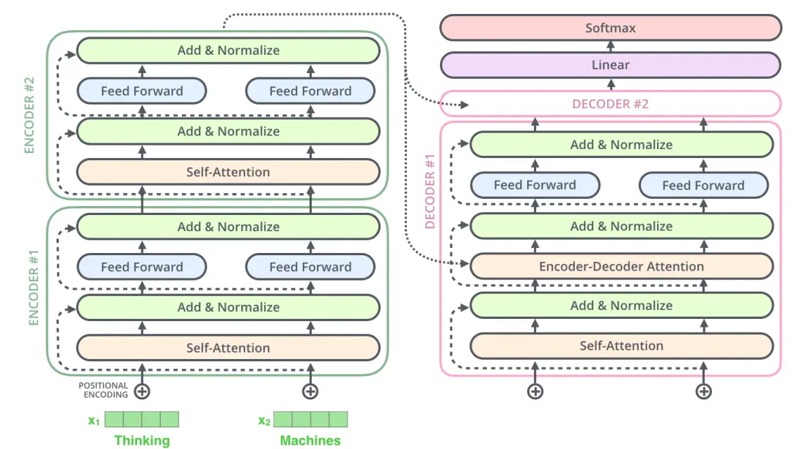

*Transformer模型架构图简版*
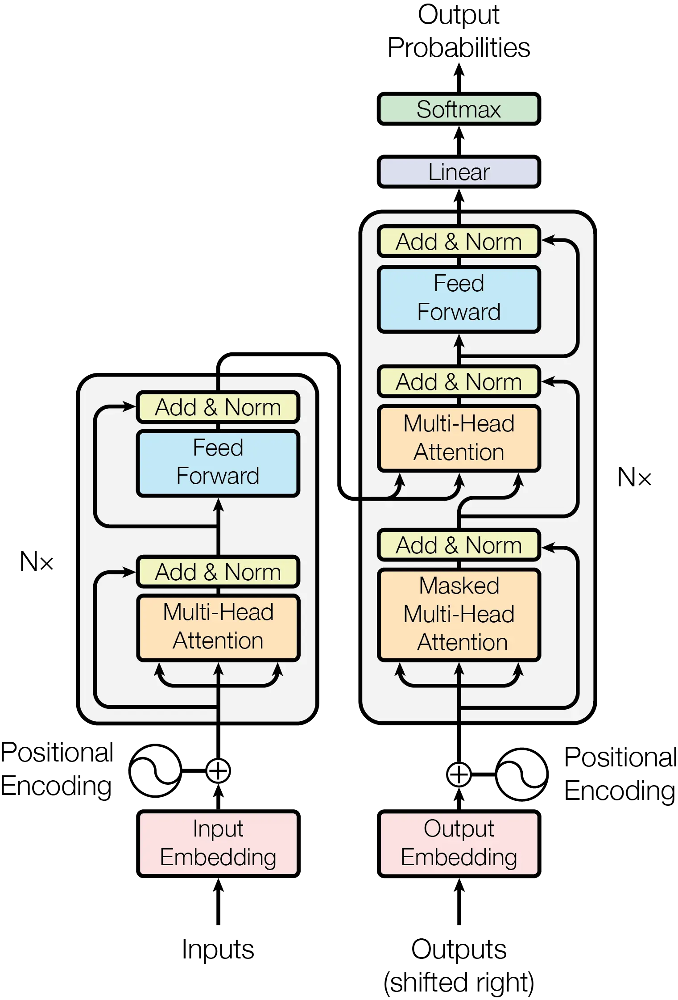


**关键组件说明：**

| 组件                               | 作用                                 |
| -------------------------------- | ---------------------------------- |
| **多头自注意力(Multi-Head Attention)** | 让每个 Token 根据与其他 Token 的相关性，重新整合信息。 |
| **前馈网络（FFN）**                    | 对每个 Token 独立进行非线性变换，增强表达能力。        |
| **残差连接（Add）**                    | 防止梯度消失，让深层网络训练稳定。                  |
| **层归一化（LayerNorm）**              | 稳定训练过程，加速收敛。                       |


*Transformer模型架构图详版*
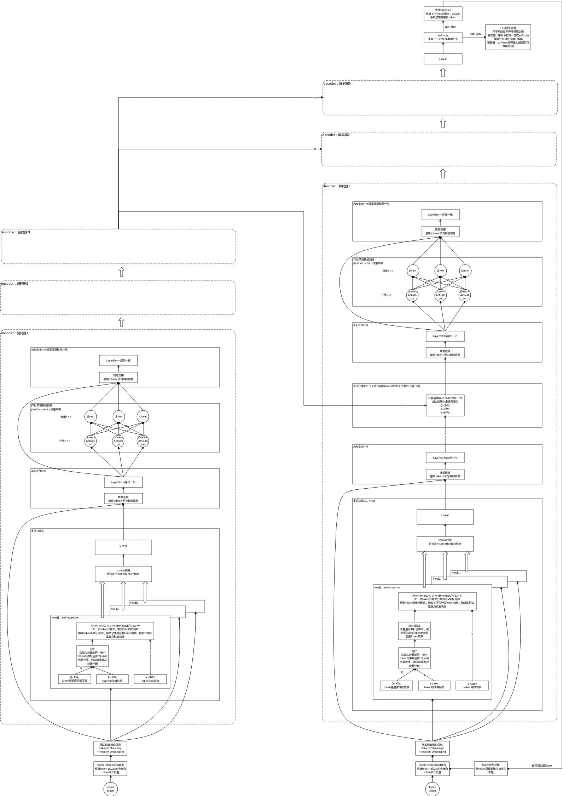


*多头注意力&自注意力(单头)结构*
Scaled Dot-Product Attention                                     Multi-Head Attention
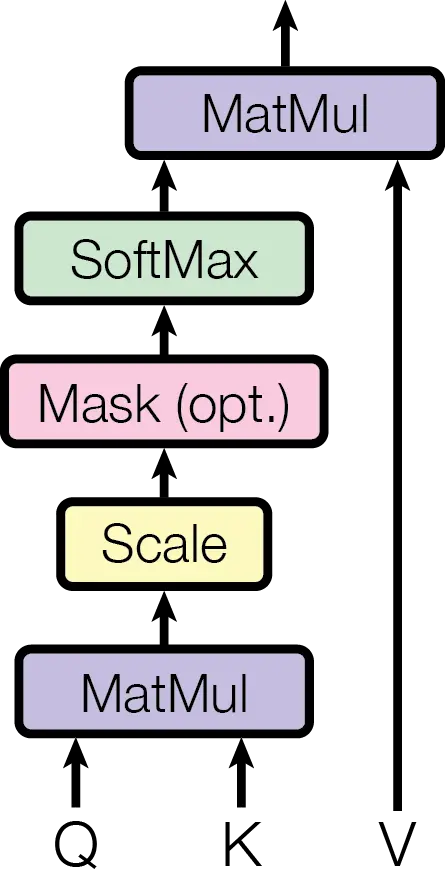                    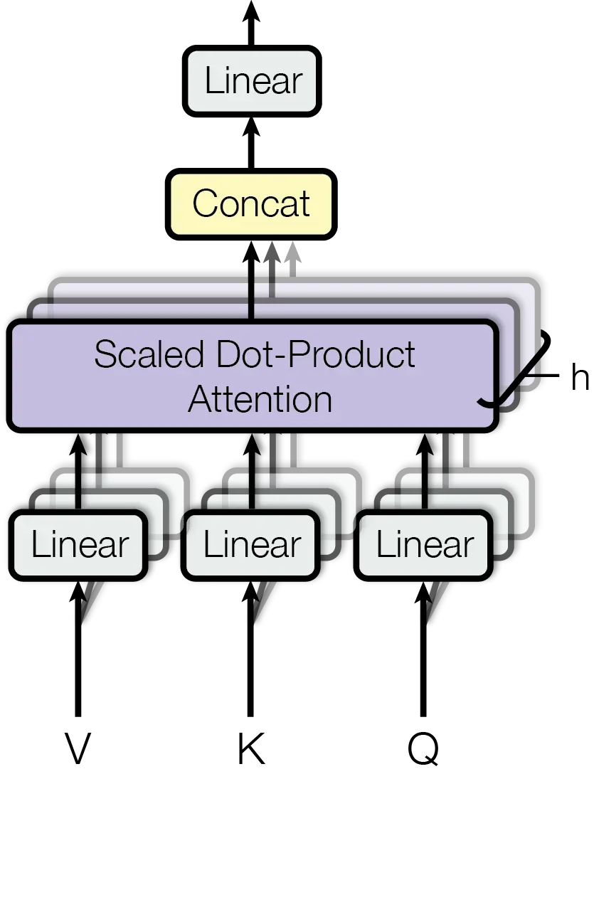


*架构资料图*
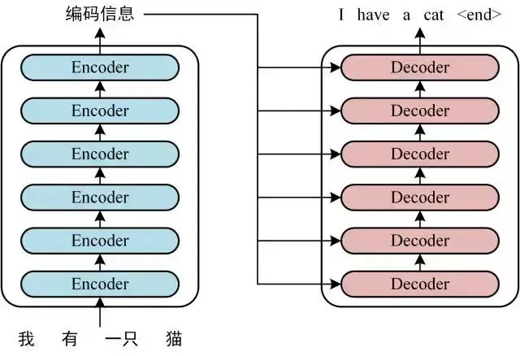

*输入图示*
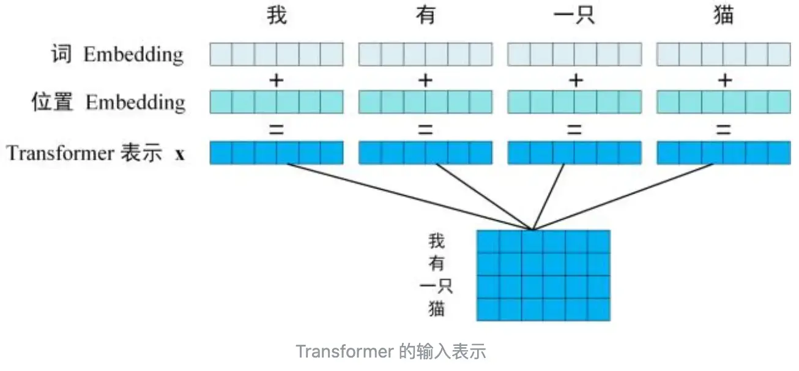


## 数据流动

这是一个 Transformer 解码器（Decoder-only） 的文本生成流程，也就是现代 LLM 的实际工作方式：
```
输入文本（如："今天天气"）
       ↓
分词器（Tokenizer）切成 Token
       ↓
Token → Embedding（查表）+ 位置编码（RoPE）
       ↓
┌─────────────────────────────────┐
│   N 层 Transformer 解码器块     │
│  ┌───────────────────────────┐  │
│  │ 1. 自注意力机制           │  │
│  │    (每个 Token 互相看)    │  │
│  └───────────────────────────┘  │
│              ↓                   │
│  ┌───────────────────────────┐  │
│  │ 2. 前馈神经网络（FFN）    │  │
│  │    (逐 Token 独立变换)    │  │
│  └───────────────────────────┘  │
└─────────────────────────────────┘
       ↓
输出层（映射回词表大小）→ 概率分布
       ↓
采样（Temperature / Top-K / Top-P）→ 下一个 Token
       ↓
将新 Token 加入输入，重复上述过程（自回归）
       ↓
输出 <END> 标记 → 停止生成
```


数据流动示例
**设定：**
- Batch Size = 2（同时处理 2 句话）
- 序列长度 T = 4（每句话 4 个 Token）
- 嵌入维度 d = 8（方便计算）

| 阶段  | 操作            | 输入形状        | 输出形状               | 说明                       |
| --- | ------------- | ----------- | ------------------ | ------------------------ |
| 1   | 输入 Token ID   | `[2, 4]`    | `[2, 4]`           | 2 句话，每句 4 个 Token        |
| 2   | Embedding 查表  | `[2, 4]`    | `[2, 4, 8]`        | 每个 Token 变成一个 8 维向量      |
| 3   | 加上位置编码        | `[2, 4, 8]` | `[2, 4, 8]`        | 形状不变，数值叠加                |
| 4   | 自注意力（Q·K^T·V） | `[2, 4, 8]` | `[2, 4, 8]`        | 形状不变，但每个 Token 已经融合了全局信息 |
| 5   | 多头切分与合并       | `[2, 4, 8]` | `[2, 4, 8]`        | 内部切分头，最后拼接回原形状           |
| 6   | 前馈网络（FFN）     | `[2, 4, 8]` | `[2, 4, 8]`        | 形状不变                     |
| 7   | 输出层（映射到词表）    | `[2, 4, 8]` | `[2, 4, V]`        | V = 词表大小（如 50000）        |
| 8   | Softmax + 采样  | `[2, 4, V]` | `[2, 4]`（Token ID） | 取概率最大的 Token ID          |

关键点： 在每一层中，数据的形状（除了最后一层映射到词表）始终保持 \[Batch, T, d]，信息通过注意力机制在 T 个位置之间流动。

```
             词
             ↓
        Embedding
             ↓
       x = 词向量
             │
       ┌─────┼─────┐
       ↓     ↓     ↓
      WQ    WK    WV
       ↓     ↓     ↓
       Q     K     V
       │     │
       └─QKᵀ─┘
          ↓
       Softmax
          ↓
      注意力权重
          ↓
          × V
          ↓
    上下文增强后的向量
```

## Transformer多种变体架构模式

三种架构对比

|       | Encoder-only | Decoder-only | Encoder-Decoder         |
| ----- | ------------ | ------------ | ----------------------- |
| 注意力   | 双向           | 单向（因果）       | Encoder 双向 + Decoder 单向 |
| 能看未来吗 | ✅ 能          | ❌ 不能         | Encoder 能，Decoder 不能    |
| 适合任务  | 理解           | 生成           | 理解 + 生成                 |
| 训练目标  | 掩码语言模型       | 预测下一个词       | 预测下一个词                  |
| 推理速度  | 快            | 慢（自回归）       | 慢（自回归）                  |
| 代表模型  | BERT         | GPT、Llama    | T5、BART                 |

三种架构是为不同任务设计的：Encoder-only 擅长理解，Decoder-only 擅长生成，Encoder-Decoder 擅长序列到序列。没有一种架构能同时最优地处理所有任务，所以三种并存。

## 位置编码(PE,Postion Encoding)
Transformer本身没有顺序感，所以必须人为加入位置信息。

Transformer模型对每个输入的词向量都加上了一个位置向量。这些向量有助于确定每个token的位置特征，或者句子中不同token之间的距离特征。token向量加上位置向量背后的直觉是：将这些表示位置的向量添加到词向量中，得到的新向量，可以为模型提供更多有意义的信息，比如词的位置，词之间的距离等。
>解决输入序列中单词的顺序：不同嵌入+位置向量后，相当于最终的向量具备了位置、距离信息；一旦它们被映射到 Q/K/V 向量并在点积注意力机制中使用，便能够在嵌入向量之间提供有意义的距离
>注意：Position Encoding，Position Encoding，PE，都代指位置向量；


**需要PE原因**
自注意力层：是当前token与序列所有token的关注得分，与顺序无关，如果把序列中token 位置变动，对应的得分是不变的，这个不变性，说明attention score是顺序无关的。然而自然语言token语义跟位置关联很大，所以引入PE增加token的位置特征；

**位置编码种类**
- 绝对位置编码(Sinusoidal)：Transformer最开始使用的，基于正弦和余弦函数的编码；使用正弦和余弦函数的不同频率来为序列中的每个位置生成唯一的编码。这种方法的优点是能够支持到任意长度的序列，并且模型可以从编码中推断出位置信息。
>有一种位置编码递增变大的绝对位置编码方式，现在基本没人使用：句子越长，后面的值越大，数字越大说明这个位置占的权重也越大，这样的方式无法凸显每个位置的真实的权重
>虽然原始的Transformer模型使用的是绝对位置编码，但后续的研究和变体模型中已经引入了相对位置编码的概念
- 相对位置编码(RoPE)：现在主流LLM模型在使用的；函数型位置编码通过输入token的位置信息，得到相应的位置编码。这种编码方式使模型能够更关注元素之间的相对位置关系。
- 可学习的位置编码：一些模型选择通过训练过程中学习位置编码，而不是使用预定义的函数。这种方法允许模型自适应地优化位置编码，以最适合特定任务的方式。但是这种方式一般要求固定输入长度，而且可解释性差，所以使用的也不多。

**PE如何获得**
PE的维度与Token Embedding维度是一样的。
- 通过某种计算公式解析获得：Transformer采用的是这种，通过sin、cos函数计算出位置编码的确定向量；
- 模型训练获得

**位置编码的数学特性**
理想的位置编码应该满足几个关键性质
1.  **唯一性**：每个位置具有独特的编码
2.  **有界性**：编码值范围可控，避免数值不稳定
3.  **泛化性**：能处理比训练时更长的序列
4.  **可分解性**：能明确表示相对位置关系

### Sinusoidal位置编码
三角函数式位置编码（也称为Sinusoidal位置编码）是Transformer原始论文提出来的位置编码方案，这种编码方案基于无参数的固定式三角函数来计算编码向量（通过sin和cos函数的线性变换来提供给模型的位置信息），这样就用**绝对位置编码**来捕捉不同位置之间的相对关系：

位置编码在架构中的位置如下图红框
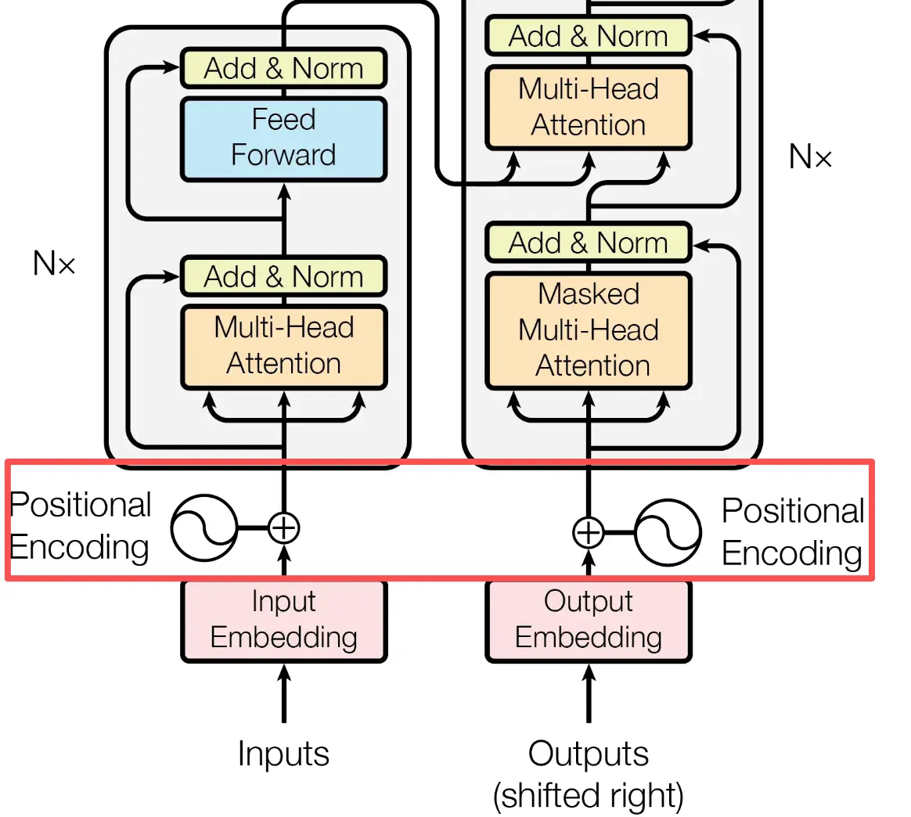


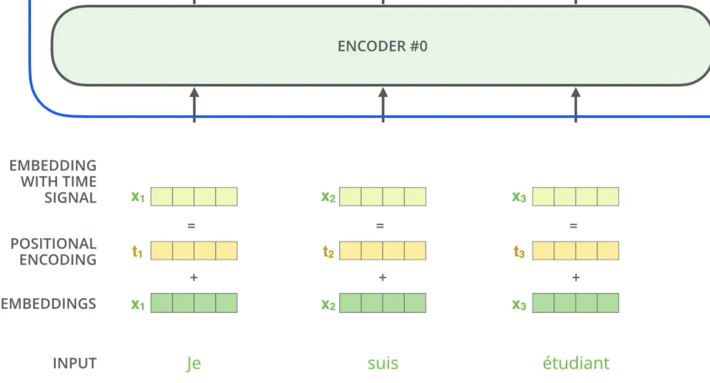

**输入信息Z**
Z = 词嵌入矩阵+位置编码矩阵 = token embeding  + PE；

**特性说明**
- 重复性：通过公式可以看出来，如1000维的position embedding。某个位置，不同维度的值，是不同sin和cos函数，即波长和频率不同，这种特性保障长序列不会出现不同位置对应的positon embedding相同情况；
- 相对性：sin和cos函数的特性，2个不同位置，可以通过线性变换(旋转矩阵)进行计算求得；这种特性也利于模型学习发现规律，即理解序列中不同token的距离关系；
- 算法特性：positon embedding的维度跟token embedding一致，一般也比较大如1000；所以维度是比较大的。在低维度PE值变化大(高频)，擅长捕捉局部、相邻位置关系；在高维度PE变化小(低频)，擅长捕捉全局、远距离位置关系；
>高频，低频理解：只有秒针(高频) + 分针(中频) + 时针(低频)组合，才能同时精确区分“秒级”和“小时级”的时间。


**Position Encoding的数学定义**
$PE_{(pos,2i)} = sin(pos / 10000^{2i/d_{model}})$
$PE_{(pos,2i+1)} = cos(pos / 10000^{2i/d_{model}})$
$PE_{pos} = [\sin(\theta_0), \cos(\theta_0), \sin(\theta_1), \cos(\theta_1), \dots, \sin(\theta_{d/2-1}), \cos(\theta_{d/2-1})]$

**公式解读**
以下是关于公式的一些说明:
- ${d}_{model}$是词向量维度。在论文中是直接将词嵌入向量和位置编码进行相加，所以我们需要让位置编码的维数和词嵌入向量的维数相等。
- pos是位置索引，表示此token在序列之中的位置，即单词在序列中的位置，设句子长度为L，那么pos取值范围是0~L-1。比如第一个token位置就是0。
- i 表示位置向量的维度索引，2i 表示偶数的维度，2i+1 表示奇数维度，例如${d}_{model}$为512，则i的取值范围是0~255。
- 10000：定义的超参数标量，这是Transformer作者所使用的值。
- $P{E}_{(pos,i)}$表示某个token的位置编码，位置编码不是单独某个数字，而是一个${d}_{model}$维度向量。其可以由位置索引pos和维度索引i计算得到。即正弦这一类的参数式位置编码中涉及两个概念：一个是距离，另一个是维度。因为结合了这两个概念，所以可以保证在一定范围内位置编码的唯一性：  
   - 不同pos的同一维度特征对应的正弦值或者余弦值也会不一样，这样会导致不同位置的pos的位置编码变得唯一。
   - 同一pos的不同维度所对应的数值也不一样。
- 同一个token中不同维度的特征信息，可以用sin和cos的方式计算，即使用不同频率的正弦、余弦函数生成。每个分量上是sin，cos轮流交替的，一对相邻的偶数和奇数分量形成一对，该对的三角函数输入相同。可以认为是输入x的嵌入维度上，依次加上不同频段的正余弦波。  
   - 位置嵌入函数的周期从2𝜋到10000\*2𝜋变化，而每个位置在embedding dimension维度上都会得到不同周期的sin和cos函数的取值组合。维度 i 的周期为$𝑇=𝑏𝑎𝑠𝑒^{𝑖/𝑑}∗2𝜋$，其中0 <= i < d，因此周期T的范围是 𝑇∈\[2𝜋,𝑏𝑎𝑠𝑒∗2𝜋]。
   - sin和cos公式表达的含义是在偶数的位置使用sin函数计算，在奇数的位置使用cos函数计算。每对奇数和偶数拼成一组，例如0,1一组，2,3一组，分别用上面的sin和cos函数做处理。
   - 每组内sin和cos函数共享一个频率，不同组函数的频率不同（低维用高频，高维用低频），从而产生不同的周期性变化。这有点傅里叶频谱变换的味道，希望用若干组cos和sin函数来代表不同的特征维度(类比频率)。
   - 第k组的频率${f}_{k}=\frac{2\pi}{{10000}^{2k/d}}$，其中$k=1,...,d/2$。这样就在embedding dimension维度上随着维度序号增大，周期变化会越来越慢。
   - 所有pos相同维度上的三角函数相同（偶数都是sin，奇数都是cos），差别仅是pos值不同，因此三角函数输入的分母相同，差异在分子。
- 位置编码将词的位置信息表征为向量，该向量由词位置和分量位置共同确定。对输入padding的位置采用全0向量作为位置编码。
- 位置编码矩阵所有句子共享，因此不同句子中相同位置的字/词的位置编码的结果相同。

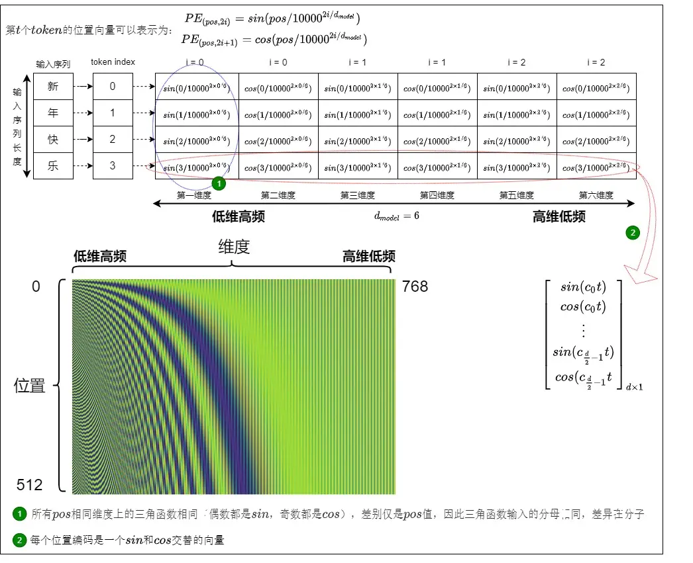

简单来说，Transformer基于正余弦的位置编码用维度控制频率，用位置控制相位。就是对不同维度使用不同频率（随特征维度变化，低维用高频，高维用低频）的正/余弦函数进而生成不同位置的高维位置向量。这种方法的优点是能够支持到任意长度的序列，并且模型可以从编码中推断出位置信息。


### RoPE(旋转位置编码)
RoPE (Rotary Position Embedding)：将位置信息隐式嵌入到 $Q$ 和 $K$ 的复数平面旋转矩阵中：
$$
R_m Q_i \cdot (R_n K_j)^T = Q_i^T R_{n-m} K_j
$$
点积结果只与相对距离 $(n - m)$ 有关，直接实现了精确的相对位置表征。

RoPE 的核心优势是：**相对位置信息自然融入点积中，支持更长的上下文外推。**
>原理：通过旋转矩阵将相对位置信息融合到自注意力机制（Self-Attention）中。
>作用：具备极佳的“外推性”，能让模型在处理比训练时更长的文本序列时保持良好的泛化与稳定性能

**相对位置推导**
根据三角函数特性
由于三角函数的和差化积性质，对于任意固定的偏移量 $k$，位置 $pos + k$ 的编码可以表示为位置 $pos$ 的编码的线性变换
$$
\begin{bmatrix} \sin(\cdot) \\ \cos(\cdot) \end{bmatrix}_{pos+k} = \begin{bmatrix} \cos(\Delta) & \sin(\Delta) \\ -\sin(\Delta) & \cos(\Delta) \end{bmatrix} \begin{bmatrix} \sin(\cdot) \\ \cos(\cdot) \end{bmatrix}_{pos}
$$
这使得模型在计算 Attention 点积 $Q_i K_j^T$ 时，能自然感知到位置 $i$ 和 $j$ 之间的相对距离$(i - j)$。

https://www.cnblogs.com/rossiXYZ/p/18744797 探秘Transformer之（8）--- 位置编码
https://zhuanlan.zhihu.com/p/647109286 十分钟读懂旋转编码（RoPE）
https://zhuanlan.zhihu.com/p/690610231 LLM：旋转位置编码（RoPE）的通俗理解
https://kexue.fm/archives/8130 让研究人员绞尽脑汁的Transformer位置编码
https://developer.aliyun.com/article/1507779 一文搞懂Transformer的位置编码

## encoder

### 介绍

encoder通过自注意力机制，获得token与序列所有token的关联程度，从而融合、丰富token信息，具备理解上下文能力；

**encoder结构**
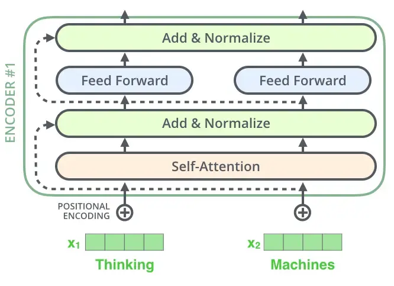

**一个encoder组成部分**
- 自注意力层(self-attention)：计算序列中token间的注意力得分，体现序列中token之间相互关系的重要性，以及某个token从序列中所有token中获取对应信息；
- 前馈神经网络层(Feed Forward)：FFN对每个token提供非线性，做特征变换，是模型参数和表达力的主要来源。
- 残差连接和归一化层(add&Normalize)：残差连接：token原始信息融合经过自注意力层后自测信息，丰富token信息，又保留原始token信息；归一化：对矩阵数据的归一化处理，使梯度更新更加稳定，方便模型训练以及增强模型稳定性；
### encoder运算流程

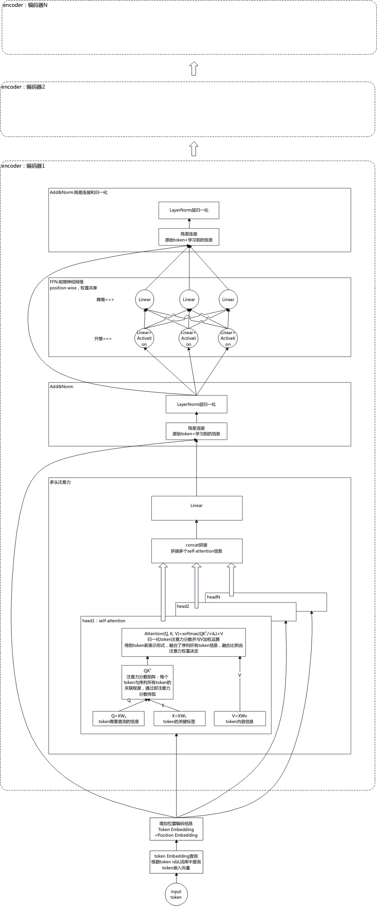
```
token->embedding查找->embedding+position->Wq-Wk-Wv=>z->FNN 线性转换+非线性激活->r->下一个encoding层循环
```

### 自注意力(self-attention)

自注意力机制仅衡量输入序列中token之间关系的重要性；self-attention解决的是这个词在当前句子中，应该从哪些其他词那里获取信息

```
The animal didn't cross the street because it was too tired.
```

上句话包含 11 个字词。这 11 个字词中的每一个都在关注其他 10 个字词，想知道这 10 个字词对自己的重要程度。例如，请注意，该句子包含代词 it。代词通常比较含糊。代词 it 通常指代最近的名词或名词短语，但在示例句子中，it 指代的是哪个最近的名词，是动物还是街道？
自注意力机制可确定每个附近字词与代词 it 的相关性。下图显示了结果，线条越蓝，表示相应字词对代词“it”越重要。也就是说，对于代词 it，动物比街道更重要。
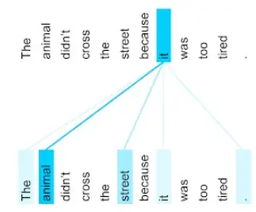

#### 自注意力结构
Scaled Dot-Product Attention


>Transformer官方论文中，对于每个编码器/解码器，我们会有八组这样的矩阵(相当于8个Self Attention结构)。这些矩阵最初是随机初始化的，经过训练后，每组矩阵会将输入的嵌入（或来自下层编码器/解码器的向量）映射到一个不同的表示子空间。


#### 注意力机制作用
- 动态聚合上下文信息（加权求和）：模型会利用这些百分比作为系数，对 Value（值）向量进行加权求和。如果某个词获得了较高的注意力权重（例如 0.6），那么在**生成当前词的新表示**时，该词的 Value 向量就会占据 60% 的比重。这使得当前词的输出不再孤立，而是融合了整个句子中与其高度相关的上下文信息，从而精准捕捉语义和长距离依赖关系。
- 建立语义与语法关联：注意力百分比反映了序列中任意两个 Token 之间的相关性强度，帮助模型解决语言主谓一致等复杂的语言结构问题
- 实现模型的可解释性：通过绘制注意力图（Attention Maps），我们可以直观地看到模型在处理特定任务时，将目光聚焦在了哪些词上
- 优化计算与显存：如果模型发现某些位置的注意力百分比极低（接近 0），可以通过”稀疏注意力“技术，只计算高分数token，忽略低分数的计算；

#### 数学公式
Transformer 最基本、最核心的运算单元，缩放点积注意力，即自注意力子层：
数学公式：$\text{Attention}(Q, K, V) = \text{softmax}\left(\frac{QK^T}{\sqrt{d_k}}\right) V$

*Attention(Q,K,V)公式图像表示如下*
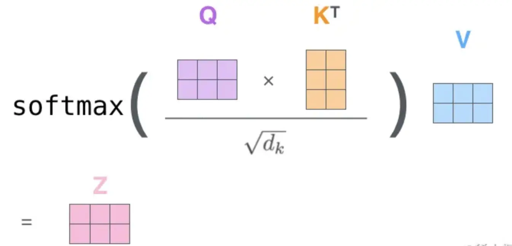

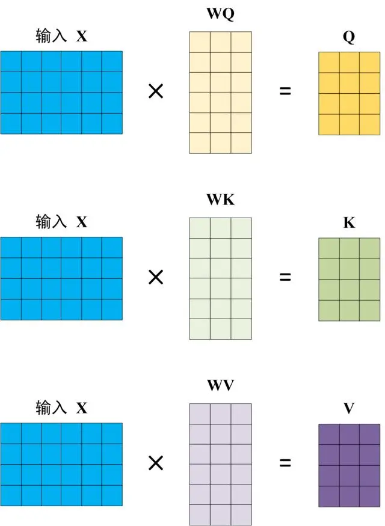

通过 Q、K、V 三个向量完成信息的全局融合，从而提取出融合上下文特征的表示。

**运算流程（逐步拆解）**
1. **点积**：`Q` 与 $K^T$ 相乘，得到 `T × T` 的注意力分数矩阵。
2. **缩放**：除以 $√d_k$，控制数值范围。
3. **Softmax**：对每一行进行归一化，得到注意力权重（和为 1）。
4. **加权求和**：注意力权重矩阵 与 `V` 相乘，得到最终输出。

**符号说明**

| 符号                 | 名称            | 形状         | 说明                                                                                                                                                                                                                                                                                   |
| ------------------ | ------------- | ---------- | ------------------------------------------------------------------------------------------------------------------------------------------------------------------------------------------------------------------------------------------------------------------------------------ |
| $Q$                | Query（查询向量）   | $[T, d_k]$ | $Q=XW^Q$：代表每个token想要从序列所有token那里获取/关注什么信息。<br>$W^Q$（查询权重矩阵）：从查询角度，应该如何看这个token。<br>$d_v$通常等于$d_k$。                                                                                                                                                                                   |
| $K$                | Key（键向量）      | $[T, d_k]$ | $K=XW^K$：代表token具有什么关键特征，可以被怎么样索引/匹配;<br>$W^{K}$（键权重矩阵）:从匹配角度，应该如何看这个 token；                                                                                                                                                                                                         |
| $V$                | Value（值向量）    | $[T, d_v]$ | $V=XW^V$：代表每个token本身携带的实质性语义信息。<br>$W^V$:值权重矩阵,从提取信息角度，如果别人关注这个 token，我应该提供什么信息。                                                                                                                                                                                                     |
| $T$                | 序列长度          | 标量         | 当前输入有多少个 Token。                                                                                                                                                                                                                                                                      |
| $d_k$              | Key/Query 的维度 | 标量         | 通常等于嵌入维度 d 除以头数。                                                                                                                                                                                                                                                                     |
| $d_v$              | Value 的维度     | 标量         | 通常等于 d_k。                                                                                                                                                                                                                                                                            |
| $QK^T$             | 注意力分数矩阵       | $[T, T]$   | Token注意力分数，体现token间的匹配程度。<br>Q 和 K 的配对逻辑：通过计算 Q 和每个 K 的点积（$Q \cdot K^T$）；点积矩阵结果的每个位置的值都是一个分数（Attention Score）。分数越高，说明当前token（Q）越应该关注那个token（K）。比如：第 $i$ 行第 $j$ 列：第 $i$ 个token（作为 Query）对第 $j$ 个token（作为 Key）的关注程度；矩阵对角线：token对自己的关注（自注意力名字的由来）。<br>行：当前 Token；列：其他 Token。数值越大表示关联越强。 |
| $\sqrt{d_k}$       | 缩放因子          | 标量         | 放大或缩小数值；<br>防止点积过大导致 Softmax梯度消失。                                                                                                                                                                                                                                                    |
| `softmax`          | 行归一化          | $[T, T]$   | 让每一行的概率和为 1，表示对每个Token 的关注权重。                                                                                                                                                                                                                                                        |
| Attention(Q, K, V) | token向量的新表示   | $[T,d_v]$  | 对于序列中的每个Token的Value向量按照注意力权重进行的加权求和，生成融合了上下文特征的新表示向量；<br>$d_v$通常等于$d_k$；                                                                                                                                                                                                             |

### 多头注意力
多头注意力机制（Multi-Head Attention）中的每个头(单头相当于单个self-attention子层)负责在不同的语义空间并行独立地计算注意力，让模型同时关注输入序列的不同特征和方面；最后会对多头运算结果进行拼接，线性转换，输出融合矩阵；

单头注意力只能学习一种“关联方式”，多头注意力允许模型同时关注多种不同的关系。
>物理意义：不同的头可以分别关注“句法关系”、“指代关系”、“语义相似度”等不同层面的信息，最后综合起来，让模型理解更丰富。
>维度变化：多头拼接矩阵，经过这个线性变换后，最终输出的矩阵维度依然保持为 $d_{model}$ 

**作用**
- 长距离依赖问题：能够让模型在处理长序列时，同时关注到全局和局部的信息。
- 多样化的注意力模式：它为注意力层创造了多个表示子空间，通过不同头学习到不同的特征和关系。
- 更好的梯度传播：分头处理后，信息可以更均匀地传递，缓解了梯度消失问题。

**结构**
Scaled Dot-Product Attention(单头)                        Multi-Head Attention(多头)
                    


**数学公式**
一个自注意力计算单元(self-attention)算是一个头，Transformer架构中采用8个(按实际需要调整)，8个自注意力计算单元并行计算，得到Z1...Z8输出；把8个Z<sub>i</sub>矩阵进行拼接，再进行一次线性变换，得到最终的Z，这个Z就是多头自注意力的输出；

数学公式：
$\text{MultiHead}(Q, K, V) = \text{Concat}(\text{head}_1, \dots, \text{head}_h) W_O$
其中：$\text{head}_i = \text{Attention}(Q W_i^Q, K W_i^K, V W_i^V)$

| 符号                    | 说明                           |
| --------------------- | ---------------------------- |
| $h$                   | 注意力头的数量（例如 8、12、32）。         |
| $W_i^Q, W_i^K, W_i^V$ | 第 $i$ 个头专属的投影矩阵，将输入映射到低维空间。  |
| $W_O$                 | 输出投影矩阵，将拼接后的多头结果映射回原始维度 $d$。 |
| `Concat`              | 将 $h$ 个头的输出拼接出一个新的矩阵。        |

**concat拼接&线性变换**
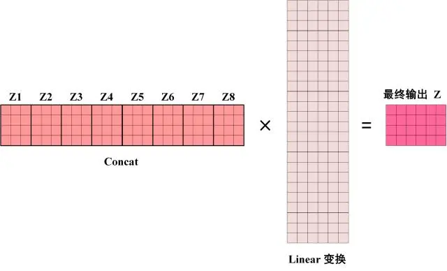
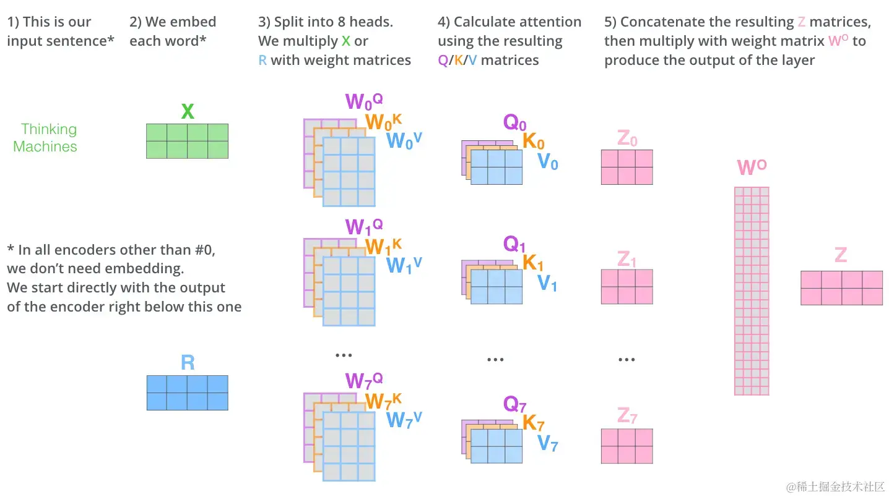

**效果示例**
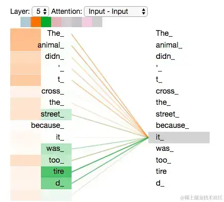


观察在我们的例句中对“it”这个词进行编码时，不同的注意力部分分别聚焦在何处：

在对“it”进行编码时，其中一个注意力部分主要关注于“the animal”，而另一个则聚焦于“tired” —— 这就意味着，模型中“it”这个词的理解融合了对“animal”和“tired”这两个词的理解。

### 残差连接(add)和层归一化(LayerNorm)

计算得到了self-attention的输出向量，单层encoder里后续还有两个重要的操作：残差链接（Residual Connection）、层归一化(layer-normalization)。

编码器的每个子层（Self Attention 层和 FFN）都有一个残差连接和层归一化（layer-normalization），主要作用是融合token原来特征信息和新学到的信息，解决深层网络训练时的梯度消失问题并加快模型收敛

**数学公式**
$$\text{Add \& Norm} : \text{LayerNorm}(\boldsymbol{X} + \text{Sublayer}(\boldsymbol{X})) \quad$$


> Pre-Norm（后来LLM主流），y = x + Sublayer(LayerNorm(x))；梯度可以直接通过 `x` 传回去，训练更稳定；但是表达力略弱，需要更多层。


**残差连接**

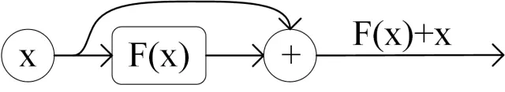
*残差连接模式*

**残差连接数学公式**
$$\text{Add} : \boldsymbol{X} + \text{Sublayer}(\boldsymbol{X})$$

>$X$： 表示该子层（如 Multi-Head Attention或FFN）的输入
>$\text{SubLayer}(X)$：表示经过子层计算后的输出。
>$\boldsymbol{X} + \text{Sublayer}(\boldsymbol{X})$；这种模式，保留原始信息，再融合子层信息，即使子层没学到什么信息，也不会丢失原始信息；让梯度可以直接传回去，缓解梯度消失；

**LayerNorm数学公式**
LayerNorm层归一化：在残差连接后，再进行层归一化计算；使梯度更新更加稳定，防止数值过大或过小，从而大幅提升训练速度和模型稳定性；
$$\text{LayerNorm}(X_{\text{add}})=\frac{X_{\text{add}}-\mu }{\sqrt{\sigma ^{2}+\epsilon }}\odot \gamma +\beta$$

>$X_{\text{add}}$ 是 Add 操作后的结果。
>$\mu$ 和 $\sigma ^2$ 是在单个样本的隐层维度（Feature Dimension）上计算出来的均值和方差。
>$\frac{X_{\text{add}}-\mu }{\sqrt{\sigma ^{2}+\epsilon }}$：归一化结果，矩阵每行均值0，方差1；
>$\epsilon$ 是为了防止分母为零而加的极小值（如 $10^{-5}$）。
>$\gamma$（缩放参数）和 $\beta$（偏移参数）：是可学习的参数，维度都是$d_{model}$；通过反向传播不断更新，假设某个特征本来应该很大（比如“情感强度”），归一化后变成 0 附近，信息就丢了，通过这2个参数，允许模型恢复由于归一化而丢失的特征表达能力。
>$\text{LayerNorm}(X_{\text{add}})$：经过 $\gamma$ 和 $\beta$ 变换后，均值和方差由模型学习决定，还原模型原来的特征表达方式；

### FFN(前馈神经网络)
FFN(Feed Forward Network)对每个token提供非线性特征转换，是模型参数和表达力的主要来源。通常由两个全连接层（Linear）和一个激活函数组成；

**数学公式**
$$\text{FFN}(\boldsymbol{X}) = RELU(\boldsymbol{X}\boldsymbol{W}_1 + b_1) \boldsymbol{W}_2 + b_2$$
>输入 $x \in \mathbb{R}^{B \times L \times d_{\text{model}}}$
>$W_1 \in \mathbb{R}^{d_{\text{model}} \times d_{\text{ff}}}$，偏置 $b_1 \in \mathbb{R}^{d_{\text{ff}}}$ （升维，通常 $d_{\text{ff}} = 4 \times d_{\text{model}}$）
>非线性激活函数：gelu、sigmod、relu等；
>$W_2 \in \mathbb{R}^{d_{\text{ff}} \times d_{\text{model}}}$，偏置 $b_2 \in \mathbb{R}^{d_{\text{model}}}$ （降维还原）
>输出 $\text{FFN}(x) \in \mathbb{R}^{B \times L \times d_{\text{model}}}$

**作用**
- 提供非线性：FFN 里的激活函数提供真正的非线性，让模型能拟合复杂函数。没有 FFN，整个Transformer 就是一堆线性变换的叠加，表达能力有限。
- 特征提取与变换：FFN 通常会先将特征维度先放大 4 倍（从 $d_{\text{model}}$ 升维到 $d_{\text{ff}}$）：把特征映射到更高维空间，捕捉更复杂的模式；激活：对这些特征进行非线性变换；降维回 $d_{model}$：重新组合，压缩回原维度，方便后续层处理
- 位置独立处理：自注意力子层是token与token交互，跨token信息交换和加工；FFN是每个token独立经过同一套网络，是token内部特征变换；

>FFN 先做一次线性升维，再做一次非线性激活，最后做一次线性降维。非线性激活是核心，没有它整个 FFN 退化成线性变换。


### 总结

**单个Encoder输出**
 因此输入矩阵${X}$经过一个Encoder后，输出表示如下
$$\begin{aligned} \boldsymbol{X_{attn}} &= \text{LayerNorm}(\boldsymbol{X} + \text{Multi-Head-Attention}(\boldsymbol{X})) \\ \boldsymbol{X_{out}} &= \text{LayerNorm}(\boldsymbol{X_{attn}} + \text{FFN}(\boldsymbol{X_{attn}})) \end{aligned}$$
Attention负责“token收集上下文信息”，FFN 负责“理解与加工当前 Token”，两者协同交替，构成了 Transformer强大的表征提取能力。

**多层Encoder叠加后输出**
通过上面的单个Encoder,输入矩阵 $\boldsymbol{X} \in \mathbb{R}^{n \times d}$, 最后输出矩阵 $\boldsymbol{O} \in \mathbb{R}^{n \times d}$ 。通过多个Encoder叠加,最后便是编码器Encoder的输出。

**多个encoder让token逐层提取更抽象、更全局的上下文信息；**

>其中 X表示 Multi-Head Attention 或者 Feed Forward 的输入，MultiHeadAttention(X) 和 FeedForward(X) 表示输出 (输出与输入 X 维度是一样的，所以可以相加)。
>Add指 X+MultiHeadAttention(X)，是一种残差连接，通常用于解决多层网络训练的问题，可以让网络只关注当前差异的部分。
>LayerNorm：Layer Normalization会将每一层神经元的输入都转成均值方差都一样的，这样可以加快收敛。
>Feed Forward层：FFN，比较简单，是一个两层的全连接层，第一层的激活函数为Relu，第二层不使用激活函数

### encoder运算示例

输入序列：\[我、爱、中国]直接标进每一个矩阵的行和列里，让你一眼就能看出每个数字属于哪个词。
约定：行 = 词，列 = 维度；

看看在自注意力层是如何进行计算以及对应的含义；

一、原始输入(X)（3 个词 × 4 维）
$$
X =
\begin{array}{c}
\text{我} \\
\text{爱} \\
\text{中国}
\end{array}
\begin{bmatrix}
1 & 0 & 1 & 0 \\
0 & 1 & 0 & 1 \\
1 & 1 & 1 & 0
\end{bmatrix}
$$
二、权重矩阵($W_Q, W_K, W_V$)（4 维 → 2 维，线性变换规则）
$$
W_Q =
\begin{array}{c}
\text{维度1} \\
\text{维度2} \\
\text{维度3} \\
\text{维度4}
\end{array}
\begin{bmatrix}
1 & 0 \\
0 & 1 \\
1 & 0 \\
0 & 1
\end{bmatrix}
$$
$$
W_K =
\begin{array}{c}
\text{维度1} \\
\text{维度2} \\
\text{维度3} \\
\text{维度4}
\end{array}
\begin{bmatrix}
0 & 1 \\
1 & 0 \\
0 & 1 \\
1 & 0
\end{bmatrix}
$$

$$
W_V =
\begin{array}{c}
\text{维度1} \\
\text{维度2} \\
\text{维度3} \\
\text{维度4}
\end{array}
\begin{bmatrix}
1 & 1 \\
1 & 0 \\
0 & 1 \\
0 & 0
\end{bmatrix}
$$
三、计算Q
$$
Q = X W_Q = 
\begin{bmatrix}
1 & 0 & 1 & 0 \\
0 & 1 & 0 & 1 \\
1 & 1 & 1 & 0
\end{bmatrix}
\begin{bmatrix}
1 & 0 \\
0 & 1 \\
1 & 0 \\
0 & 1
\end{bmatrix}
=
\begin{array}{c}
\text{我} \\
\text{爱} \\
\text{中国}
\end{array}
\begin{bmatrix}
2 & 0 \\
0 & 2 \\
2 & 1
\end{bmatrix}
$$

$$
Q= \begin{array}{c|cc} & Q\text{特征1} & Q\text{特征2}\\ \hline \text{我}&2&0\\ \text{爱}&0&2\\ \text{中国}&2&1 \end{array}
$$
>Q的含义：重新定义一个适合Query检索的特征空间

四、计算K
$$
K = X W_K = 
\begin{bmatrix}
1 & 0 & 1 & 0 \\
0 & 1 & 0 & 1 \\
1 & 1 & 1 & 0
\end{bmatrix}
\begin{bmatrix}
0 & 1 \\
1 & 0 \\
0 & 1 \\
1 & 0
\end{bmatrix}
=
\begin{array}{c}
\text{我} \\
\text{爱} \\
\text{中国}
\end{array}
\begin{bmatrix}
0 & 2 \\
2 & 0 \\
1 & 2
\end{bmatrix}
$$

五、计算V
$$
V =  X W_V  = 
\begin{bmatrix}
1 & 0 & 1 & 0 \\
0 & 1 & 0 & 1 \\
1 & 1 & 1 & 0
\end{bmatrix}
\begin{bmatrix}
1 & 1 \\
1 & 0 \\
0 & 1 \\
0 & 0
\end{bmatrix}
=
\begin{array}{c}
\text{我} \\
\text{爱} \\
\text{中国}
\end{array}
\begin{bmatrix}
1 & 2 \\
1 & 0 \\
2 & 2
\end{bmatrix}
$$

六、计算$QK^T$

先写出$K^T$，注意**行和列都标上词**：
$$
K^T =
\begin{array}{c|ccc}
{}&我&爱&中国 \\
\hline 
\text{K第1维} & 0 & 2 & 1  \\
\text{K第2维} &2 & 0 & 2 \\
\end{array}
$$

$$
QK^T =
\begin{bmatrix}
2 & 0 \\
0 & 2 \\
2 & 1
\end{bmatrix}
\begin{bmatrix}
0 & 2 & 1 \\
2 & 0 & 2 \\
\end{bmatrix}
=
\begin{array}{c|ccc}
{Q\textbackslash K} & 我 & 爱 & 中国 \\
\hline
\text{我} & 0 & 4 & 2 \\
\text{爱} & 4 & 0 & 4 \\
\text{中国} & 2 & 4 & 4
\end{array}
$$

>第i行第j列的注意力分数(Attention Score)= 词i作为 Query，对词j作为 Key的原始分数

七、缩放$\div \sqrt{d_k}$
$d_k = 2 ，\sqrt{2} \approx 1.414$：
$$
\frac{QK^T}{\sqrt{d_k}} =
\begin{array}{c|ccc} {Q \textbackslash K} & 我 & 爱 & 中国 \\
\hline 
\text{我} & 0 & 2.83 & 1.41\\
\text{爱} & 2.83 & 0 & 2.83\\
\text{中国} & 1.41 & 2.83 & 2.83
\end{array}
$$

八、Softmax（按行归一化）
对每一行做 Softmax：
$$
A = Softmax(\frac{QK^T}{\sqrt{d_k}}) = 
\begin{array}{c|ccc} {} & 我 & 爱 & 中国 \\
\hline
\text{我} & 0.05 & 0.77 & 0.18 \\
\text{爱} & 0.49 & 0.03 & 0.49\\
\text{中国} & 0.11 & 0.45 & 0.45
\end{array}
$$
含义解读
- `我` 这一行：对 `我` 关注 5%，对 `爱` 关注 77%，对 `中国` 关注 18%。
- `爱` 这一行：对 `我` 关注 49%，对 `爱` 关注 3%，对 `中国` 关注 49%。
- `中国` 这一行：对 `我` 关注 11%，对 `爱` 关注 45%，对 `中国` 关注 45%。

九、加权 V  得到输出
$$
V =
\begin{array}{c}
\text{我} \\
\text{爱} \\
\text{中国}
\end{array}
\begin{bmatrix}
1 & 2 \\
1 & 0 \\
2 & 2
\end{bmatrix}
$$
$$
\text{Output} = A \times V =
\begin{bmatrix}
\ 0.05 & 0.77 & 0.18 \\
\ 0.49 & 0.03 & 0.49\\
\ 0.11 & 0.45 & 0.45
\end{bmatrix}
\begin{bmatrix}
1 & 2 \\
1 & 0 \\
2 & 2
\end{bmatrix}
=
\begin{array}{c}
\text{我} \\
\text{爱} \\
\text{中国}
\end{array}
\begin{bmatrix}
1.18 & 0.46 \\
1.50 & 1.96 \\
1.46 & 1.12
\end{bmatrix}
$$

Output：融合全句信息后的新表示

| 词 | 输出第1维 | 输出第2维 |
|---|---|---|
| 我 | 1.18 | 0.46 |
| 爱 | 1.50 | 1.96 |
| 中国 | 1.46 | 1.12 |


十、完整链路（带词标注版）

```
X (我/爱/中国 × 4维)
│
├── × W_Q ──→ Q (我/爱/中国 × 2维)
│              我:[2,0]  爱:[0,2]  中国:[2,1]
│
├── × W_K ──→ K (我/爱/中国 × 2维)
│              我:[0,2]  爱:[2,0]  中国:[1,2]
│
└── × W_V ──→ V (我/爱/中国 × 2维)
               我:[1,2]  爱:[1,0]  中国:[2,2]
                    │
         QK^T (我/爱/中国 × 我/爱/中国)
                    │
              ÷ √d_k
                    │
           Softmax (按行)
                    │
         A (我/爱/中国 × 我/爱/中国)
                    │
              A × V
                    │
        Output (我/爱/中国 × 2维)
               我:[1.18,0.46]  爱:[1.50,1.96]  中国:[1.46,1.12]
```

十一、一句话总结每个矩阵的“词标签”

| 矩阵         | 行代表           | 列代表         | 含义          |
| ---------- | ------------- | ----------- | ----------- |
| \( X \)    | 我/爱/中国        | 4 个特征维度     | 原始词嵌入       |
| \( Q \)    | 我/爱/中国        | 2 个查询维度     | 每个词的“提问向量”  |
| \( K \)    | 我/爱/中国        | 2 个键维度      | 每个词的“标签向量”  |
| \( V \)    | 我/爱/中国        | 2 个值维度      | 每个词的“内容向量”  |
| \( QK^T \) | 我/爱/中国（Query） | 我/爱/中国（Key） | 词与词的相关性分数   |
| \( A \)    | 我/爱/中国（Query） | 我/爱/中国（Key） | 归一化后的注意力权重  |
| Output(AV) | 我/爱/中国        | 2 个输出维度     | 融合全句信息后的新表示 |

## decoder

### 介绍
Decoder（解码器）是Transformer中负责“生成输出序列”的部分。

**作用**
- 生成输出序列：逐词生成目标句子
- 利用Encoder信息：通过交叉注意力看源句子
- 保证因果性：通过Mask防止看到未来
- 自回归生成：每步用上一步的输出作为输入
- 融合上下文：自注意力让每个位置看到已生成的词


### decoder结构


decoder与encoder结构基本一样，只是多了一层多头自注意力层(这层会进行Mask运算)，详见[decoder中的self-attention](深度学习-Transformer.md#decoder中的self-attention)

### decoder运算流程
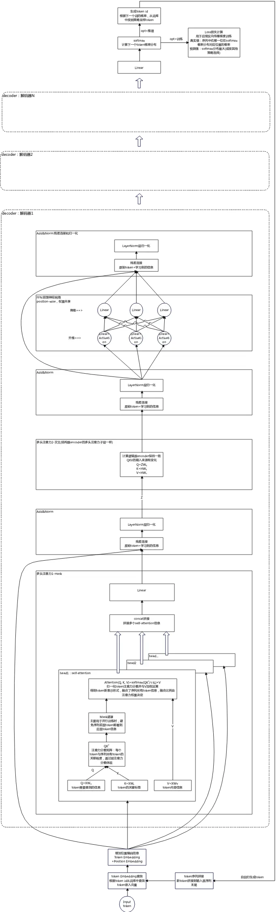


### decoder中的self-attention
Transformer的Decoder结构，与Encoder相似，但是存在一些区别：
- 包含两个 Multi-Head Attention层。
- 第一个Multi-Head Attention(又称：因果注意力causal attention)层多了Masked操作。目的是在训练时，防止当前token提前知道后续token信息；
- 第二个Multi-Head Attention层(又称：交叉注意力，cross attention)的**K, V**矩阵使用Encoder的**编码信息矩阵H**进行计算，而**Q**使用第一个Multi-Head Attention的输出Z计算。

其他逻辑与encoder Multi-Head Attention一样；
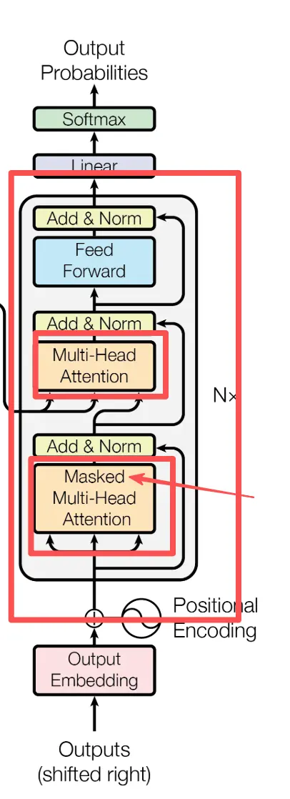


#### Causal Mask矩阵运算

Causal Mask(或叫下三角mask，应果遮罩)：Mask 用来“屏蔽”某些位置，让注意力机制不去关注它们，从而保证token只能看已生成的词。
>训练时：由于decoder的输入是完整序列；通过 Causal Mask 保证每个位置不能看到未来 Token，同时整个序列可以一次性进行矩阵化、并行化计算，从而同时得到所有位置的下一个 Token 预测，再统一计算损失并进行反向传播；
>
>推理时：token逐个生成和计算，天然具备应该关系，也就不需要遮挡未来的token；所以推理时通常不加 Mask，靠 KV Cache保证因果性和加快运算速度。

**Mask计算过程**
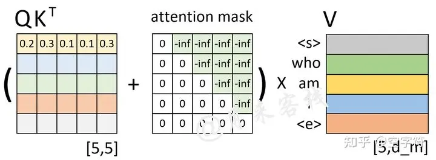

**Mask计算示例**
假设一个注意力得分矩阵：$S=QK^T$，如下：$S= \begin{bmatrix} 2&3&1&4\\ 1&2&5&2\\ 3&1&4&6\\ 2&3&1&5 \end{bmatrix}$

Mask矩阵形式如下：$M= \begin{bmatrix} 0&-\infty&-\infty&-\infty\\ 0&0&-\infty&-\infty\\ 0&0&0&-\infty\\ 0&0&0&0 \end{bmatrix}$

未来位置加入$-\infty$。

$$
S_{mask}
= S+M =
\begin{bmatrix} 2&3&1&4\\ 1&2&5&2\\ 3&1&4&6\\ 2&3&1&5 \end{bmatrix}
+ \begin{bmatrix} 0&-\infty&-\infty&-\infty\\ 0&0&-\infty&-\infty\\ 0&0&0&-\infty\\ 0&0&0&0 \end{bmatrix}
= \begin{bmatrix} 2&-\infty&-\infty&-\infty\\ 1&2&-\infty&-\infty\\ 3&1&4&-\infty\\ 2&3&1&5 \end{bmatrix}
$$

sofmtmax计算的时候，因为：$e^{-\infty}=0$，所以未来 token 的 Attention 权重就变成0。
$$
A = Softmax(S_{mask}) = \begin{bmatrix} 1.000 & 0 & 0 & 0 \\ 0.269 & 0.731 & 0 & 0 \\ 0.260 & 0.035 & 0.705 & 0 \\ 0.041 & 0.112 & 0.015 & 0.831 \end{bmatrix}
$$

于是：$\text{Attention}(Q, K, V) =AV$时，遮罩信息不会进入当前token的表示。
因此 Mask 的本质是：限制信息流，而不是简单限制矩阵计算。

**其他mask矩阵**
在实际 LLM 推理系统中，是否需要其他Mask，要看模型架构、输入形式和推理优化方式。常见如下：
- Padding mask 
  >一个批次，样本长度不一致，用来补齐矩阵；

https://zhuanlan.zhihu.com/p/28786272137 探秘Transformer系列之（11）--- 掩码

### decoder运算示例

在encoder中我们有一个示例：输入序列：\[我、爱、中国]，我们在decoder中对其进行翻译，输出\[I、Love、China]

- 一、环境假设
输入序列：\[我、爱、中国]直接标进每一个矩阵的行和列里，让你一眼就能看出每个数字属于哪个词。
约定：行 = 词，列 = 维度；
模型训练：我们在模型训练阶段进行decoder运算，并观察Mask子层；(推理阶段运算基本一致，Mask运算差异？？)

- 二、目标
观察decoder运算流程，数据流转；decoder二层自注意力层与encoder的一层自注意力层区别；Mask运算；与encoder交互；

- 三、Decoder输入的词嵌入 + 位置编码
为手算方便，沿用 Encoder 的 4×4 维设定。
假设 Decoder输入的词嵌入 + 位置编码后：
$$
X_{\text{dec}} = \begin{array}{c} \text{<SOS>} \\ \text{I} \\ \text{love} \\ \text{China} \end{array} \begin{bmatrix} 1 & 0 & 1 & 0 \\ 0 & 1 & 0 & 1 \\ 1 & 1 & 1 & 0 \\ 0 & 0 & 1 & 1 \end{bmatrix}
$$
>\<SOS>：输入开始特殊标识符

四、第一层：自注意力&Masked
1. 计算 Q、K、V
用和 Encoder 相同的 $W_Q, W_K, W_V$：
$$
W_Q = \begin{bmatrix} 1 & 0 \\ 0 & 1 \\ 1 & 0 \\ 0 & 1 \end{bmatrix} \quad W_K = \begin{bmatrix} 0 & 1 \\ 1 & 0 \\ 0 & 1 \\ 1 & 0 \end{bmatrix} \quad W_V = \begin{bmatrix} 1 & 1 \\ 1 & 0 \\ 0 & 1 \\ 0 & 0 \end{bmatrix}
$$

$$
Q_{\text{dec}} = X_{\text{dec}} W_Q = \begin{array}{c} \text{<SOS>} \\ \text{I} \\ \text{love} \\ \text{China} \end{array} \begin{bmatrix} 2 & 0 \\ 0 & 2 \\ 2 & 1 \\ 1 & 1 \end{bmatrix}
$$
$$
K_{\text{dec}} = X_{\text{dec}} W_K = \begin{array}{c} \text{<SOS>} \\ \text{I} \\ \text{love} \\ \text{China} \end{array} \begin{bmatrix} 0 & 2 \\ 2 & 0 \\ 1 & 2 \\ 2 & 1 \end{bmatrix}
$$
$$
V_{\text{dec}} = X_{\text{dec}} W_V = \begin{array}{c} \text{<SOS>} \\ \text{I} \\ \text{love} \\ \text{China} \end{array} \begin{bmatrix} 1 & 2 \\ 1 & 0 \\ 2 & 2 \\ 1 & 1 \end{bmatrix}
$$
2. 计算 $QK^T$
$$
Q_{\text{dec}} K_{\text{dec}}^T = 
\begin{array}{c|cccc} {} & {<SOS>} & \text{I} & \text{love} & \text{China}\\ \hline \text{<SOS>} & 0 & 4 & 2 & 4 \\ \text{I} & 4 & 0 & 4 & 2 \\ \text{love} & 2 & 4 & 4 & 5 \\ \text{China} & 2 & 2 & 3 & 3 \end{array} 
$$

3. 加因果 Mask（关键步骤）
**Mask 规则**：位置 $i$ 只能看位置 $j \leq i$。
Mask下三角矩阵(未来信息置为无穷小)形式：$M= \begin{bmatrix} 0&-\infty&-\infty&-\infty\\ 0&0&-\infty&-\infty\\ 0&0&0&-\infty\\ 0&0&0&0 \end{bmatrix}$

上三角（$j > i$）设为 $-\infty$：
$$
\text{Masked Score} = 
QK^T + M
=
\begin{array}{c|cccc} {} & {<SOS>} & \text{I} & \text{love} & \text{China}\\ \hline \text{<SOS>} & 0 & -\infty & -\infty & -\infty \\ \text{I} & 4 & 0 & -\infty & -\infty \\ \text{love} & 2 & 4 & 4 & -\infty \\ \text{China} & 2 & 2 & 3 & 3 \end{array} 
$$
4. 缩放 + Softmax
$d_k = 2$，$\sqrt{d_k} \approx 1.414$：

$$
\frac{\text{Masked Score}}{\sqrt{d_k}} = \begin{array}{c} \text{<SOS>} \\ \text{I} \\ \text{love} \\ \text{China} \end{array} \begin{bmatrix} 0 & -\infty & -\infty & -\infty \\ 2.83 & 0 & -\infty & -\infty \\ 1.41 & 2.83 & 2.83 & -\infty \\ 1.41 & 1.41 & 2.12 & 2.12 \end{bmatrix}
$$

**Masked注意力矩阵**：
按行Softmax
$$
A_{\text{masked}} = 
Softmax(\frac{QK^T}{\sqrt{d_k}}) =
\begin{array}{c|cccc} {} & {<SOS>} & \text{I} & \text{love} & \text{China} \\ \hline \text{<SOS>} & 1.00 & 0 & 0 & 0 \\ \text{I} & 0.94 & 0.06 & 0 & 0 \\ \text{love} &  0.11 & 0.45 & 0.45 & 0 \\ \text{China} & 0.17 & 0.17 & 0.33 & 0.33 \end{array}
$$

**对比Encoder**：
- Encoder 的注意力矩阵**没有上三角为 0** 的约束。
- Decoder 的注意力矩阵**上三角全是 0**，因为 Mask 挡住了未来。

5. 加权 V
$$
\text{Output}_{\text{self-attn}} = A_{\text{masked}} \times V_{\text{dec}}
= \begin{bmatrix} 1.00 & 0 & 0 & 0 \\ 0.94 & 0.06 & 0 & 0 \\ 0.11 & 0.45 & 0.45 & 0 \\ 0.17 & 0.17 & 0.33 & 0.33 \end{bmatrix}
\begin{bmatrix} 1 & 2 \\ 1 & 0 \\ 2 & 2 \\ 1 & 1 \end{bmatrix}
= \begin{array}{c} \text{<SOS>} \\ \text{I} \\ \text{love} \\ \text{China} \end{array} 
\begin{bmatrix} 1.00 & 2.00 \\ 1.00 & 1.88 \\ 1.46 & 1.12 \\ 1.33 & 1.33 \end{bmatrix}
$$

**简化操作**：后续的8个自注意子层的concat拼接和Linear操作就省略了，最终输出维度没变化，对应的矩阵值也不变，不重新计算了；

- 五、第二层：交叉注意力
5. Q、K、V 来源

| 矩阵  | 来源                | 说明      |
| --- | ----------------- | ------- |
| Q   | Decoder自注意力输出×Wq  | 当前生成到哪了 |
| K   | Encoder 输出 × Wk   | 源句子的编码  |
| V   | Encoder 输出 × Wv   | 源句子的编码  |

**Encoder 输出**（沿用之前例子）：
$$
H_{\text{enc}} = \begin{array}{c} \text{我} \\ \text{爱} \\ \text{中国} \end{array} \begin{bmatrix} 1.18 & 0.46 \\ 1.50 & 1.96 \\ 1.46 & 1.12 \end{bmatrix}
$$
2. 计算交叉注意力的 Q、K、V
用新的权重矩阵（交叉注意力有自己的 $W_Q, W_K, W_V$），为简化，假设：
$$
Q_{\text{cross}} = \text{Output}_{\text{self-attn}}
$$
$$
K_{\text{cross}} = H_{\text{enc}}, \quad V_{\text{cross}} = H_{\text{enc}}
$$
  > Q、K、V都需要输入矩阵×权重矩阵才能得到结果，这里简化了，直接等于对应的输入矩阵；

3. 计算 $QK^T$

$$K^T = \begin{bmatrix} 1.18 & 1.50 & 1.46 \\ 0.46 & 1.96 & 1.12 \end{bmatrix}$$
$$
Q_{\text{cross}} K_{\text{cross}}^T 
= \begin{bmatrix} 1.00 & 2.00 \\ 1.00 & 1.88 \\ 1.46 & 1.12 \\ 1.33 & 1.33 \end{bmatrix}\begin{bmatrix} 1.18 & 1.50 & 1.46 \\ 0.46 & 1.96 & 1.12 \end{bmatrix}
= \begin{array}{c|ccc} {} & 我 & 爱 & 中国 \\ \hline \text{<SOS>} & 2.10 & 5.42 & 3.70 \\ \text{I} & 2.04 & 5.19 & 3.57 \\ \text{love} & 2.24 & 4.39 & 3.39 \\ \text{China} & 2.18 & 4.61 & 3.44 \end{array} 
$$
4. 交叉注意力**不加Mask**
因为Encoder输出是完整的源句子，不需要挡未来。
Softmax后：
$$
A_{\text{cross}} 
= Softmax(\frac{QK^T}{\sqrt{d_k}})
= \begin{array}{c|ccc} {} & 我& 爱& 中国 \\ \hline \text{<SOS>} & 0.18 & 0.55 & 0.27\\ \text{I} & 0.18 & 0.55 & 0.27\\ \text{love} & 0.24 & 0.48 & 0.28 \\ \text{China} & 0.23 & 0.49 & 0.28 \end{array}
$$
5. 加权V

$$
\text{Output}_{\text{cross}} = A_{\text{cross}} \times H_{\text{enc}}
= \begin{bmatrix} 0.18 & 0.55 & 0.27\\ 0.18 & 0.55 & 0.27\\ 0.24 & 0.48 & 0.28 \\ 0.23 & 0.49 & 0.28 \end{bmatrix}
\begin{bmatrix} 1.18 & 0.46 \\ 1.50 & 1.96 \\ 1.46 & 1.12 \end{bmatrix}
= \begin{array}{c} \text{<SOS>} \\ \text{I} \\ \text{love} \\ \text{China} \end{array} \begin{bmatrix} 1.36 & 1.09 \\ 1.36 & 1.09 \\ 1.39 & 1.04 \\ 1.39 & 1.05 \end{bmatrix}
$$

- 六、第三层：FFN
对交叉注意力输出做 FFN：
$$
\text{Output}_{\text{FFN}} = \text{FFN}(\text{Output}_{\text{cross}})
$$
为简化，假设 FFN 是恒等映射：
$$
\text{Output}_{\text{FFN}} = \text{Output}_{\text{cross}}
$$
- 七、最终输出

$$
\text{Output}_{\text{dec}} = \begin{array}{c} \text{<SOS>} \\ \text{I} \\ \text{love} \\ \text{China} \end{array} \begin{bmatrix} 1.36 & 1.09 \\ 1.36 & 1.09 \\ 1.39 & 1.04 \\ 1.39 & 1.05 \end{bmatrix}
$$
至此decoder处理完成；

后续再把decoder的输出，经过Linear + Softmax运算，预测下一个词：

| 位置  | 输入      | 预测输出    |
| --- | ------- | ------- |
| 0   | `<SOS>` | I       |
| 1   | I       | love    |
| 2   | love    | China   |
| 3   | China   | `<EOS>` |

下面是模拟的一个Output的softmax后的概率分布，以及一个词表数据；
```
训练到softmax已经输出概率分布，如
<SOS>    0.1 0.32 0.04 0.05 0.06  .... 跟词表维度一样长
I        0.2  0.4最大  0.04 0.05 0.06 .... 跟词表维度一样长
love     0.15 0.05 0.04 0.05 0.6最大 .... 跟词表维度一样长
China    0.3 0.03  0.04 0.05 0.06 .... 跟词表维度一样长
<EOS>    0.4 0.02 0.04 0.05 0.06 .... 跟词表维度一样长

假设一个词表：
[I,其他1，Love，其他2，china，...]
```

假设1：当前位置是I，I的softmax 最大是0.4，预测值：其他1；预测错误，真实应该是Love；交叉熵Loss=−log(p真实值)=−log(0.04)≈3.22
假设2：当前位置是Love，Love最大是0.6，预测值：china，预测正确；交叉熵Loss=−log(p真实值)=−log(0.6)≈0.51;


## 最终生成下一个token

经历前面encoder+decoder运算后，最后有一个Linear+Softmax层计算下一个翻译单词的概率。
最后一个编码器Decoder输出后；会经过Linear变换，将维度转换为词表的个数；再利用 Softmax计算出token的概率分布，按照策略(如概率最大)，从词表中选择下一个token；
>前面的自注意力机制是为了“充分理解上下文”，而最后的线性层加 Softmax 则是将这种“理解”转化为对下一个词的具体“预测概率”。

**运算步骤**
- 线性变换（LM Head）生成原始分数（Logits）
当输入序列经过所有 Transformer 层后，模型会提取出最后一个 Token（词）位置的输出特征向量（这个向量已经融合了整个句子的深层语义和上下文信息）。随后，这个高维特征向量会进入一个被称为LM Head（语言模型头）的线性层。这一步的作用是**将特征向量映射到与整个词表大小相同的维度**，为词表中的每一个候选词计算出一个原始得分，这个得分被称为 Logits。Logits 的数值越大，代表该词作为下一个词的匹配度越高
>token得分向量**Logits**：$\text{Logits} = h_t \cdot W_{lm} \quad \Rightarrow \quad \text{维度为 } [1, \text{Vocab\_Size}]$

- Softmax归一化生成概率分布
由于 Logits 是没有任何范围限制的实数（包含正负值），无法直接作为概率使用。因此，模型会引入 Softmax 函数对这些原始得分进行归一化处理。Softmax 会将所有的 Logits 转换为介于 0 到 1 之间的数值，并且保证这些数值的总和恰好等于 1。这就形成了一个标准的概率分布，直观地展示了词表中每个词成为下一个词的可能性
> Token 的概率分布向量：$P(y_t) = \text{Softmax}(\text{Logits})$，

- 根据策略选择Token
在完成上述两步得到概率分布后，模型会根据特定的解码策略（如贪心搜索直接选概率最高的词，或 Top-k/Top-p 采样以增加多样性）从中挑选出一个目标 Token ID，并将其拼接到原始序列的末尾，从而进入下一轮的循环预测，直到生成结束符

**示例如下**
假如概率值最高的单元被选出，与之对应的token就是该时间步骤的输出结果。

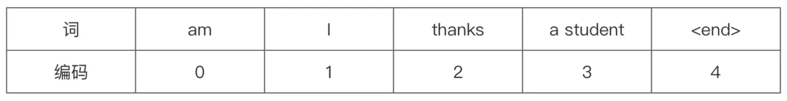
*词表(假如只有6个词)*

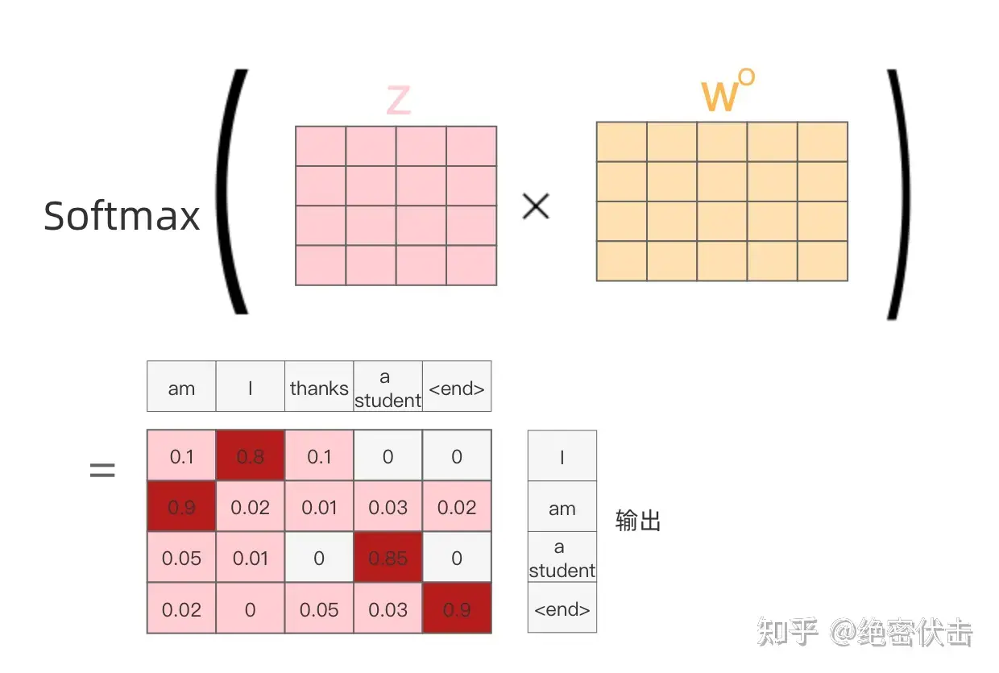
*softmax运算*


## 损失函数
由于模型的参数（权重）是随机设定的，一个未经训练的模型会为每个词生成一个任意值的概率分布。我们可以将这个分布与实际的输出相比较，然后通过反向传播调整模型的所有权重，让输出更贴近我们的目标。

损失值数学公式(交叉熵)： $L = -\log(P_{\text{target}})$：
损失值比较：如果预测跟真实不一致，比如预测为a，概率0.8，真实为b，概率0.1；损失值直接使用真实概率进行运算；即$L = -\log(0.1)$：不需要2个概率进行运算：真实值的概率大小，本身就代表了预测准确概率值；
损失函数也只在训练阶段，才需要进行计算，推理阶段直接按策略采样(如概率最大)选定下一个token即可；

训练时：只用真实值算Loss，预测值不参与。推理时：没有真实值，必须用预测值，且要选词、拼接、自回归。

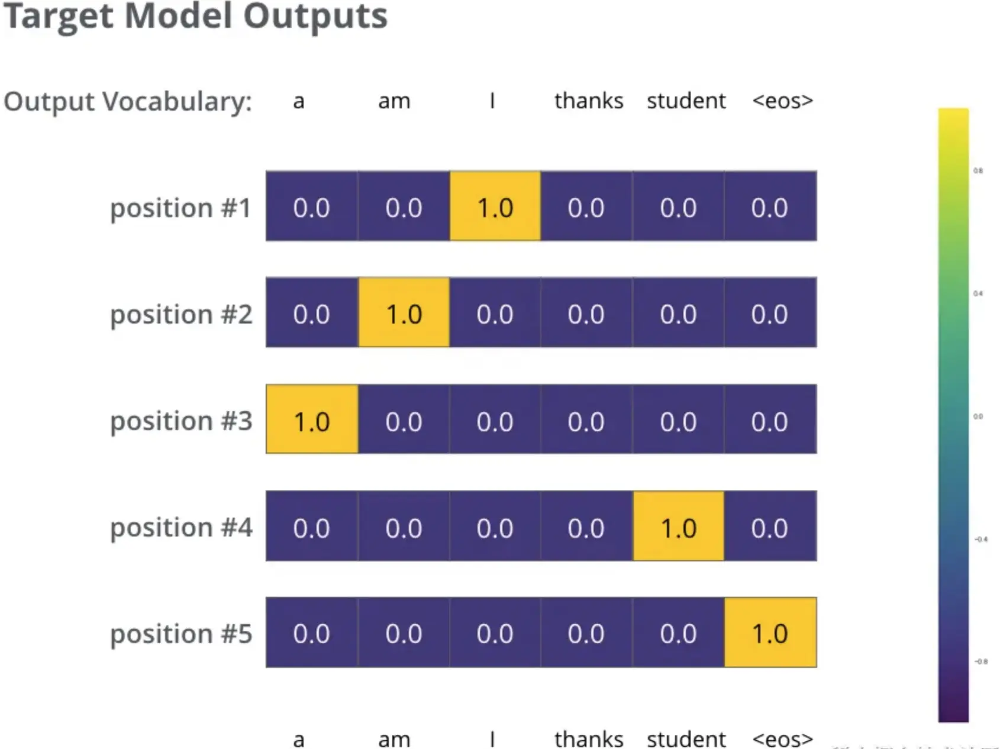


### 损失值计算示例


```
训练到softmax已经输出概率分布，如
<SOS>    0.1 0.32 0.04 0.05 0.06  .... 跟词表维度一样长
I        0.2  0.4最大  0.04 0.05 0.06 .... 跟词表维度一样长
Love     0.15 0.05 0.04 0.05 0.6最大 .... 跟词表维度一样长
china    0.3 0.03  0.04 0.05 0.06 .... 跟词表维度一样长
<EOS>    0.4 0.02 0.04 0.05 0.06 .... 跟词表维度一样长

假设一个词表：[I,其他1，Love，其他2，china，...]
```

假设1：当前位置是I，I的softmax 最大是0.4，预测值：其他1；预测错误，真实应该是Love；交叉熵Loss=−log(p真实值)=−log(0.04)≈3.22
假设2：当前位置是Love，Love最大是0.6，预测值：china，预测正确；交叉熵Loss=−log(p真实值)=−log(0.6)≈0.51;

## 训练

构建 LLM 的主要要素是海量的训练数据（文本），通常经过一定程度的过滤。通过自监督模式，以及Casual Mask遮罩处理，并行进行训练；
>训练时，decoder的输入序列已经是完整的，不需要再一个个再生成token；预测的token是否正确，只需要查看输入序列当前位置下一个的token是否与预测token匹配即可；

具体训练流程，参考[decoder运算流程](深度学习-Transformer.md#decoder运算流程)

**训练时的并行输入机制**
- Encoder 侧： 一口气接收完整的源序列（例如："天气如何"），通过 Self-Attention（自注意力机制）在单次前向传播中同时计算出所有位置的上下文特征向量 $H_{enc}$。
- Decoder 侧： 一口气接收完整的目标序列（例如：\<BOS> 杭州 20 度）。为了防止位置 $t$ 的词提前看到 $t$ 之后的未来信息，Decoder 内部使用了 带掩码的自注意力（Masked Self-Attention）。
```
[ 前向传播 (Forward Pass) 同步进行 ]

Encoder 输入:  "天"  "气"  "如"  "何"  ───>  [ Encoder ] ───> 输出高维向量 H_enc
                                                             │
                                                             ▼ (Cross-Attention)
Decoder 输入:  <BOS> "杭"  "州"  "20"  ───>  [ Decoder ] ───> 预测输出 Logits
                │     │     │     │             ▲
                └─────┴─────┴─────┴─────────────┘ (通过 Mask 挡住未来 Token)
```

### 并行训练机制

在 Transformer 的训练过程中，Encoder（编码器）和 Decoder（解码器）是以并行（同时）的方式接收输入序列的，而不是先等 Encoder 完全算完再传给 Decoder。

训练时使用的是 Teacher Forcing（教师指导） 技术：
- 直接把真实的目标序列全部喂给 Decoder。
- 通过在 decoder层的Self-Attention矩阵上加一个**下三角掩码（Mask）**，将矩阵右上角（未来的 Token 权重）强制设为 $-\infty$。
- **效果：** 计算生成 `"州"` 的概率时，Mask 会保证网络只能“看到” `<BOS>` 和 `"杭"`，即使完整的目标句子已经一次性全部输入给了Decoder。

**两层的交互节点：交叉注意力（Cross-Attention）**
在 Transformer 的前向传播计算图（Computational Graph）中：
1. **并行启动：** Encoder 输入矩阵 $X_{enc}$ 与 Decoder 输入矩阵 $Y_{dec}$ 同时进入各自的第一层（Embedding + Positional Encoding）。
2. **计算依赖：** Decoder 前半部分（Masked Self-Attention）的计算**不需要** Encoder 的结果，可以并行进行。
3. **数据交汇：** 当计算到达 Decoder 的 **Cross-Attention 层** 时，Decoder 需要使用 Encoder 最终输出的特征矩阵 $H_{enc}$ 作为 $K$ (Key) 和 $V$ (Value)。此时，交叉注意力层会等待 Encoder 的前向输出结果到位，完成融合后再向后计算损失（Loss）。

## 推理

LLM 推理真正的核心流程可以浓缩成：
$$
\text{Token} \rightarrow \text{Embedding} \rightarrow \text{新Q/K/V} \rightarrow \text{读取历史KV Cache} \rightarrow \text{Attention} \rightarrow \text{Logits} \rightarrow \text{选择Token} \rightarrow \text{追加} \rightarrow \text{循环}
$$

推理/生成时： 先Encode，再Decode。Encoder运行一次算完所有输入向量，Decoder像 RNN 一样逐字自回归循环生成Token。
>推理：decoder中，Q,K,V等的运算中间结果，可以通过K/V复用(KV-cache技术进行缓存)，只计算新Token的增量；

## KV-cache

在推理时，decoder每步只算新词的 K、V；历史的 K、V 缓存起来，直接复用。
>训练不需要KV-cache，本身输入的就是完整序列，完整运算即可；

```
Step 1: 算 <SOS> 的 K、V → 缓存
Step 2: 算 I 的 K、V → 缓存追加
Step 3: 算 love 的 K、V → 缓存追加
...
```

## 总结

Transformer是一套基于自注意力机制的神经网络架构，能生成上下文相关的token；
上下文信息关联问题：通过自注意力机制来解决；顺序问题：依靠position embedding解决；
多头注意力、残差连接、层归一化、位置编码这些运算结构共同构成了现代大语言模型的基础骨架；
Transformer在现代LLM中的应用越来越广泛，生成、翻译、推理、工具调用等等场景发挥出了难以想象的作用；

## QA
### Q：自注意力中有$W^{QKV}$ 3个权重，为什么是3个；
A为什么要三个，而不是用一个？
因为投影空间不同。如果 Q、K、V 从同一个空间映射出来，那“查询”和“被查询”的边界就模糊了。三个独立的矩阵让模型能学习到三种不同的表征方式：

### Q：KVQ计算顺序疑问
A：

| 约定                  | X 形状    | 变换写法     | 函数位置       |
| ------------------- | ------- | -------- | ---------- |
| 数学教材                | 维度 × 样本 | $Y = WX$ | 函数在左，采用列向量 |
| PyTorch/Transformer | 样本 × 维度 | $Y = XW$ | 函数在右，采用行向量 |
**两者本质是转置关系：**$(WX)^T = X^T W^T$


### Q：transformer序列顺序如何解决
A我们知道transformer语义问题，通过自注意力机制来解决；


### Q：encoder输出的矩阵和encoder的Attention(Q, K, V) 融合矩阵区别
A

| 维度           | Attention 融合矩阵                                                               | Encoder 最终输出矩阵 ($H_{enc}$)                                   |
| ------------ | ---------------------------------------------------------------------------- | ------------------------------------------------------------ |
| **位置**       | 某个 Transformer Block **内部** 的局部中间状态                                          | **整个 Encoder 模块** 最后一层算完后的最终产物                               |
| **计算阶段**     | 仅完成了 $Q, K, V$ 的交互与加权                                                        | 经历了 $N$ 层 Attention + 残差 + LayerNorm + FFN 的完整流转             |
| **非线性度**     | 低（主要是线性的 $V$ 向量加权组合）                                                         | 极高（深度非线性网络加工）                                                |
| **用途**       | 供当前 Block 内后续的 FFN 进一步提炼                                                     | 传给 Decoder 的 Cross-At                                        |
| 特征映射与非线性能力不同 | 本质上只是一个线性加权组合。它只是把不同 Token 的 $V$ 向量按照注意力权重折算相加，没有经过任何非线性激活函数（如 GELU/ReLU）的加工 | 经历了 $N$ 层注意力机制与 FFN 的交替叠加。FFN（包含升维、非线性激活、降维）为特征赋予了极高的非线性表达能力 |
| 抽象层次/语义深度    | 捕捉的是浅层表象特征（例如语法结构、相邻词汇的字面关联、词性搭配）                                            | 经过层层抽取与深度抽象，蕴含的是高层全局语义（例如整句话的上下文逻辑、深层意图、实体间的指代关系）。           |

### Q：transformer输入维度
Transformer 的输入在实际工程中通常确实可以表示为 3 维张量\[batch, sequence, hidden]

通常写成：$\boxed{X\in R^{B\times S\times d}}$
>多个句子数量 × 句子划分 token 数量 × token嵌入向量维度

| 维度  | 含义                             | 例子  |
| --- | ------------------------------ | --- |
| $B$ | Batch，句子/样本数量                  | 32  |
| $S$ | Sequence Length，每个句子的 Token 数量 | 128 |
| $d$ | Hidden Size，每个 Token 的向量维度     | 768 |

### Q Token Embedding+PE会破解token embedding的语义信息吗
A：
在高维向量空间中，随机生成的两个向量大概率是近似正交的；将相加后的向量 $X = E_{\text{token}} + E_{\text{pos}}$在经过 $W^Q, W^K$ 线性变换后，模型可以通过网络权重自动提取并分离出属于“词义”的部分和属于“位置”的部分，两者在高维空间中互不干扰。
设计 Transformer 时，学者们曾实验过将 $E_{\text{token}}$ 和 $E_{\text{pos}}$ 在维度上进行拼接（拼接后维度变为 $2 \times d_{\text{model}}$）。
- **拼接 (Concat)**：信息完全独立，无任何交叠，但会使得模型的 Embedding 维度翻倍，显著增加计算量与显存占用。
- **相加 (Add)**：效果与拼接几乎一致，但**节省了一半的参数量与计算开销**。在高维空间中，加法等价于隐含的拼接（可以通过线性变换矩阵恢复原貌）。

### Q模型词表特殊字符怎么来的
A：人为定义的，不是训练出来的。
在构建词表（vocabulary）时，人为加入这一些特殊 token；
每个特殊 token 分配一个唯一的整数 ID；
这些特殊字符是词表的一部分，和其他词一样有 ID、有嵌入向量。它们和普通词一样，参与训练，会更新；但是token id是人为分配的；

```
词表 = [<PAD>, <SOS>, <EOS>, <UNK>, I, love, China, ...]
         ↑      ↑      ↑      ↑
       人为加入的特殊 token
```

训练时：位置 0：输入\<SOS>，最后位置：\<EOS>
模型学习：看到\<SOS>，开始生成。生成到\<EOS>，停止。

注意：
\<SOS> 是输入，不参与 Loss 计算。
\<EOS> 是目标，参与 Loss 计算。


### Q：LLM的推理本质是预测还是真实推理能力
在使用LLM的时候有几类功能使用的原理
1计算：输入：1+1，它怎么知道是算术，以及如何运算得出2；
2最新内容：输入：当前天气，如何获取最新天气，以及对应位置；
3顺序调整，格式整理：输入：某一段内容，进行顺序调整、格式整理
4工具调用：输入：帮我打开taobao；

这几类难道都是通过大量文本训练后，LLM就自动具备了推理能力；
或者说是文本预测能力，而非推理能力；
A：
LLM 的底层是文本预测，但在大规模训练后，为了把预测做得更准，它涌现出了推理、工具调用等能力。这些能力表现为“智能”，但本质仍是“基于上下文的模式生成”。

| 说法       | 是否准确   | 说明               |
| -------- | ------ | ---------------- |
| 纯文本预测    | ✅ 底层机制 | 训练目标就是预测下一个词     |
| 具备推理能力   | ✅ 涌现现象 | 为了预测更准，模型内部学会了推理 |
| 真正理解算术   | ❌      | 是模式匹配 + 内部计算链    |
| 自己获取实时信息 | ❌      | 靠外部检索/工具         |
| 自己执行操作   | ❌      | 靠外部系统执行          |

比如代码执行，复杂计算，我们发给模型，模型会通过tool调用，使用对应服务资源专门进行运算；运算结果重新传入模型进行汇总；

### Q：训练时，可以多批次并行训练，参数更新是怎么处理；
训练时，可以多批次，多序列并行训练，会并行产生多个Loss，更新冲突怎么解决
在transformer中，梯度优化，是一个批次计算完成后，就进行一次；这样会影响并行多批次的训练吗；
A
不冲突。因为“多批次并行”指的是“多个 batch 同时前向/反向”，但梯度更新仍然是“按优化步”进行的。并行的是计算，不是更新。

| 概念 | 含义 |
| --- | --- |
| **Batch** | 一次前向/反向的样本集合 |
| **Mini-batch** | 实际训练时的一个 batch |
| **Gradient Accumulation** | 多个 mini-batch 累积梯度，再更新一次 |
| **Data Parallel** | 多个 GPU 各跑一个 batch，梯度汇总后更新 |
| **Pipeline Parallel** | 不同层分布在不同 GPU，流水线并行 |

“多批次并行”通常指 Data Parallel 或 Gradient Accumulation。
```
GPU1: batch1 → Loss1 → grad1 ┐
GPU2: batch2 → Loss2 → grad2 ├──→ All-Reduce → 平均梯度 → 更新参数
GPU3: batch3 → Loss3 → grad3 ┘
```

一个长序列拆成多段，分到不同 GPU。各段并行计算注意力。需要跨 GPU 通信（因为注意力要看全序列）。汇总一个优化步更新一次

### Q：LLM的请求-暂停-恢复流程，细节如何，有缓存使用吗
A：
一个请求输出：1+1等于多少，并且告诉我原理；
1+1模型通过tool调用外部资源，会暂停；外部tool算出来后，再通过"system prompt/tool"和原来的输入内容，一起返回给模型，模型恢复继续处理；

上述这个示例：在LLM侧来看，相当于2次请求；暂停，其实表示一次请求已经完成；LLM本身没有状态(除了KV-cache)；

总结：对后端模型来说，工具调用是两次（或多次）完全独立的请求。模型无状态，每次只处理当前传入的完整上下文。上下文由外部系统维护，第二次请求的输入包含第一次的全部内容 + 工具返回结果。“暂停”是外部系统的概念，对模型来说就是一次请求结束。
KV Cache 默认不能跨请求复用，但加 Prefix Caching 后可以复用相同前缀。上下文超长靠截断、摘要、检索等策略处理。主流 LLM 模型本身无状态，上下文由应用层维护。


## 参考
https://zhuanlan.zhihu.com/p/338817680 Transformer模型详解（图解最完整版）
https://github.com/datawhalechina/learn-nlp-with-transformers/blob/main/docs/%E7%AF%87%E7%AB%A02-Transformer%E7%9B%B8%E5%85%B3%E5%8E%9F%E7%90%86/2.2-%E5%9B%BE%E8%A7%A3transformer.md 图解transformer
https://developers.google.com/machine-learning/crash-course/llm/transformers?hl=zh-cn LLM：什么是大语言模型？
https://arxiv.org/abs/1706.03762 Attention Is All You Need
https://www.zhihu.com/tardis/zm/art/600773858?source_id=1003 一文了解Transformer全貌（图解Transformer）
https://juejin.cn/post/7320082701212844044 图解 Transformer
https://transformers.run/c1/transformer/ Transformer 模型