## 介绍
深度学习是机器学习的一个子集。它试图模仿人脑神经元的工作方式，让机器自动从原始数据中学习多层次的特征表示。

与传统机器学习明确定义的数学逻辑不同，深度学习模型的神经网络由许多相互连接的“神经元”层组成，每个神经元都执行特定的数学运算操作。通过机器学习技术调整相邻层神经元之间的连接强度（即不断优化的模型权重与偏置），可以使网络逐步优化并产生更精确的输出结果。虽然神经网络和深度学习已变得彼此密不可分，但它们严格来说并不是同义词：“深度学习”是指至少具有 4 层的模型训练（尽管现代神经网络架构通常比这“更深”）。

深度学习模型通常采用**监督学习方式**在标注数据上进行训练，以执行回归与分类任务。但由于大规模神经网络通常需要海量训练数据才能达到最优性能，获取足够规模的标注训练数据集所需成本和工作量往往令人望而却步。这促使研究者开发出利用未标注数据复制监督学习任务的技术方法。自监督学习这一术语由 Yann LeCun 在 2010 年代后期正式提出，旨在将此类方法与传统的无监督学习进行明确区分。自监督学习随后逐渐发展成为训练神经网络的重要范式，尤其适用于支持生成式 AI 的基础模型。

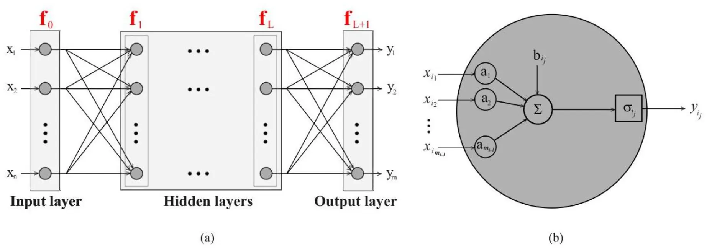

### 深度学习原理
深度学习的底层核心原理，本质上是用数学手段将“复杂、高维、非线性的未知规律”转化为“可计算、可迭代优化的几何与概率问题”。

广义而言，人工神经网络的设计灵感来源于人类大脑神经回路的工作机制，其运行依赖于神经细胞（神经元）网络间复杂的化学信号与电信号传递过程。在深度学习领域，类似“信号”实际上是由众多嵌套数学运算产生的加权输出结果，每个运算由人工“神经元”（节点）独立完成，这些神经元共同构成了完整的神经网络体系。

简而言之，深度学习模型可以理解为一系列复杂的嵌套方程，将输入映射到输出。通过专门的机器学习流程调整网络内部各个方程的相对影响权重，进而能够改变整个网络处理输入输出映射关系的方式。

虽然该框架功能强大，用途广泛，但却**牺牲了可解释性**。除了纯粹的数学解释之外，我们往往很难直观理解神经网络学习到的各个参数值是如何反映数据的真实世界特征的。因此，深度学习模型经常被称为“黑匣”，特别是与基于人工特征工程的传统机器学习模型相比时，这种特性更加明显。

### 与机器学习核心差异对比表

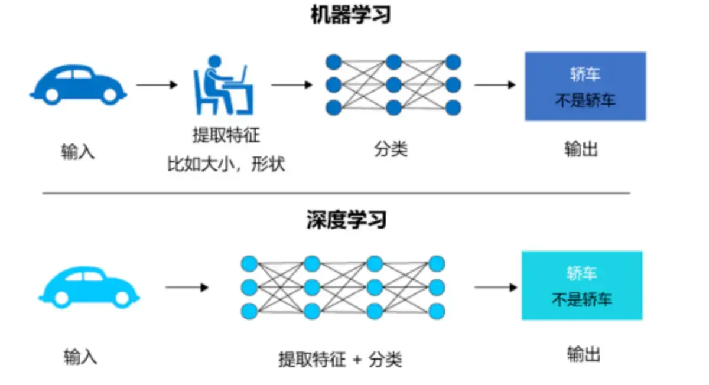

| 对比维度       | 传统机器学习                        | 深度学习                         |
| :--------- | :---------------------------- | :--------------------------- |
| **数据依赖**   | 对数据量要求相对较低，适用于中小规模数据集。        | 极度依赖大数据，数据越多，性能通常越好。         |
| **特征处理**   | **手动**特征工程是关键和主要负担。           | **自动**进行特征提取与抽象。             |
| **计算资源**   | 通常可在CPU上高效运行，需求较低。            | 需要强大的GPU进行训练，计算成本高。          |
| **模型可解释性** | 较好，决策过程相对透明。                  | 较差，常被视为"黑箱模型"。               |
| **问题领域**   | 擅长处理**结构化数据**（表格数据、有明确特征的场景）。 | 擅长处理**非结构化数据**（图像、音频、文本、视频）。 |
| **训练时间**   | 相对较短，从几分钟到几小时。                | 通常很长，从数小时到数周甚至更久。            |
| **入门门槛**   | 相对较低，易于理解和实现原型。               | 门槛较高，需要理解神经网络、调参等复杂知识。       |
一句话总结：传统机器学习是数据分析的艺术，而深度学习是感知与表示的科学。 它们不是取代关系，而是互补的工具箱。

### 概念

|概念|核心要点|
|:--|:--|
|**神经元**|计算单元，完成`加权求和 -> 加偏置 -> 激活函数`。|
|**权重与偏置**|模型需要学习的核心参数，决定了网络的行为。|
|**激活函数**|引入非线性（如ReLU, Sigmoid），使网络能学习复杂关系。|
|**网络层级**|**输入层**（接收数据）、**隐藏层**（特征提取）、**输出层**（产生预测）。|
|**前向传播**|数据从输入层流向输出层，计算预测值的过程。|

**前向传播**
输入数据在网络中正向流动，通过线性组合计算，经由非线性激活函数处理，最终生成输出预测结果。
**反向传播**
误差信号沿网络层级反向传播。在每个神经元上，算法通过微积分链式法则精确计算各权重与偏差对总误差的贡献比例。

 **神经网络**
 神经网络作为一种机器学习模型，通过将简易的"神经元"分层堆叠，从数据中自动学习模式识别的权重与偏置，从而建立输入到输出的映射关系。

### 神经网络层级关系

#### 三层结构

矩阵的行通常代表batch中的样本，列代表当前层的特征/神经元；权重矩阵负责把“上一层的特征空间”映射到“下一层的特征空间”。


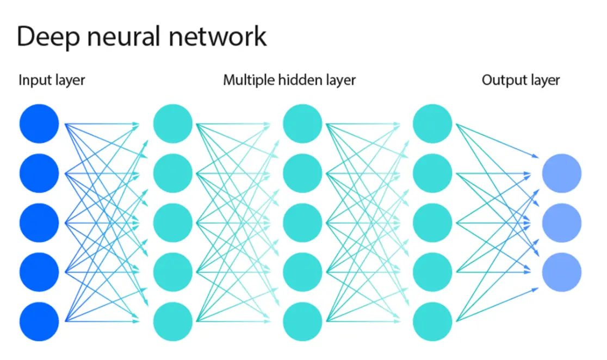

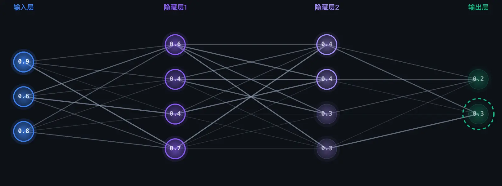
##### 输入层
网络的感官，负责接收原始数据
每个输入神经元处理输入向量的一个独立特征，输入层神经元数量要等于特征维度。例如，处理 10x10 像素灰度图像的模型的输入层通常有 100 个神经元，每个输入神经元对应一个单独的像素。
- 数学本质：恒等映射或数据向量化。
- 本质作用：接收原始数据（如像素矩阵、文本词向量），将其转化为计算机可处理的张量（Tensor），不改变数据所属的初始数学空间

##### 隐藏层
隐藏层是神经网络的核心，每一层都在做特征的提取和转换
多个隐藏层的设计使得深度学习模型能够学习数据的复杂层次化特征，其中较早的层识别较宏观的模式，而更深的层则识别更细微的模式。

- **浅层（靠近输入）**
  - 数学本质：局部梯度与边缘检测。
  - 本质作用：提取图像的边缘、线条，或语音的音素等低级特征。
- **中层**
  - 数学本质：组合基础几何结构。
  - 本质作用：将边缘组合成局部形状（如眼睛、鼻子、音节组合），形成中级特征。
- **深层（靠近输出）**
  - 数学本质：高维语义抽象。
  - 本质作用：将局部形状组合成完整的全局概念（如整张人脸、特定语义的句子），形成高度抽象的高级语义特征

>隐藏层神经元个数与输入层可以不一致；
>隐藏层神经元个数>输入层神经元个数：网络会把这 100 个原始特征交叉组合，生成更丰富的高维特征
>隐藏层神经元个数<输入层神经元个数：网络会强制把这 100 个特征压缩、提炼，提取出最核心的 64 个本质特征（这其实就是一种“降维”操作）
##### 输出层
网络的决策者，输出最终的预测结果
- 数学本质：决策与空间映射，通过线性转换将高维特征投影到目标标签空间，根据需要进行非线性激活函数处理(如Softmax)。
- 本质作用：输出最终结果。例如：回归任务输出连续数值，分类任务输出各类别的概率分布。


#### 网络层级作用

隐藏层是网络的特征检测器。当数据在这些层中移动时，网络可以更好地发现和组合输入特征，将它们分层到对数据的更复杂的理解中。

随着数据通过的每一层，网络都可以拾取更复杂的模式。早期的图层可能会学习形状或纹理等基本知识，而更深的图层则掌握了更复杂的想法，例如识别图片中的物体或人脸。


#### 单个神经元 vs 整层网络

| 维度对比       | 单个神经元 (Single Neuron)                          | 同一层的整体 (Whole Layer)                                    |
| ---------- | ---------------------------------------------- | ------------------------------------------------------- |
| **变换形式**   | 一维仿射投影：$z_i = \mathbf{w}_i^T \mathbf{x} + b_i$ | 高维仿射映射：$\mathbf{z} = \mathbf{W}\mathbf{x} + \mathbf{b}$ |
| **几何形态**   | 一条**超平面**（切割一刀；在二维是直线，三维是平面）                   | 多个超平面的**组合切割/空间旋转拉伸**                                   |
| **输出结果**   | 一个标量（代表特征在单一方向上的抽取得分）                          | 一个向量（代表在新的特征坐标系下的坐标点）                                   |
| **加激活函数后** | 沿着单一超平面折叠/扭曲（如 ReLU 的“折纸”）                     | 整个空间在多个方向上被同时切碎与弯曲                                      |

### 流程

神经网络训练分为四个步骤：
- 前向传播： 输入数据在网络中正向流动，通过线性组合计算，经由非线性激活函数处理，最终生成输出预测结果。  
- 误差计算： 损失函数衡量预测与事实之间的差异。  
- 反向传播（反向传播算法）：误差信号沿网络层级反向传播。在每个神经元上，算法通过微积分链式法则精确计算各权重与偏差对总误差的贡献比例。  
- 权重更新：使用 梯度下降等优化方法，沿误差减小的方向对权重和偏置进行微调。


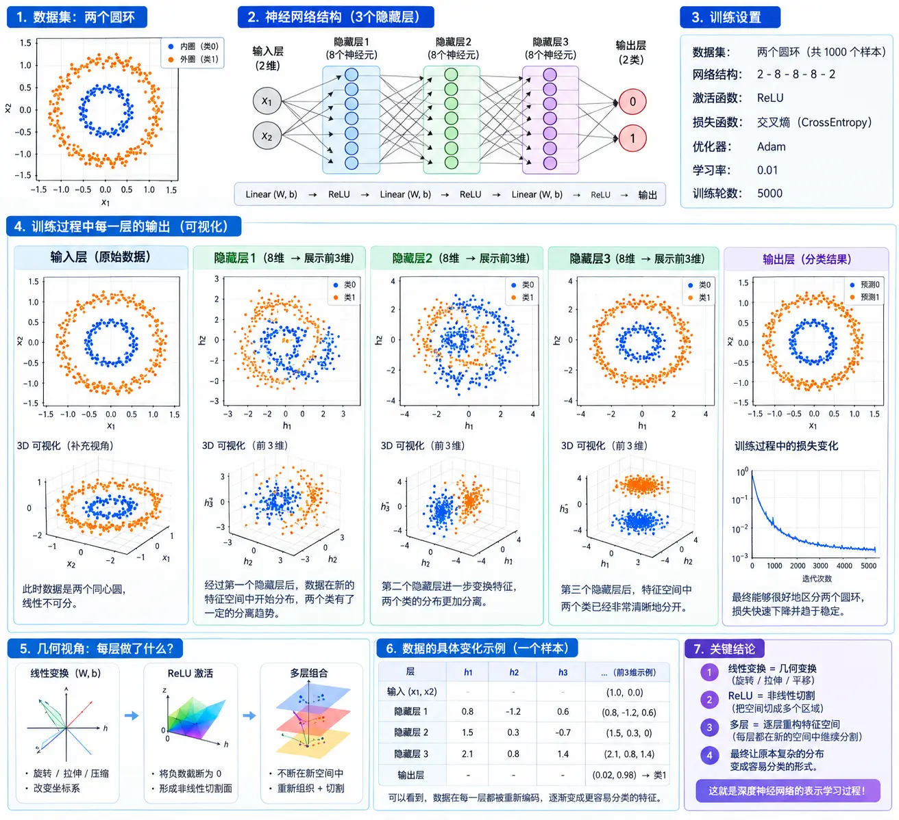

### 作用
在实际工程与学术界中，所有机器学习/深度学习问题，本质上都可以统一抽象为“寻找从输入空间 $\mathcal{X}$ 到输出空间 $\mathcal{Y}$ 的映射关系 $f: \mathcal{X} \rightarrow \mathcal{Y}$”。理论上深度学习如果有足够多的神经网络就能拟合任意映射规则，这也是深度学习(神经网络)在现在AI中，越来越重要。

>神经网络直接从数据中学习有效的内部表示，捕获传统模型难以捕捉的非线性结构。只要具备足够容量、合理目标函数及防过拟合正则化，它们就能从小型基准测试扩展至计算机视觉、自然语言处理、语音识别、预测分析等生产系统，显著提升精度与稳健性。 

**神经网络的一些重要应用**
- 计算机视觉：CNN 广泛应用于图像识别、医疗影像分析及自动驾驶系统。   
- 自然语言处理：转换器用于机器翻译、聊天机器人和摘要。   
- 语音识别：RNN 与深度网络赋能语音转写及智能助手系统。  
- 预测与时序分析：涵盖需求预测、金融建模与气象预报等领域。  
- 强化学习：神经网络作为函数逼近器应用于游戏智能体（如DeepMind 围棋程序 AlphaGo）。   
- 模式识别：涵盖欺诈检测、异常识别与文档分类等场景。


根据输入与输出形态的不同，这些“规则查找”被细化为多种表现形式，但底层全是神经网络在做拟合。

| **任务类型**                  | **输入 X**         | **输出 Y**         | **底层寻找的规则/规律**                 |
| ------------------------- | ---------------- | ---------------- | ------------------------------ |
| **标准分类**                  | 图像/文本/表格         | 离散类别概率           | 找到不同类别在特征空间中的**复杂决策边界**        |
| **标准回归**                  | 房屋特征/传感器数据       | 连续数值             | 拟合高维空间中的**连续超曲面**              |
| **序列/生成 (LLM/Diffusion)** | 上文 Prompt / 随机噪声 | 下一个 Token / 目标图像 | 拟合复杂高维数据的**联合概率分布**            |
| **表征/嵌入 (Embedding)**     | 复杂数据（如用户/商品）     | 低维密集向量           | 提取数据内部隐性的**相似性与结构规则**          |
| **控制/决策 (强化学习)**          | 环境状态 State       | 动作 Action        | 拟合当前状态下的**最优决策策略函数 $Q(s, a)$** |

分类和回归
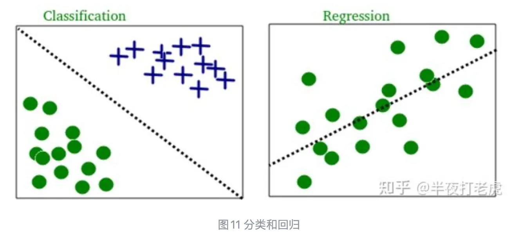

## 神经元

神经元是神经网络最基本的计算单元，它模拟了生物神经元接收信号-处理信号-传递信号的过程。

>每个神经元执行的数学运算都是统一的：加权求和（线性变换） + 激活函数（非线性变换）。

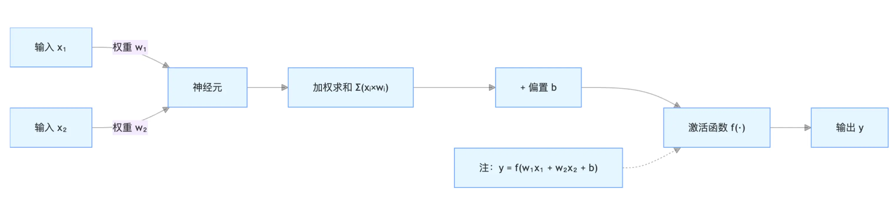


**神经元各部件功能详解：**

| 部件           | 类比         | 数学表达                                       | 作用                                        |
| ------------ | ---------- | ------------------------------------------ | ----------------------------------------- |
| **输入 $x$**   | 来自其他神经元的信号 | $x_1, x_2, ..., x_n$                       | 接收外部信息或上一层神经元的输出。                         |
| **权重 $w$**   | 信号的重要性     | $w_1, w_2, ..., w_n$                       | 决定每个输入对神经元输出的影响程度。**学习的过程就是不断调整这些权重的过程。** |
| **偏置 $b$**   | 神经元的激活阈值   | $b$                                        | 一个常数，用于调整神经元激活的难易程度。可以理解为让加权和整体上下移动。      |
| **加权和 $z$**  | 信号总强度      | $z = (x_1w_1 + x_2w_2 + ... + x_nw_n) + b$ | 对所有输入信号进行综合。                              |
| **激活函数 $f$** | 开关与加工器     | $a = f(z)$                                 | 引入**非线性**。如果没有它，多层网络将退化为单层网络，无法学习复杂模式。    |

**总结**
神经元跟一组权重和一个偏置相关，它们代表“对输入各维度的重视程度”和“激活门槛”。这些参数是训练出来的，本质是数据统计规律的压缩。

### 神经元计算模型
神经元是神经网络架构中最微小的单位，也是最小的可训练单位，一个基本的神经元结构是下面这样的：
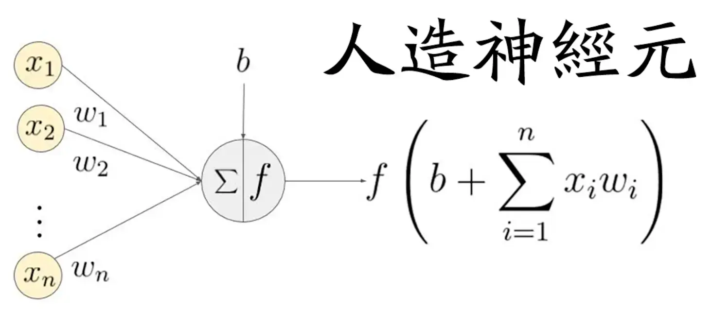


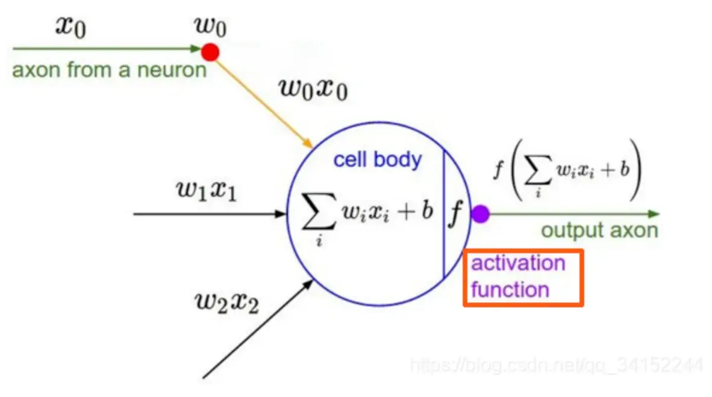

数学公式：
$$
y = f\left(\sum_{i=1}^{d} w_i x_i + b\right)
$$


f( sum( x*w) + b );
x代表输入的数据，w代表权重，sum代表求和，b代表偏差，f代表激活函数，最后这个公式运行的结果，就是机器学习的结果。
x维度(特性)： x代表输入的数据，生产环境中，x并非是单维度，而是多维度的，比如x1、x2、x3.....组成的矩阵，但无论是多维度还是单维度，计算公式用的还是一样的，每一个x对应一个权重w，所以是xn\*wn。比如猫的特征，比如形态、颜色、眼睛、叫声等等，作为多维度的输入特征x，喂给电脑，让电脑给出识别结果，这就是简单的机器学习处理分类问题。x参数特征并不是我们认为的单词或者汉字，而是一串单精度区间在0-1之间的浮点数字，也就是所谓的“向量”，因为只有数字才能套着神经元公式进行计算。

w权重：权重是指神经元接收到的输入值的重要性，这些输入值通过乘以对应的权重，被加权求和作为神经元的输入。权重值越大，表示该输入在神经元的输出中所占的比重越大。猫的所有特征的权重并不是统一的，比如黑夜里突然一个东西跳了出来，你怎么判断它是什么物种？很明显，一声“喵呜”我们就可以立刻断定这是一只猫，所以叫声特征的权重一定大于其他特征的权重。

b偏差(bias)：偏差通常是一个实数，与神经元的权重一样，也是通过训练神经网络而调整的参数。偏差的作用是在神经元的输入上增加一个常量，以调整神经元的激活阈值。如果没有偏差，网络生成的模型被迫从问题空间中的原点或点（ x=0， y=0 ）传递。偏差增加了灵活性，并允许对不满足此条件的数据集进行建模。

**激活函数**
激活函数通常具有非线性的特性，这使得神经网络能够拟合非线性的复杂函数，从而提高其性能和准确度。
如果没有激活函数，无论你的神经网络叠加了多少层（100 层还是 1000 层），整个网络数学上依然等价于一个单层的线性回归模型。
>引入激活函数是为了增加神经网络模型的非线性。没有激活函数的每层都相当于矩阵相乘。就算你叠加了若干层之后，无非还是个矩阵相乘罢了。


## 神经网络运算示例


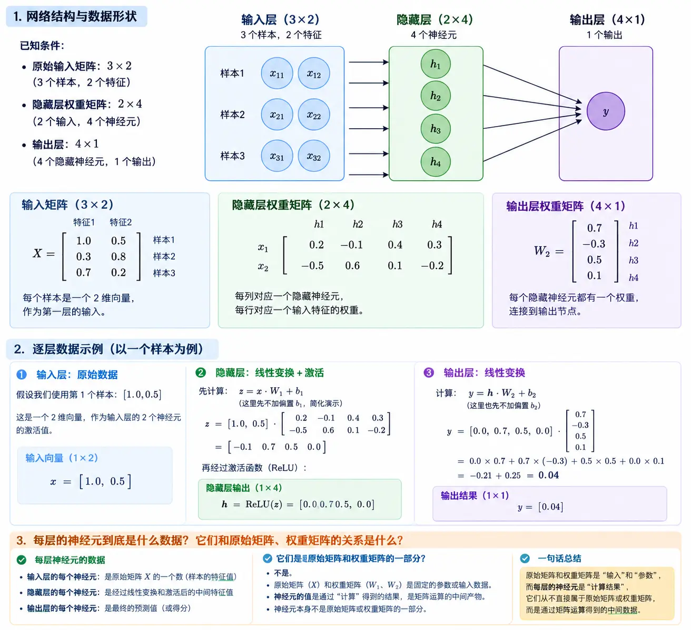
*神经网络计算过程图*
上图是chatgpt生成的，一些中间计算结果是错误的，我们只关注计算公式和流程即可；

**示例2**
原始数据X：3×2，隐藏层：权重W：2×4，XW(线性运算)：3×4；

$$\begin{bmatrix}100&1\\ 200&2 \\ 300 & 3\end{bmatrix}
\begin{bmatrix}0.1 & 1 & 10 & 100\\ 0.2 & 2 & 20 & 200 \end{bmatrix} = 
\begin{bmatrix} 10.2 & 102 & 1020 & 10200 \\ 20.4 & 204 & 2040 & 20400 \\ 30.6 & 306 & 3060 & 30600 \end{bmatrix}$$

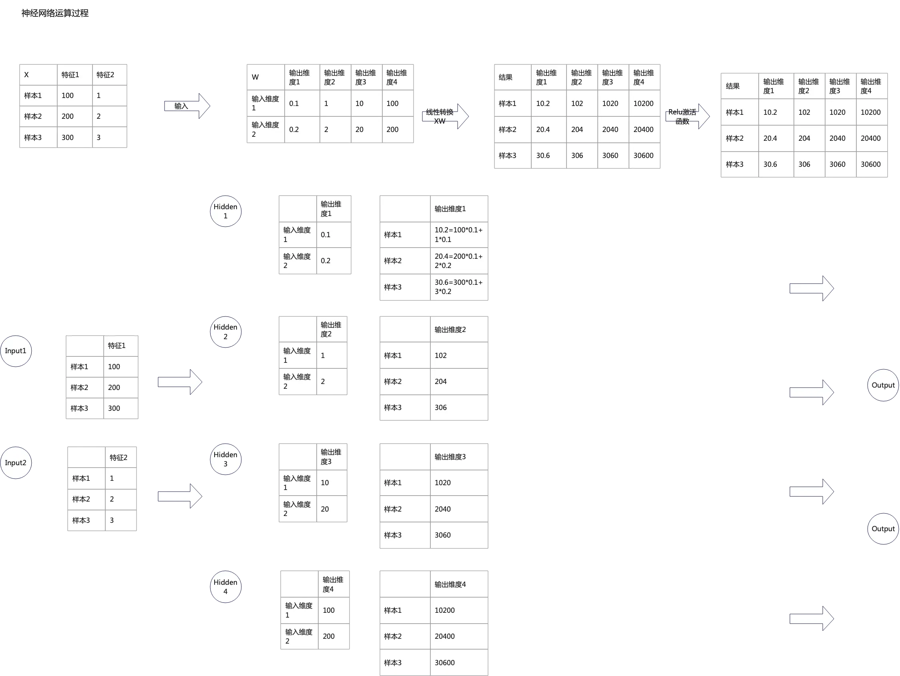

## 神经网络数学本质
神经网络的数学本质是一个高维复杂的**非线性复合函数**，它通过层层嵌套的矩阵运算和非线性变换，实现从输入空间到输出空间的映射与万能近似。

几何意义：多层神经网络就是在进行分段线性空间折叠与扭曲。通过“线性旋转/平移->非线性折叠”的反复交替，神经网络能够将原本复杂的非线性边界转化为可以被线性切分的空间状态，这就是接近万能拟合的几何本质。

1. **复合函数映射**
神经网络由多个基础层堆叠而成。数学上，整个网络就是把每一层的函数运算逐层套用：
$\mathbf{y}=f_{L}(f_{L-1}(\dots f_2(f_1(\mathbf{x}))))$
其中 $\mathbf{x}$ 是输入，$\mathbf{y}$ 是输出，$f_{i}$ 代表第 $i$ 层的数学变换。

2. **空间几何变换（流形弯曲与拉伸）**
单层网络的核心是 **线性变换（矩阵乘法 $\mathbf{W}$）** 加上**非线性激活函数**。
- 线性变换对数据空间进行旋转、缩放、平移。
>仿射变换（线性组合）：$z = Wx + b$ （负责旋转、平移和缩放空间）；它将上一层的特征进行加权组合，寻找新的观测角度。但如果只有线性变换，无论叠加多少层，最终都等价于单层矩阵乘法，无法解决复杂问题。
- 激活函数则将原本平直的坐标空间“扭曲”或“折叠”。
>激活函数（非线性映射）：$a = \sigma(z)$ （负责弯曲空间，打破线性限制）；它把原本纠缠在一起的非线性边界，通过“折叠”和“拉伸”空间，让它们在新的空间里变成直线或超平面

多层叠加后，原本在低维或复杂空间中无法被简单分开的数据（线性不可分），被一步步揉捏、展开，最终在输出层变得线性可分

3. **万能近似定理（Universal Approximation Theorem）**  
只要激活函数是非线性的，哪怕只有一个隐藏层、只要神经元足够多，神经网络就能以任意精度逼近任何连续函数。深度网络的本质，则是用“更深、更窄”的复合结构，以极少的参数量去高效逼近极其复杂的真实世界规律。
>这里面使用的是梯度下降和反向传播算法；梯度是一个偏导数向量，每个偏导数对应损失函数对最终影响损失计算的每个方程中各个变量的导数。换句话说，它描述了增加或减少任一神经元激活函数的输出会如何影响整体损失；进而，它也描述了这些输出所乘以的权重（或加在这些输出上的偏置项）发生任何变化时，损失会如何增减。

### 数学公式

训练神经网络时，单个神经元计算流程为： 
$z=\sum_{i=1}^n{w}_{i}{x}_{i}+b$
$a=\sigma(z)$
其中：
-  ${x}_{i}$ = 输入特征，
-  ${w}_{i}$ = 权重，
-  $b$ = 偏差，
-  $z$ = 加权和（线性转换），
-  $\sigma$ = 激活函数（非线性转换），
-  $a$ = 输出

此线性函数隐藏层和输出层都需要运算；激活函数隐藏层需要运算，输出层按需使用(如回归任务，预测房价就可以线性运算后输出一个实数就可以，不需要再经过激活函数运算)

### 链式法则（Chain Rule）

微积分中有一个基本定理：
> 如果函数 $f(x)$ 在点 $x$ 处可导，函数 $g(y)$ 在点 $y = f(x)$ 处可导，那么复合函数 $g(f(x))$ 在点 $x$ 处也可导，其导数为：
$$
(g \circ f)'(x) = g'(f(x)) \cdot f'(x)
$$

这就是**链式法则（Chain Rule）**。深度学习的整个反向传播，就是链式法则在**多层复合函数**上的反复应用。

### 神经网络可微推导

逐个环节检验可微性
让我们拆解神经网络的前向传播链条：
$$
\text{输入 } X \xrightarrow{\text{线性层（仿射）}} Z_1 = W_1X + b_1 \xrightarrow{\text{激活}} A_1 = \sigma(Z_1) \xrightarrow{\text{线性层}} Z_2 = W_2A_1 + b_2 \xrightarrow{\text{激活}} \cdots \xrightarrow{\text{损失函数}} \mathcal{L}
$$
现在检验每个环节的可微性：

| 环节 | 函数形式 | 是否可微？ | 备注 |
| --- | --- | --- | --- |
| **线性层** | $Z = WX + b$ | ✅ **全程可微** | 对 $W, X, b$ 的导数都是常数矩阵 |
| **激活函数** | ReLU: $\max(0, Z)$ | ⚠️ **几乎处处可微** | 在 $Z=0$ 处不可导，但该点测度为0，工程上定义其导数为0或1 |
| **激活函数** | Sigmoid: $1/(1+e^{-Z})$ | ✅ **全程可微** | 导数光滑连续 |
| **激活函数** | Tanh, Swish, GELU | ✅ **全程可微**（或几乎处处） | 现代平滑激活函数均满足 |
| **损失函数** | MSE: $(y - \hat{y})^2$ | ✅ **全程可微** | 导数 = $-2(y - \hat{y})$ |
| **损失函数** | 交叉熵: $-y\log\hat{y}$ | ✅ **全程可微**（定义域内） | 注意 $\hat{y} \in (0,1)$ 保证定义域安全 |

**关键结论**：链条中的每一个环节都是可微的（或仅在一个零测度集上不可导），根据链式法则，整个复合函数 $\mathcal{L}(X; W, b)$ 也是（几乎处处）可微的。

一句话总结：
因为线性变换、主流激活函数和损失函数都是（几乎处处）可微的，所以它们的复合函数也（几乎处处）可微。链式法则通过反向传播，将损失函数的梯度逐层回传，确保每个权重都能获得有效的更新信号。
ReLU在零点的不连续点在实际训练中几乎不会命中，即便命中了，工程实践上用次梯度(定义次梯度为0)处理也足以保证训练收敛。

### todo后续数学知识补充

神经网络多层能做到这么复杂的事情，想要完全理解需要数学和几何理论知识的进一步了解，下面是对应的知识点，有时间再深入了解。

缺失关键知识点：超平面、凸函数、分段线性函数；


|优先级|数学知识|在神经网络中的意义|
|---|---|---|
|⭐⭐⭐⭐⭐|点积|神经元如何感知方向|
|⭐⭐⭐⭐⭐|超平面|神经元产生的分割边界|
|⭐⭐⭐⭐⭐|半空间|ReLU 的开/关区域|
|⭐⭐⭐⭐⭐|矩阵/线性变换|特征空间如何变形|
|⭐⭐⭐⭐⭐|分段线性函数|ReLU 网络的基本函数|
|⭐⭐⭐⭐|凸几何|多个平面形成的区域|
|⭐⭐⭐⭐|链式法则|网络如何学习这些平面|

| 目标学科           | 核心学习知识点                                                       | 在神经网络中的几何/数学意义               |
| -------------- | ------------------------------------------------------------- | ---------------------------- |
| **1. 进阶线性代数**  | 仿射空间 (Affine Space)、超平面、正交投影、核与秩                              | 理解单层神经元在空间中的切割角度、位移与降维映射     |
| **2. 凸几何与多面体** | 凸集、半空间交集 ($\mathbf{A}\mathbf{x} \le \mathbf{b}$)、凸包、Voronoi 图 | 理解多平面切割出的区域几何边界，以及数据落入哪个区域   |
| **3. 组合几何与拓扑** | 超平面排列 (Hyperplane Arrangements)、分段线性拓扑 (PL Topology)          | 理解空间折叠后的拓扑结构变化（如将交错的数据解环/拉开） |
| **4. 微积分与实分析** | Sobolev 空间、弱导数 (Weak Derivatives)、Lipschitz 连续性               | 理解非光滑函数（折痕处不可微）的梯度的计算与表达能力上限 |
Zaslavsky 定理（超平面排列计数）
理解“多平面切割”表达能力的关键钥匙是Zaslavsky 定理

## 生物神经网络
人工神经网络（ANNs）的工作机制与大脑的工作机制并不是十分的相似。不过在我们了解为什么把激活函数应用在人工神经网络中之前，了解一下激活函数与生物神经网络的关联依然是十分有用的。一个典型神经元的物理结构由细胞体、向其他神经元发送信息的轴突以及从其他神经元接受信号或信息的树突组。

红色的圆圈表示两个神经元连接的区域。神经元通过树突从其他神经元中接受信号。树突的信号强度称为突触权值，用于与传入信号相乘。树突传出的信号在细胞体中累积，如果最后的信号强度超过了某个阈值，神经元就会允许轴突中的信息继续传递。否则，信号就会被阻止而得不到进一步的传播。激活函数决定了信号是否能够被通过。这个例子仅仅是个只有阈值这一个参数的简单的阶跃函数。现在，当我们学习了一些新东西（或者忘掉一些东西）时，阈值以及一些神经元的突触权重会发生改变。这在神经元中创造了新的连接从而使得大脑能学习到新的东西。让我们在人工神经元的基础上来再次理解相同的概念
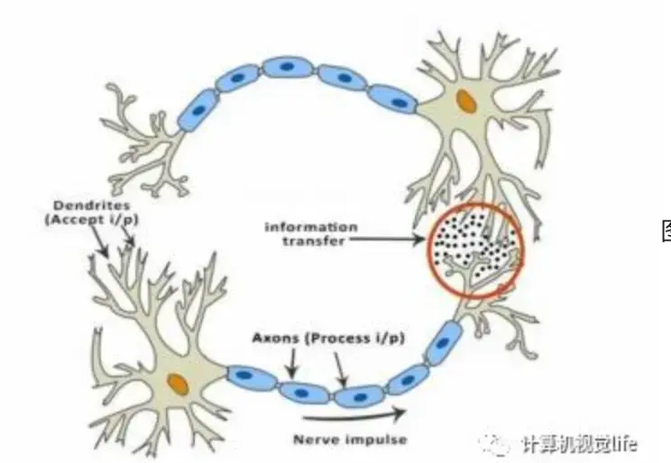


## 前向传播和反向传播

- **前向传播**：数据从输入层，经过隐藏层，最终到达输出层，并产生预测结果的过程。这是一个**推理**过程。
    >想象一下，你正在教一个孩子识别猫和狗。你给他看一张图片（输入），他根据自己大脑中已有的知识（网络参数，即权重和偏置）进行判断，然后告诉你这是猫（输出）。这个看图片 -> 大脑处理 -> 给出答案的过程，就是前向传播。

- **反向传播**：根据前向传播产生的预测结果与真实值之间的误差，从输出层开始，反向逐层计算每个参数（权重和偏置）对总误差的"贡献"大小（即梯度），并据此更新参数。这是一个**学习**过程。
    >但孩子的判断可能出错。你告诉他：不对，这是狗。这个正确答案与孩子答案之间的差异，就是误差。孩子需要根据这个误差，回头去反思：我大脑里的哪些知识（参数）导致了这次误判？我应该如何调整它们，下次才能认对？这个根据误差，从后往前调整知识的过程，就是反向传播。


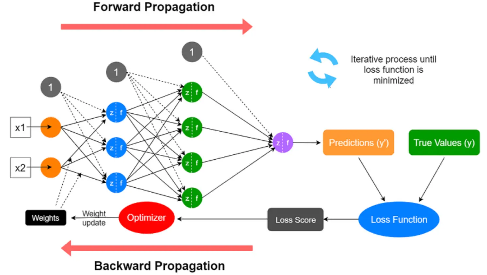


**两者交互流程**
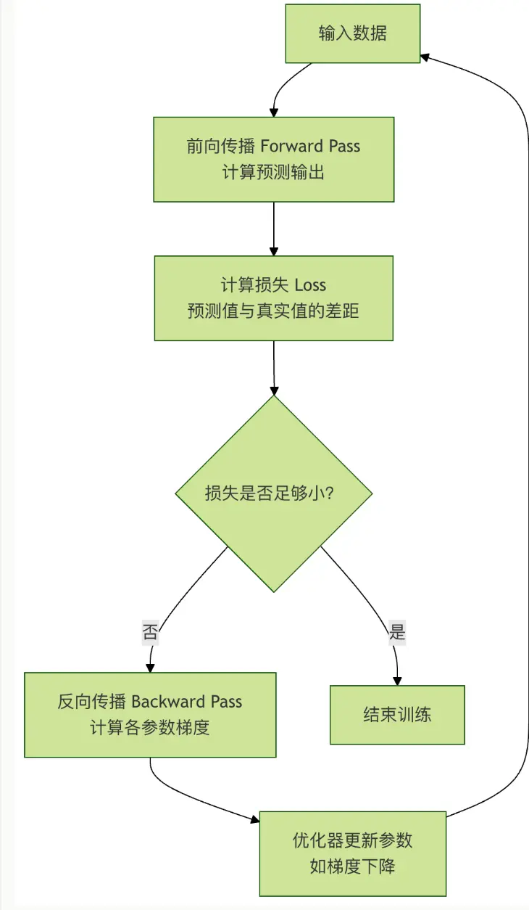


### 反向传播
反向传播(误差的向后传播)是深度学习的学习算法核心。其本质是链式法则在神经网络中的高效应用。目标是计算损失函数 L 对每个参数（w1, b1, w2, b2）的偏导数（梯度），即 ∂L/∂w1, ∂L/∂b1 等。这些梯度指明了为了减小损失，每个参数应该朝哪个方向、以多大的幅度调整。

有多层隐藏层，就对应进行多层梯度计算，再更具学利率，每层微调梯度，从新进入正向传播，检查损失值；重复直到收敛；


**链式法则**
链式法则（Chain Rule）是微积分中用于求复合函数导数的核心法则
链式法则的计算方法是：外层函数的导数乘以内层函数的导数。即可以通过求内层函数导数，一步步反向(向外)求导后续函数的导数，最终求导这个复核函数的偏导数；

能求得复合函数的偏导数后，就可以进行梯度计算，这也是深度学习的核心；

**一元函数链式法则**
假设 $y$ 且 $u$，构成复合函数 $y$。若 $f$ 和 $g$ 都可导，则 $y$ 对 $x$ 的导数为：
$\frac{dy}{dx}=\frac{dy}{du}\cdot \frac{du}{dx}$
或者写成函数形式：
$(f(g(x)))^{\prime }=f^{\prime }(g(x))\cdot g^{\prime }(x)$


## 神经网络类型

深度学习，作为机器学习的一个强大分支，其核心就是让计算机模拟这个过程，它通过构建多层的神经网络，让机器能够自动从海量数据中学习并提取复杂的特征，最终完成识别图像、理解语言、预测趋势等高级任务。而不同的任务，需要不同结构的网络来处理。本文将带你了解几种最核心、最常见的深度学习网络类型，理解它们的设计思想与典型应用。

| 名称                                                         | 核心作用                                                | 核心特性与重点                                                                                                   |
| :--------------------------------------------------------- | :-------------------------------------------------- | :-------------------------------------------------------------------------------------------------------- |
| 人工神经网络  <br>(ANN)  <br>(Artificial Neural Network)         | 基础的分类、回归及结构化数据处理。                                   | 特性：具备大规模并行处理、容错性、强联想功能及非线性建模能力。  <br>重点：采用前向传播计算误差与反向传播（BP）更新参数，是深度学习的基础。这是所有神经网络的总称和顶层概念                 |
| 卷积神经网络  <br>(CNN)  <br>(Convolutional Neural Network)      | 处理图像、视频等网格状数据，广泛用于图像分类、目标检测及语义分割。                   | 特性：具有平移不变性、参数高效、端到端学习能力强。  <br>重点：核心思想源于生物视觉皮层，通过局部连接和权值共享（卷积核）自动提取层级化特征，解决高维数据参数爆炸问题。                    |
| 循环神经网络  <br>(RNN)  <br>(Recurrent Neural Network)          | 处理时间序列和序列数据，如语音识别、机器翻译及文本生成。                        | 特性：具备记忆性、参数共享且图灵完备。  <br>重点：采用循环连接结构，通过隐藏状态在时间维度上传递信息，对动态序列的前后关联进行建模。                                     |
| 前馈神经网络(多层感知机)<br>(FNN/MLP)<br>(Feedforward Neural Network) | 主要发挥非线性模式识别和复杂函数逼近的作用。它能够自动学习特征，处理传统的线性模型无法解决的复杂问题。 | 特性：单向传播、逐层处理、通用近似<br>重点：是最简单的人工神经网络类型，其信息传递方向是单向的，内部没有循环回路                                                |
| 长短期记忆网络  <br>(LSTM)  <br>(Long Short-Term Memory)          | 解决长序列任务中的记忆衰减问题，适用于长文本、长时序数据预测。                     | 特性：记忆可控，能有效缓解梯度消失/爆炸问题。  <br>重点：引入输入门、遗忘门、输出门和细胞状态（记忆单元），通过门控机制自主筛选信息的保留与丢弃。                              |
| 门控循环单元  <br>(GRU)  <br>(Gated Recurrent Unit)              | 序列数据处理，适用于资源受限或实时性要求高的场景。                           | 特性：结构轻量、参数较少、计算效率更高。  <br>重点：作为LSTM的简化变体，将输入门和遗忘门合并为单一的更新门，在保持性能的同时大幅提升训练速度。                              |
| 生成对抗网络  <br>(GAN)  <br>(Generative Adversarial Network)    | 图像生成、图像修复、超分辨率及数据增强。                                | 特性：强大的生成能力，能合成逼真的新数据样本。  <br>重点：包含生成器和判别器，训练过程是一个“二元极小极大博弈”，两者相互竞争、交替更新，直至达到平衡。                           |
| 变换器  <br>(Transformer)  <br>(Transformer)                  | 自然语言处理（大语言模型）、计算机视觉及代码生成。                           | 特性：支持并行计算、长距离依赖建模、强大的上下文感知能力。  <br>重点：完全摒弃RNN/CNN结构，核心是自注意力机制（Self-Attention），能一次性并行处理整个序列并直接计算任意位置的关联权重。 |
| 自编码器  <br>(AE)  <br>(Autoencoder)                          | 数据压缩、特征提取、图像去噪及异常检测。                                | 特性：无监督学习（自我监督），能自动发现数据中的隐藏模式。  <br>重点：由编码器和解码器组成，通过降维将输入数据压缩到潜在空间，再尽可能准确地重建原始输入。                          |
| 变分自编码器  <br>(VAE)  <br>(Variational Autoencoder)           | 生成与训练数据相似的新样本，支持潜在空间平滑插值。                           | 特性：概率生成模型，潜在空间具有连续性和结构化特点。  <br>重点：不同于AE的固定离散表示，VAE对潜在变量进行连续概率分布编码（输出均值和方差），通过变分推理和重新参数化技巧生成新数据。          |
| 深度信念网络  <br>(DBN)  <br>(Deep Belief Network)               | 早期的无监督特征学习和模型参数初始化。                                 | 特性：概率生成模型，具备强大的特征学习能力。  <br>重点：由多层受限玻尔兹曼机（RBM）堆叠而成，通过逐层贪婪训练，有效解决了深层网络难以训练的问题。                             |
| 图神经网络  <br>(GNN)  <br>(Graph Neural Network)               | 处理社交网络、推荐系统及分子结构等图结构数据。                             | 特性：擅长捕捉实体间的复杂拓扑关系。  <br>重点：专门处理非欧几里得数据，通过节点间的“消息传递”机制，聚合邻居节点信息来更新当前节点的表示。                                 |

## FNN(前馈神经网络)
前馈神经网络（Feedforward Neural Network, FNN），也叫多层感知机（MLP），是最基础、最经典的人工神经网络结构。它的名字揭示了其核心特征：
前馈 ：信息从输入层开始，逐层向前传递，最终到达输出层，整个过程没有回头路 ——没有循环连接，也不存在层间的反馈回路。就像一条单向流水线，每个环节只处理上游传来的结果，然后交给下游。
>全连接神经网络（Fully Connected Network，简称 FCN 或 MLP）属于FNN 的一种最常见形式

你可以把它想象成一个多层的信息处理流水线 ：
- 输入层 ：原材料（原始数据，如图像的像素值、文本的词向量）。
- 隐藏层 ：多道加工工序，每道工序（神经元）对输入进行加权求和、加上偏置，再通过一个激活函数（如ReLU）进行非线性变换，提取出更高层的特征。
- 输出层 ：最终产品，输出任务的预测结果（如图片属于猫的概率）。

**作用**
- 作为独立的分类/回归模型
- 特征提取与维度变换
  >通过调整隐藏层的神经元数量，前馈网络可以灵活地升维或降维。


**总结**
优点 ：简单、灵活、万能近似（理论上足够深的前馈网络可以拟合任何函数）。 缺点 ：参数多、对输入维度敏感、无法直接处理序列或空间结构。

前馈网络 = 多层全连接层 + 非线性激活函数，信息单向传递。
- 作用 ：独立模型、复杂模型的组成部分、特征提取与维度变换。
- 使用方式 ：在PyTorch/TensorFlow中通过堆叠层`nn.Linear`实现，搭配激活函数和优化器训练。

## RNN(循环神经网络)
RNN（循环神经网络）是专门用于处理“序列数据”的神经网络。它通过“循环连接”在内部维护一个持续更新的“状态向量”，从而让模型具备对历史信息的记忆能力。

RNN 的出现，解决了传统神经网络（全连接、CNN）无法处理“变长序列”和“前后依赖”的痛点。

RNN 的**工作原理**是将接收到的顺序数据逐步传递给隐藏层。但是，RNN 还有一个自循环或循环的工作流程：隐藏层可以在短期记忆组件中记住之前的输入并使用这些输入进行未来的预测。它使用当前输入和存储的记忆来预测下一个序列。 
>例如，考虑以下序列：_Apple is red。_您想让 RNN 在接收输入序列 _Apple is_ 时预测 _red_。当隐藏层处理 _Apple_ 一词时，会在记忆中存储一份副本。随后，当接收到 _is_ 一词时，它会从记忆中调取 _Apple_，并根据上下文理解完整序列：_Apple is_。然后，它可以预测 _red_ 以提高准确性。这使得 RNN 在语音识别、机器翻译和其他语言建模任务中颇为有用。

**特性**
- 时间步长(输入序列长度)：时间步数完全由你的输入数据长度决定；RNN的时间步长（序列长度）通常在 50 ~ 500 之间，极少超过 1000。
>时间步长：理论上代表了模型能够“回溯”的最远物理距离，实际上真正能被模型有效记忆的，往往只有最近的一二十步。算法的缘故，历史信息衰减程度是指数级的；

- 输入格式：在逻辑上确实是“多个按顺序排列的 One-hot 向量”；但在计算机运算时，被优化为“多个按顺序排列的 Token ID”。每个 ID 一进入嵌入层，就立刻被映射为密集向量，再送入 RNN 循环体进行计算。如一个句子 = 一个向量序列。如果句子有 10 个字，RNN 就会依次接收 10 个向量；向量序列 \[\[...], \[...], \[...]]
- 循环连接（状态传递）。普通网络层与层之间是“前馈”的（只往前传），而 RNN 的隐藏层有一条指向自己的回路。这条回路使得当前时刻的输出，会成为下一时刻的输入之一。这是 RNN 拥有“记忆”的物理基础。
- 网络结构：RNN的结构跟FNN或一般神经网络没什么区别，主要在同一层上，可以循环重复根据当前输入和历史信息(上下文语义信息)进行计算；
- 梯度消失或爆炸：RNN存在长期依赖的问题，并且由于反向传播的过程中存在梯度消失或者爆炸的问题，简单的RNN很难建模长距离的依赖关系。
- 变长处理（灵活输入）：RNN 天然支持不同长度的输入序列。处理 5 个字的句子和处理 50 个字的句子，用的是同一个网络结构，只是循环的次数不同。

**RNN劣势**
1.会出现“遗忘”的现象，无法支持长时间序列，虽然LSTM在一定程度上缓解了这种现象，但是这种缺陷仍然存在；
2.句子越靠后的token对结果的影响越大；
3.只能利用上文信息，不能获取下文信息；就不能并行就行训练；
4.计算的时间复杂度比较高，循环网络是一个token一个token的输入的，也就是句子有多长就要循环多少遍；

### RNN核心思想
循环连接 + 权重共享
- 数学本质：$h_t = f(W_hh · h_{t-1} + W_xh · x_t)$；
- 关键优势：处理变长序列，具有记忆能力
- 主要问题：梯度消失/爆炸，训练困难
- 发展方向：LSTM → GRU → Transformer

隐藏层状态数学公式：$h_{t}=\sigma (W_{hh}h_{t-1}+W_{xh}x_{t}+b_{h})$或简写为为：$h_{t}=\tanh (Wh_{t-1}+Ux_{t}+b)$
 >$x_{t}$：时间步 t 的输入向量。
 >$h_{t}$：时间步 t 的隐藏状态（当前信息+历史信息/记忆）。
 >$h_{t-1}$：上一个时间步 t-1 的隐藏状态(历史信息/记忆)。
 >$W_{hh}$ / W：隐藏层到隐藏层的权重矩阵（连接前一步的历史信息）。负责将上一个时间步的隐藏状态 $h_{t-1}$ 进行线性变换，带入到当前时间步。这是 RNN 能够“记住”过去、处理序列数据的关键所在，体现了时间演化的关系。
 >$W_{xh}$ / U：输入到隐藏层的权重矩阵。
 >$b_{h}$ / b：偏置项（Bias）。
 >σ / $\tanh$：非线性激活函数（常用 $\tanh$ 或 ReLU、Sigmoid）。

输出层（Output）数学公式：$y_{t}=\text{softmax}(W_{hy}h_{t}+b_{y})$；在时间步 t 时，模型的输出 $y_{t}$ 通常基于当前的隐藏状态 $h_{t}$ 计算得出
>$y_{t}$：时间步 t 的最终输出预测值。
>$W_{hy}$：隐藏层到输出层的权重矩阵。
>$b_{y}$：输出层的偏置项。
>softmax：分类任务常用的激活函数（若为回归任务则可能不用激活函数或使用恒等映射）。

>RNN三类权重系数 $W_{hx}$、$W_{hh}$ 、$W_{hy}$ 在整个时间步是共享这3组权重的。无论序列有多长，每一个时间步使用的都是同一套 $W_{hx}$、$W_{hh}$ 和 $W_{hy}$

输入层：RNN通过输入文本->token化->Embedding映射查找词向量；Embedding不是“词的权重”，而是“词在向量空间中的数学表示”；从模型实现角度，它又是一组可训练参数。训练时是变量，通过 Loss 和梯度不断调整；训练完成后作为模型参数固定下来，在推理时可以看作常量。


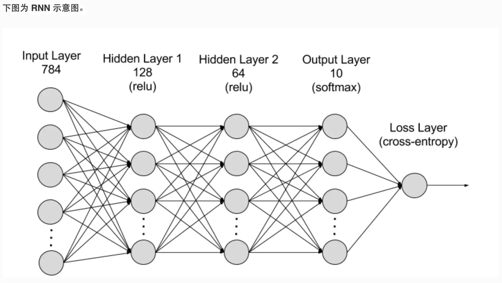
跟普通FNN结构类似，只是同一层在不同时刻上会循环重复计算；

同一个网络，不同时刻的快照；
>不同时刻的隐藏层，还是同一层；只是不同时刻同一层进行循环重复运算；简单来说：当前时刻的输入是上一时刻的历史信息输出+当前输入值；
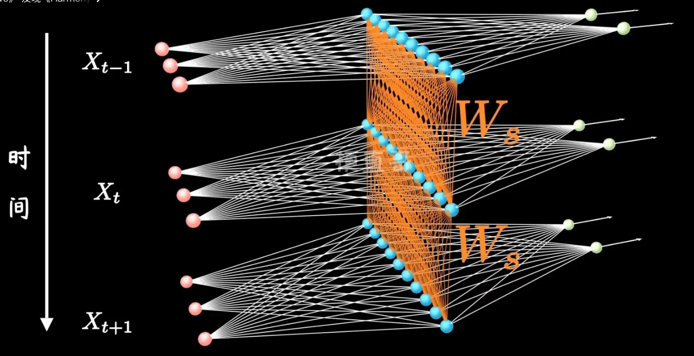


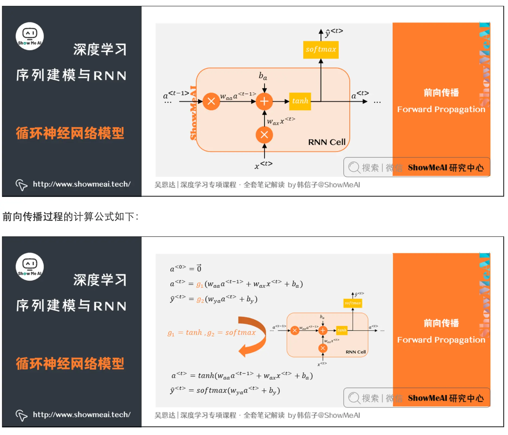

### 不同模式的RNN以及作用
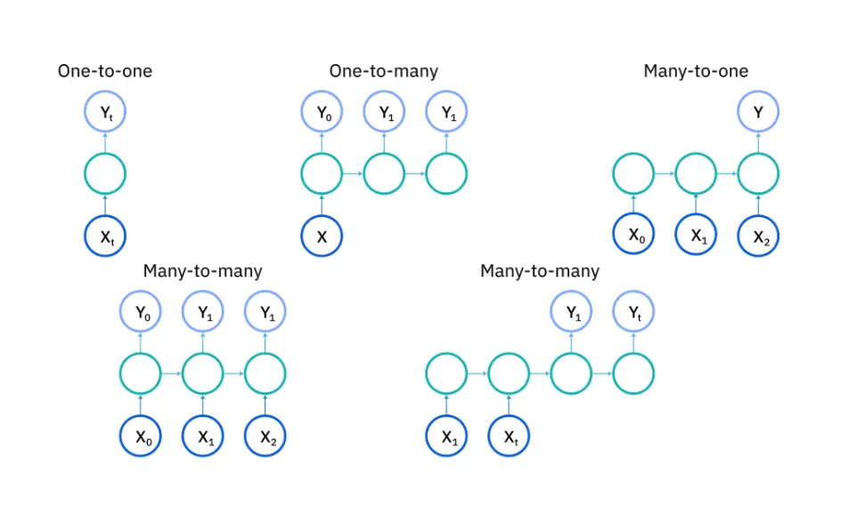

|模式|结构|应用场景|
|---|---|---|
|**一对一**|单输入→单输出|传统神经网络|
|**多对一**|多输入→单输出|情感分类、文本分类|
|**一对多**|单输入→多输出|图像描述生成|
|**多对多（同步）**|多输入→多输出|词性标注|
|**多对多（异步）**|多输入→多输出|机器翻译（Encoder-Decoder）|


https://www.showmeai.tech/article-detail/225 深度学习教程 | 序列模型与RNN网络
https://zhuanlan.zhihu.com/p/52119092 NLP中的RNN、Seq2Seq与attention注意力机制


### RNN架构

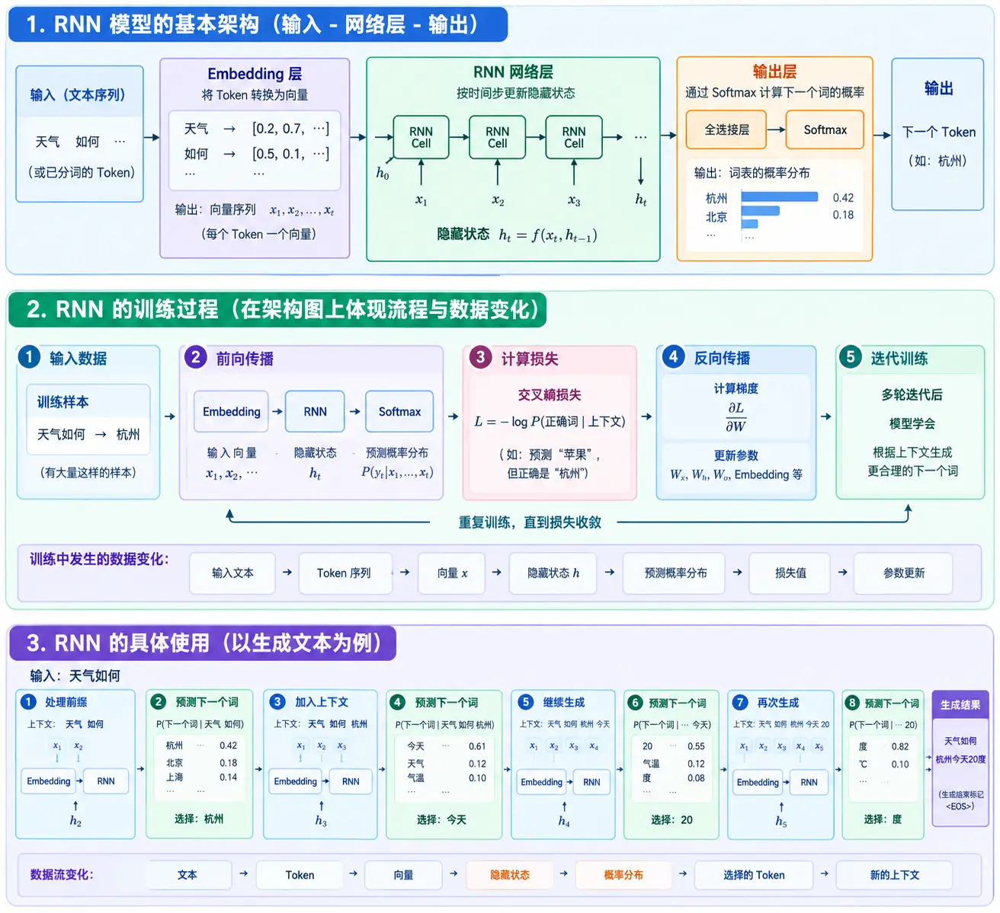


**RNN网络结构**
跟普通FNN结构类似，只是隐藏层在不同时刻上有回路能循环重复计算(这也是RNN拥有记忆，理解上下文语义的核心关键)；


**隐藏层的不同时刻快照**

不同时刻的隐藏层，还是同一层；只是不同时刻同一层进行循环重复运算；简单来说：当前时刻的输入是上一时刻的历史信息输出+当前输入值；


### 训练过程

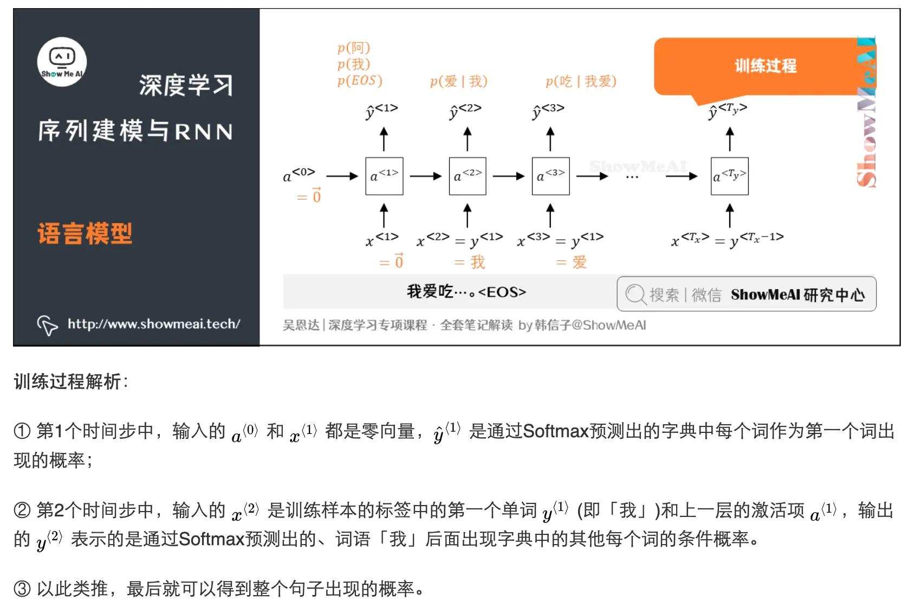

**RNN 训练流程**
RNN 的训练采用随时间反向传播（BPTT, Backpropagation Through Time）算法。为了计算梯度，RNN 会在时间轴上“展开”，将循环结构转换为链式结构。
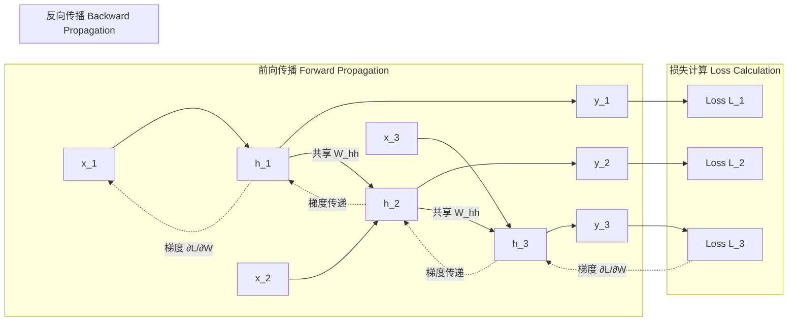


**RNN大数据多轮次小批量训练流程**
```
数据池（1M条文本，打乱顺序）
    ↓
第1批（32条随机文本）→ RNN计算损失 → 梯度下降 → 参数微调（Step 1）
    ↓
第2批（新的32条随机文本）→ 基于Step1的参数计算损失 → 再次微调（Step 2）
    ↓
参数中关于“第1批”的信息被略微冲淡，但与“第2批”融合成了更通用的规律
    ↓
... 重复几万步，完成第一轮；如果损失没有收敛，继续重新打乱数据池，开始第2轮训练；直到第n轮次，损失收敛为止 ...
    ↓
最终参数不再记得“第1批的具体文字”，但掌握了“人类语言通识”
```

>RNN 是一段一段（按批次）训练的。参数每一小步都会变动，后一段文字必然会冲刷掉前一段文字的“记忆痕迹”。
>但训练的目的本来就不是“背诵”前一段文字，而是“忘掉具体案例，记住抽象规律”。只要通过海量数据、随机打乱、极低学习率，模型最后学到的就是所有段落的“最大公约数”——也就是语言本身。
>训练方式：小批量随机梯度下降
>参数更新评率：一个批次数据训练，针对损失函数只更新一次参数，损失值降低微乎其微；
>整个训练过程依赖“海量迭代次数”（几十万到上百万步）来积累微小的改进。


### 生成文本流程
任务场景：输入提示词 "天气如何"，自回归（Autoregressively）生成后续文本 "杭州20度"。

生成文本流程就是：
$$\boxed{ \text{已有上下文} \rightarrow \text{RNN} \rightarrow \text{下一个Token概率} \rightarrow \text{选择Token} \rightarrow \text{加入上下文} \rightarrow \text{下一轮} }$$

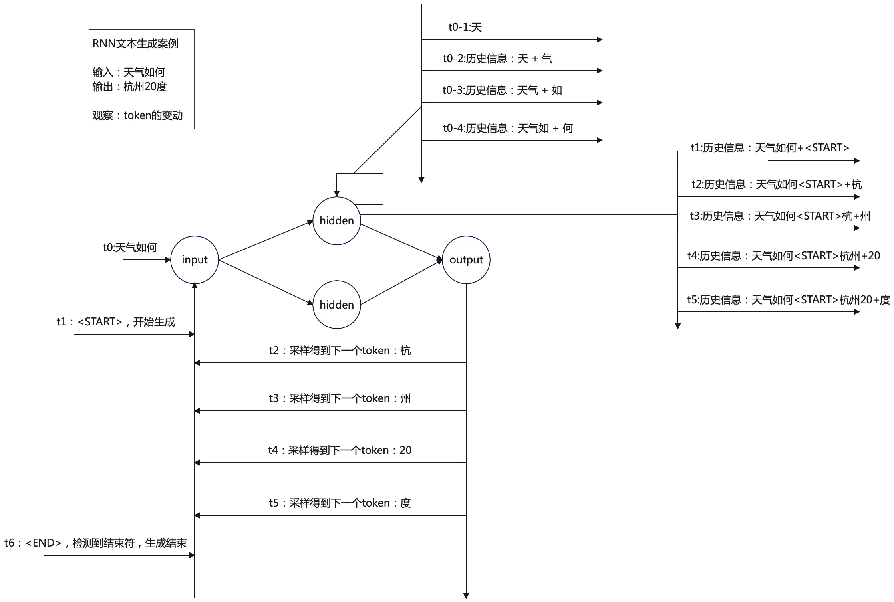
*Token变动图*

| 图表达的内容                         | 对应的技术术语                      |
| ------------------------------ | ---------------------------- |
| t0-1 到 t0-4：只有箭头流入 Hidden，没有输出 | **编码器（Encoder）阶段**           |
| t1 注入 `<START>`                | **解码器（Decoder）启动**           |
| t1 到 t5：箭头循环流动并不断输出            | **自回归（Autoregressive）生成**    |
| t6 输出 `<END>`                  | **停止条件（Stopping Criterion）** |

>注意：图中的所有token中文字，都是一个个中文->token->向量；图中的历史信息是累加的，看起来是越来越长，实际上累加的内容，也是一个向量结果，跟一个token向量长度是一样的，只是累加的这一个向量包含了上下文语义信息了；
>历史信息这个向量：相当于把旧状态里的信息"压缩"了一点，再让出一部分空间给新信息，但是尽量保留当前上下文的核心语义；当句子非常长（比如 500 个词）时，最早的"天"的信息，在经历了 500 次乘法和压缩后，会被稀释到几乎消失。为了解决这个问题才有了 LSTM 和 Transformer 来弥补这个短板。
>采样：LLM跟采用相关参数如：Temperature 、Top-K 、Top-P；选择下一个词的概率选择策略；采用概率最大或具有一定随机创造性；

### 翻译中的RNN使用

RNN翻译最经典的方案：Encoder-Decoder（编码器-解码器），也叫Seq2Seq模型
它由两个独立的 RNN 组成：
- Encoder（编码器）RNN：负责“阅读理解”。
  >它的任务不是“预测下一个词”，而是“把输入句子的语义压进最后一个隐藏状态 $h_t$”。不输出任何文字，只留下一个 $h_{final}$（包含完整语义的向量），传给Decoder进行翻译；
- Decoder（解码器）RNN：负责“逐词生成翻译”。

>关键点：Encoder 和 Decoder 是两个不同的 RNN，它们各自有自己的权重矩阵（虽然可以部分共享参数）。Encoder 负责“理解”，Decoder 负责“生成”。翻译的质量取决于 h_final 能否完美压缩整句源语言的信息。


训练时：两个 RNN 同时训练。Encoder 负责压缩源句子，Decoder 负责展开目标句子。损失函数计算 Decoder 输出与目标译文的差距，这个误差会同时反向传播更新 Decoder 和 Encoder 的参数。
>翻译能力来自训练时见过大量中英对照的语料
>损失计算：在Decoder阶段，第一步：输入 \<START>，期望输出 "What"，第二步：输入 "What"，期望输出 "is"，..直到\<END>;每一步都计算交叉熵损失，累积成总损失。


推理时：Encoder 先处理完整源句子，把 h_final 传给 Decoder，然后 Decoder 自回归地生成翻译，直到 \<END>。


## 残差连接
残差连接(Residual Connection)的数学原理核心是通过残差映射和恒等映射的结合，解决深度神经网络训练中的梯度消失问题。其本质是将传统的网络层学习任务从直接拟合目标函数 $H(x)$ 转变为学习残差 $F(x)=H(x)-x$，从而保证梯度在深层网络中能够有效传播。
>又称跳跃连接 Skip Connection：一种将某一层的输入直接“跳过”中间的计算层，并与中间层的输出相加合并的技术

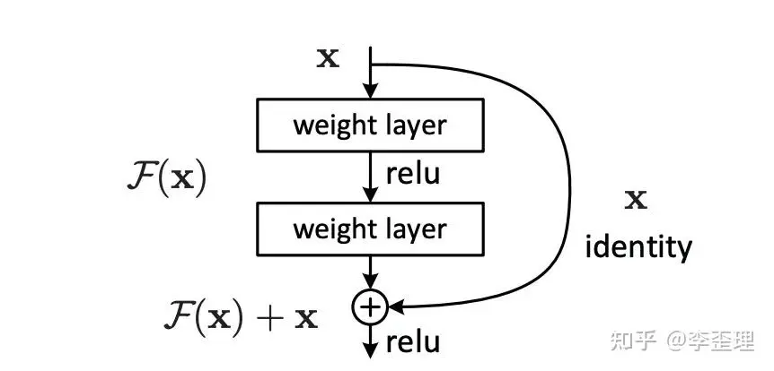

**核心原理与作用**
- 数学本质：将网络的学习目标从直接拟合完整映射 H(x)，简化为学习输入与输出的差异（即残差）F(x) = H(x) - x 
- 缓解梯度消失：反向传播时，恒等映射项保证了梯度可以不经过复杂非线性变换直接回传到浅层，使深度网络（如ResNet、Transformer）能够顺利训练到上百甚至上千层
- 解决退化问题：当深层网络已经达到最优时，新增的子网络如果难以学习有效特征，可以退化为 F(x) ≈ 0，从而保证输出 y ≈ x，网络性能不会随着深度增加而下降
- 平滑损失地形：残差连接引入的线性分量有效抑制了深度非线性叠加带来的剧烈震荡，让损失函数（Loss Landscape）的几何形状变得更平坦，优化器更容易收敛

>残差映射：将学习任务简化为拟合输入与输出的差异，降低学习难度
>恒等映射：通过直接传递输入，保证梯度在深层网络中不消失
>递归展开：深层网络的输出是所有残差块的叠加，保留了各层的特征贡献

**应用场景**
- 残差网络（ResNet）：图像识别，通过残差块彻底打通了构建超深卷积神经网络的瓶颈。
- Transformer 架构：自然语言处理，广泛应用于 BERT、GPT 系列、LLaMA 等大语言模型中，作为连接自注意力层和前馈网络层的基础结构

https://zhuanlan.zhihu.com/p/1992918095468188119 残差链接（Residual Connection）

## QA
### Q神经网络的能力边界
A
- “拟合规则”不等同于“逻辑推理”：**神经网络本质上是基于概率与统计的插值拟合**。如果新数据完全超出了训练分布（Out-of-Distribution, OOD），神经网络的泛化和推断能力会大幅下降（即它本质上擅长“插值”，不擅长“外推”）。
- 数据与算力依赖：理论上的万能拟合要求参数量和数据量足够大。如果数据量极小，简单模型（如 SVM、高斯过程、甚至简单的多项式/树模型）往往比神经网络效果更好且不易过拟合。
- 可微与梯度可达：神经网络寻找规则依赖于“反向传播（Backpropagation）与梯度下降”，这意味着问题必须能够被设计成可微的损失函数（或者能通过强化学习转换为概率梯度优化）。
### QRNN是Token串行计算吗
A
- 从数学逻辑上看：RNN 是一个个 Token 按顺序进入的。
- 从工程代码上看：你是一次性把整个句子（甚至整个批次）传进去的。
- 从底层硬件上看：虽然 GPU 在批量维度（多个句子同时）上是并行的，但在时间维度（一个句子内部的各个位置）上依然是串行的。**串行原因**：虽然传给 RNN 层的是一个矩阵，但底层实现中，h₂ 的运算必须等 h₁ 的结果出来才能开始。GPU 无法同时计算 h₁ 和 h₂，因为 h₂ **依赖** h₁

RNN，在一个长序列输入的时候，计算量比较大，后续一个一个生成->输入->生成，计算量就比较小，而且是固定单个token了。
- **RNN 时代**：由于生成阶段计算量小，RNN 在实时翻译、语音识别等低延迟场景中表现优异。
- **Transformer 时代**：虽然 Transformer 生成阶段计算量更大，但通过 **KV Cache**（键值缓存）技术，它能够在生成时复用之前计算的 Key 和 Value，从而把每步的复杂度从 $O(T^2)$ 降为 $O(T)$，大幅提升生成速度。


## 参考
https://www.runoob.com/ml/ml-forward-and-backward-propagation.html 深度学习
https://playground.tensorflow.org/ 神经网络可视化操作
https://luxiangdong.com/2024/04/10/math/ 【翻译】神经网络背后的数学原理
http://staff.ustc.edu.cn/~lgliu/Resources/DL/What_is_DeepLearning.html 什么是深度学习(深度解读的文章，需要花时间仔细了解)
https://www.ibm.com/cn-zh/think/topics/neural-networks#741977106 什么是神经网络
https://zhuanlan.zhihu.com/p/105614160 神经网络隐藏层揭秘
https://cloud.tencent.com/developer/article/1971648 神经网络的第一性原理
https://zhuanlan.zhihu.com/p/421374471 深度学习之神经网络（ANN/FNN/MLP）
