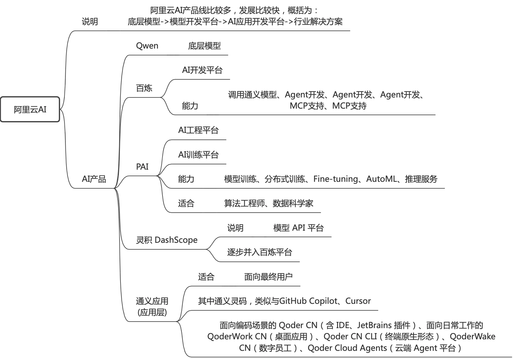

## 说明
通过阿里云AI平台，来看看AI应用如何创建，项目如何集成；

阿里云百炼是一站式大模型开发与应用平台，集成千问及主流第三方模型。面向开发者提供兼容 OpenAI 的API和全链路模型服务；面向业务人员提供可视化应用构建能力，可快速创建智能体、知识库问答等 AI 应用。

特点：
开发方式：自然语言配置（零代码）
核心特点：AI 自主决策、动态规划
由大模型根据提示词自主规划任务步骤
适合人群：业务人员、产品经理、运营

## 阿里云AI产品体系



## 创建一个智能体


### 背景说明
想要创建一个个人知识库智能体，可以集成到项目中，也可以web直接使用；


### AI智能体应用创建

通过阿里云AI平台(百炼平台)：https://bailian.console.aliyun.com/，创建一个知识库笔记AI助手的流程。

**流程**
apikey的创建->AI应用创建(个人知识库智能体)->模型选择:Qwen-Plus-Latest->提示词prompt设置->私有知识库创建(把私有知识库资料上传，md、excel等格式，也支持db等数据源)->关联知识库->发布

上述设置流程完成后，已经有了AI应用：个人知识库智能体，可以直接打开下面地址进行使用：
https://bailian.console.aliyun.com/cn-beijing?&tab=app&scm=20140722.S_%E7%99%BE%E7%82%BCprompt._.RL_%E7%99%BE%E7%82%BCprompt-LOC_aillm-OR_chat-V_3-RC_llm#/app-center/assistant/acdf491b3ed148c4966dc359f6a72cb8


**AI智能体应用创建**


**知识库创建**


**私有知识库内容上传**
其实也是【数据连接】的一种：文件连接器；还支持mysql，oss等；


### 项目中接入
在AI应用创建发布后，可通过发布渠道，来接入此AI应用。
使用阿里云的DashScope SDK，关联应用appid和apikey，即可在自己的项目中集成【个人知识库智能体】


```java
    public static void appCall()  
            throws ApiException, NoApiKeyException, InputRequiredException {  
        ApplicationParam param = ApplicationParam.builder()  
                // 若没有配置环境变量，可用百炼API Key将下行替换为：.apiKey("sk-xxx")。但不建议在生产环境中直接将API Key硬编码到代码中，以减少API Key泄露风险。  
//                .apiKey(System.getenv("DASHSCOPE_API_KEY"))  
                .apiKey("apikey")  
                .appId("appid")  
                .prompt("个人blog仓库介绍")  
                .build();  
  
        Application application = new Application();  
        ApplicationResult result = application.call(param);  
        System.out.printf("内容生成中请耐心等待...");  
        System.out.printf("text: %s\n",  
                result.getOutput().getText());  
    }
```


### web页面集成
在AI应用创建完成后，我们如果想要通过web来直接访问或集成到公司的网页中，需要进行如下设置：
https://appflow.console.aliyun.com/ ->AI助手->创建AI助手->页面设置->关联阿里云百炼模型(关联AI应用:个人知识库智能体，关联私有知识库)->集成->web页面集成。


即可通过https://1028158823340282.appflow.aliyunnest.com/webhook/home/b271bff17c807329509bcc08c8d63de274f167ba5bddf916439ec73d4d7091ef9d9408c046198868f7/index，来访问；
也可按页面中的内容，嵌入到公司网页中；

**自定义域名访问流程**
如果配置了自定义域名，访问链路可以概括为：用户访问自定义域名 -> DNS 解析到阿里云 AppFlow 域名 -> 请求被路由至 AI 助手页面。

**参考**
[在网站上增加一个AI助手](https://help.aliyun.com/zh/model-studio/add-an-ai-assistant-to-your-website-in-10-minutes?spm=a2c4g.11186623.help-menu-2400256.d_1_14_0.3db52c58fFHVFL&scm=20140722.H_2833529._.OR_help-T_cn~zh-V_1)


### 评测

大模型评测是一种基于应用维度评估应用效果的方法，通过针对特定业务场景来构建评测集，并对应用的回答进行自动/人工分析与评分，产出评测报告。


评测任务是应用评测的核心功能，用于对应用的输出质量进行系统化评估。支持智能体应用和工作流应用的评测，可结合自动评估器和人工标签进行多维度评价。
使用说明：
[https://bailian.console.aliyun.com/cn-beijing?tab=doc&scm=20140722.S_%E7%99%BE%E7%82%BCprompt._.RL_%E7%99%BE%E7%82%BCprompt-LOC_aillm-OR_chat-V_3-RC_llm#/doc/?type=app&url=3016254](https://bailian.console.aliyun.com/cn-beijing?tab=doc&scm=20140722.S_%E7%99%BE%E7%82%BCprompt._.RL_%E7%99%BE%E7%82%BCprompt-LOC_aillm-OR_chat-V_3-RC_llm#/doc/?type=app&url=3016254)


#### 操作流程

创建评测任务->关联评测数据集(包括问题，正确答案等内容)->数据集与评估器关联(字段映射，用于自动化评估结果，二选一)->添加标签(二选一)->自动运行评测任务->观察评测结果->人工标签(是否手动通过/不通过，备注内容)；


#### 评测数据集


#### 评估器
评估器用在自动评估应用输出质量；

设置：主要是评估器的prompt设置，评估任务中的数据集字段与评估器中字段的映射(问题、答案...等的映射)，以满足后续自动化结果评定；


评估器：关联评测集中的问题和答案后，评测任务会自动对评测的每条结果进行结果判断；
标签：设置标签后，需要手动给每条评测结果标注，结果是通过或者不通过


**内置的字段**

| **评估器参数** | **映射到**        | **说明**                 |
| --------- | -------------- | ---------------------- |
| query     | 评测集字段：question | 从评测集的question字段获取用户问题  |
| reference | 评测集字段：标准答案     | 从评测集的"标准答案"字段获取参考答案    |
| response  | 模型输出或评测集字段     | 从应用的实际输出或评测集的字段获取待评估内容 |
| context   | 上下文            | 上下文                    |

**评估器prompt**
此prompt定位于评测员，用于评估结果的判断；

```shell
您是一位专业的AI评估员。
您的任务是xxx。

**输出格式要求**：请务必以 JSON 格式输出评估结果，例如：`{"score": 5, "reason": "准确且简洁。"}`。**必须包含 score 字段**，系统将解析该 JSON 结构，若格式不正确或缺少 score 字段将导致评测失败。

<评分标准>

</评分标准>  


<评估步骤>  

</评估步骤>  


<注意事项>  

</注意事项>  


<评分量表>  

</评分量表>  


<查询>  
${query}  
</查询>  

<上下文（可选）>  
${context}  
</上下文>  

<参考回复>  
${reference}
</参考回复>  

<回复>  
${response}  
</回复>  

<参考示例>  
示例1：  
查询：“法国的首都是什么？”  
回复：“巴黎。”  
评估：{"score": 5, "reason": "准确且简洁。"}  
</参考示例>
```


#### 标签
评测中的标签用于评测结果进行人工打标，判断每条评测内容通过/不通过，备注信息；

类型说明：分类(命中分类代表通过/不通过)，boolean(通过/不通过)，数字(阈值判断通过/不通过)，文本(相当于备注)


#### 评估器和标签如何配合使用

评估器用于自动评分，适合有明确规则或标准答案的评测维度。标签用于人工标注，适合需要主观判断的评测维度。在同一个评测任务中，您可以同时使用评估器进行自动评分，并添加标签进行人工补充标注，实现全面的评测覆盖。


#### 评估器的提示词和应用的提示词区别

- 应用的提示词（生产阶段）
它是智能体或工作流应用的“灵魂”。主要用于定义应用在面对真实用户时的角色、任务、执行步骤、能力边界以及输出风格19。它的核心目标是生成高质量、符合业务需求的回复内容（例如：扮演手机导购推荐手机、扮演心理助手提供情绪陪伴）。

- 评估器的提示词（质检阶段）
它是评测体系的“裁判”。主要用于在应用生成回复后，对输出结果进行打分和评判。它的核心目标不是生成内容，而是评估当前生成的答案是否充分、是否准确、是否符合预设的规范（例如：判断答案是否解决了用户问题，或者是否遗漏了关键信息）。


`注意：实际使用的时候，在页面上来看，没看到根据评估器根据prompt输出的完整结果。只有类似通过 100分`


#### 效果图

评测任务创建


关联评估器


评测结果明细


评测结果统计


评测结果进行标注


### 总结

通过阿里云平台，0代码创建了一个智能体应用，并且使用了私有的知识库内容，来增强智能体应用，使AI回答的答案更符合实际要求。另外也演示了AI智能体如何继承进项目中，以及web页面如何访问。

## prompt提示词

提示词像是一份需求说明书，定义了背景、角色、输出内容、输出要求(格式、规范)，再结合变量的嵌入，给各个不同用户提供符合其自身的专业服务。

提示词的完整性、结构性，决定了AI服务的质量；


```
 作为一个经验丰富的理财规划师，请基于当前经济形势和市场动态，为用户提供关于：${question}的专业理财建议。请考虑用户的个人情况：风险承受能力：${risk_tolerance}、投资期限：${investment_horizon}年，及特定财务目标${financial_goal}，在回答中提供具体的投资策略或资产配置方案。
```

如果一个实际应用，通过db把变量值填入进入，就能针对每个人的实际情况，回答更专业、更针对性的回复。


## QA
### Q数据安全性
私有知识库是上传到阿里云上的，AI使用知识库的时候，会进行解析、索引，会持久化到阿里云AI引用中；
用户问题和ai的答案，阿里云会有日志记录，有审计要求，直接来说，是可以恢复一个人的问题和获得的答案；
